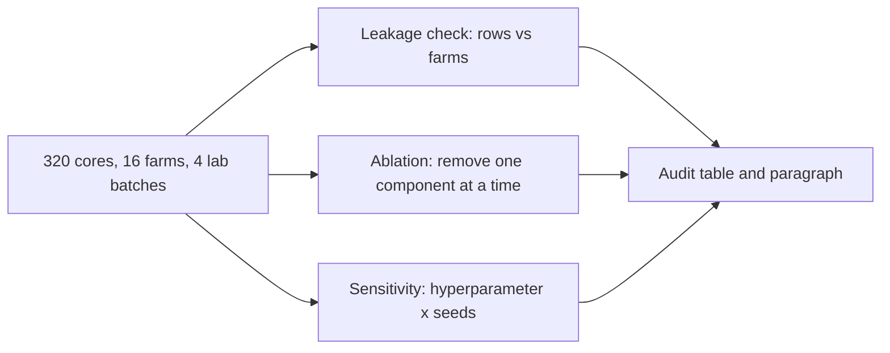

:::objectives
- Write scikit-learn transformers whose preprocessing is learned from training folds only.
- Measure how much row-level cross-validation overstates a multi-site result.
- Produce an ablation table and chart with seed-to-seed error bars.
- Separate model-seed, split-seed, and hyperparameter sensitivity, and summarize all checks in one audit table.
:::

An agronomy group wants to flag nitrogen-deficient soil from near-infrared (NIR) reflectance so farmers can skip expensive lab tests. They collected 20 soil cores at each of 16 farms. The lab scanned the cores in four batches, four farms per batch, and the scanner was recalibrated between batches. Their draft reports 0.80 accuracy. You're the internal reviewer, and you'll produce three checks and one table:



## Step 1: Simulate the study

Three things in this generator matter later: each farm has its own soil texture that shifts every band, each lab batch has its own instrument offset, and deficiency rates differ by farm (partly because rain leaches nitrogen).

```python run title="soil.py"
import numpy as np
import pandas as pd

BANDS = [f"band_{nm}" for nm in (850, 1200, 1450, 1700, 1940, 2200)]

def make_soil(seed=4, n_farms=16, cores=20):
    rng = np.random.default_rng(seed)
    farm = np.repeat(np.arange(n_farms), cores)
    batch = farm // 4                                        # four farms per lab batch
    rain = rng.uniform(500, 1400, n_farms)                   # mm per year
    elev = rng.uniform(50, 900, n_farms)                     # m
    farm_risk = rng.normal(0, 1.0, n_farms) + 0.002 * (rain - 950)
    p = 1 / (1 + np.exp(-(farm_risk[farm] + rng.normal(0, 0.6, farm.size))))
    deficient = (rng.random(farm.size) < p).astype(int)
    texture = 0.6 * rng.normal(0, 1, (n_farms, 6))[farm]     # soil texture shifts all bands
    offset = rng.normal(0, 1.2, (4, 6))[batch]               # scanner calibration per batch
    signal = np.outer(deficient, [0.0, 0.2, 0.6, 0.9, 0.3, 0.0])
    spectra = 5 + texture + offset - signal + rng.normal(0, 0.5, (farm.size, 6))
    df = pd.DataFrame(spectra, columns=BANDS)
    df["rain_mm"], df["elev_m"] = rain[farm], elev[farm]
    df["farm"], df["batch"], df["deficient"] = farm, batch, deficient
    return df

soil = make_soil()
print(f"{len(soil)} cores, {soil.deficient.mean():.0%} deficient overall")
print("deficiency rate by farm:", soil.groupby("farm").deficient.mean().round(2).tolist())
```

Farm deficiency rates run from 15% to 85%. That spread is what makes farm-level leakage dangerous: if the model can recognize a farm, it can guess that farm's usual answer without reading the spectrum at all.

## Step 2: Make every preprocessing step learn from training rows only

Two preprocessing ideas come from the group's draft. **Batch centering** subtracts each batch's average spectrum to cancel the scanner offset. A **nitrogen index**, band 1700 minus band 1200, contrasts the band that drops most with one that barely moves. Batch centering *learns* something (the batch means), so it must be fit on training rows. Writing both as scikit-learn transformers puts them inside the pipeline, where `cross_val_score` refits them on every training fold.

```python run
from sklearn.base import BaseEstimator, TransformerMixin
from sklearn.ensemble import RandomForestClassifier
from sklearn.pipeline import make_pipeline

class BatchCenter(BaseEstimator, TransformerMixin):
    """Subtract each batch's mean spectrum, estimated from the training rows."""
    def __init__(self, on=True):
        self.on = on
    def fit(self, X, y=None):
        if self.on:
            self.batch_means_ = X.groupby("batch")[BANDS].mean()
            self.overall_ = X[BANDS].mean()      # fallback for a batch never seen in training
        return self
    def transform(self, X):
        X = X.copy()
        if self.on:
            means = self.batch_means_.reindex(X["batch"]).fillna(self.overall_)
            X[BANDS] = X[BANDS].to_numpy() - means.to_numpy()
        return X.drop(columns="batch")

class AddIndex(BaseEstimator, TransformerMixin):
    """Append band_1700 - band_1200; nothing to learn, so fit does nothing."""
    def __init__(self, on=True):
        self.on = on
    def fit(self, X, y=None):
        return self
    def transform(self, X):
        X = X.copy()
        if self.on:
            X["n_index"] = X["band_1700"] - X["band_1200"]
        return X

def build(center=True, index=True, leaf=3, seed=0):
    return make_pipeline(BatchCenter(on=center), AddIndex(on=index),
                         RandomForestClassifier(n_estimators=60, min_samples_leaf=leaf, random_state=seed))

FEATURES = BANDS + ["rain_mm", "elev_m", "batch"]
X, y, farm = soil[FEATURES], soil["deficient"], soil["farm"]
print(build().fit(X, y).predict(X.head(3)))
```

The `on=` switches are there for the ablation: every variant is the *same* pipeline with one switch flipped, so nothing else changes between rows of the table. Following scikit-learn's conventions (store constructor arguments unchanged, put learned values in attributes ending with `_`) is what lets `cross_val_score` clone these steps safely.

## Step 3: Leakage check, rows versus farms

```python run
from sklearn.model_selection import GroupKFold, KFold, cross_val_score

by_row = cross_val_score(build(), X, y, cv=KFold(5, shuffle=True, random_state=0))
by_farm = cross_val_score(build(), X, y, cv=GroupKFold(4), groups=farm)
print(f"KFold over cores:     {by_row.mean():.3f}  (folds {np.round(by_row, 2)})")
print(f"GroupKFold over farms: {by_farm.mean():.3f}  (folds {np.round(by_farm, 2)})")
```

There's the draft's 0.80, and it drops by about 14 points once whole farms are held out. Under KFold, every test core has 15 or so cores from the same farm in training, with the same rainfall, elevation, and soil texture. Rainfall and elevation are constant within a farm, so they work as a farm ID. The agronomists want a model that works on a *new* farm, so the rest of the audit uses farm-level splits only.

## Step 4: The ablation table

`StratifiedGroupKFold` keeps farms whole and roughly balances deficiency across folds. Each variant runs with four seeds; every seed changes both the forest and the fold assignment, so the spread covers both sources of noise.

```python run alt="Horizontal bar chart of the change in grouped CV accuracy relative to the full pipeline, with error bars. Removing batch centering and removing farm covariates each cost about 7 points; removing the nitrogen index costs about 1 point; removing the spectra entirely costs about 11 points." caption="Change in farm-level CV accuracy when each component is removed"
import matplotlib.pyplot as plt
from sklearn.model_selection import StratifiedGroupKFold

def farm_cv(cols=FEATURES, seeds=range(4), **switches):
    return np.array([
        cross_val_score(build(seed=s, **switches), X[cols], y, groups=farm,
                        cv=StratifiedGroupKFold(4, shuffle=True, random_state=s)).mean()
        for s in seeds])

spectra_off = ["rain_mm", "elev_m", "batch"]
variants = {
    "full pipeline": farm_cv(),
    "without batch centering": farm_cv(center=False),
    "without nitrogen index": farm_cv(index=False),
    "without farm covariates": farm_cv(BANDS + ["batch"]),
    "without spectra": farm_cv(spectra_off, center=False, index=False),
}
ablation = pd.DataFrame({name: {"mean": s.mean(), "SD": s.std(ddof=1)} for name, s in variants.items()}).T
ablation["change"] = ablation["mean"] - ablation.loc["full pipeline", "mean"]
print(ablation.round(3).to_string())

drops = ablation.drop(index="full pipeline")
plt.figure(figsize=(7, 2.8))
plt.barh(drops.index, drops["change"], xerr=drops["SD"], color="#c44e52", capsize=3)
plt.axvline(0, color="grey")
plt.xlabel("change in accuracy vs full pipeline (± SD over 4 seeds)")
plt.gca().invert_yaxis()
```

First, the full pipeline scores 0.70 here, not the 0.66 of Step 3's single unshuffled split. One split is one draw, which is why every row uses four. Batch centering is worth about 7 points: without it, the scanner offsets swamp the deficiency signal. The farm covariates are worth about as much, and unlike in Step 3 that's legitimate here, because farm-level CV means the model has to use rainfall on farms it has never seen, and rain truly drives leaching. The nitrogen index adds about a point, which is inside the seed-to-seed spread, so the honest wording is "no measurable benefit," not "the index improves accuracy." The "without spectra" row is a control: spectra contribute about 11 points beyond what farm weather can give.

:::tip
Look at the error bar before the bar. A component whose removal changes the score by less than about one SD hasn't been shown to matter, in either direction. Say so explicitly rather than ranking components by tiny means.
:::

## Step 5: Sensitivity to the hyperparameter and to seeds

The forest's `min_samples_leaf` controls how finely it can carve the data. Sweep it across a 30× range, three seeds each, and separately measure how much the model seed alone and the split seed alone move the score.

```python run alt="Line chart of farm-level CV accuracy against min_samples_leaf on a log axis from 1 to 30, with a shaded band of plus or minus one SD over three seeds. The mean stays between about 0.68 and 0.70 and the bands overlap everywhere." caption="The choice of leaf size barely matters next to seed noise"
leaves = [1, 3, 10, 30]
sweep = np.array([farm_cv(seeds=range(3), leaf=leaf) for leaf in leaves])
plt.figure(figsize=(7, 2.8))
plt.plot(leaves, sweep.mean(axis=1), "o-", color="C0")
plt.fill_between(leaves, sweep.mean(axis=1) - sweep.std(axis=1, ddof=1),
                 sweep.mean(axis=1) + sweep.std(axis=1, ddof=1), color="C0", alpha=0.2)
plt.xscale("log")
plt.xticks(leaves, leaves)
plt.xlabel("min_samples_leaf")
plt.ylabel("farm-level CV accuracy")

fixed_split = StratifiedGroupKFold(4, shuffle=True, random_state=0)
model_seed = [cross_val_score(build(seed=s), X, y, groups=farm, cv=fixed_split).mean() for s in range(5)]
split_seed = [cross_val_score(build(seed=0), X, y, groups=farm,
                              cv=StratifiedGroupKFold(4, shuffle=True, random_state=s)).mean() for s in range(5)]
print("leaf size range of means:", f"{sweep.mean(axis=1).min():.3f} to {sweep.mean(axis=1).max():.3f}")
print(f"model seed only: SD {np.std(model_seed, ddof=1):.3f}   split seed only: SD {np.std(split_seed, ddof=1):.3f}")
```

The whole 30× sweep moves the mean by about two points, less than the seed noise inside each setting. That's a good outcome: the conclusion doesn't depend on a lucky hyperparameter. The two seed SDs are similar in size, which tells you that rerunning with a different `random_state` in *either* place can shift the headline by a couple of points. Both should appear in the methods.

## Step 6: Assemble the audit

```python run
audit = pd.DataFrame([
    ["Leakage", "KFold over cores vs GroupKFold over farms",
     f"{by_row.mean():.2f} vs {by_farm.mean():.2f}", "Report farm-level CV only"],
    ["Ablation", "Remove batch centering",
     f"{ablation.loc['without batch centering', 'change']:+.2f}", "Keep; essential"],
    ["Ablation", "Remove nitrogen index",
     f"{ablation.loc['without nitrogen index', 'change']:+.2f}", "Within seed noise"],
    ["Ablation", "Remove farm covariates",
     f"{ablation.loc['without farm covariates', 'change']:+.2f}", "Keep; generalizes across farms"],
    ["Sensitivity", "min_samples_leaf 1 to 30",
     f"{sweep.mean(axis=1).min():.2f} to {sweep.mean(axis=1).max():.2f}", "Robust"],
    ["Sensitivity", "Model seed / split seed SD",
     f"{np.std(model_seed, ddof=1):.3f} / {np.std(split_seed, ddof=1):.3f}", "Report as noise floor"],
], columns=["check", "what changed", "result", "decision"])
print(audit.to_string(index=False))

full = ablation.loc["full pipeline"]
print(f"\nOn farms held out of training, the pipeline scored {full['mean']:.2f} ± {full['SD']:.2f} "
      f"(mean ± SD over 4 seeds of 4-fold farm-grouped CV), compared with {by_row.mean():.2f} "
      f"when cores from the same farm appeared in both training and test folds.")
```

That last paragraph can go into a methods section nearly as is. It names the splitter, the unit, the number of seeds, what ± means, and the inflated number that a careless analysis would have reported.

## The finished script

```python title="soil_audit.py"
import numpy as np
import pandas as pd
from sklearn.base import BaseEstimator, TransformerMixin
from sklearn.ensemble import RandomForestClassifier
from sklearn.model_selection import GroupKFold, KFold, StratifiedGroupKFold, cross_val_score
from sklearn.pipeline import make_pipeline

BANDS = [f"band_{nm}" for nm in (850, 1200, 1450, 1700, 1940, 2200)]


def make_soil(seed=4, n_farms=16, cores=20):
    rng = np.random.default_rng(seed)
    farm = np.repeat(np.arange(n_farms), cores)
    batch = farm // 4
    rain = rng.uniform(500, 1400, n_farms)
    elev = rng.uniform(50, 900, n_farms)
    farm_risk = rng.normal(0, 1.0, n_farms) + 0.002 * (rain - 950)
    p = 1 / (1 + np.exp(-(farm_risk[farm] + rng.normal(0, 0.6, farm.size))))
    deficient = (rng.random(farm.size) < p).astype(int)
    texture = 0.6 * rng.normal(0, 1, (n_farms, 6))[farm]
    offset = rng.normal(0, 1.2, (4, 6))[batch]
    signal = np.outer(deficient, [0.0, 0.2, 0.6, 0.9, 0.3, 0.0])
    spectra = 5 + texture + offset - signal + rng.normal(0, 0.5, (farm.size, 6))
    df = pd.DataFrame(spectra, columns=BANDS)
    df["rain_mm"], df["elev_m"] = rain[farm], elev[farm]
    df["farm"], df["batch"], df["deficient"] = farm, batch, deficient
    return df


class BatchCenter(BaseEstimator, TransformerMixin):
    def __init__(self, on=True):
        self.on = on

    def fit(self, X, y=None):
        if self.on:
            self.batch_means_ = X.groupby("batch")[BANDS].mean()
            self.overall_ = X[BANDS].mean()
        return self

    def transform(self, X):
        X = X.copy()
        if self.on:
            means = self.batch_means_.reindex(X["batch"]).fillna(self.overall_)
            X[BANDS] = X[BANDS].to_numpy() - means.to_numpy()
        return X.drop(columns="batch")


class AddIndex(BaseEstimator, TransformerMixin):
    def __init__(self, on=True):
        self.on = on

    def fit(self, X, y=None):
        return self

    def transform(self, X):
        X = X.copy()
        if self.on:
            X["n_index"] = X["band_1700"] - X["band_1200"]
        return X


def build(center=True, index=True, leaf=3, seed=0):
    return make_pipeline(BatchCenter(on=center), AddIndex(on=index),
                         RandomForestClassifier(n_estimators=60, min_samples_leaf=leaf, random_state=seed))


soil = make_soil()
FEATURES = BANDS + ["rain_mm", "elev_m", "batch"]
X, y, farm = soil[FEATURES], soil["deficient"], soil["farm"]


def farm_cv(cols=FEATURES, seeds=range(4), **switches):
    return np.array([
        cross_val_score(build(seed=s, **switches), X[cols], y, groups=farm,
                        cv=StratifiedGroupKFold(4, shuffle=True, random_state=s)).mean()
        for s in seeds])


by_row = cross_val_score(build(), X, y, cv=KFold(5, shuffle=True, random_state=0)).mean()
by_farm = cross_val_score(build(), X, y, cv=GroupKFold(4), groups=farm).mean()
print(f"leakage check: {by_row:.3f} by core vs {by_farm:.3f} by farm")

variants = {
    "full pipeline": farm_cv(),
    "without batch centering": farm_cv(center=False),
    "without nitrogen index": farm_cv(index=False),
    "without farm covariates": farm_cv(BANDS + ["batch"]),
    "without spectra": farm_cv(["rain_mm", "elev_m", "batch"], center=False, index=False),
}
for name, scores in variants.items():
    print(f"{name:25s} {scores.mean():.3f} ± {scores.std(ddof=1):.3f}")
```

:::quiz
Q: Why is batch centering written as a transformer instead of subtracting batch means from the whole dataset before cross-validation?
- [x] So the batch means are estimated from training rows only in every fold
  Means computed on all rows would include the test fold's spectra, a small but real leak.
- [ ] Because pandas can't group by a column outside a pipeline
  It can; the point is *when* the means are computed, not whether pandas can do it.
- [ ] Because random forests require transformers
  A forest accepts any numeric matrix; the transformer exists for leak-proof evaluation.

Q: Rainfall and elevation were a leak in Step 3 but a legitimate gain in Step 4. What changed?
- [ ] The model was retrained with different settings
  The pipeline is identical; only the splitter changed.
- [x] Under farm-level CV the covariates can only help by generalizing to unseen farms
  When a farm's cores span train and test, a constant farm value acts as an ID; when the farm is held out entirely, it can only help if rain really relates to deficiency.

Q: Removing the nitrogen index changes the mean by about −0.01 with a seed-to-seed SD of about 0.015. How should the paper describe the index?
- [ ] "The index improves accuracy by one point"
  A one-point change inside seed noise isn't an improvement you've demonstrated.
- [x] "Removing the index produced no change beyond seed-to-seed variation"
  That states the result and its precision without claiming more than the data show.
- [ ] Leave it out of the paper because it didn't work
  Negative and null ablation results tell readers what the result does *not* depend on.
:::

:::takeaways
- Put every step that learns from data (scaling, batch correction, selection) inside the pipeline so each fold refits it.
- Group-level CV can turn a "leaky" covariate into an honest one: the same feature can be a farm ID or a real predictor depending on the split.
- An ablation is only as good as its error bars. Changes within the seed-to-seed spread are "no detectable effect."
- Run the sweep and the seed checks together. A conclusion that survives a 30× hyperparameter range and several seeds is robust; report both kinds of noise.
- End with a table of checks, results, and decisions, plus a sentence that names the splitter, unit, seeds, and what ± means.
:::

## Extend it

- Add a "leave one batch out" check with `LeaveOneGroupOut` on `soil.batch`. What happens to batch centering when the test batch has no training rows, and what would a real lab need to do (run reference samples in every batch)?
- Ablate two components at once (centering and covariates). Is the combined drop the sum of the individual drops?
- Replace the forest with logistic regression and rerun the ablation. Do the same components matter?

## Further reading

- [scikit-learn: Common pitfalls and recommended practices](https://scikit-learn.org/stable/common_pitfalls.html): the official page on preprocessing leakage and controlling randomness, with short examples of each.
- [scikit-learn: Developing estimators](https://scikit-learn.org/stable/developers/develop.html): the conventions `BatchCenter` follows, and why breaking them makes cloning in cross-validation fail.
- [Lones, "How to avoid machine learning pitfalls: a guide for academic researchers" (2021)](https://arxiv.org/abs/2108.02497): a checklist-style tour of design, evaluation, and reporting mistakes, including ablations and multiple comparisons.
