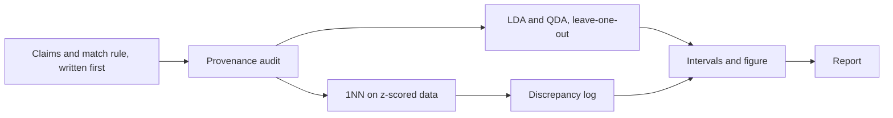

:::objectives
- Turn a published sentence into precise, checkable claims and write the match rule before running anything.
- Audit a dataset's provenance against its documentation.
- Reproduce several reported results exactly, and report one that doesn't match along with what was tried.
- Generate a short reproduction report with a results table, intervals, a figure, a discrepancy log, and limitations.
:::

The wine dataset that ships with scikit-learn has a published result attached. Its documentation, copied from the UCI repository, says the data were used by Aeberhard, Coomans and de Vel (1992) to compare classifiers, and reports:

```text
(RDA : 100%, QDA 99.4%, LDA 98.9%, 1NN 96.1% (z-transformed data))
(All results using the leave-one-out technique)
```

That's a reproduction target with every property from the notes: specific numbers, public data, simple methods, seconds of compute. By the end you'll have this report, generated from your own results:



## Step 1: Write the claims and the match rule first

Leave-one-out (LOO) on 178 wines means each accuracy is a count out of 178, so turn each percentage back into a number of errors. That tells you exactly what you're trying to match.

```python run
import numpy as np
import pandas as pd

N = 178
CLAIMS = {"RDA": 1.000, "QDA": 0.994, "LDA": 0.989, "1NN, z-scored": 0.961}
RULE = ("Exact match: same number of LOO errors. Consistent: the claimed accuracy lies inside "
        "our 95% Wilson interval. Primary analysis: the first faithful attempt; variants are reported, "
        "never substituted.")

for name, acc in CLAIMS.items():
    errors = N - round(acc * N)
    print(f"{name:14s} {acc:.1%}  ->  {N - errors}/178 correct, {errors} wrong")
print("\nRule:", RULE)
```

Only one decimal place was reported, but at n = 178 each wine is worth 0.56 points, so the counts are unambiguous: 7 errors for 1NN, 2 for LDA, 1 for QDA, none for RDA. RDA (regularized discriminant analysis, Friedman 1989) isn't in scikit-learn, so this is a **partial reproduction** of three of the four numbers. Say that now, not at the end.

## Step 2: Audit provenance

Check the data against its own documentation before modeling. The UCI page says 178 wines from three cultivars, class sizes 59, 71, and 48, 13 chemical measurements.

```python run
import sklearn
from sklearn.datasets import load_wine

wine = load_wine(as_frame=True)
X, y = wine.data, wine.target
print(f"rows {X.shape[0]}, features {X.shape[1]}, class sizes {np.bincount(y).tolist()}")
print(f"missing values: {int(X.isna().sum().sum())}, duplicate rows: {int(X.duplicated().sum())}")
print(f"scikit-learn {sklearn.__version__}, pandas {pd.__version__}")
```

Everything matches. One line in the UCI notes matters, though. The donor wrote that "the initial data set had around 30 variables," that only the 13-variable version was donated, and that they no longer knew which 13 those were. If the 1992 study used a different set of variables, no amount of modeling care will make every number match. That goes in the discrepancy log as an unresolvable difference.

## Step 3: Reproduce LDA and QDA

`cross_val_predict` with `LeaveOneOut` fits 178 models, each on 177 wines, and returns the held-out prediction for every wine. Counting the mismatches gives the LOO errors directly.

```python run
from sklearn.discriminant_analysis import LinearDiscriminantAnalysis, QuadraticDiscriminantAnalysis
from sklearn.model_selection import LeaveOneOut, cross_val_predict

loo = LeaveOneOut()
def loo_errors(model, data):
    pred = cross_val_predict(model, data, y, cv=loo)
    return int((pred != y).sum())

results = {}
for name, model in [("LDA", LinearDiscriminantAnalysis()), ("QDA", QuadraticDiscriminantAnalysis())]:
    results[name] = loo_errors(model, X)
    claimed_errors = N - round(CLAIMS[name] * N)
    print(f"{name}: {results[name]} wrong (claimed {claimed_errors}) -> "
          f"{'exact match' if results[name] == claimed_errors else 'differs'}")
```

Two exact matches, on scikit-learn defaults, three decades and several programming languages later. That's a strong reproduction: LDA and QDA are deterministic, so either you get the same count or something differs.

## Step 4: 1NN on z-transformed data, and a discrepancy

"z-transformed" has two reasonable readings: z-score all 178 wines once (what a 1992 paper most likely did), or z-score inside each LOO fold (what we'd do today to avoid leakage). The primary attempt is the first, the closer reading of the paper; the second is a pre-declared variant.

```python run
from sklearn.neighbors import KNeighborsClassifier
from sklearn.pipeline import make_pipeline
from sklearn.preprocessing import StandardScaler

z_all = pd.DataFrame(StandardScaler().fit_transform(X), columns=X.columns)
results["1NN, z-scored"] = loo_errors(KNeighborsClassifier(n_neighbors=1), z_all)
in_fold = loo_errors(make_pipeline(StandardScaler(), KNeighborsClassifier(n_neighbors=1)), X)
print(f"1NN, z-score once (primary):   {results['1NN, z-scored']} wrong (claimed 7)")
print(f"1NN, z-score inside each fold: {in_fold} wrong")
```

Eight errors instead of seven: 95.5% against a claimed 96.1%, one wine apart. Both readings of "z-transformed" agree, so scaling leakage isn't the explanation (with LOO, one held-out row barely moves the means and SDs).

Now the temptation. You could try Manhattan distance, other scalers, or ties broken differently until something gives 7. Instead, run a **small, declared** sensitivity check and report all of it, whichever way it lands:

```python run
variants = {
    "Euclidean, z-scored (primary)": (KNeighborsClassifier(1), z_all),
    "Manhattan, z-scored": (KNeighborsClassifier(1, p=1), z_all),
    "Euclidean, unscaled": (KNeighborsClassifier(1), X),
}
sensitivity = pd.DataFrame(
    [(name, loo_errors(model, data)) for name, (model, data) in variants.items()],
    columns=["variant", "LOO errors"])
sensitivity["accuracy"] = (1 - sensitivity["LOO errors"] / N).round(3)
print(sensitivity.to_string(index=False))
```

Manhattan gives 4 errors, unscaled gives 41. So the 1NN result is very sensitive to the distance and scaling choices, and the paper's "z-transformed" with Euclidean distance is the closest match to their number. None of the variants hits 7 exactly, and that's fine: the job was to test, not to match. The honest summary is "not exactly reproduced; off by one wine; consistent within sampling error; likely causes are a different data version or unreported details of the distance or tie-breaking."

## Step 5: Put intervals on everything and draw the comparison

With 178 wines, a Wilson interval tells you how much any of these numbers could move by chance alone.

```python run alt="Dot plot comparing claimed and reproduced leave-one-out accuracy for QDA, LDA, and 1NN on z-scored data. Each reproduced value has a 95% Wilson interval; the claimed values, shown as open diamonds, fall inside the intervals. QDA and LDA dots sit exactly on the claimed diamonds, and 1NN is about half a point below its claim." caption="Claimed (open diamonds) vs reproduced (dots with 95% Wilson intervals), n = 178"
import matplotlib.pyplot as plt
from statsmodels.stats.proportion import proportion_confint

rows = []
for name in ["QDA", "LDA", "1NN, z-scored"]:
    correct = N - results[name]
    low, high = proportion_confint(correct, N, method="wilson")
    rows.append({"method": name, "claimed": CLAIMS[name], "reproduced": correct / N,
                 "ci_low": low, "ci_high": high,
                 "claimed errors": N - round(CLAIMS[name] * N), "our errors": results[name]})
table = pd.DataFrame(rows)
table["status"] = np.where(table["claimed errors"] == table["our errors"], "exact",
                  np.where((table.claimed >= table.ci_low) & (table.claimed <= table.ci_high),
                           "consistent", "inconsistent"))
print(table.round(3).to_string(index=False))

plt.figure(figsize=(7, 2.6))
ypos = np.arange(len(table))
plt.errorbar(table.reproduced, ypos, xerr=[table.reproduced - table.ci_low, table.ci_high - table.reproduced],
             fmt="o", color="C0", capsize=4, label="reproduced, 95% Wilson CI")
plt.plot(table.claimed, ypos, "D", mfc="none", color="C3", markersize=9, label="claimed (1992)")
plt.yticks(ypos, table.method)
plt.xlim(0.90, 1.005)
plt.xlabel("leave-one-out accuracy")
plt.legend(loc="lower left", fontsize=8)
```

The intervals are wide (about ±3 points for 1NN), which cuts both ways. Our 1NN result is consistent with the claim, *and* the claimed ranking of QDA above LDA (one wine apart) is far inside the noise. This dataset can't tell those two methods apart, a point the original one-decimal table doesn't make.

## Step 6: Generate the report

The report is built from the variables, so rerunning the notebook updates it. Nothing is typed by hand.

```python run
log = pd.DataFrame([
    ["Variables", "possibly ~30 (per dataset notes)", "13 (UCI / scikit-learn)", "unknown", "cannot test"],
    ["Software", "1992 implementation", f"scikit-learn {sklearn.__version__}", "none for LDA/QDA", "exact matches"],
    ["z-transform", "'z-transformed'", "all rows; variant: per fold", "none", "both 8 errors"],
    ["Distance (1NN)", "not stated", "Euclidean; variants tested", "large", "4 to 41 errors"],
    ["RDA", "reported 100%", "not attempted", "n/a", "not in scikit-learn"],
], columns=["difference", "paper", "reproduction", "expected effect", "result"])

def md_table(df):
    """Format a DataFrame as a Markdown table without extra packages."""
    cells = [list(df.columns)] + df.astype(str).values.tolist()
    rows = ["| " + " | ".join(map(str, row)) + " |" for row in cells]
    return "\n".join([rows[0], "|" + " --- |" * len(df.columns)] + rows[1:])

lines = [
    "# Reproduction: Aeberhard, Coomans & de Vel (1992), UCI wine leave-one-out accuracies",
    "",
    "**Claim.** RDA 100%, QDA 99.4%, LDA 98.9%, 1NN on z-scored data 96.1% (LOO, n = 178).",
    f"**Rule (set before running).** {RULE}",
    f"**Result.** {sum(table.status == 'exact')} of 3 attempted results reproduced exactly; "
    "1NN differs by one wine and is consistent within sampling error; RDA not attempted.",
    "",
    md_table(table[["method", "claimed", "reproduced", "ci_low", "ci_high", "status"]].round(3)),
    "",
    "**Discrepancy log.**",
    "",
    md_table(log),
    "",
    "**Limitations.** One dataset of 178 wines from one region; LOO accuracy has ±3-point uncertainty, "
    "so the reported ranking of QDA over LDA (one wine) is not supported by these data. The original "
    "variable set and distance details are unknown.",
]
print("\n".join(lines))
```

`md_table` writes Markdown by hand so the cell needs no extra packages; paste the output into a `.md` file or a notebook text cell. The report states the claim, the pre-set rule, the outcome in one sentence, the results table, everything that differed, and where the conclusions stop. It also says plainly what wasn't attempted.

## The finished script

```python title="reproduce_wine.py"
import numpy as np
import pandas as pd
from sklearn.datasets import load_wine
from sklearn.discriminant_analysis import LinearDiscriminantAnalysis, QuadraticDiscriminantAnalysis
from sklearn.model_selection import LeaveOneOut, cross_val_predict
from sklearn.neighbors import KNeighborsClassifier
from sklearn.preprocessing import StandardScaler
from statsmodels.stats.proportion import proportion_confint

N = 178
CLAIMS = {"QDA": 0.994, "LDA": 0.989, "1NN, z-scored": 0.961}   # RDA 100% not attempted

wine = load_wine(as_frame=True)
X, y = wine.data, wine.target
assert X.shape == (178, 13) and np.bincount(y).tolist() == [59, 71, 48], "data differ from UCI docs"

z_all = pd.DataFrame(StandardScaler().fit_transform(X), columns=X.columns)
models = {
    "QDA": (QuadraticDiscriminantAnalysis(), X),
    "LDA": (LinearDiscriminantAnalysis(), X),
    "1NN, z-scored": (KNeighborsClassifier(n_neighbors=1), z_all),
}

for name, (model, data) in models.items():
    pred = cross_val_predict(model, data, y, cv=LeaveOneOut())
    errors = int((pred != y).sum())
    claimed_errors = N - round(CLAIMS[name] * N)
    low, high = proportion_confint(N - errors, N, method="wilson")
    status = ("exact" if errors == claimed_errors
              else "consistent" if low <= CLAIMS[name] <= high else "inconsistent")
    print(f"{name:14s} claimed {CLAIMS[name]:.3f} ({claimed_errors} errors)  "
          f"reproduced {1 - errors / N:.3f} ({errors} errors)  CI [{low:.3f}, {high:.3f}]  {status}")
```

:::quiz
Q: Why does the build convert 96.1% into "7 errors out of 178" before running anything?
- [x] It turns a rounded percentage into the exact target, so "match" has one meaning
  With LOO on 178 wines, accuracy only comes in steps of 1/178, so the error count is what you're actually matching.
- [ ] Because scikit-learn can only report error counts
  It reports accuracy just as easily; the conversion is about defining the target precisely.
- [ ] To make the result look closer to the paper
  The conversion makes the comparison stricter, not looser.

Q: 1NN gives 8 errors instead of 7. Manhattan distance gives 4. Why not report Manhattan, since it's at least as good?
- [ ] Because Manhattan distance is wrong for chemistry data
  It's a perfectly reasonable distance; the problem is choosing it after seeing results.
- [x] The primary analysis was fixed before running; picking a variant by its result is fishing
  Variants go in a sensitivity table, all of them, and the pre-declared attempt stays the headline.
- [ ] Because it's further from the claimed 96.1%
  Distance from the claim is exactly the wrong reason to choose an analysis, in either direction.

Q: The claimed QDA and LDA results differ by one wine, and both reproduced exactly. What does the report say about which method is better?
- [ ] QDA is better, because it reproduced at 99.4% versus 98.9%
  One wine out of 178 is far inside the ±2 to 3 point intervals.
- [x] The data can't distinguish them; the ranking isn't supported at n = 178
  Reproducing a number exactly doesn't make the difference between two numbers meaningful.
:::

:::takeaways
- Convert published percentages back into counts when the sample size allows; that's the precise target.
- Write the match rule and the primary analysis before running, and declare which claims you won't attempt.
- Check the data against its documentation; a provenance note (such as "originally ~30 variables") can explain a gap that modeling never will.
- When one result doesn't match, run a small, declared sensitivity check and report every variant, not the closest.
- Generate the report from the notebook's variables, with intervals, a discrepancy log, and limitations, including what reproducing exactly does *not* show.
:::

## Extend it

- Check robustness: rerun LDA and QDA with `RepeatedStratifiedKFold(n_splits=10, n_repeats=5)` and compare the mean ± SD with the LOO results.
- Try scikit-learn's `QuadraticDiscriminantAnalysis(reg_param=...)` as a *related but different* method to RDA, and label it that way in the report. If you choose `reg_param` with LOO on the same data, the score will be optimistic; nest it.
- Find another dataset with a reported result in its documentation (the Wisconsin breast-cancer data's notes report 97.5% from repeated 10-fold CV on three features) and run the same workflow.

## Further reading

- [UCI Machine Learning Repository: Wine](https://archive.ics.uci.edu/dataset/109/wine): the dataset page with the original notes, the donor's comment about variables, and links to the papers.
- [Aeberhard, Coomans & de Vel, "Comparative analysis of statistical pattern recognition methods in high dimensional settings" (Pattern Recognition, 1994)](https://doi.org/10.1016/0031-3203%2894%2990145-7): the journal version of the comparison behind the numbers.
- [scikit-learn: Linear and Quadratic Discriminant Analysis](https://scikit-learn.org/stable/modules/lda_qda.html): how both classifiers work and what the `shrinkage` and `reg_param` options change.
