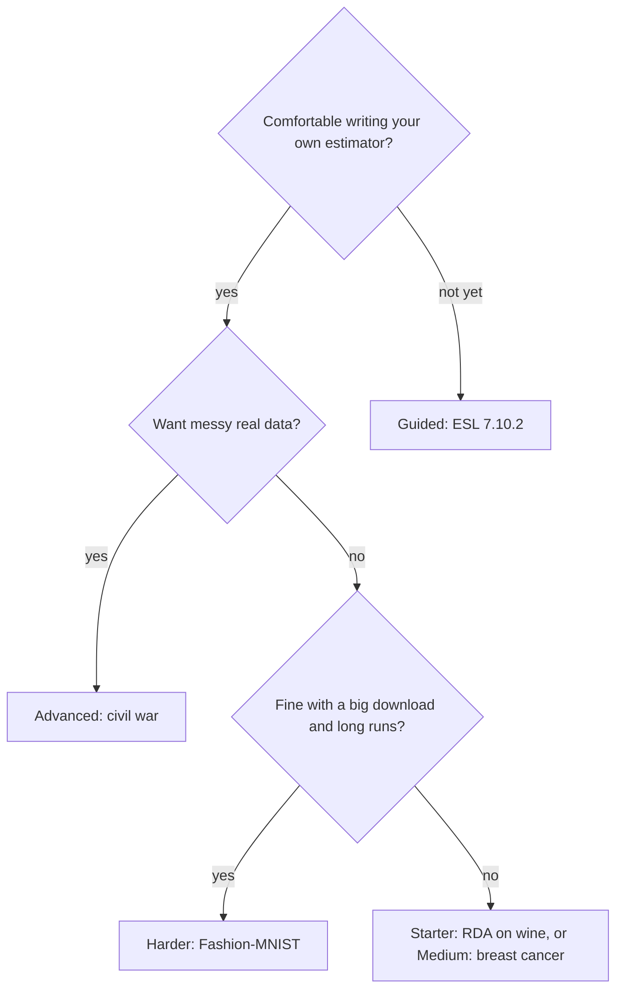
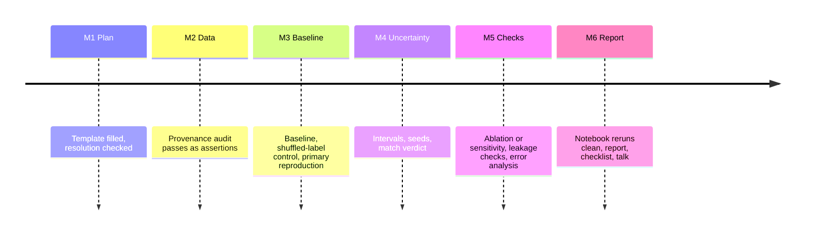

:::objectives
- Pick a reproduction target that fits your skills, data access, and compute.
- Check whether the target number can be distinguished from nearby values at its sample size.
- Write a pre-registration plan: claim, match rule, primary analysis, declared variants, controls, and exclusions.
- Lay out milestones so the study is finished, tested, and written up on time.
:::

Your capstone is a reproduction study of one published machine-learning result. Not a whole paper: one claim, one table row or figure, reproduced carefully enough that a reader trusts your verdict whether it matches or not. A clean "we reproduced 2 of 3 numbers exactly, the third is off by one sample, and here is everything we tried" is a complete, publishable-quality capstone. So is "the headline doesn't reproduce, and here's the leak."

## What you'll hand in

1. **A notebook** that runs top to bottom in a fresh Colab runtime and regenerates every number and figure in the report.
2. **A report** of about 4 to 6 pages: research context, the claim, data provenance, methods, baseline and controls, results with uncertainty, ablation or sensitivity analysis, error analysis, discrepancy log, limitations, and a reproducibility statement.
3. **The REFORMS checklist,** filled in for your study, with "not applicable" where it truly isn't.
4. **A 5-minute talk** (slides or a poster) aimed at someone who hasn't read the paper.

Every one of those must survive the question "how do you know?" The rest of this module is about making sure they do.

## Five project ideas

Each comes with a real source, a specific target, and the twist that makes it interesting. Data for the first three ship with scikit-learn or are pure simulation; the last two need a download inside your own Colab notebook.

| Level | Project | Target claim | Twist |
| --- | --- | --- | --- |
| Starter | **Wine classifiers, finished.** [Aeberhard et al.](https://archive.ics.uci.edu/dataset/109/wine), as in Module 7 | RDA 100% by leave-one-out | Implement regularized discriminant analysis (Friedman, 1989) yourself, tune it with *nested* LOO, and see whether 100% survives honest tuning. |
| Guided | **The wrong way to cross-validate.** [*Elements of Statistical Learning*](https://hastie.su.domains/ElemStatLearn/), Section 7.10.2 | Selecting 100 of 5,000 noise predictors on all 50 samples, then 1-NN with CV: about 3% average CV error, true error 50% | Pure simulation in seconds. The next lesson builds it with you; your job is the extensions. |
| Medium | **Breast cancer from three nuclear features.** [Street, Wolberg & Mangasarian (1993)](https://archive.ics.uci.edu/dataset/17/breast+cancer+wisconsin+diagnostic), per the dataset notes | One separating plane on worst area, worst smoothness, mean texture: 97.5% by repeated 10-fold CV | The three features were chosen by exhaustive search on the full dataset. Does 97.5% hold when the search runs inside each fold? |
| Harder | **Fashion-MNIST benchmark.** [Xiao, Rasul & Vollgraf (2017)](https://arxiv.org/abs/1708.07747), Table 3 | e.g. `RandomForestClassifier(n_estimators=100, criterion="entropy", max_depth=100)`: 0.873 test accuracy, mean of 5 runs | 70,000 images. Plan compute, report seed variance, and compare your spread with "averaged over 5 runs." |
| Advanced | **Civil war prediction.** [Kapoor & Narayanan's reproduction](https://reproducible.cs.princeton.edu/) of published political-science models | Complex models beat logistic regression; after fixing leakage, they don't | Messy real data and someone else's code. Reproduce *both* the original and the corrected result. |



You may propose your own target instead. It must meet the five tests from Module 7: one specific number, public data, a method described well enough to rebuild, compute you have, and a claim that matters.

## Can your target even be tested?

Before you commit, check the **resolution** of the claim: how far apart two results can be and still be indistinguishable at that sample size. A claim with a ±2-point interval can't confirm or refute a 1-point discrepancy, and your plan should say so up front.

```python run
from statsmodels.stats.proportion import proportion_confint

targets = [
    ("Wine LDA, leave-one-out", 0.989, 178),
    ("Breast cancer, 3-feature plane", 0.975, 569),
    ("Fashion-MNIST random forest", 0.873, 10_000),
]
for name, acc, n in targets:
    low, high = proportion_confint(round(acc * n), n, method="wilson")
    print(f"{name:32s} n = {n:>6,}: 95% interval {low:.3f} to {high:.3f}  (± {(high - low) / 2:.1%})")
```

The Fashion-MNIST test set is 56 times larger than the wine data, yet its interval is only about three times narrower, because accuracies near 100% vary less than accuracies near 87%. For CV-based claims such as the breast-cancer one, treating each row's held-out prediction as one test case gives a rough lower bound on the uncertainty. For a simulation claim like ESL's, the resolution comes from the spread across simulations: with 50 runs and a run-to-run SD of about 2 points, the average is pinned down to about ±0.6 points.

## Write the plan before you touch the data

Copy this template into the first text cell of your notebook and fill in every line. Once you've run the primary analysis, don't edit the plan; add dated notes below it instead.

```text
REPRODUCTION PLAN                                   date: ____________

1. Claim (quote it, with table/figure/page):
2. Target number(s) and the sample size behind each:
3. Data: source, version, how obtained, expected shape and class counts:
4. Method as the paper describes it (model, features, preprocessing, split, metric):
5. Primary analysis: the single most faithful reading of (4):
6. Ambiguities in the description, and how the primary analysis resolves each:
7. Declared variants (at most 3-5), each with the reason it's plausible:
8. Match rule: exact = ___ ; consistent = ___ ; inconsistent = ___
9. Baseline(s) and controls (e.g. majority class, shuffled labels):
10. Uncertainty: which intervals, how many seeds or resamples:
11. Ablation or sensitivity analysis: what you'll remove or vary:
12. Leakage risks specific to this study, and the check for each:
13. Not attempting (and why):
14. Compute estimate and fallback if it's too slow:
15. Milestone dates (see below):
```

Item 6 is where reproductions usually go wrong. Every paper leaves something unstated: the distance metric, whether scaling happened inside the folds, what "highest correlation" means for negative correlations. Decide how your primary analysis reads each one *now*, and list the alternatives as declared variants.

Item 9 deserves a control as well as a baseline. A **shuffled-label control** reruns your whole pipeline with `y` randomly permuted; it should score at chance. If it doesn't, something is leaking, and you've found it before a reviewer did.

## Milestones



Give M3 the most time. It's where the surprises are, and anything unexpected there changes M4 and M5. If you're short on time, cut the number of variants in M5, never the uncertainty in M4.

:::warning
**Changing the target after seeing results.** If your first run misses the paper's number, it's tempting to switch to a different table row that happens to match. That turns your study into a search for agreement. Keep the target, report the miss, and investigate it; add the second row as an extra, clearly labeled.
:::

:::tip
Email isn't off limits. If the paper leaves out a detail you can't resolve, it's normal to write to the corresponding author with one specific question. Log the question, the date, and the answer (or the silence) in your discrepancy table.
:::

:::takeaways
- One claim, reproduced carefully, beats a whole paper reproduced loosely; matching and not matching are both valid outcomes.
- Check the target's resolution first: the sample size decides which discrepancies you can detect.
- Fill in the plan, including the ambiguities, declared variants, and match rule, before the primary run, and don't edit it afterward.
- Add a shuffled-label control as well as a baseline; it catches leaks early.
:::
