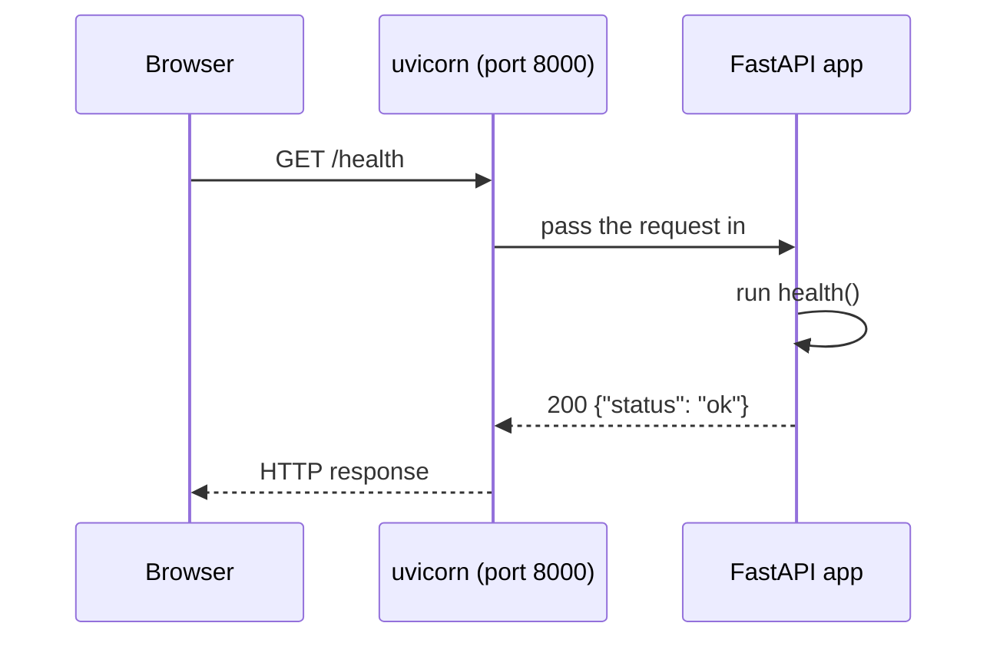

:::objectives
- Create a project folder with its own virtual environment on any operating system.
- Install exact library versions from `requirements.txt` and `requirements-dev.txt`.
- Run a smoke test that trains, saves, reloads, and serves a tiny model.
- Start a real API server with `uvicorn` and call it from a browser.
- Run Python 3.12 inside a Docker container.
:::

By the end of this page you should have three passing checks. A model trains, goes to disk, comes back, and gives identical predictions. A web API answers `GET /health` with `{"status": "ok"}`. And a container started from `python:3.12-slim` reports Python 3.12. Each check exercises one layer of the service you'll build in Module 2, so if one fails, you know exactly which layer to fix.

## Step 1: Make the folder and a virtual environment

A virtual environment (venv) is a private folder of packages for one project. Without one, every project on your computer shares a single set of libraries, and upgrading scikit-learn for one project silently changes another.

:::tabs
@tab Windows
In PowerShell:

```powershell
mkdir late-delivery
cd late-delivery
py -3.12 -m venv .venv
.venv\Scripts\Activate.ps1
```

If PowerShell says the script `cannot be loaded because running scripts is disabled on this system`, run `Set-ExecutionPolicy -Scope CurrentUser RemoteSigned` once, answer **Y**, and activate again.
@tab macOS
```bash
mkdir late-delivery
cd late-delivery
python3.12 -m venv .venv
source .venv/bin/activate
```
@tab Linux
```bash
mkdir late-delivery
cd late-delivery
python3.12 -m venv .venv
source .venv/bin/activate
```
@tab Chromebook
In your Codespace, the repository folder is already open. In the terminal at the bottom:

```bash
python -m venv .venv
source .venv/bin/activate
```
:::

Your prompt now starts with `(.venv)`. While it's active, `python` and `pip` mean the venv's copies on every operating system, so the rest of the course just says `python`. Run `deactivate` to leave, and activate again each time you open a new terminal.

## Step 2: Pin the libraries

Create two files in the project folder. The first lists what the running service needs; the second adds tools only developers need (the test client and pytest). Keeping them apart means the Docker image in Module 2 won't carry test tools into production.

```text title="requirements.txt"
fastapi==0.115.11
uvicorn==0.34.0
pydantic==2.10.6
scikit-learn==1.8.0
scipy==1.15.2
numpy==2.1.3
pandas==2.2.3
joblib==1.5.3
```

```text title="requirements-dev.txt"
-r requirements.txt
httpx==0.28.1
pytest==9.1.1
```

`==` means "exactly this version". These are the versions that produced every output you'll see in this course, so your numbers should match the pages. The `-r` line includes the first file, so one command installs both:

```bash
python -m pip install -r requirements-dev.txt
```

```text
...
Successfully installed annotated-types-0.7.0 anyio-4.x ... fastapi-0.115.11 ... scikit-learn-1.8.0 ... uvicorn-0.34.0
```

Notice that pip installs more packages than you listed, such as `starlette` and `anyio`. Those are dependencies of your dependencies. They aren't pinned yet; Module 4 shows how to lock the complete set.

## Step 3: Check the environment

Save this as `check_setup.py` and run it with `python check_setup.py`. It checks the things the smoke test can't see: the Python version, and whether `docker` and `git` are on your PATH.

```python title="check_setup.py"
"""Print what this course needs and whether this machine has it."""
import shutil
import sys
from importlib.metadata import PackageNotFoundError, version

def report(ok, label, detail):
    print(f"[{'OK' if ok else 'FIX'}] {label}: {detail}")

major, minor = sys.version_info[:2]
report((major, minor) == (3, 12), "Python", sys.version.split()[0] + " (want 3.12.x)")
report(sys.prefix != sys.base_prefix, "Virtual environment", sys.prefix)

for package, wanted in [("scikit-learn", "1.8.0"), ("fastapi", "0.115.11"), ("pandas", "2.2.3")]:
    try:
        found = version(package)
        report(found == wanted, package, f"{found} (want {wanted})")
    except PackageNotFoundError:
        report(False, package, "not installed: run pip install -r requirements-dev.txt")

for tool in ["docker", "git"]:
    path = shutil.which(tool)
    report(path is not None, tool, path or "not found on PATH")
```

```text
[OK] Python: 3.12.10 (want 3.12.x)
[OK] Virtual environment: /home/you/late-delivery/.venv
[OK] scikit-learn: 1.8.0 (want 1.8.0)
[OK] fastapi: 0.115.11 (want 0.115.11)
[OK] pandas: 2.2.3 (want 2.2.3)
[OK] docker: /usr/bin/docker
[OK] git: /usr/bin/git
```

`sys.prefix != sys.base_prefix` is how Python itself tells whether it's running inside a venv: the prefix points at `.venv`, while the base prefix points at the Python you created it from. A `FIX` on that line means you forgot to activate.

## Step 4: The smoke test

This program touches every library the service will use. Save it as `smoke_test.py` and run it.

```python run title="smoke_test.py"
"""Smoke test: train, save, reload, and serve a tiny model."""
import joblib
import numpy as np
import sklearn
from fastapi import FastAPI
from fastapi.testclient import TestClient
from sklearn.datasets import make_classification
from sklearn.linear_model import LogisticRegression

X, y = make_classification(n_samples=200, n_features=4, random_state=0)
model = LogisticRegression().fit(X, y)
joblib.dump(model, "smoke.joblib")
reloaded = joblib.load("smoke.joblib")
same = np.array_equal(model.predict(X), reloaded.predict(X))
print(f"1. scikit-learn {sklearn.__version__}: saved, reloaded, same predictions = {same}")

app = FastAPI()

@app.get("/health")
def health():
    return {"status": "ok"}

client = TestClient(app)
response = client.get("/health")
print(f"2. GET /health -> {response.status_code} {response.json()}")

assert same and response.status_code == 200
print("Smoke test passed.")
```

Two things to notice. `joblib.dump` wrote the fitted model, coefficients and all, into `smoke.joblib`, and `joblib.load` rebuilt an identical object from it. And `TestClient` sent a real HTTP request to the app without starting a server or opening a port: it calls the app directly in the same process. That's why it's the workhorse for testing APIs in this course.

## Step 5: Start a real server

The test client is great for tests, but you also want to see the API the way a user's program will. Save this as `hello.py`:

```python title="hello.py"
from fastapi import FastAPI

app = FastAPI(title="Hello service")

@app.get("/health")
def health():
    return {"status": "ok"}
```

Then start it with uvicorn, the web server that runs FastAPI apps. `hello:app` means "the object called `app` in `hello.py`", and `--reload` restarts the server whenever you save a change.

```bash
uvicorn hello:app --reload
```

```text
INFO:     Will watch for changes in these directories: ['/home/you/late-delivery']
INFO:     Uvicorn running on http://127.0.0.1:8000 (Press CTRL+C to quit)
INFO:     Started reloader process [4120] using StatReload
INFO:     Started server process [4122]
INFO:     Waiting for application startup.
INFO:     Application startup complete.
```

Open http://127.0.0.1:8000/health in your browser and you'll see `{"status":"ok"}`. Each request adds a log line such as `"GET /health HTTP/1.1" 200 OK` in the terminal. Now open http://127.0.0.1:8000/docs: FastAPI generates an interactive page listing every endpoint, with a **Try it out** button. You'll use it to send test predictions in Module 2. Press **Ctrl+C** to stop the server.

In a Codespace, a pop-up offers to open the forwarded port 8000; the **Ports** tab lists it too. Forwarded ports are private to your GitHub account by default.



:::video iWS9ogMPOI0
What to watch for: how path functions become endpoints, and how the automatic `/docs` page is built from your type hints. This course uses the same pattern, plus Pydantic request models.
:::

## Step 6: Run Python 3.12 in a container

Last check. This starts a throwaway container from the official slim Python image, runs one line of Python inside it, and deletes the container when it exits (`--rm`):

```bash
docker run --rm python:3.12-slim python -c "import sys; print(sys.version)"
```

```text
Unable to find image 'python:3.12-slim' locally
3.12-slim: Pulling from library/python
...
Status: Downloaded newer image for python:3.12-slim
3.12.12 (main, ...) [GCC ...]
```

The last line must start with `3.12`; the patch number depends on when you pulled the image. Notice that the container's Python has nothing to do with the Python on your laptop. The image carries its own operating system files and interpreter, which is exactly why containers make deployments repeatable.

:::warning
**`ModuleNotFoundError: No module named 'fastapi'`** when you run the smoke test usually means the venv isn't active, so `python` is your system Python. Look for `(.venv)` in your prompt. If it's missing, activate again; if it's there, run `python -m pip install -r requirements-dev.txt` once more.
:::

:::quiz
Q: Why does `requirements-dev.txt` exist instead of putting pytest in `requirements.txt`?
- [ ] pytest can't be installed with `-r`
  It can; `-r` just includes another file. The split is about what goes where.
- [x] The production image installs only `requirements.txt`, so test tools stay out of it
  Smaller images build faster, and every package you don't ship is one you don't have to patch.
- [ ] pip installs files in alphabetical order
  pip resolves all requirements together; file names don't affect order.

Q: The smoke test printed `GET /health -> 200`, but no server was running. How?
- [ ] FastAPI started a hidden server on port 8000
  Nothing listened on any port; you could run the test with port 8000 already in use.
- [x] `TestClient` passes requests straight to the app object in the same process
  It builds a real HTTP request and response, but skips the network, which makes tests fast and repeatable.
:::

:::takeaways
- One project, one venv, activated in every new terminal.
- Pin exact versions with `==`, and keep test-only tools in `requirements-dev.txt`.
- `TestClient` tests an API in-process; `uvicorn` serves it for real on port 8000.
- `docker run --rm python:3.12-slim ...` gives you a clean Python 3.12, whatever your laptop has.
:::

## Further reading

- [venv: creation of virtual environments](https://docs.python.org/3.12/library/venv.html): the official reference, including how activation works on each shell.
- [FastAPI: first steps](https://fastapi.tiangolo.com/tutorial/first-steps/): the smallest app, `/docs`, and how path operations work.
