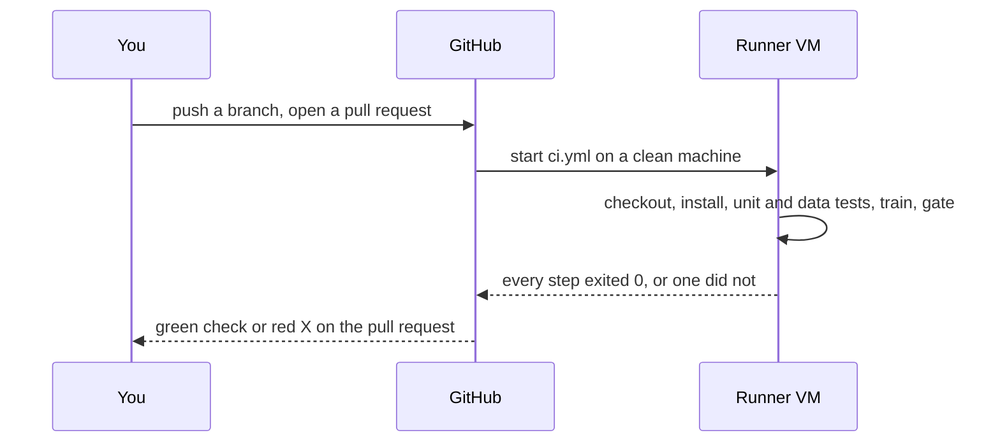

:::objectives
- Order a training pipeline so a failed check stops every step after it, including publishing.
- Write unit tests for feature code and data tests for a batch's schema and value ranges.
- Turn a model metric into a quality gate that compares against a floor and the current champion.
- Explain what a GitHub Actions workflow does with those tests every time you push.
:::

This is the log from the nightly training job for the late-delivery model, the one that warns customers when their food will probably arrive late:

```text
02:10:04  validate   ok     2,000 orders, 5 columns
02:10:31  train      ok     model 1.4.0 written to models/model.joblib
02:10:33  publish    ok     1.4.0 uploaded to the registry as "latest"
02:10:34  deploy     ok     late-delivery API reloaded "latest"
02:10:52  evaluate   FAIL   ROC AUC 0.52 (floor 0.75)
```

Nothing crashed, and the evaluation step did its job: it caught a model that was no better than a coin flip. It just ran fourth, after the publish step had pushed 1.4.0 and the deploy hook had picked it up. For eleven hours the app told customers their orders were on time based on a model that had learned nothing. The fix isn't a smarter test. It's moving the test in front of the door.

## Each step has to earn the next one

Think of an assembly line with inspectors. A part that fails inspection never reaches the shipping dock, because the dock is at the end and the line stops when an inspector says no.

Precisely: a **training pipeline** is a set of steps where each one reads artifacts from earlier steps and writes new ones (a cleaned dataset, a model file, a metrics report). Two rules keep it safe. Every check runs *before* the step it protects. And any failure stops everything downstream, so the steps with side effects that leave the pipeline, like publishing to a registry or deploying, sit at the very end.

```mermaid caption="A pipeline where publishing is only reachable through every check"
flowchart LR
    A[Load batch] --> B{Data tests pass?}
    B -->|no| X[Stop: nothing published]
    B -->|yes| C[Train candidate]
    C --> D{Quality gate passes?}
    D -->|no| X
    D -->|yes| E[Register new version]
    E --> F[Deploy]
```

A pipeline runner can be tiny. Step through this one and watch what happens to `published` when the data check fails on the second row:

:::trace A runner that stops at the first failure
```python
def check_data(ctx):
    bad = [r for r in ctx["rows"] if not 0 <= r["hour"] <= 23]
    if bad:
        raise ValueError(f"{len(bad)} row(s) have an impossible hour")
    return "data ok"

def train(ctx):
    ctx["model"] = "model-1.4.0"
    return "trained"

def publish(ctx):
    ctx["published"] = ctx["model"]
    return "published"

ctx = {"rows": [{"hour": 9}, {"hour": 25}], "published": None}
for step in [check_data, train, publish]:
    try:
        print(step.__name__, "->", step(ctx))
    except ValueError as err:
        print(step.__name__, "FAILED:", err)
        break
print("published:", ctx["published"])
```
:::

The `break` is the entire safety mechanism. `train` and `publish` never run, so `published` stays `None`. Real orchestrators give you the same guarantee by default: in Airflow a task whose upstream task failed is marked `upstream_failed` and skipped, and in GitHub Actions a job that `needs:` a failed job is skipped. Your job is to put the steps in the right order.

## Four kinds of tests an ML repo needs

Ordinary software has unit tests. ML code needs those plus tests for the two things that change without anyone editing code: the data and the model.

| Test | What it protects | Example check | When it runs |
| --- | --- | --- | --- |
| Unit | Feature and helper code | `rush_hour` is 1 at 19:00 and 0 at 20:00 | every push, milliseconds |
| Data | The batch you are about to train or score on | no missing columns, `hour` in 0–23 | every pipeline run |
| Model | The trained model | ROC AUC ≥ 0.75 and not worse than the champion | after training |
| Service | The API contract | `/predict` returns a probability in [0, 1]; bad input gets 422 | every push |

Here is `make_orders` from the `make_data.py` you wrote in Module 2, which rebuilds `data/orders.csv`. Lateness is built in from distance, item count, rain, and the 17:00–19:59 dinner rush, so you know what a working model should find.

```python run
import numpy as np
import pandas as pd

def make_orders(n=2000, seed=23):
    rng = np.random.default_rng(seed)
    distance_km = rng.gamma(shape=2.0, scale=2.0, size=n).round(2)
    items = rng.integers(1, 9, size=n)
    hour = rng.integers(10, 23, size=n)
    raining = (rng.random(n) < 0.25).astype(int)
    rush = (hour >= 17) & (hour <= 19)
    logit = -4.0 + 0.45 * distance_km + 0.15 * items + 1.2 * raining + 0.9 * rush
    late = (rng.random(n) < 1 / (1 + np.exp(-logit))).astype(int)
    return pd.DataFrame({"distance_km": distance_km, "items": items,
                         "hour": hour, "raining": raining, "late": late})

df = make_orders()
print(df.head(3))
print(f"{len(df)} orders, {df.late.mean():.1%} late")
```

Unit tests come first because they're the cheapest. Feature code is where off-by-one bugs hide. Suppose you add an explicit `rush_hour` column: does the rush include 7 p.m.? Pin the answer down in a test so nobody changes it by accident.

Tests here are written pytest-style, as plain functions named `test_...` that use `assert`. On this page, a small `run_tests` helper wraps each function in `unittest.FunctionTestCase` and prints the results; in the repo, `python -m pytest` finds the same functions by their names.

```python run
import sys
import unittest

class PageTest(unittest.FunctionTestCase):
    def __str__(self):
        return self.id()          # print just the test's name

def run_tests(*tests):
    suite = unittest.TestSuite(PageTest(t) for t in tests)
    return unittest.TextTestRunner(stream=sys.stdout, verbosity=2).run(suite).wasSuccessful()

def add_features(frame):
    out = frame.copy()
    out["rush_hour"] = out["hour"].between(17, 19).astype(int)
    out["km_in_rain"] = out["distance_km"] * out["raining"]
    return out

def test_rush_hour_boundaries():
    frame = pd.DataFrame({"hour": [16, 17, 19, 20], "distance_km": 1.0, "raining": 0})
    got = add_features(frame)["rush_hour"].tolist()
    assert got == [0, 1, 1, 0], f"rush_hour for 16, 17, 19, 20 was {got}"

def test_input_is_not_modified():
    frame = pd.DataFrame({"hour": [18], "distance_km": [2.0], "raining": [1]})
    add_features(frame)
    assert list(frame.columns) == ["hour", "distance_km", "raining"]

def test_km_in_rain_is_zero_when_dry():
    frame = pd.DataFrame({"hour": [12, 12], "distance_km": [3.0, 3.0], "raining": [0, 1]})
    assert add_features(frame)["km_in_rain"].tolist() == [0.0, 3.0]

run_tests(test_rush_hour_boundaries, test_input_is_not_modified, test_km_in_rain_is_zero_when_dry)
```

Each test function is one claim about the code. The message after the comma in an `assert` is printed when it fails; pytest adds its own detailed diff on top, but a plain message keeps the failure readable anywhere.

:::try
Change `between(17, 19)` to `between(17, 20)` in `add_features` and run the cell again. `test_rush_hour_boundaries` fails with `AssertionError: rush_hour for 16, 17, 19, 20 was [0, 1, 1, 1]`, pointing at the exact hour that moved.
:::

## Data tests: check the batch before you trust it

Code changes go through review. Data doesn't. An upstream team renames a column, a timezone conversion produces hour 24, a GPS bug reports negative distances, and none of it shows up in your git history. A **data test** states what a valid batch looks like and lists every way the current batch breaks the rule.

```python run
EXPECTED = {"distance_km": "float64", "items": "int64", "hour": "int64",
            "raining": "int64", "late": "int64"}

def validate(batch):
    problems = []
    missing = sorted(set(EXPECTED) - set(batch.columns))
    if missing:
        problems.append(f"missing columns {missing}")
    for col, dtype in EXPECTED.items():
        if col in batch and str(batch[col].dtype) != dtype:
            problems.append(f"{col} is {batch[col].dtype}, expected {dtype}")
    if batch.isna().any().any():
        problems.append(f"{int(batch.isna().sum().sum())} missing values")
    checks = {"hour": (0, 23), "items": (1, 50), "distance_km": (0.001, 50)}
    for col, (low, high) in checks.items():
        if col in batch and not batch[col].between(low, high).all():
            problems.append(f"{(~batch[col].between(low, high)).sum()} rows with {col} outside {low}-{high}")
    if "late" in batch and not 0.10 <= batch["late"].mean() <= 0.60:
        problems.append(f"late rate {batch['late'].mean():.1%} is outside 10%-60%")
    return problems

print("clean batch:", validate(df) or "no problems")

bad = df.head(400).rename(columns={"items": "item_count"})
bad.loc[:9, "hour"] = 24                                           # timezone bug
bad.loc[10:14, "distance_km"] = -bad.loc[10:14, "distance_km"]   # GPS sign bug
for problem in validate(bad):
    print("bad batch:", problem)
```

Notice that `validate` collects *every* problem instead of stopping at the first. When a 2 a.m. job fails, the person reading the log wants the whole list, not one problem per rerun. The late-rate check is a range rather than an exact value: lateness drifts a little with weather and season, but a jump to 95% means the labels are broken.

## A quality gate turns a metric into pass or fail

A metric printed in a log is a suggestion. A **quality gate** is a rule that fails the pipeline. A useful gate checks two things: an absolute **floor** (below this, the model isn't fit for the job) and a comparison with the **champion**, the model in production now (a new model shouldn't be noticeably worse than what it replaces).

The pipeline below is `build_pipeline()` from your `train.py`, unchanged:

```python run
from sklearn.compose import ColumnTransformer
from sklearn.linear_model import LogisticRegression
from sklearn.metrics import roc_auc_score
from sklearn.model_selection import train_test_split
from sklearn.pipeline import Pipeline
from sklearn.preprocessing import OneHotEncoder, StandardScaler

FEATURES = ["distance_km", "items", "hour", "raining"]
train_df, val_df = train_test_split(df, test_size=0.25, stratify=df.late, random_state=0)

def build_pipeline():
    prep = ColumnTransformer([
        ("scale", StandardScaler(), ["distance_km", "items"]),
        ("hour", OneHotEncoder(handle_unknown="ignore"), ["hour"]),
    ], remainder="passthrough")
    return Pipeline([("prep", prep), ("clf", LogisticRegression(max_iter=1000))])

def train(frame):
    return build_pipeline().fit(frame[FEATURES], frame["late"])

def quality_gate(model, champion_auc, floor=0.75, max_drop=0.01):
    auc = roc_auc_score(val_df["late"], model.predict_proba(val_df[FEATURES])[:, 1])
    failures = []
    if auc < floor:
        failures.append(f"AUC {auc:.3f} is below the floor {floor}")
    if auc < champion_auc - max_drop:
        failures.append(f"AUC {auc:.3f} is more than {max_drop} below the champion's {champion_auc:.3f}")
    return auc, failures

CHAMPION_AUC = 0.807   # model 1.0.0's AUC; a real gate reads it from the registry

candidate = train(train_df)
shuffled = train_df.assign(late=train_df["late"].sample(frac=1, random_state=4).values)
broken = train(shuffled)   # labels misaligned, like a join on the wrong key

for name, model in [("candidate", candidate), ("broken", broken)]:
    auc, failures = quality_gate(model, CHAMPION_AUC)
    print(f"{name:9}  AUC {auc:.3f}  {'PASS' if not failures else 'FAIL: ' + '; '.join(failures)}")
```

The broken model trained without complaint. Shuffled labels produce a perfectly valid model file; it just learned noise. Only the gate notices. In CI the gate is a script that ends with `sys.exit(1 if failures else 0)`. The exit code is the contract: the runner treats any non-zero exit as a failed step.

Pick the gate's metric carefully. Here is the most common gate bug for any model where one class is rare:

```python run
from sklearn.dummy import DummyClassifier
from sklearn.metrics import accuracy_score

lazy = DummyClassifier(strategy="most_frequent").fit(train_df[FEATURES], train_df["late"])
for name, model in [("always 'on time'", lazy), ("candidate", candidate)]:
    acc = accuracy_score(val_df["late"], model.predict(val_df[FEATURES]))
    auc = roc_auc_score(val_df["late"], model.predict_proba(val_df[FEATURES])[:, 1])
    print(f"{name:17} accuracy {acc:.3f}   AUC {auc:.3f}")
```

A model that predicts "on time" for every order scores about 0.70 accuracy without looking at a single feature, because roughly 70% of orders are on time. A gate of "accuracy ≥ 0.65" would wave it through. AUC sits at exactly 0.5 for a model whose scores carry no ranking information, so it can't be fooled that way.

## CI runs the same checks on every push

**Continuous integration** means every change is tested automatically before it's merged. On GitHub, you describe the checks in a YAML file under `.github/workflows/`. On each push or pull request, GitHub starts a fresh virtual machine (a **runner**), checks out your code, and runs your steps in order. If any step exits non-zero, the job fails, later steps are skipped, and the pull request shows a red X.



A minimal workflow looks like this. You'll build the full version next lesson.

```yaml title=".github/workflows/ci.yml"
name: ci
on: [push, pull_request]

jobs:
  test:
    runs-on: ubuntu-latest
    steps:
      - uses: actions/checkout@v7
      - uses: actions/setup-python@v7
        with:
          python-version: "3.12"
      - run: pip install -r requirements-dev.txt
      - run: python -m pytest -v
      - run: python gate.py
```

A red X only informs people. To make it *block* merging, a repository admin turns on branch protection (or a ruleset) for `main` with "Require status checks to pass before merging" and selects the `test` job.

:::video bSXUJRnQPPo
What to watch for: the split between tests that check code and tests that check the data and model, and how the results show up on a pull request.
:::

:::warning
**Three gates that look fine and aren't.**

1. **Accuracy on imbalanced data.** As the lazy model showed, "always say no" passes an accuracy gate. Gate on AUC, recall at a fixed threshold, or precision, whichever matches the cost of a mistake.
2. **Randomness without seeds.** Leave out `random_state` and the same code passes on Monday and fails on Tuesday. A flaky gate teaches the team to click "re-run" until it's green. Seed the split and the model, and leave a margin between typical scores and the threshold.
3. **Paths from your laptop.** `pd.read_csv("C:/Users/sam/data.csv")` passes locally and fails on the runner with `FileNotFoundError`. Every file a test reads must be in the repo or created by an earlier step.
:::

:::quiz
Q: A pipeline runs validate → train → publish → evaluate, and evaluate fails. What is in the registry afterward?
- [ ] Nothing, because the run failed
  The run failed, but publish had already succeeded before evaluate ran. Failure only stops the steps after it.
- [x] The new model that just failed evaluation
  Publish ran third and succeeded. The failing evaluation came too late to stop it, which is exactly the bug in the opening log.
- [ ] The previous champion, restored automatically
  Nothing in this pipeline restores anything. Rollback is a separate action you'd have to build.

Q: 30% of orders are late. Your gate requires accuracy ≥ 0.65. Which model passes?
- [ ] Only a model that has learned the lateness pattern
  A model that predicts "on time" for everything scores about 0.70 accuracy and passes too.
- [x] Both a real model and one that always says "on time"
  Accuracy rewards the majority class. The lazy model's AUC of 0.5 would expose it, but this gate doesn't check AUC.
- [ ] Neither, because 0.65 is too high for this data
  The lazy model reaches about 0.70 just by matching the majority.

Q: Why compare the candidate with the champion as well as with a fixed floor?
- [x] A candidate can clear the floor and still be worse than what is serving now
  A floor of 0.75 lets a 0.76 model replace a 0.81 one. The champion comparison stops that regression.
- [ ] The champion's AUC is more accurate than the validation set's
  Both numbers come from evaluation data. The comparison is about not getting worse, not about which number is truer.
- [ ] Registries reject models without a champion comparison
  Registries store whatever you send them. Enforcing the comparison is the gate's job.

Q: In a GitHub Actions job, `python gate.py` exits with code 1. What happens to the `upload-artifact` step listed after it?
- [ ] It runs, because each step is independent
  By default, a failed step stops the job, and later steps are skipped.
- [x] It is skipped and the job is marked failed
  Steps run in order and stop at the first non-zero exit unless a step opts in with `if: always()`.
- [ ] GitHub retries the gate until it passes
  Actions doesn't retry steps on its own. Someone would have to re-run the job.
:::

:::takeaways
- Put every check before the step it protects, and put publishing and deploying last.
- ML repos need four kinds of tests: unit tests for code, data tests for batches, quality gates for models, and contract tests for the API.
- A data test should report every problem it finds, with counts, so one failed run tells the whole story.
- A gate is a script that exits non-zero. Gate on a metric the lazy model can't game, and compare against both a floor and the champion.
- CI runs on a clean machine for every push, so tests can only depend on what's in the repo.
:::

## Further reading

- [Understanding GitHub Actions](https://docs.github.com/en/actions/get-started/understand-github-actions): the official overview of workflows, events, jobs, runners, and steps.
- [The ML Test Score](https://research.google/pubs/the-ml-test-score-a-rubric-for-ml-production-readiness-and-technical-debt-reduction/): Google's checklist of 28 tests for production ML, grouped into data, model, infrastructure, and monitoring.
- [MLOps: continuous delivery and automation pipelines in ML](https://cloud.google.com/architecture/mlops-continuous-delivery-and-automation-pipelines-in-machine-learning): how pipeline automation grows from manual notebooks to full CI/CD, with diagrams of each level.
