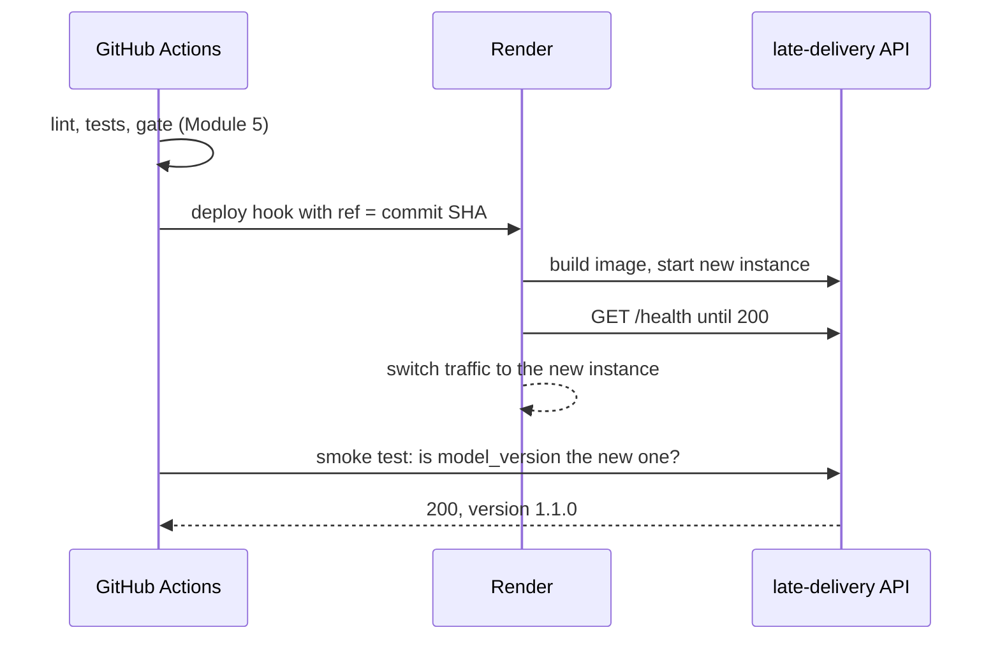

:::objectives
- Explain the difference between continuous delivery and continuous deployment, and why you build one immutable image per commit.
- Compare recreate, rolling, blue-green, canary, and shadow releases by what users see when the new version is bad.
- Write separate liveness and readiness checks, where readiness proves the right model is loaded and working.
- Monitor the four golden signals plus input drift, and write alert rules that wait for a sustained breach.
:::

Model 1.1.0 of the late-delivery service passed every gate from Module 5. Its AUC was 0.01 higher than 1.0.0's, the data tests were green, and the contract snapshot matched. Ten minutes after it went live, the dashboard looked like this:

```text
                      1.0.0 (before)    1.1.0 (after)
p50 latency               14 ms             14 ms
p99 latency               34 ms            800 ms
5xx error rate          under 0.1%          1.5%
```

Offline tests measure what a model *predicts*. They don't measure how long it takes under real traffic, or what happens with inputs nobody put in the validation set. In this case the new model loaded a larger lookup table lazily, so about one request in twenty paid the loading cost, and orders from a newly launched zone hit a code path that crashed. The median didn't budge, which is why nobody noticed in the first minute. This module is about the two things that would have contained it: releasing gradually, and watching the right numbers.

## From "tests pass" to "it's live"

**Continuous delivery** means every commit that passes CI produces a release you *could* deploy with one click. **Continuous deployment** goes one step further: it deploys automatically. Either way, two rules make it safe.

First, **build once, deploy that artifact everywhere**. The Docker image is built from one commit, tagged with that commit's SHA, and never rebuilt for staging or production. If staging tested image `sha-3f9c2e1`, production runs `sha-3f9c2e1`, byte for byte. Rebuilding "the same code" later can pull different base-image patches or package versions.

Second, **verify after deploying**. A deploy isn't done when the platform says "live"; it's done when the new version answers correctly.



Render, where you deployed in Module 3, gives each service a secret **deploy hook** URL on its Settings page; a GET or POST to it starts a deploy, and adding `ref=<commit SHA>` deploys that exact commit. Store the URL as a repository secret and add a job after `test`:

```yaml title=".github/workflows/ci.yml (new job)"
  deploy:
    needs: test
    if: github.event_name == 'push' && github.ref == 'refs/heads/main'
    runs-on: ubuntu-latest
    environment: production
    steps:
      - uses: actions/checkout@v7
      - name: Deploy this exact commit
        run: curl -fsS -X POST "${{ secrets.RENDER_DEPLOY_HOOK_URL }}&ref=${{ github.sha }}"
      - name: Smoke test until the new model answers
        run: |
          want=$(python -c "import json; print(json.load(open('models/model.json'))['version'])")
          for attempt in $(seq 1 30); do
            got=$(curl -fsS "${{ vars.SERVICE_URL }}/health" | python -c "import sys, json; print(json.load(sys.stdin)['model_version'])") || true
            if [ "$got" = "$want" ]; then echo "serving $got"; exit 0; fi
            sleep 20
          done
          echo "still not serving $want after 10 minutes"; exit 1
```

The deploy hook URL already contains `?key=...`, which is why `ref` is appended with `&`. If you'd rather not write a job at all, Render's **Auto-Deploy** setting has an **After CI Checks Pass** option that waits for your checks before deploying each push to the linked branch. Either way, Render's zero-downtime deploys keep the old instance serving until the new one passes its health check, and cancel the deploy if it never does.

## Five ways to switch versions

How you move traffic from 1.0.0 to 1.1.0 decides how many users meet a bad release, and how fast you can undo it.

| Strategy | How it works | If 1.1.0 is bad | Extra cost |
| --- | --- | --- | --- |
| Recreate | Stop old, start new | Everyone, plus downtime | None |
| Rolling | Replace instances a few at a time | A growing share during the roll | Little |
| Blue-green | Start a full new copy, switch all traffic at once | Everyone, but switching back is instant | Double capacity briefly |
| Canary | Send a small share (say 5%) to the new version, widen in steps | Only the canary share, until you stop | Little |
| Shadow | Copy requests to the new version, ignore its answers | Nobody; you only compare | Double compute |

**Shadow** is unusually useful for ML: the new model scores real traffic and you compare its predictions and latency with the champion's, at zero risk to users. You can't measure user-facing effects that way, which is what a **canary** is for. Render's own deploys are blue-green style. Weighted canaries need a platform that splits traffic (Cloud Run does it with `gcloud run services update-traffic SERVICE --to-revisions REVISION=5`, and Kubernetes tools such as Argo Rollouts do it too) or a small router of your own.

A router has to make one decision: which version serves this request? Hash a stable ID rather than flipping a coin, so each customer stays on the same version across requests:

```python run
import hashlib
from collections import Counter

def route(customer_id: str, canary_percent: float) -> str:
    bucket = int(hashlib.sha256(customer_id.encode()).hexdigest(), 16) % 10_000
    return "1.1.0" if bucket < canary_percent * 100 else "1.0.0"

customers = [f"cust-{i}" for i in range(20_000)]
print("at 5%: ", Counter(route(c, 5) for c in customers))
print("cust-42 three times:", [route("cust-42", 5) for _ in range(3)])

on_canary = {c for c in customers if route(c, 5) == "1.1.0"}
print("still on 1.1.0 after widening to 25%:", all(route(c, 25) == "1.1.0" for c in on_canary))
```

The hash maps each ID to one of 10,000 buckets, and the canary owns buckets below the threshold. Because widening only raises the threshold, everyone already on the canary stays there. That stickiness matters: a customer whose ETA warning flips between models on every refresh would rightly lose trust in it.

:::video AWVTKBUnoIg
What to watch for: the cost of each strategy (spare capacity, routing complexity) next to its benefit, and how canary differs from blue-green in how much traffic is exposed at once.
:::

## Health checks that know about the model

Platforms ask two different questions, and they deserve two endpoints. **Liveness** asks "is the process stuck?" A failed liveness check gets the container restarted. **Readiness** asks "should this instance receive traffic right now?" A failed readiness check takes the instance out of rotation without killing it. In Kubernetes these are the `livenessProbe` and `readinessProbe`; Render's health check path and Docker's `HEALTHCHECK` each use one endpoint, so point them at readiness.

Your Module 2 `/health` returns 503 until the model is loaded, which is a good start. A model-aware readiness check goes further: is this the version the deploy expected, and does it still give the answer it gave at training time for a fixed **golden order**?

```python run
import json
import numpy as np
import pandas as pd
from fastapi import FastAPI, Response
from fastapi.testclient import TestClient
from sklearn.compose import ColumnTransformer
from sklearn.linear_model import LogisticRegression
from sklearn.pipeline import Pipeline
from sklearn.preprocessing import OneHotEncoder, StandardScaler

def make_orders(n=2000, seed=23):
    rng = np.random.default_rng(seed)
    distance_km = rng.gamma(shape=2.0, scale=2.0, size=n).round(2)
    items = rng.integers(1, 9, size=n)
    hour = rng.integers(10, 23, size=n)
    raining = (rng.random(n) < 0.25).astype(int)
    rush = (hour >= 17) & (hour <= 19)
    logit = -4.0 + 0.45 * distance_km + 0.15 * items + 1.2 * raining + 0.9 * rush
    late = (rng.random(n) < 1 / (1 + np.exp(-logit))).astype(int)
    return pd.DataFrame({"distance_km": distance_km, "items": items,
                         "hour": hour, "raining": raining, "late": late})

FEATURES = ["distance_km", "items", "hour", "raining"]
model = Pipeline([
    ("prep", ColumnTransformer([("scale", StandardScaler(), ["distance_km", "items"]),
                                ("hour", OneHotEncoder(handle_unknown="ignore"), ["hour"])],
                               remainder="passthrough")),
    ("clf", LogisticRegression(max_iter=1000)),
]).fit(make_orders()[FEATURES], make_orders()["late"])

GOLDEN = {"distance_km": 6.5, "items": 3, "hour": 18, "raining": 1}
meta = {"version": "1.1.0", "features": FEATURES,
        "golden": {"order": GOLDEN, "probability": float(model.predict_proba(pd.DataFrame([GOLDEN]))[0, 1])}}

state = {}
EXPECTED_VERSION = "1.1.0"   # in the container: os.environ["EXPECTED_MODEL_VERSION"]
app = FastAPI()

@app.get("/livez")
def livez():
    return {"status": "alive"}

@app.get("/readyz")
def readyz(response: Response):
    problems = []
    if "model" not in state:
        problems.append("model not loaded")
    elif state["meta"]["version"] != EXPECTED_VERSION:
        problems.append(f"serving {state['meta']['version']}, deploy expected {EXPECTED_VERSION}")
    else:
        golden = state["meta"]["golden"]
        p = state["model"].predict_proba(pd.DataFrame([golden["order"]]))[0, 1]
        if abs(p - golden["probability"]) > 1e-6:
            problems.append(f"golden order scored {p:.4f}, expected {golden['probability']:.4f}")
    if problems:
        response.status_code = 503
        return {"status": "not ready", "problems": problems}
    return {"status": "ready", "model_version": state["meta"]["version"]}

client = TestClient(app)
print("starting up:   ", client.get("/readyz").status_code, client.get("/readyz").json())
state.update(model=model, meta={**meta, "version": "1.0.0"})
print("stale model:   ", client.get("/readyz").status_code, client.get("/readyz").json())
state.update(meta=meta)
print("correct model: ", client.get("/readyz").status_code, client.get("/readyz").json())
print("liveness:      ", client.get("/livez").status_code)
```

The golden check costs one prediction and catches failures nothing else does: a model file saved by a different scikit-learn that loads but scores differently, or preprocessing that changed between training and serving. The version check catches a deploy that silently kept the old artifact. Keep liveness trivial, though. If `/livez` checked the model too, a slow model load would get the container restarted in a loop, and it would never finish starting.

## What to watch, and when to wake someone

Google's SRE book names four **golden signals** for any service: **latency** (how long requests take), **traffic** (how many arrive), **errors** (how many fail), and **saturation** (how full the service is: CPU, memory, queue length). An ML service adds three of its own: the distribution of **inputs**, the distribution of **predictions**, and, once outcomes arrive, **accuracy**. For this service the outcome is cheap to get: within an hour you know whether each order was actually late.

All of that comes from one structured log line per prediction, written by the service and shipped to whatever log store you use:

```json
{"ts": "2026-11-16T18:02:11Z", "request_id": "a41f9c", "model_version": "1.1.0",
 "distance_km": 6.5, "items": 3, "hour": 18, "raining": true,
 "late_probability": 0.61, "status": 200, "latency_ms": 14.2}
```

Here are an hour of those lines for the opening incident, with 1.1.0 deployed at minute 30, summarized per minute:

```python run alt="Two stacked line charts over 60 minutes. Top: p50 latency stays flat near 14 ms the whole hour, while p99 jumps from about 35 ms to between 600 and 900 ms right after the deploy line at minute 30. Bottom: the 5xx error rate sits near zero before the deploy and rises to about 2 percent after it." caption="The median never moved. The tail and the errors did."
import matplotlib.pyplot as plt

rng = np.random.default_rng(7)
rows = []
for minute in range(60):
    version = "1.0.0" if minute < 30 else "1.1.0"
    n = rng.poisson(150)
    latency = rng.lognormal(np.log(14), 0.35, n)
    slow = rng.random(n) < (0.05 if version == "1.1.0" else 0.005)
    latency[slow] = rng.uniform(350, 900, slow.sum()) if version == "1.1.0" else rng.uniform(40, 90, slow.sum())
    failed = rng.random(n) < (0.02 if version == "1.1.0" else 0.001)
    rows += [(minute, version, lat, 500 if bad else 200) for lat, bad in zip(latency, failed)]
log = pd.DataFrame(rows, columns=["minute", "model_version", "latency_ms", "status"])

per_minute = log.groupby("minute").agg(
    p50=("latency_ms", "median"),
    p99=("latency_ms", lambda s: s.quantile(0.99)),
    error_rate=("status", lambda s: (s >= 500).mean()))

fig, (top, bottom) = plt.subplots(2, 1, figsize=(7, 4.2), sharex=True)
top.plot(per_minute.index, per_minute.p50, label="p50")
top.plot(per_minute.index, per_minute.p99, label="p99")
top.set_ylabel("latency (ms)")
top.legend(frameon=False)
bottom.plot(per_minute.index, per_minute.error_rate * 100, color="C3")
bottom.set_ylabel("5xx (%)")
bottom.set_xlabel("minute")
for ax in (top, bottom):
    ax.axvline(30, color="gray", linestyle="--")
    ax.spines[["top", "right"]].set_visible(False)
plt.tight_layout()
summary = log.groupby("model_version").agg(
    mean_ms=("latency_ms", "mean"), p50_ms=("latency_ms", "median"),
    p99_ms=("latency_ms", lambda s: s.quantile(0.99)), error_rate=("status", lambda s: (s >= 500).mean()))
print(summary.round(3))
```

A dashboard is for humans who are already looking. An **alert** is for when nobody is. Two rules keep alerts trustworthy. Alert on **symptoms users feel** (slow responses, errors) rather than on causes (CPU at 80%), since a busy CPU that hurts no one shouldn't wake anyone. And require the breach to **last**, because single bad minutes happen all the time. Step through a rule that pages only after three consecutive minutes with p99 above 300 ms:

:::trace An alert that waits for a sustained breach
```python
p99_by_minute = [34, 41, 380, 36, 33, 650, 720, 810, 790]
threshold, needed = 300, 3
streak = 0
for minute, p99 in enumerate(p99_by_minute):
    streak = streak + 1 if p99 > threshold else 0
    if streak == needed:
        print(f"minute {minute}: PAGE, p99 above {threshold} ms for {needed} minutes")
print("final streak:", streak)
```
:::

The lone spike at minute 2 resets to zero a minute later and never pages. The real regression pages at minute 7, two minutes after it started. That delay is the price of not paging on noise, and you tune it per alert: a few minutes for "users are failing," hours for "this input looks a bit unusual."

## Drift: when the world stops matching the training data

A model learns the relationship between inputs and outcomes from one slice of history. Two things can change afterward:

- **Data drift**: the inputs change. The company launches in a suburban zone, and distances get longer. The model may still be right about each order, but it's now working in a region it saw little of.
- **Concept drift**: the relationship changes. A bridge closes, and the same 5 km now takes twice as long. Inputs look exactly as before; the model is simply wrong.

Data drift shows up immediately in the prediction log. Concept drift only shows up when outcomes arrive, as a drop in accuracy. Two standard ways to compare a feature's live distribution with its training distribution:

**PSI** (population stability index) bins the reference data into, say, 10 equal-count buckets, measures what fraction of each sample lands in each bucket, and adds up `(a - e) * ln(a / e)` over the buckets, where `e` is a bucket's expected (reference) fraction and `a` its actual (live) one. A common rule of thumb from credit scoring: below 0.1 is stable, 0.1 to 0.25 is worth a look, above 0.25 is a real shift. **The Kolmogorov–Smirnov (KS) test** measures the largest vertical gap between the two cumulative distributions; `scipy.stats.ks_2samp` returns that gap and a p-value.

```python run alt="Two panels comparing training and live distance distributions. Left: overlaid histograms, with the live distribution shifted right and a longer tail past 10 km. Right: the two cumulative distribution curves, with the live curve below the training curve and the largest vertical gap marked." caption="A new suburban zone stretches the distance distribution."
from scipy import stats

reference = make_orders()
live = make_orders(1500, seed=99)
new_zone = np.random.default_rng(5).random(len(live)) < 0.45
live.loc[new_zone, "distance_km"] += np.random.default_rng(6).gamma(2.0, 2.5, new_zone.sum()).round(2)

def psi(expected, actual, bins=10):
    edges = np.quantile(expected, np.linspace(0, 1, bins + 1))
    edges[0], edges[-1] = -np.inf, np.inf
    e = np.histogram(expected, edges)[0] / len(expected)
    a = np.histogram(actual, edges)[0] / len(actual)
    e, a = np.clip(e, 1e-4, None), np.clip(a, 1e-4, None)
    return float(np.sum((a - e) * np.log(a / e)))

for col in ["distance_km", "items", "hour"]:
    ks = stats.ks_2samp(reference[col], live[col])
    print(f"{col:12} PSI {psi(reference[col], live[col]):.3f}   KS {ks.statistic:.3f}   p = {ks.pvalue:.1e}")

fig, (left, right) = plt.subplots(1, 2, figsize=(8, 3))
bins = np.linspace(0, 30, 40)
left.hist(reference.distance_km, bins=bins, density=True, alpha=0.6, label="training")
left.hist(live.distance_km, bins=bins, density=True, alpha=0.6, label="live")
left.set_xlabel("distance_km")
left.legend(frameon=False)
for data, label in [(reference.distance_km, "training"), (live.distance_km, "live")]:
    xs = np.sort(data)
    right.plot(xs, np.arange(1, len(xs) + 1) / len(xs), label=label)
right.set_xlabel("distance_km")
right.set_ylabel("fraction of orders ≤ x")
right.set_xlim(0, 30)
for ax in (left, right):
    ax.spines[["top", "right"]].set_visible(False)
plt.tight_layout()
```

Distance drifts and the other features don't, which is exactly the story: same customers and menus, new geography. The KS p-value for distance is astronomically small. Don't read that as "very important": with thousands of rows, even a trivial shift gets a tiny p-value. Judge size with the statistic itself (PSI, or the KS gap), and use the p-value only to rule out noise on small samples. You'll compute all of this from a real prediction log in the next lesson.

:::warning
**Three monitoring mistakes that bite in the first month.**

1. **Alerting on the mean.** In the chart above, mean latency roughly tripled while p99 grew more than twentyfold. Alert on the percentile in your objective, not on the average.
2. **One noisy minute, one page.** Per-minute p99 from a few dozen requests is basically the single slowest request. Require a sustained breach, or compute the percentile over a longer window, or both.
3. **Treating drift as an emergency.** Drift says the world changed, not that the model is wrong. Route drift alerts to a ticket for someone to investigate. Page only on symptoms users feel, such as errors, latency, or a measured accuracy drop.
:::

:::quiz
Q: Production should run exactly the image that passed staging. Which practice guarantees that?
- [ ] Rebuilding the image from the same commit for each environment
  The same commit can build different images: base-image patches and unpinned packages change between builds.
- [x] Building one image per commit, tagged with its SHA, and promoting that tag
  The artifact is immutable, so "what passed staging" and "what runs in production" are the same bytes.
- [ ] Running the test suite again in production
  Re-testing helps, but it doesn't make the two environments run the same artifact.

Q: The new model loads a 2 GB file at startup, which takes 90 seconds. What happens if liveness checks the model is loaded, with a 30-second timeout?
- [x] The platform restarts the container before it finishes loading, forever
  Liveness failures trigger restarts. The model never gets 90 seconds, so the container loops. Readiness (or a startup probe) is where "not loaded yet" belongs.
- [ ] Traffic waits until the model is ready, then flows normally
  That's what a readiness check does. A liveness check restarts instead of waiting.
- [ ] Nothing, because health checks only run after startup
  They run from the start unless you configure an initial delay or a startup probe.

Q: Inputs to the late-delivery model show PSI below 0.05 on every feature, but recall measured on delivered orders fell from 0.49 to 0.31. What is the most likely explanation?
- [ ] Data drift in one of the features
  PSI says the input distributions match training closely, so the inputs haven't moved much.
- [x] Concept drift: the same inputs now lead to different outcomes
  Something changed the relationship, such as road works or a courier shortage. Only outcome-based monitoring can see this.
- [ ] The PSI calculation is wrong because it uses 10 bins
  Ten equal-count bins is the standard choice and works fine at these sample sizes.

Q: Why does the canary router hash the customer ID instead of calling `random.random() < 0.05`?
- [ ] Hashing is faster than generating a random number
  Speed isn't the reason; both are far cheaper than the prediction itself.
- [x] Each customer consistently sees one version, and widening the canary keeps existing canary customers on it
  Random routing would flip a customer between models on every request, which is confusing for users and makes per-customer comparisons meaningless.
- [ ] Random routing can't produce exactly 5%
  Over many requests it lands very close to 5%. The problem is consistency per customer, not the overall share.
:::

:::takeaways
- Continuous deployment is safe when every commit builds one immutable, SHA-tagged artifact and the pipeline verifies the new version after deploying.
- Canary and shadow releases limit who meets a bad model; blue-green makes switching back instant. Route canaries by a stable hash so customers don't flip between versions.
- Liveness should be trivial. Readiness should prove the expected model version is loaded and still scores a golden input correctly.
- Monitor latency percentiles, traffic, errors, and saturation, plus input, prediction, and outcome distributions, from one structured log line per prediction.
- Page on sustained symptoms users feel. Send drift to a ticket, and judge drift by its size (PSI, KS statistic), not its p-value.
:::

## Further reading

- [Monitoring Distributed Systems](https://sre.google/sre-book/monitoring-distributed-systems/): the SRE book chapter that defines the four golden signals and argues for symptom-based alerting.
- [Configure liveness, readiness, and startup probes](https://kubernetes.io/docs/tasks/configure-pod-container/configure-liveness-readiness-startup-probes/): the Kubernetes guide, with clear examples of what each probe failure does.
- [Canary release](https://martinfowler.com/bliki/CanaryRelease.html): Martin Fowler's short explanation of canaries, including routing by user and the cost of running two versions at once.
