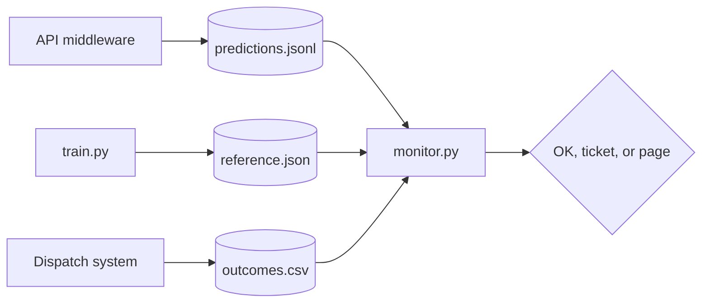

:::objectives
- Save a reference profile of the training data next to the model, so monitoring never needs the training set.
- Log every prediction from FastAPI middleware, including rejected requests and their latency.
- Compute PSI by hand and the KS test with `scipy.stats` for each feature, and chart how a shifted distribution looks.
- Detect concept drift by joining outcomes to predictions, and turn every signal into an OK, ticket, or page decision.
:::

Here is what you'll have at the end: a `monitor.py` that reads a day of prediction logs and delivered-order outcomes and prints this report.

```text
signal                          value    limit   status
p99 latency (ms)                  3.1  250.000   OK
5xx error rate                  0.000    0.010   OK
4xx rate                        0.012    0.050   OK
PSI distance_km (17:00+)        0.443    0.250   TICKET
PSI items (17:00+)              0.016    0.250   OK
late-rate gap (19:00+)          0.219    0.100   PAGE
overall: PAGE
```

Every number except latency is the same on any machine; latency depends on yours. To get there, you'll replay a realistic day through the service. Two things happen that afternoon. At 17:00 the company opens a new suburban zone, so many orders travel farther: **data drift**. At 19:00 a bridge closes, so the same distance suddenly takes longer: **concept drift**. A good monitor should flag the first for investigation and page someone for the second.



## Step 1: Train, and save a reference profile with the model

Drift is always measured against something. Save that something at training time, in the same folder as the model, so every model version carries its own baseline: ten equal-count bin edges per numeric feature, the share of training rows in each bin, and a 500-value sample for the KS test.

```python run
import json
import os
import pathlib
import time
import uuid

import joblib
import numpy as np
import pandas as pd
from sklearn.compose import ColumnTransformer
from sklearn.linear_model import LogisticRegression
from sklearn.pipeline import Pipeline
from sklearn.preprocessing import OneHotEncoder, StandardScaler

def make_orders(n=2000, seed=23):
    rng = np.random.default_rng(seed)
    distance_km = rng.gamma(shape=2.0, scale=2.0, size=n).round(2)
    items = rng.integers(1, 9, size=n)
    hour = rng.integers(10, 23, size=n)
    raining = (rng.random(n) < 0.25).astype(int)
    rush = (hour >= 17) & (hour <= 19)
    logit = -4.0 + 0.45 * distance_km + 0.15 * items + 1.2 * raining + 0.9 * rush
    late = (rng.random(n) < 1 / (1 + np.exp(-logit))).astype(int)
    return pd.DataFrame({"distance_km": distance_km, "items": items,
                         "hour": hour, "raining": raining, "late": late})

FEATURES = ["distance_km", "items", "hour", "raining"]
for folder in ["models", "logs"]:
    pathlib.Path(folder).mkdir(exist_ok=True)

orders = make_orders()
model = Pipeline([
    ("prep", ColumnTransformer([("scale", StandardScaler(), ["distance_km", "items"]),
                                ("hour", OneHotEncoder(handle_unknown="ignore"), ["hour"])],
                               remainder="passthrough")),
    ("clf", LogisticRegression(max_iter=1000)),
]).fit(orders[FEATURES], orders["late"])
joblib.dump(model, "models/model.joblib")
pathlib.Path("models/model.json").write_text(json.dumps(
    {"name": "late-delivery", "version": "1.0.0", "features": FEATURES, "threshold": 0.5}))

def profile(frame, numeric=("distance_km", "items", "hour"), bins=10):
    out = {"late_rate": float(frame["late"].mean()), "raining_rate": float(frame["raining"].mean())}
    for col in numeric:
        edges = np.unique(np.quantile(frame[col], np.linspace(0, 1, bins + 1)))
        edges[0], edges[-1] = -np.inf, np.inf
        counts = np.histogram(frame[col], edges)[0]
        out[col] = {"edges": edges.tolist(), "fractions": (counts / counts.sum()).tolist(),
                    "sample": frame[col].sample(500, random_state=0).tolist()}
    return out

reference = profile(orders)
pathlib.Path("models/reference.json").write_text(json.dumps(reference))
print("items bins:", len(reference["items"]["fractions"]), "| hour bins:", len(reference["hour"]["fractions"]))
print("items fractions:", np.round(reference["items"]["fractions"], 3))
```

`np.unique` on the edges matters for whole-number features. `items` only takes values 1 to 8, so several deciles fall on the same value, and duplicate edges would create empty bins. The first and last edges become ±infinity so live values outside the training range still land in a bin instead of disappearing.

## Step 2: Log every prediction from middleware

The endpoint knows the features and the score; the middleware knows the status code and the total time, including requests that fail validation and never reach the endpoint. So the endpoint leaves its details on `request.state`, and the middleware writes one line with everything.

```python run title="app/main.py"
import logging
from contextlib import asynccontextmanager

from fastapi import FastAPI, HTTPException, Request
from pydantic import BaseModel, ConfigDict, Field

MODEL_DIR = pathlib.Path(os.environ.get("MODEL_DIR", "models"))
LOG_PATH = os.environ.get("PREDICTION_LOG", "logs/predictions.jsonl")   # unset in production: stdout

prediction_log = logging.getLogger("predictions")
prediction_log.setLevel(logging.INFO)
prediction_log.handlers = [logging.FileHandler(LOG_PATH) if LOG_PATH else logging.StreamHandler()]
prediction_log.propagate = False

class Order(BaseModel):
    model_config = ConfigDict(extra="forbid")
    distance_km: float = Field(gt=0, le=50)
    items: int = Field(ge=1, le=50)
    hour: int = Field(ge=0, le=23)
    raining: bool

class Prediction(BaseModel):
    late_probability: float
    late: bool
    model_version: str

state = {}

@asynccontextmanager
async def lifespan(app: FastAPI):
    state["model"] = joblib.load(MODEL_DIR / "model.joblib")
    state["meta"] = json.loads((MODEL_DIR / "model.json").read_text())
    yield
    state.clear()

app = FastAPI(title="Late-delivery predictor", lifespan=lifespan)

@app.middleware("http")
async def log_predictions(request: Request, call_next):
    start = time.perf_counter()
    response = await call_next(request)
    if request.url.path == "/predict":
        record = {"request_id": request.headers.get("x-request-id") or uuid.uuid4().hex[:12],
                  "status": response.status_code,
                  "latency_ms": round((time.perf_counter() - start) * 1000, 2),
                  "model_version": state.get("meta", {}).get("version")}
        record.update(getattr(request.state, "prediction", {}))
        prediction_log.info(json.dumps(record))
    return response

@app.post("/predict", response_model=Prediction)
def predict(order: Order, request: Request):
    if "model" not in state:
        raise HTTPException(status_code=503, detail="model not loaded")
    row = pd.DataFrame([order.model_dump()], columns=state["meta"]["features"])
    probability = float(state["model"].predict_proba(row)[0, 1])
    request.state.prediction = {**order.model_dump(), "late_probability": round(probability, 4)}
    return Prediction(late_probability=round(probability, 3),
                      late=probability >= state["meta"]["threshold"],
                      model_version=state["meta"]["version"])
```

This copy loads from `models/` to keep the page short. Your Module 4 service loads whatever the `champion` alias points to through `load_alias`, and nothing in this lesson depends on which. The log records features and the score, but no customer name, address, or phone number. Keep it that way: logs get copied to many places, and the monitor only needs what the model saw.

## Step 3: Replay a day of traffic

This cell plays the role of a day in production. It builds 900 orders, applies the two afternoon events, sends each order to the API with its order ID as `X-Request-ID`, and writes the true outcomes that the dispatch system reports once each delivery finishes. A percent or two of requests are malformed, as real traffic always is.

```python run
from fastapi.testclient import TestClient

rng = np.random.default_rng(101)
day = make_orders(900, seed=101)
day["order_id"] = [f"ord-{i:04d}" for i in range(len(day))]

new_zone = (day.hour >= 17) & (rng.random(len(day)) < 0.5)            # data drift
day.loc[new_zone, "distance_km"] += rng.gamma(2.0, 2.5, new_zone.sum()).round(2)
bridge_closed = (day.hour >= 19) & (day.distance_km > 3)                # concept drift
logit = (-4.0 + 0.45 * day.distance_km + 0.15 * day["items"] + 1.2 * day.raining
         + 0.9 * day.hour.between(17, 19) + 1.8 * bridge_closed)
day["late"] = (rng.random(len(day)) < 1 / (1 + np.exp(-logit))).astype(int)

with TestClient(app) as client:
    for row in day.itertuples():
        body = {"distance_km": float(row.distance_km), "items": int(row.items),
                "hour": int(row.hour), "raining": bool(row.raining)}
        if rng.random() < 0.02:
            body["hour"] = 24                                           # a buggy client
        client.post("/predict", json=body, headers={"X-Request-ID": row.order_id})

day[["order_id", "late"]].rename(columns={"order_id": "request_id"}).to_csv("logs/outcomes.csv", index=False)
lines = pathlib.Path("logs/predictions.jsonl").read_text().splitlines()
print(len(lines), "log lines; the first two:")
print(lines[0])
print(lines[1])
```

Every request produced exactly one line, including the rejected ones. In production the lines would stream to stdout, and the platform's log collection (Render's log streams, for example) would forward them to storage where this monitor can read them.

## Step 4: The golden signals

`pd.read_json(..., lines=True)` turns a JSON-lines file into a DataFrame, one row per request. Rejected requests have no features, so their feature columns are `NaN`.

```python run
log = pd.read_json("logs/predictions.jsonl", lines=True)
ok = log[log.status == 200]

p50, p95, p99 = np.percentile(ok.latency_ms, [50, 95, 99])
print(f"traffic   {len(log)} requests, {len(ok)} scored")
print(f"errors    4xx {(log.status.between(400, 499)).mean():.1%}   5xx {(log.status >= 500).mean():.1%}")
print(f"latency   p50 {p50:.1f} ms   p95 {p95:.1f} ms   p99 {p99:.1f} ms")
print(log.groupby("status").size().to_string())
```

These latencies are measured in-process, so they're far below what a client across the internet sees; the shape of the distribution is what matters here. The 4xx rate is tracked separately from 5xx on purpose: 422s mean a caller sent bad data, which is worth a ticket to that team, while 5xx means *your* service failed, which is worth a page.

## Step 5: PSI by hand, against the saved profile

PSI needs the reference fractions (saved in Step 1) and the live fractions in the same bins. A small floor of 0.0001 on each fraction keeps an empty bin from producing `log(0)`.

```python run
def psi(ref_profile, live_values):
    edges = np.array(ref_profile["edges"])
    expected = np.array(ref_profile["fractions"])
    counts = np.histogram(live_values, edges)[0]
    actual = counts / counts.sum()
    expected, actual = np.clip(expected, 1e-4, None), np.clip(actual, 1e-4, None)
    return float(np.sum((actual - expected) * np.log(actual / expected)))

early, late_shift = ok[ok.hour < 17], ok[ok.hour >= 17]
print(f"{'feature':12}{'10:00-16:59':>13}{'17:00-22:59':>13}")
for col in ["distance_km", "items", "hour"]:
    print(f"{col:12}{psi(reference[col], early[col]):13.3f}{psi(reference[col], late_shift[col]):13.3f}")
print(f"raining rate: training {reference['raining_rate']:.2f}, today {ok.raining.mean():.2f}")
```

Split the day by period before computing drift, or the signal gets diluted: half a day of shifted distances averaged with half a day of normal ones looks like a mild change. The `hour` row is huge in both windows, and that's expected: each window holds only some hours of the day, while the training profile spreads across all of them. That "drift" is just the clock, which is why real monitors compare each window with the same window in the reference, or leave time features out of drift alerts.

## Step 6: The KS test and a picture of the shift

```python run alt="Two panels for distance_km. Left: three overlaid histograms; training and the 10:00 to 16:59 window overlap almost exactly, while the 17:00 onward window has a heavier right tail. Right: three cumulative curves; the 17:00 onward curve sits clearly below the other two between about 3 and 15 km." caption="Distance after 17:00 has a long new tail from the suburban zone."
import matplotlib.pyplot as plt
from scipy import stats

ref_sample = np.array(reference["distance_km"]["sample"])
for name, window in [("10:00-16:59", early), ("17:00-22:59", late_shift)]:
    result = stats.ks_2samp(ref_sample, window.distance_km)
    print(f"distance_km {name}: KS statistic {result.statistic:.3f}, p-value {result.pvalue:.2g}, n = {len(window)}")

fig, (left, right) = plt.subplots(1, 2, figsize=(8.5, 3))
bins = np.linspace(0, 30, 31)
series = [("training", ref_sample), ("10:00-16:59", early.distance_km), ("17:00-22:59", late_shift.distance_km)]
for label, values in series:
    left.hist(values, bins=bins, density=True, histtype="step", linewidth=1.8, label=label)
    xs = np.sort(values)
    right.plot(xs, np.arange(1, len(xs) + 1) / len(xs), label=label)
left.set_xlabel("distance_km")
left.set_ylabel("density")
right.set_xlabel("distance_km")
right.set_ylabel("share of orders ≤ x")
right.set_xlim(0, 30)
right.legend(frameon=False)
for ax in (left, right):
    ax.spines[["top", "right"]].set_visible(False)
plt.tight_layout()
```

Read the right panel. The KS statistic is the largest vertical gap between the training curve and a window's curve. The afternoon curve sits below the others because a smaller share of its orders are short. PSI and KS agree here, and they usually will on a shift this size; KS uses the exact values, while PSI depends on the bins but is easier to explain in a report.

## Step 7: Join outcomes to catch concept drift

Inputs alone can't reveal concept drift, because the inputs look normal. Outcomes can. Join each delivered order's true result to its prediction by request ID, then compare, per window, the share of orders the model expected to be late (the mean predicted probability) with the share that actually were.

```python run
from sklearn.metrics import recall_score, roc_auc_score

outcomes = pd.read_csv("logs/outcomes.csv")
joined = ok.merge(outcomes, on="request_id", how="inner")
joined["window"] = pd.cut(joined.hour, [9, 16, 18, 23], labels=["10:00-16:59", "17:00-18:59", "19:00-22:59"])

print(f"{'window':13}{'n':>5}{'predicted':>11}{'actual':>8}{'gap':>7}{'recall':>8}{'AUC':>7}")
for window, g in joined.groupby("window", observed=True):
    predicted, actual = g.late_probability.mean(), g.late.mean()
    recall = recall_score(g.late, g.late_probability >= 0.5)
    print(f"{window:13}{len(g):5}{predicted:11.2f}{actual:8.2f}{actual - predicted:+7.2f}{recall:8.2f}"
          f"{roc_auc_score(g.late, g.late_probability):7.2f}")
```

From 17:00 the model expects more lateness, and it's right: the new zone's long trips really are late more often. That's data drift the model handles. After 19:00, actual lateness pulls far ahead of predicted, and recall falls. The model still *ranks* orders reasonably (AUC holds up better than recall) but its probabilities are now too low, so too few orders cross the 0.5 warning threshold. That's concept drift, and it's the one customers feel.

## Step 8: Rules, decisions, and the finished monitor

Each signal gets a limit and a severity. Symptoms users feel page; signs that the world changed open a ticket. Here is the whole `monitor.py`, reusing the `psi` function from Step 5:

```python run title="monitor.py"
RULES = [
    # (signal, limit, severity when the limit is exceeded)
    ("p99 latency (ms)", 250, "PAGE"),
    ("5xx error rate", 0.01, "PAGE"),
    ("4xx rate", 0.05, "TICKET"),
    ("PSI distance_km (17:00+)", 0.25, "TICKET"),
    ("PSI items (17:00+)", 0.25, "TICKET"),
    ("late-rate gap (19:00+)", 0.10, "PAGE"),
]

def measure(log, outcomes, reference):
    scored = log[log.status == 200]
    evening = scored[scored.hour >= 17]
    tail = scored[scored.hour >= 19].merge(outcomes, on="request_id")
    return {
        "p99 latency (ms)": float(np.percentile(scored.latency_ms, 99)),
        "5xx error rate": float((log.status >= 500).mean()),
        "4xx rate": float(log.status.between(400, 499).mean()),
        "PSI distance_km (17:00+)": psi(reference["distance_km"], evening.distance_km),
        "PSI items (17:00+)": psi(reference["items"], evening["items"]),
        "late-rate gap (19:00+)": float(tail.late.mean() - tail.late_probability.mean()),
    }

def report(values):
    print(f"{'signal':28}{'value':>9}{'limit':>9}   status")
    worst = "OK"
    for signal, limit, severity in RULES:
        status = severity if values[signal] > limit else "OK"
        if status == "PAGE" or (status == "TICKET" and worst == "OK"):
            worst = status
        print(f"{signal:28}{values[signal]:9.3f}{limit:9.3f}   {status}")
    print("overall:", worst)
    return worst

if __name__ == "__main__":
    log = pd.read_json("logs/predictions.jsonl", lines=True)
    outcomes = pd.read_csv("logs/outcomes.csv")
    reference = json.loads(pathlib.Path("models/reference.json").read_text())
    report(measure(log, outcomes, reference))
```

The report pages for the bridge closure and opens a ticket for the new zone. Both are right. The new zone needs a human to decide whether to retrain with suburban orders, which can wait until morning. The bridge closure is making the app tell customers "on time" when it isn't, and that can't wait. In production, run this on a schedule (every 15 minutes, say) over a sliding window of recent logs, and send PAGE results to your on-call tool and TICKET results to the issue tracker.

:::video HGIgUH11nVo
What to watch for: the difference between drift in the inputs and a drop in model quality, and why you often monitor input drift as an early warning while waiting for true labels.
:::

:::quiz
Q: Why does `train.py` save `reference.json` instead of having the monitor load the training CSV?
- [x] Each model version carries its own baseline, and the monitor never needs access to training data
  Retraining on new data changes what "normal" means. Storing the profile with the model keeps the baseline matched to the model actually serving, and keeps raw training data out of production systems.
- [ ] PSI can only be computed from saved bin edges
  You could recompute bins from the CSV every time; it's just slower, and it ties monitoring to wherever the training data lives.
- [ ] The KS test requires exactly 500 values
  `ks_2samp` accepts samples of any size. 500 is a size that's small to store but large enough to compare.

Q: Logging happens in middleware rather than inside `predict()`. What would be lost if it moved into the endpoint?
- [ ] Nothing; the endpoint sees every request
  Requests that fail validation get a 422 before `predict()` ever runs.
- [x] Rejected requests and the full request time, including validation and serialization
  Middleware wraps the whole request, so it can time everything and record requests the endpoint never sees.
- [ ] The model version
  The endpoint has the version too; that's not what would be lost.

Q: After 19:00, PSI on every feature is similar to the 17:00–18:59 window, but actual lateness is far above predicted. Which response fits?
- [ ] Ignore it until PSI crosses 0.25
  PSI only describes inputs. The inputs didn't change; the outcomes did.
- [x] Page, because customers are getting wrong "on time" answers now
  Outcome-based signals measure what users experience. Mitigate first (for example, raise predicted risk for affected routes or show a general delay notice), then retrain.
- [ ] Retrain immediately on today's data and deploy without a gate
  Retraining on a few hours of an unusual event, without the CI gates, risks a worse model when the bridge reopens.
:::

:::takeaways
- Store a reference profile (bin edges, fractions, a sample) with every model version, and measure drift against the profile of the model that's actually serving.
- Log one JSON line per request from middleware, so rejected requests and true latency are captured, and leave personal data out.
- Compute drift per time window; mixing shifted and normal periods dilutes the signal, and time-of-day features drift every day by design.
- PSI and KS answer "did the inputs change?"; only joined outcomes answer "is the model still right?"
- Map every signal to a severity: user-facing symptoms page, changes in the world open tickets.
:::

## Ideas to extend it

- Compare each hour with the same hour in the reference instead of the whole training day, so the `hour` feature stops looking like drift every evening.
- Expose the counters with a Prometheus client library and a `/metrics` endpoint, and compute p99 from histogram buckets instead of raw logs.
- Add a per-slice gap (rainy versus dry, short versus long) to `measure`, so a problem affecting only long orders isn't averaged away.

## Further reading

- [Prometheus: histograms and summaries](https://prometheus.io/docs/practices/histograms/): how production systems compute latency percentiles from bucketed counts, and the trade-offs of each approach.
- [scipy.stats.ks_2samp](https://docs.scipy.org/doc/scipy/reference/generated/scipy.stats.ks_2samp.html): the reference for the two-sample KS test, including its alternatives and how the p-value is computed.
- [What is data drift in ML?](https://www.evidentlyai.com/ml-in-production/data-drift): Evidently's guide to drift types and detection methods, with notes on choosing tests for different data sizes.
