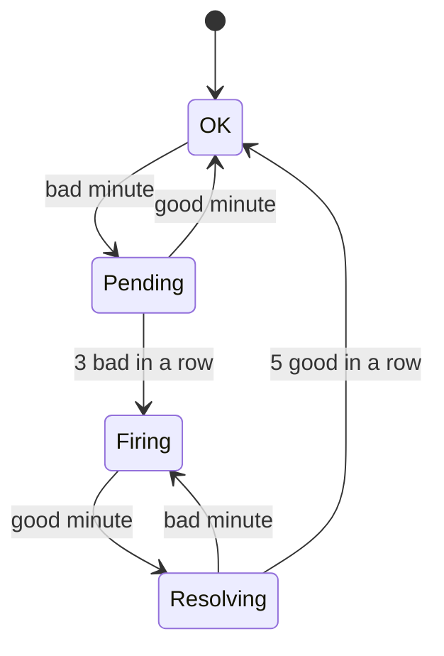

:::objectives
- Compare a challenger model with the champion on the same traffic in shadow mode, for both decisions and latency.
- Compute a rolling p99 from a request log and find when a regression started.
- Handle PSI's empty-bin and categorical cases, and judge drift by size rather than p-value.
- Detect concept drift when labels arrive late, and design alerts that neither flap nor miss real incidents.
:::

The setup trains the champion (1.0.0) and defines helpers used below. Run it first.

```python run
import time

import numpy as np
import pandas as pd
from scipy import stats
from sklearn.compose import ColumnTransformer
from sklearn.ensemble import RandomForestClassifier
from sklearn.linear_model import LogisticRegression
from sklearn.metrics import recall_score
from sklearn.pipeline import Pipeline
from sklearn.preprocessing import OneHotEncoder, StandardScaler

def make_orders(n=2000, seed=23):
    rng = np.random.default_rng(seed)
    distance_km = rng.gamma(shape=2.0, scale=2.0, size=n).round(2)
    items = rng.integers(1, 9, size=n)
    hour = rng.integers(10, 23, size=n)
    raining = (rng.random(n) < 0.25).astype(int)
    rush = (hour >= 17) & (hour <= 19)
    logit = -4.0 + 0.45 * distance_km + 0.15 * items + 1.2 * raining + 0.9 * rush
    late = (rng.random(n) < 1 / (1 + np.exp(-logit))).astype(int)
    return pd.DataFrame({"distance_km": distance_km, "items": items,
                         "hour": hour, "raining": raining, "late": late})

FEATURES = ["distance_km", "items", "hour", "raining"]
orders = make_orders()
champion = Pipeline([
    ("prep", ColumnTransformer([("scale", StandardScaler(), ["distance_km", "items"]),
                                ("hour", OneHotEncoder(handle_unknown="ignore"), ["hour"])],
                               remainder="passthrough")),
    ("clf", LogisticRegression(max_iter=1000)),
]).fit(orders[FEATURES], orders["late"])

def psi(expected, actual, bins=10, floor=1e-4):
    edges = np.unique(np.quantile(expected, np.linspace(0, 1, bins + 1)))
    edges[0], edges[-1] = -np.inf, np.inf
    e = np.histogram(expected, edges)[0] / len(expected)
    a = np.histogram(actual, edges)[0] / len(actual)
    e, a = np.clip(e, floor, None), np.clip(a, floor, None)
    return float(np.sum((a - e) * np.log(a / e)))

print("champion ready; training late rate", round(orders.late.mean(), 3))
```

## Warm-up: pick the release strategy

Choose recreate, rolling, blue-green, canary, or shadow for each:

1. A random-forest challenger might be slower and might disagree with the champion on rainy orders. You want evidence before any customer sees it.
2. 1.2.0 passed shadow testing. You want real customer outcomes from a small group before everyone gets it.
3. A database migration means old and new versions can't run side by side for even a minute.
4. The service runs on 12 instances and the change is a logging tweak.

:::solution
1. **Shadow**: it scores real traffic with zero user impact, which is exactly the "evidence first" requirement.
2. **Canary**: only a canary exposes real users, and therefore real outcomes, while limiting how many.
3. **Recreate** (or blue-green with the migration done during the switch): when versions can't coexist, rolling and canary are impossible by definition.
4. **Rolling**: low risk, no spare capacity needed, and done in minutes.
:::

### Exercise 1: Shadow-test a challenger

Score 200 logged orders with both the champion and a random-forest challenger, one request at a time as the service would. Report the share of orders where the warning decision (probability ≥ 0.5) differs, the mean absolute probability difference, and each model's p95 latency. Flag the challenger if decisions differ on more than 10% of orders or its p95 latency is more than 1.5 times the champion's.

```python run
challenger = Pipeline([
    ("prep", ColumnTransformer([("hour", OneHotEncoder(handle_unknown="ignore"), ["hour"])],
                               remainder="passthrough")),
    ("clf", RandomForestClassifier(n_estimators=100, min_samples_leaf=5, random_state=0)),
]).fit(orders[FEATURES], orders["late"])
traffic = make_orders(200, seed=7)[FEATURES]
print(len(traffic), "orders to replay")
```

Sample output (your latencies will differ):

```text
decisions differ on 6.0% of orders, mean |difference| 0.068
p95 latency: champion 1.6 ms, challenger 3.5 ms (2.2x)
flags: latency
```

:::hint
Loop over `traffic.iloc[[i]]` (double brackets keep a one-row DataFrame), time each model's `predict_proba` with `time.perf_counter()`, and collect the probabilities in two lists. `np.percentile(times, 95)` gives each p95.
:::

:::solution
```python run
def shadow_compare(champion, challenger, traffic, max_disagree=0.10, max_latency_ratio=1.5):
    p_old, p_new, t_old, t_new = [], [], [], []
    for i in range(len(traffic)):
        row = traffic.iloc[[i]]
        for model, probs, times in [(champion, p_old, t_old), (challenger, p_new, t_new)]:
            start = time.perf_counter()
            probs.append(model.predict_proba(row)[0, 1])
            times.append((time.perf_counter() - start) * 1000)
    p_old, p_new = np.array(p_old), np.array(p_new)
    disagree = float(((p_old >= 0.5) != (p_new >= 0.5)).mean())
    lat_old, lat_new = np.percentile(t_old, 95), np.percentile(t_new, 95)
    print(f"decisions differ on {disagree:.1%} of orders, mean |difference| {np.abs(p_old - p_new).mean():.3f}")
    print(f"p95 latency: champion {lat_old:.1f} ms, challenger {lat_new:.1f} ms ({lat_new / lat_old:.1f}x)")
    flags = [name for name, bad in [("decisions", disagree > max_disagree),
                                    ("latency", lat_new / lat_old > max_latency_ratio)] if bad]
    print("flags:", ", ".join(flags) or "none")
    return flags

shadow_compare(champion, challenger, traffic)
```

A hundred trees cost noticeably more per request than one logistic regression, and offline AUC would never have told you that. Disagreement alone isn't bad; a better model *should* change some decisions. What it gives you is a list of orders to inspect, and if the new decisions cluster in one slice (say, every rainy order), that's a question to answer before any canary. In production the shadow runs inside the service, scoring a copy of each request after the champion has already answered, so the extra time never reaches the user.
:::

### Exercise 2: Find when the regression started with a rolling p99

The SLO says p99 latency stays under 250 ms. Per-minute p99 is noisy, so compute a **5-minute rolling p99** from the request log, and print the first minute where it breaches the SLO.

```python run
rng = np.random.default_rng(3)
seconds = np.sort(rng.uniform(0, 3600, 6000))                 # an hour of requests
latency = rng.lognormal(np.log(15), 0.4, len(seconds))
slow = (seconds > 37 * 60) & (rng.random(len(seconds)) < 0.03)
latency[slow] = rng.uniform(400, 1200, slow.sum())          # the regression
requests = pd.DataFrame({"ts": pd.Timestamp("2026-11-16 18:00") + pd.to_timedelta(seconds, unit="s"),
                         "latency_ms": latency})
print(requests.head(3))
```

Sample output:

```text
first 5-minute window over 250 ms ends at 18:39
```

:::hint
Set the timestamp as the index, then `series.rolling("5min").quantile(0.99)` computes the percentile over the five minutes before each request. Take the value at the end of each minute with `.resample("1min").last()`.
:::

:::solution
```python run
series = requests.set_index("ts")["latency_ms"]
per_minute = series.resample("1min").quantile(0.99)
rolling = series.rolling("5min").quantile(0.99).resample("1min").last()

breach = rolling[rolling > 250]
print("first 5-minute window over 250 ms ends at", breach.index[0].strftime("%H:%M") if len(breach) else "never")
print(pd.DataFrame({"1-min p99": per_minute, "5-min p99": rolling}).loc["2026-11-16 18:34":"2026-11-16 18:41"].round(0))
```

The regression starts at 18:37, and the rolling window crosses 250 ms within a couple of minutes, once enough slow requests have piled up in the window to reach the top 1%. The 1-minute p99 reacts first but then dips under the SLO at 18:38, so a "three bad minutes in a row" rule on it would have reset; the rolling value stays up once it gets there. A wider window would be steadier but slower to react; that's the trade every percentile alert makes. In production, monitoring systems compute this from histogram buckets rather than raw latencies, but the windowing logic is the same.
:::

### Exercise 3: Fix PSI for empty bins and categories

Two bugs. First, with no floor, a bin that's empty in the live data makes PSI `inf` (or `nan`). Second, `raining` is binary, and quantile bins on a 0/1 column don't make sense. Write `psi_categorical(expected, actual)` that compares category shares directly, apply it to `raining` and to `hour` for an evening-only batch, and show what the floor does.

```python run
evening = make_orders(600, seed=11)
evening = evening[evening.hour >= 18]                # a batch from 18:00 onward
print(len(evening), "evening orders; hours present:", sorted(evening.hour.unique().tolist()))
print("PSI with no floor:", psi(orders.hour, evening.hour, floor=0))
```

:::hint
For categories, `value_counts(normalize=True)` gives each category's share. Reindex both shares onto the union of categories with `fill_value=0`, then apply the same floor and formula.
:::

:::solution
```python run
def psi_categorical(expected, actual, floor=1e-4):
    cats = sorted(set(expected) | set(actual))
    e = pd.Series(expected).value_counts(normalize=True).reindex(cats, fill_value=0).to_numpy()
    a = pd.Series(actual).value_counts(normalize=True).reindex(cats, fill_value=0).to_numpy()
    e, a = np.clip(e, floor, None), np.clip(a, floor, None)
    return float(np.sum((a - e) * np.log(a / e)))

print(f"raining PSI: {psi_categorical(orders.raining, evening.raining):.3f}")
print(f"hour PSI:    {psi_categorical(orders.hour, evening.hour):.3f}")
print(f"hour PSI, floor 1e-2 instead of 1e-4: {psi_categorical(orders.hour, evening.hour, floor=1e-2):.3f}")
```

Rain looks stable, and `hour` is enormous because the evening batch has no lunch orders at all: that's the clock, not drift, as in the build. Notice that the result depends on the floor. Each empty bin contributes about `e * ln(e / floor)`, so a smaller floor punishes empty bins harder. Pick one floor, write it down, and keep it fixed, or PSI values from different months of reports won't be comparable.
:::

### Exercise 4: The KS sample-size trap

Every order in a new batch is 0.1 km longer than usual, a shift nobody would care about. Run the KS test on samples of 200 and 50,000 live orders against a 50,000-order reference. Compare p-values, KS statistics, and PSI, then write a rule that flags only meaningful shifts.

```python run
reference = make_orders(50_000, seed=1).distance_km
small = make_orders(200, seed=2).distance_km + 0.1
large = make_orders(50_000, seed=3).distance_km + 0.1
print("medians:", round(reference.median(), 2), round(small.median(), 2), round(large.median(), 2))
```

:::hint
`stats.ks_2samp(a, b)` returns an object with `.statistic` and `.pvalue`. A rule that ignores sample size might be "flag if the KS statistic is above 0.1 or PSI is above 0.1."
:::

:::solution
```python run
for name, sample in [("n = 200", small), ("n = 50,000", large)]:
    ks = stats.ks_2samp(reference, sample)
    p = psi(reference, sample)
    flagged = ks.statistic > 0.1 or p > 0.1
    print(f"{name:11} KS stat {ks.statistic:.3f}  p-value {ks.pvalue:.1e}  PSI {p:.3f}  flag: {flagged}")
```

The big sample's p-value is tiny, so a "p < 0.05" rule would alert on a 0.1 km shift. The small sample's p-value is unremarkable, so the same rule would miss a real shift if you only had a few hundred orders. The statistic and PSI stay small at both sizes (a small sample adds a little noise to each), because they measure *how different* the distributions are, not *how sure* you are that they differ. Production traffic is large, so use effect-size thresholds and treat the p-value only as a check that a small sample isn't noise.
:::

### Exercise 5: Concept drift when labels arrive an hour late

From 14:00 a courier shortage makes deliveries slower, but orders look the same. Outcomes are known 60 minutes after each order. At each hourly check from 11:00 to 20:00, compute recall over the previous two hours of orders *whose outcome has arrived*, require at least 40 late orders before judging, and alert when recall falls below 0.35. Report the first alert time.

```python run
rng = np.random.default_rng(21)
stream = make_orders(1800, seed=21)
stream["placed"] = np.sort(rng.uniform(10, 21, len(stream)))            # hours, 10:00 to 21:00
shortage = stream.placed >= 14
logit = (-4.0 + 0.45 * stream.distance_km + 0.15 * stream["items"] + 1.2 * stream.raining
         + 0.9 * stream.hour.between(17, 19) + 1.5 * shortage)
stream["late"] = (rng.random(len(stream)) < 1 / (1 + np.exp(-logit))).astype(int)
stream["p"] = champion.predict_proba(stream[FEATURES])[:, 1]
stream["outcome_known_at"] = stream.placed + 1.0
print(stream[["placed", "p", "late", "outcome_known_at"]].head(3).round(2))
```

:::hint
At check time `t`, keep rows with `outcome_known_at <= t` and `placed > t - 2`. Skip the check (print "waiting") if fewer than 40 of them are late, since recall's denominator is the number of late orders.
:::

:::solution
```python run
for t in range(11, 21):
    window = stream[(stream.outcome_known_at <= t) & (stream.placed > t - 2)]
    positives = int(window.late.sum())
    if positives < 40:
        print(f"{t}:00  waiting ({positives} late orders with known outcomes)")
        continue
    recall = recall_score(window.late, window.p >= 0.5)
    print(f"{t}:00  recall {recall:.2f} on {positives} late orders  {'ALERT' if recall < 0.35 else 'ok'}")
```

The shortage starts at 14:00, but the first outcomes from it only arrive at 15:00, and a two-hour window still mixes in older, normal orders. So the first alert comes at 15:00, an hour after the cause, and that lag is built into any outcome-based monitor. Notice too that the alert flickers: recall over 50 to 100 late orders is noisy near the 0.35 line, which is exactly the problem Exercise 6 solves. Shorten it by computing the metric more often over a shorter window (noisier), or watch a faster proxy, such as the gap between predicted and actual late rate from the build, which needs no threshold and responds as soon as outcomes land.
:::

### Exercise 6: Stop an alert from flapping

This series records, for each minute, whether p99 was over the SLO. A naive alert notifies every time the state changes, so a borderline service sends a storm of fire/resolve messages. Implement **hysteresis**: fire after 3 consecutive bad minutes, resolve only after 5 consecutive good minutes. Count notifications both ways.

```python run
bad = [0, 1, 0, 1, 1, 0, 1, 1, 1, 0, 1, 1, 1, 1, 0, 1, 0, 0, 1, 0, 0, 0, 0, 0, 0, 0, 1, 0, 0, 0]
naive = sum(1 for prev, cur in zip([0] + bad, bad) if prev != cur)
print("naive notifications:", naive)
```

:::hint
Keep two counters (consecutive bad, consecutive good) and a `firing` flag. Only change `firing`, and notify, when the relevant counter reaches its limit.
:::

:::solution
```python run
def hysteresis(bad_minutes, fire_after=3, resolve_after=5):
    firing, bad_run, good_run, events = False, 0, 0, []
    for minute, is_bad in enumerate(bad_minutes):
        bad_run, good_run = (bad_run + 1, 0) if is_bad else (0, good_run + 1)
        if not firing and bad_run >= fire_after:
            firing = True
            events.append(f"minute {minute}: FIRE")
        elif firing and good_run >= resolve_after:
            firing = False
            events.append(f"minute {minute}: RESOLVE")
    return events

events = hysteresis(bad)
print(len(events), "notifications:", events)
```

One incident, one page, one all-clear, instead of a stream of messages that trains people to mute the channel. The asymmetry is deliberate: firing a little late costs a couple of minutes, while resolving too early produces a second page for the same incident.
:::



### Challenge: A burn-rate alert from the SRE workbook

The SLO is 99.5% of requests succeeding over 30 days, so the **error budget** is 0.5% of requests. The **burn rate** is the current error rate divided by 0.005: a burn rate of 1 spends the budget in exactly 30 days. Google's SRE workbook suggests paging when the burn rate exceeds 14.4 over the last hour *and* over the last 5 minutes; 14.4 for one hour spends 2% of a month's budget. Simulate three hours of per-minute traffic with a 2-minute blip at 40% errors (minute 40) and an incident at 30% errors (minutes 120 to 150), and print when the alert fires and stops.

:::solution
```python run
rng = np.random.default_rng(8)
minutes = np.arange(180)
requests_pm = rng.poisson(300, len(minutes))
error_rate = np.full(len(minutes), 0.001)
error_rate[40:42] = 0.40
error_rate[120:150] = 0.30
errors = rng.binomial(requests_pm, error_rate)

def burn(window):
    req = pd.Series(requests_pm).rolling(window, min_periods=window).sum()
    err = pd.Series(errors).rolling(window, min_periods=window).sum()
    return (err / req) / 0.005

long_burn, short_burn = burn(60), burn(5)
paging = (long_burn > 14.4) & (short_burn > 14.4)
changes = paging.astype(int).diff().fillna(0)
for minute in minutes[changes != 0]:
    print(f"minute {minute}: {'PAGE' if paging[minute] else 'resolved'} "
          f"(1h burn {long_burn[minute]:.1f}, 5m burn {short_burn[minute]:.1f})")
print("blip at minute 40 paged:", bool(paging[40:50].any()))
```

The blip burns budget fast for two minutes, but the hour as a whole stays far below 14.4, so it never pages. The incident pages about 14 minutes in, once the one-hour window has absorbed enough errors, and the 5-minute window makes the alert resolve within minutes of recovery instead of an hour later. Both windows together give you fast detection of real incidents, no pages for blips, and quick resets: properties no single threshold has.
:::
