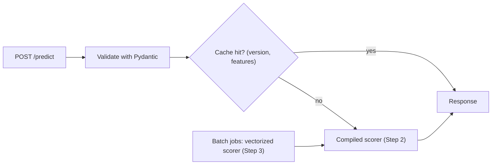

:::objectives
- Benchmark the prediction path and find what dominates a request's time before optimizing anything.
- Replace the pipeline call with a hand-compiled scorer, guarded by a parity test against the original.
- Measure the gains from batching and from an LRU cache keyed on model version and features.
- Quantize a neural network's weights to float32 and int8, and measure size, speed, and accuracy changes.
:::

The late-delivery app polls for an updated risk score every 30 seconds while a customer watches the ETA screen. That means most requests repeat one an earlier poll already sent, and every one of them pays for a DataFrame, a `ColumnTransformer`, and a logistic regression. This build makes that path cheaper in four ways and measures each one, ending with a table of cost per million predictions.



All timings on this page come from the machine that built it, which runs other jobs too. Your numbers will differ; the ratios are what to compare.

## Step 1: Measure the baseline

Start from the champion pipeline and time a single prediction the way the Module 2 service makes one: build a one-row DataFrame, call `predict_proba`.

```python run
import functools
import math
import time

import numpy as np
import pandas as pd
from sklearn.compose import ColumnTransformer
from sklearn.linear_model import LogisticRegression
from sklearn.metrics import roc_auc_score
from sklearn.pipeline import Pipeline
from sklearn.preprocessing import OneHotEncoder, StandardScaler

def make_orders(n=2000, seed=23):
    rng = np.random.default_rng(seed)
    distance_km = rng.gamma(shape=2.0, scale=2.0, size=n).round(2)
    items = rng.integers(1, 9, size=n)
    hour = rng.integers(10, 23, size=n)
    raining = (rng.random(n) < 0.25).astype(int)
    rush = (hour >= 17) & (hour <= 19)
    logit = -4.0 + 0.45 * distance_km + 0.15 * items + 1.2 * raining + 0.9 * rush
    late = (rng.random(n) < 1 / (1 + np.exp(-logit))).astype(int)
    return pd.DataFrame({"distance_km": distance_km, "items": items,
                         "hour": hour, "raining": raining, "late": late})

FEATURES = ["distance_km", "items", "hour", "raining"]
orders = make_orders()
prep = ColumnTransformer([("scale", StandardScaler(), ["distance_km", "items"]),
                          ("hour", OneHotEncoder(handle_unknown="ignore"), ["hour"])],
                         remainder="passthrough")
model = Pipeline([("prep", prep), ("clf", LogisticRegression(max_iter=1000))]).fit(orders[FEATURES], orders["late"])

def bench(fn, calls, repeat=1):
    """Return per-call latencies in microseconds."""
    times = []
    for _ in range(repeat):
        for args in calls:
            start = time.perf_counter()
            fn(args)
            times.append((time.perf_counter() - start) * 1e6)
    return np.array(times)

requests = make_orders(300, seed=5)[FEATURES].to_dict("records")
baseline_us = bench(lambda o: model.predict_proba(pd.DataFrame([o], columns=FEATURES))[0, 1], requests)
print(f"pipeline, one row: p50 {np.median(baseline_us):,.0f} µs   p95 {np.percentile(baseline_us, 95):,.0f} µs")
```

A logistic regression on four numbers is a few dozen multiplications, yet this takes on the order of a millisecond. Nearly all of it is overhead: building the DataFrame, validating column names, and walking through each pipeline step. Optimizing the regression itself would change nothing.

## Step 2: Compile the pipeline into a few lines of arithmetic

For a linear model, the whole pipeline collapses into one formula. The scaler computes `(x - mean) / scale`, which can be folded into the coefficient and the intercept. One-hot encoding `hour` just picks one weight out of a table. So the score is the intercept, plus a weight times distance, plus a weight times items, plus the hour's weight, plus the rain weight, passed through the logistic function.

```python run title="app/fast_scorer.py"
class FastScorer:
    """The late-delivery pipeline as plain arithmetic. Valid only for this pipeline's structure."""

    def __init__(self, pipeline, version):
        prep, clf = pipeline.named_steps["prep"], pipeline.named_steps["clf"]
        names = list(prep.get_feature_names_out())
        scaler = prep.named_transformers_["scale"]
        hours = prep.named_transformers_["hour"].categories_[0].astype(int)
        w, b = clf.coef_[0], clf.intercept_[0]
        mean, scale = scaler.mean_, scaler.scale_
        self.version = version
        self.w_distance = w[0] / scale[0]
        self.w_items = w[1] / scale[1]
        self.intercept = b - w[0] * mean[0] / scale[0] - w[1] * mean[1] / scale[1]
        self.w_hour = np.zeros(24)                       # unknown hours get 0, like handle_unknown="ignore"
        self.w_hour[hours] = w[[names.index(f"hour__hour_{h}") for h in hours]]
        self.w_rain = w[names.index("remainder__raining")]

    def score_one(self, distance_km, items, hour, raining):
        z = (self.intercept + self.w_distance * distance_km + self.w_items * items
             + self.w_hour[hour] + self.w_rain * raining)
        return 1.0 / (1.0 + math.exp(-z))

    def score_batch(self, frame):
        z = (self.intercept + self.w_distance * frame["distance_km"].to_numpy()
             + self.w_items * frame["items"].to_numpy() + self.w_hour[frame["hour"].to_numpy()]
             + self.w_rain * frame["raining"].to_numpy())
        return 1.0 / (1.0 + np.exp(-z))

scorer = FastScorer(model, version="1.1.0")
```

Fast code that gives different answers is a bug, so the scorer ships with a **parity test**: on thousands of orders, including hours the model never saw, it must match the pipeline to within floating-point rounding. In the repo this runs in CI, right after `train.py`, so a retrained or restructured model can't silently break the shortcut.

```python run title="tests/test_fast_scorer.py"
def test_fast_scorer_matches_pipeline():
    check = make_orders(5000, seed=6)[FEATURES]
    check.loc[:9, "hour"] = [0, 1, 2, 3, 4, 5, 6, 7, 8, 23]   # hours outside training
    expected = model.predict_proba(check)[:, 1]
    one_by_one = np.array([scorer.score_one(**row) for row in check.to_dict("records")])
    assert np.abs(scorer.score_batch(check) - expected).max() < 1e-9
    assert np.abs(one_by_one - expected).max() < 1e-9

test_fast_scorer_matches_pipeline()
print("parity test passed")

fast_us = bench(lambda o: scorer.score_one(**o), requests, repeat=5)
print(f"compiled, one row: p50 {np.median(fast_us):.2f} µs   ({np.median(baseline_us) / np.median(fast_us):,.0f}x faster)")
```

That's a speedup of thousands of times on the model call. The catch is in the class docstring: this works only for this exact pipeline shape. If the model becomes a random forest, the scorer is wrong, and the parity test is what tells you. For general models, the same idea is done by tools that convert a fitted pipeline into a portable graph, such as `skl2onnx` with ONNX Runtime, and the parity test stays just as necessary.

## Step 3: Batch when you can

When requests can wait to be grouped (the nightly batch job from Module 3, or a backfill), the vectorized `score_batch` spreads the fixed cost of each call over many rows:

```python run
for size in [1, 100, 10_000]:
    batch = make_orders(size, seed=9)[FEATURES]
    runs = bench(lambda frame: scorer.score_batch(frame), [batch], repeat=20)
    print(f"batch of {size:>6,}: {np.median(runs):8.1f} µs per call, {np.median(runs) / size:7.3f} µs per row")
```

Per-row cost falls by orders of magnitude as the batch grows, the same shape you measured for the pipeline in Module 3, just at a much smaller scale. Batching trades latency for throughput: every request in a batch waits for the batch. For the polling screen, the cache in the next step is the better tool.

## Step 4: Cache the polls

A customer watching the ETA screen sends identical features every 30 seconds. Simulate an hour of that traffic: 600 orders, each polled every 30 seconds for as long as its customer keeps the screen open (a few minutes on average), interleaved by time as the polls would arrive at the server.

```python run
rng = np.random.default_rng(12)
placed_orders = make_orders(600, seed=12)[FEATURES].to_dict("records")
events = []
for order in placed_orders:
    placed = rng.uniform(0, 60)
    for poll in range(1 + rng.geometric(0.1)):
        events.append((placed + poll * 0.5, order))
events.sort(key=lambda e: e[0])
polls = [order for _, order in events]
print(f"{len(polls)} requests for {len(placed_orders)} distinct orders")
```

`functools.lru_cache` keeps the most recently used results and evicts the oldest when full. The key must contain everything that can change the answer, *including the model version*, or a rollback would keep serving the rolled-back model's cached scores.

```python run alt="Line chart of cache hit rate against cache size on a log scale from 8 to 1024 entries. The hit rate stays near zero up to 32 entries, jumps to about 0.8 at 64, reaches the dashed ceiling of about 0.91 at 128, and stays flat after that." caption="An LRU cache smaller than the set of active orders is nearly useless; one slightly larger catches almost every repeat."
import matplotlib.pyplot as plt

def make_cached(score_fn, maxsize):
    @functools.lru_cache(maxsize=maxsize)
    def cached(version, distance_km, items, hour, raining):
        return score_fn(distance_km, items, hour, raining)
    return cached

def hit_rate(maxsize):
    cached = make_cached(scorer.score_one, maxsize)
    for o in polls:
        cached("1.1.0", o["distance_km"], o["items"], o["hour"], o["raining"])
    info = cached.cache_info()
    return info.hits / (info.hits + info.misses)

sizes = [8, 16, 32, 64, 128, 256, 512, 1024]
rates = [hit_rate(size) for size in sizes]
ceiling = 1 - len(placed_orders) / len(polls)
for size, rate in zip(sizes, rates):
    print(f"maxsize {size:5}: hit rate {rate:.2f}")
print(f"ceiling (every repeat is a hit): {ceiling:.2f}")

fig, ax = plt.subplots(figsize=(6.5, 3))
ax.plot(sizes, rates, "o-")
ax.axhline(ceiling, color="gray", linestyle="--", label="ceiling: first polls always miss")
ax.set_xscale("log", base=2)
ax.set_xlabel("cache size (entries)")
ax.set_ylabel("hit rate")
ax.legend(frameon=False)
ax.spines[["top", "right"]].set_visible(False)
plt.tight_layout()
```

The ceiling is set by first polls, which can never hit. Below about 50 entries the cache is nearly useless: by the time an order's next poll arrives 30 seconds later, polls for some 50 other active orders have pushed it out, which is the classic way LRU caches fail when they're smaller than the working set. Once the cache holds every active order, it catches nearly every repeat, and more entries add nothing. Caching pays off most in front of slow work. In front of the compiled scorer, which takes about a microsecond, a cache lookup costs about as much as the work it saves; in front of the original pipeline, it saves a millisecond per hit.

## Step 5: Measure the whole request, then price it

Optimizing the model call only matters as much as the model's share of a request. Here are three versions of `/predict`, measured end to end through `TestClient`, which includes validation, routing, and JSON:

```python run
from fastapi import FastAPI
from fastapi.testclient import TestClient
from pydantic import BaseModel, ConfigDict, Field

class Order(BaseModel):
    model_config = ConfigDict(extra="forbid")
    distance_km: float = Field(gt=0, le=50)
    items: int = Field(ge=1, le=50)
    hour: int = Field(ge=0, le=23)
    raining: bool

pipeline_cached = make_cached(
    lambda d, i, h, r: float(model.predict_proba(pd.DataFrame([[d, i, h, int(r)]], columns=FEATURES))[0, 1]), 256)

variants = {
    "pipeline": lambda o: float(model.predict_proba(pd.DataFrame([o.model_dump()], columns=FEATURES))[0, 1]),
    "pipeline + cache": lambda o: pipeline_cached("1.1.0", o.distance_km, o.items, o.hour, o.raining),
    "compiled scorer": lambda o: scorer.score_one(o.distance_km, o.items, o.hour, o.raining),
}
bodies = [{**o, "raining": bool(o["raining"])} for o in polls[:600]]
PRICE = 0.10   # dollars per instance-hour, illustrative

def make_app(score):
    app = FastAPI()

    @app.post("/predict")
    def predict(order: Order):
        return {"late_probability": round(score(order), 3)}

    return app

print(f"{'variant':18}{'p50 ms':>8}{'p95 ms':>8}{'req/s':>8}{'$ per million':>15}")
for name, score in variants.items():
    with TestClient(make_app(score)) as client:
        times = []
        for body in bodies:
            start = time.perf_counter()
            client.post("/predict", json=body)
            times.append((time.perf_counter() - start) * 1000)
    per_second = 1000 / np.mean(times)
    print(f"{name:18}{np.median(times):8.2f}{np.percentile(times, 95):8.2f}{per_second:8.0f}"
          f"{1e6 * PRICE / (3600 * per_second):15.3f}")
```

Compare the rows. The model call was a large share of each request, so removing it (with the compiled scorer, or with cache hits) raises throughput substantially, but nowhere near the thousands-of-times speedup from Step 2: validation, routing, and JSON now dominate. That's the general lesson of performance work: after you remove the biggest cost, the next one shows up, and the end-to-end number is the only one users and invoices see. These figures are for one worker on one core with no network; use them to compare variants, not to size production.

## Step 6: Quantize a neural-network challenger

The team is evaluating a neural-net challenger, a two-layer MLP with about five thousand weights. Larger models like this are where **quantization** pays off: storing weights in fewer bits. float32 halves the size of float64 with almost no change in results. int8 stores each weight as an integer from −127 to 127 plus one scale per weight matrix, a quarter of float32's size, at the cost of a little rounding error.

```python run
from sklearn.neural_network import MLPClassifier

X_train = prep.transform(orders[FEATURES])
X_train = X_train.toarray() if hasattr(X_train, "toarray") else X_train
mlp = MLPClassifier(hidden_layer_sizes=(64, 64), alpha=3.0, max_iter=300, random_state=0).fit(X_train, orders["late"])

holdout = make_orders(1000, seed=99)                 # Module 4's frozen holdout
X_hold = prep.transform(holdout[FEATURES])
X_hold = X_hold.toarray() if hasattr(X_hold, "toarray") else X_hold

def forward(X, weights, biases):
    a = X
    for i, (W, b) in enumerate(zip(weights, biases)):
        a = a @ W + b
        if i < len(weights) - 1:
            a = np.maximum(a, 0)                     # ReLU, the MLP's default activation
    return 1 / (1 + np.exp(-a[:, 0]))

def quantize_int8(W):
    scale = np.abs(W).max() / 127
    return np.round(W / scale).astype(np.int8), scale

W64, b64 = mlp.coefs_, mlp.intercepts_
W32, b32 = [W.astype(np.float32) for W in W64], [b.astype(np.float32) for b in b64]
q = [quantize_int8(W) for W in W64]
W8 = [codes.astype(np.float32) * scale for codes, scale in q]   # dequantize for NumPy math

p64 = forward(X_hold, W64, b64)
assert np.allclose(p64, mlp.predict_proba(X_hold)[:, 1])       # our forward pass matches sklearn's
print(f"{'weights':8}{'bytes':>8}{'AUC':>8}{'max |Δp|':>10}{'same decision':>15}")
for name, W, b, nbytes in [("float64", W64, b64, sum(w.nbytes for w in W64)),
                           ("float32", W32, b32, sum(w.nbytes for w in W32)),
                           ("int8", W8, b32, sum(codes.nbytes for codes, _ in q))]:
    p = forward(X_hold.astype(W[0].dtype), W, b)
    print(f"{name:8}{nbytes:8,}{roc_auc_score(holdout.late, p):8.4f}{np.abs(p - p64).max():10.4f}"
          f"{((p >= 0.5) == (p64 >= 0.5)).mean():15.1%}")

big = np.tile(X_hold, (100, 1))
for name, W, b in [("float64", W64, b64), ("float32", W32, b32)]:
    X_big = big.astype(W[0].dtype)
    runs = bench(lambda _: forward(X_big, W, b), [None], repeat=3)
    print(f"{name} forward pass on {len(big):,} rows: {np.median(runs) / 1000:.1f} ms")
```

float32 is the free win: half the memory, a faster forward pass because each number is half the size (so twice as many move through memory and the CPU's vector units at once), and predictions that match to within rounding. int8 shrinks the weights to an eighth of float64, the AUC barely moves, and a small share of decisions near the 0.5 threshold flip, which is exactly what your parity and slice tests should measure before you ship it. NumPy has no fast int8 matrix multiply, so here int8 saves memory and download size but not time; serving runtimes such as ONNX Runtime and PyTorch have int8 kernels that also run faster. For a model this small, none of it matters for cost: the HTTP overhead from Step 5 dwarfs it. It starts to matter when weights are megabytes or gigabytes, and a smaller container starts faster and fits on a cheaper instance.

## The finished scorer module

Everything that ships from this lesson fits in one file: the compiled scorer, the version-keyed cache, and the parity check that guards them. The service builds it once at startup, right after loading the champion from the registry.

```python run title="app/fast_scorer.py"
import functools
import math

import numpy as np

class FastScorer:
    def __init__(self, pipeline, version, cache_size=256):
        prep, clf = pipeline.named_steps["prep"], pipeline.named_steps["clf"]
        names = list(prep.get_feature_names_out())
        scaler = prep.named_transformers_["scale"]
        hours = prep.named_transformers_["hour"].categories_[0].astype(int)
        w, b = clf.coef_[0], clf.intercept_[0]
        self.version = version
        self.w_distance = w[0] / scaler.scale_[0]
        self.w_items = w[1] / scaler.scale_[1]
        self.intercept = b - self.w_distance * scaler.mean_[0] - self.w_items * scaler.mean_[1]
        self.w_hour = np.zeros(24)
        self.w_hour[hours] = w[[names.index(f"hour__hour_{h}") for h in hours]]
        self.w_rain = w[names.index("remainder__raining")]
        self.cached = functools.lru_cache(maxsize=cache_size)(self._score)

    def _score(self, version, distance_km, items, hour, raining):
        z = (self.intercept + self.w_distance * distance_km + self.w_items * items
             + self.w_hour[hour] + self.w_rain * raining)
        return 1.0 / (1.0 + math.exp(-z))

    def score_one(self, distance_km, items, hour, raining):
        return self.cached(self.version, distance_km, items, hour, bool(raining))

    def check_parity(self, pipeline, frame, tolerance=1e-9):
        expected = pipeline.predict_proba(frame)[:, 1]
        got = np.array([self._score(self.version, **row) for row in frame.to_dict("records")])
        worst = float(np.abs(got - expected).max())
        if worst > tolerance:
            raise RuntimeError(f"fast scorer disagrees with the pipeline by {worst:.2e}; refusing to use it")
        return worst

final = FastScorer(model, version="1.1.0")
print("parity:", final.check_parity(model, make_orders(2000, seed=7)[FEATURES]))
for o in polls[:500]:
    final.score_one(o["distance_km"], o["items"], o["hour"], o["raining"])
print(final.cached.cache_info())
```

`check_parity` raising at startup is deliberate. A service that can't prove its shortcut is correct should fail its readiness check (Module 6) and never take traffic, rather than serve fast wrong answers.

:::quiz
Q: The compiled scorer is thousands of times faster than the pipeline, but end-to-end throughput rose far less. Why?
- [ ] The parity test slows every request down
  The parity test runs once, at startup or in CI, not per request.
- [x] After the model call shrank, validation, routing, and JSON serialization became most of each request
  Speeding up one part of a request can only remove that part's share. The rest of the request path now dominates.
- [ ] `TestClient` adds a fixed sleep to every request
  It doesn't sleep. It runs the full ASGI request path in-process, which is real work.

Q: Why is the model version part of the cache key?
- [x] After a rollback, cached answers from the rolled-back model would otherwise keep being served
  Without the version, the key for an order is the same before and after the alias moves, so the cache can't tell old answers from new.
- [ ] `lru_cache` requires at least five arguments
  It works with any number of hashable arguments.
- [ ] To make the cache larger
  Including the version doesn't change the cache size; it changes what counts as the same request.

Q: int8 weights changed a small share of decisions. What should happen before shipping the int8 model?
- [ ] Nothing, because AUC barely changed
  Overall AUC can hide changes concentrated in one group, as Module 5's slice gate showed.
- [x] Run the same gates as any new model: parity tolerance, holdout metrics, and slice checks
  Quantization creates a new model artifact. It goes through the registry and gates like any other version.
- [ ] Switch back to float64, because any change in decisions is unacceptable
  Every retrain changes some decisions too. The question is whether the changes are acceptable, which the gates decide.
:::

:::takeaways
- Measure before optimizing: for small models, overhead around the model usually dominates.
- A compiled or converted model is only safe with a parity test against the original, run in CI and at startup.
- Batching cuts per-row cost when requests can wait; caching removes repeated work, and its key must include the model version.
- float32 halves memory nearly for free; int8 quarters it again with small, measurable changes that must pass the usual gates.
- Judge every optimization by end-to-end throughput and cost per million predictions, the numbers users and invoices see.
:::

## Ideas to extend it

- Add a time-to-live to the cache (for example, entries older than 60 seconds count as misses) so a change in rain status is picked up even if the client resends stale features.
- Quantize per output column instead of per matrix (one scale for each column of `W`) and measure how much the largest probability change shrinks.
- Export the pipeline with `skl2onnx`, run it with ONNX Runtime, and compare its parity and latency with the hand-compiled scorer.

## Further reading

- [scikit-learn: computational performance](https://scikit-learn.org/stable/computing/computational_performance.html): what drives prediction latency and throughput in scikit-learn, including bulk versus one-at-a-time prediction.
- [functools.lru_cache](https://docs.python.org/3/library/functools.html): the standard library reference, including `cache_info()` and how arguments become keys.
- [ONNX Runtime: quantize ONNX models](https://onnxruntime.ai/docs/performance/model-optimizations/quantization.html): how production runtimes do int8 quantization, with the difference between dynamic and static quantization.
