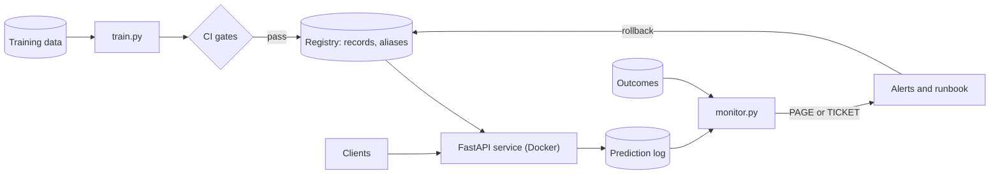
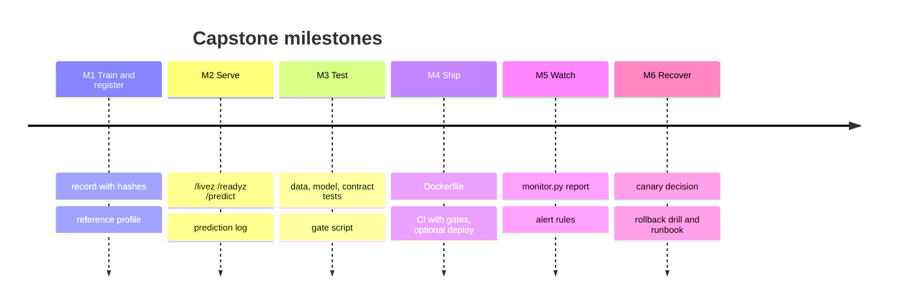

:::objectives
- Choose a capstone project whose difficulty matches your time, and say exactly what is new compared with the course project.
- Write a one-page plan covering the contract, SLOs, gates, release strategy, monitoring, rollback trigger, cost budget, and security.
- Size the service from expected traffic and measured throughput before building it.
- Break the work into milestones that each end with something you can demonstrate.
:::

Here's the test for your capstone: imagine handing the repository to a teammate who has never seen it, and then going on holiday. Ten days later, at 7 p.m. on a rainy Saturday, an alert fires. Can they tell what the service promises, whether it's broken, what changed, and how to undo it, using only what's in the repo? If yes, you've built a production-style ML service. If they'd need to call you, something is missing, and this lesson's plan is how you find out what before you write code.

## What every project must include

Whatever you build, the finished service has these ten parts. Each one maps to a module, so you've already built a version of all of them:

| # | Requirement | What "done" looks like | Built in |
| --- | --- | --- | --- |
| 1 | Packaged service | FastAPI app with a validated request contract, in a non-root Docker image | Module 2 |
| 2 | Serving mode with a reason | Batch, online, or both, justified with measured latency and throughput | Module 3 |
| 3 | Versioned model | Registry record with data and artifact hashes; serving by alias | Module 4 |
| 4 | Automated workflow | CI that runs data, model, and API tests and a gate that blocks bad models | Module 5 |
| 5 | Health checks | Liveness, plus readiness that checks the model version and a golden input | Module 6 |
| 6 | Logs | One JSON line per prediction, with no personal data | Module 6 |
| 7 | Latency and failure monitoring | p50/p95/p99 and 4xx/5xx against written SLOs, with alert rules | Module 6 |
| 8 | Drift plan | Reference profile saved with the model; PSI/KS per feature; an outcome check | Module 6 |
| 9 | Rollback | A rollback trigger, a runbook, and a drill you have actually run | Module 7 |
| 10 | Cost, performance, and security notes | Cost per million predictions with a cap; a threat list and how each threat is handled | Modules 7 and 8 |

Deploying to a public host is encouraged but not required. A service that runs in Docker on your laptop, with CI on GitHub, meets every requirement if the plan explains how it would deploy.

## Pick a project

Choose by the time you have, not by ambition. A small service with all ten parts is a better capstone than a clever model with five.

**1. Finish the late-delivery service (starter).** Take the course project and complete every requirement: readiness with a golden order, the monitor on a schedule, a canary router, a rollback drill, and the cost table. New work: mostly integration and documentation. Good if you have about 10 hours.

**2. Bike-share demand forecaster (standard).** A regression model predicting rentals per station per hour, from weather and calendar features. Download a public trip-history dataset once (many city bike-share systems publish one) and commit a processed sample. New work: a regression contract and metrics (MAE instead of AUC), a nightly batch job *and* an online endpoint, and drift on weather features. About 15 to 20 hours.

**3. Support-ticket urgency classifier (standard).** Text in, "urgent / normal" out, using TF-IDF and logistic regression in a scikit-learn pipeline. Use a public ticket or complaints dataset, or write and label 300 examples yourself. New work: text inputs need limits (length, encoding), drift for text (vocabulary share, document length), and a slice for each product area. About 15 to 20 hours.

**4. Shadow-to-canary release platform (stretch).** The late-delivery service with two models live at once: a challenger in shadow mode, promoted to a hash-routed canary by code, with automatic rollback on per-slice checks. New work: the router, comparison logs, and an end-to-end game day. 20+ hours.

**5. Your own idea (any level).** Any tabular or text problem with a clear user, data you're allowed to use, and an outcome you can observe later (so you can monitor accuracy). Run it past the plan below first; if you can't fill in the contract and SLO sections, the idea isn't ready.

Avoid projects that need a GPU, paid APIs, or data about real people that you don't have permission to use. Medical, financial, and school records are off-limits unless they're a public, anonymized dataset meant for teaching.

## The reference architecture

Whatever the domain, the pieces connect the same way. Use this as the skeleton of your own diagram in the README.



## Write the plan before the code

Copy this into `PLAN.md` at the root of your repo and fill in every line. Blank lines are decisions you haven't made yet; the plan is finished when there are none.

```text
SERVICE PLAN: <name>                         Author: <you>    Date: <date>

1. USER AND DECISION
   Who calls the service, and what do they do with the answer?
   What does a wrong answer cost (false positive vs false negative)?

2. CONTRACT
   Request fields with types and limits:
   Response fields:
   Error codes: 422 for bad input, 503 when not ready, ...

3. SERVING MODE
   Batch / online / both, and why (expected requests per second, latency need):

4. SLOs
   Latency: p99 < ___ ms, measured where?
   Availability: ___% of requests succeed per 30 days
   Quality: <metric> stays within ___ of the holdout value, measured on outcomes

5. GATES (CI)
   Data tests:
   Model floors and champion comparison (on which holdout?):
   Slices that must not regress:

6. RELEASE AND ROLLBACK
   Strategy (canary %, steps, minimum sample per step):
   Rollback trigger (exact rule):
   Who can roll back, and how (command or click):

7. MONITORING
   Signal | threshold | for how long | PAGE or TICKET
   ...

8. DRIFT PLAN
   Reference profile saved where? Which features? PSI/KS thresholds?
   How do outcomes arrive, and how late?

9. COST
   Measured requests/s per instance, instance price, cap, cost per million:

10. SECURITY
   Threats (bad input, leaked secrets, tampered model, personal data in logs, ...)
   and the control for each:

11. RISKS AND OPEN QUESTIONS
```

Section 1 drives everything else. For the late-delivery service, a missed warning (an order that's late with no warning) costs more customer trust than an unnecessary warning, which is why the gates watch recall and the warn rate rather than accuracy. Your project needs its own version of that sentence.

## Size it before you build it

The plan's numbers should come from measurement, not guesses. This cell turns expected traffic and the throughput you measure (Module 7's benchmark) into an instance count, a monthly cost, and an error budget in requests. Change the inputs to your project's.

```python run
import math

expected = {
    "peak_requests_per_second": 120,
    "average_requests_per_second": 15,
    "measured_rps_per_instance": 500,     # from your end-to-end benchmark
    "target_utilization": 0.7,            # headroom for bursts
    "price_per_instance_hour": 0.10,      # illustrative; use your host's real price
    "max_instances": 3,
    "availability_slo": 0.995,
}

e = expected
peak_instances = max(1, math.ceil(e["peak_requests_per_second"] / (e["measured_rps_per_instance"] * e["target_utilization"])))
capped = min(peak_instances, e["max_instances"])
monthly_requests = e["average_requests_per_second"] * 3600 * 24 * 30
budget = (1 - e["availability_slo"]) * monthly_requests
peak_cost = capped * e["price_per_instance_hour"] * 24 * 30
ceiling_cost = e["max_instances"] * e["price_per_instance_hour"] * 24 * 30

print(f"instances at peak: {peak_instances} (cap {e['max_instances']}, so {capped})")
print(f"monthly cost if peak capacity ran all month: ${peak_cost:,.0f}; hard ceiling at the cap: ${ceiling_cost:,.0f}")
print(f"requests per month: {monthly_requests:,.0f}")
print(f"error budget: {budget:,.0f} failed requests per 30 days")
print(f"cost per million predictions at peak: ${1e6 * e['price_per_instance_hour'] / (3600 * e['measured_rps_per_instance'] * e['target_utilization']):.3f}")
```

The error budget line makes the SLO concrete: at 15 requests per second, 99.5% still allows about two hundred thousand failures a month, which tells you that one bad deploy fixed within minutes won't break the SLO, while a slow-burning bug left for a day might. Put these four numbers in section 9 of your plan, and re-measure them in the final lesson.

## Milestones that each end in a demo

Each milestone ends with something you can show in under a minute. If a milestone can't be demonstrated, split it.



:::warning
**Three ways capstones run out of time.**

1. **Polishing the model first.** Getting AUC from 0.81 to 0.83 takes days and earns little here. Ship a simple, honest baseline through all six milestones, then improve the model through your own gates if time remains.
2. **Building a dashboard UI.** A printed report from `monitor.py` and a chart in the README demonstrate monitoring. A web dashboard is a separate project.
3. **Leaving the rollback drill to the end.** It's the milestone that most often reveals a missing piece (a cache without the version in its key, a service that never reloads the alias). Do a rough drill as soon as M2 works.
:::

:::video OejCJL2EC3k
What to watch for: the loop from data to training to deployment to monitoring and back, and where automation sits in it. Your architecture diagram should show the same loop for your project.
:::

## Further reading

- [Rules of Machine Learning](https://developers.google.com/machine-learning/guides/rules-of-ml): Google's practical guide to ML engineering, especially the early rules about starting simple and getting the pipeline right first.
- [The ML Test Score](https://research.google/pubs/the-ml-test-score-a-rubric-for-ml-production-readiness-and-technical-debt-reduction/): a checklist you can score your capstone against before you present it.
- [Model Cards for Model Reporting](https://arxiv.org/abs/1810.03993): the paper behind model cards, with examples of intended use, slices, and limitations sections.
