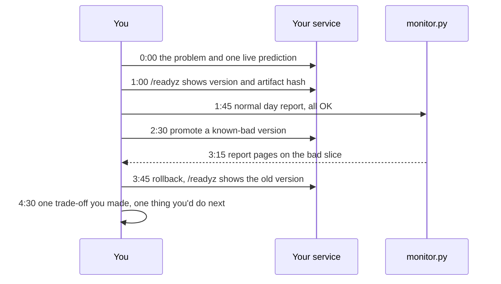

:::objectives
- Run a pre-launch check that load-tests the service, throws bad input at it, injects failures, and times a rollback.
- Close the security gaps ML services usually ship with, and show evidence for each control.
- Write a README, a model card, and a runbook that let a stranger operate the service.
- Present the project in five minutes, including a live failure and recovery, and score it against the rubric.
:::

A service is ready to launch when you've tried to break it and written down what happened. "It works on my laptop" describes one happy path; production sends every unhappy path, usually at the worst possible moment. This lesson is the checklist that turns your capstone from "it runs" into "I know how it fails, and so does the README."

## The test plan

Your tests from Module 5 cover the code, the data, and the model. Before launch, add the tests that cover the *running service*:

| Test | How | Passes when |
| --- | --- | --- |
| Load | 500+ requests, record per-request latency | p99 under the SLO in `PLAN.md` |
| Bad input | Every malformed payload you can think of | Each gets 422, never 500 |
| Not ready | Start without a model, or with the wrong version expected | `/readyz` returns 503 and says why |
| Tampered model | Change one byte of the artifact | Startup refuses to load it |
| Rollback drill | Promote a bad version, then roll back | Old version serving again; time recorded |
| Monitor fires | Replay a drifted or failing day | The report pages or tickets as designed |

Here's a pre-launch script that runs the first five against a compact version of the service. Point the same checks at your own app.

```python run title="prelaunch.py"
import hashlib
import json
import shutil
import time
from contextlib import asynccontextmanager
from pathlib import Path

import joblib
import numpy as np
import pandas as pd
from fastapi import FastAPI, HTTPException, Response
from fastapi.testclient import TestClient
from pydantic import BaseModel, ConfigDict, Field
from sklearn.compose import ColumnTransformer
from sklearn.linear_model import LogisticRegression
from sklearn.pipeline import Pipeline
from sklearn.preprocessing import OneHotEncoder, StandardScaler

def make_orders(n=2000, seed=23):
    rng = np.random.default_rng(seed)
    distance_km = rng.gamma(shape=2.0, scale=2.0, size=n).round(2)
    items = rng.integers(1, 9, size=n)
    hour = rng.integers(10, 23, size=n)
    raining = (rng.random(n) < 0.25).astype(int)
    rush = (hour >= 17) & (hour <= 19)
    logit = -4.0 + 0.45 * distance_km + 0.15 * items + 1.2 * raining + 0.9 * rush
    late = (rng.random(n) < 1 / (1 + np.exp(-logit))).astype(int)
    return pd.DataFrame({"distance_km": distance_km, "items": items,
                         "hour": hour, "raining": raining, "late": late})

FEATURES = ["distance_km", "items", "hour", "raining"]
GOLDEN = {"distance_km": 6.5, "items": 3, "hour": 18, "raining": 1}
SLO_P99_MS = 250
REG = Path("registry/late-delivery")

def publish(version, data, alias_history):
    model = Pipeline([("prep", ColumnTransformer([("scale", StandardScaler(), ["distance_km", "items"]),
                                                  ("hour", OneHotEncoder(handle_unknown="ignore"), ["hour"])],
                                                 remainder="passthrough")),
                      ("clf", LogisticRegression(max_iter=1000))]).fit(data[FEATURES], data["late"])
    (REG / version).mkdir(parents=True, exist_ok=True)
    joblib.dump(model, REG / version / "model.joblib")
    digest = hashlib.sha256((REG / version / "model.joblib").read_bytes()).hexdigest()
    golden = float(model.predict_proba(pd.DataFrame([GOLDEN]))[0, 1])
    (REG / version / "record.json").write_text(json.dumps(
        {"version": version, "artifact_sha256": digest, "golden": {"input": GOLDEN, "probability": golden}}))
    alias_history.append(version)
    (REG / "aliases.json").write_text(json.dumps({"current": {"champion": version}, "history": alias_history}))

shutil.rmtree("registry", ignore_errors=True)
history = []
publish("1.0.0", make_orders(), history)

class Order(BaseModel):
    model_config = ConfigDict(extra="forbid")
    distance_km: float = Field(gt=0, le=50)
    items: int = Field(ge=1, le=50)
    hour: int = Field(ge=0, le=23)
    raining: bool

state = {}

@asynccontextmanager
async def lifespan(app):
    version = json.loads((REG / "aliases.json").read_text())["current"]["champion"]
    record = json.loads((REG / version / "record.json").read_text())
    if hashlib.sha256((REG / version / "model.joblib").read_bytes()).hexdigest() != record["artifact_sha256"]:
        raise RuntimeError(f"{version}: artifact hash mismatch, refusing to load")
    state.update(model=joblib.load(REG / version / "model.joblib"), record=record)
    yield
    state.clear()

app = FastAPI(lifespan=lifespan)

@app.get("/readyz")
def readyz(response: Response):
    if "model" not in state:
        response.status_code = 503
        return {"status": "not ready", "problems": ["model not loaded"]}
    return {"status": "ready", "model_version": state["record"]["version"]}

@app.post("/predict")
def predict(order: Order):
    if "model" not in state:
        raise HTTPException(503, "model not loaded")
    p = float(state["model"].predict_proba(pd.DataFrame([order.model_dump()], columns=FEATURES))[0, 1])
    return {"late_probability": round(p, 3), "model_version": state["record"]["version"]}

results = []
def check(name, passed, detail):
    results.append((name, passed))
    print(f"{'PASS' if passed else 'FAIL'}  {name:16} {detail}")

# 1. Load
orders = make_orders(500, seed=8)[FEATURES].to_dict("records")
with TestClient(app) as client:
    latencies = []
    for o in orders:
        start = time.perf_counter()
        client.post("/predict", json={**o, "raining": bool(o["raining"])})
        latencies.append((time.perf_counter() - start) * 1000)
p99 = np.percentile(latencies, 99)
check("load", p99 < SLO_P99_MS, f"p99 {p99:.1f} ms over {len(latencies)} requests (SLO {SLO_P99_MS} ms)")

# 2. Bad input: every one must be a 422, never a 500
good = {"distance_km": 3.0, "items": 2, "hour": 12, "raining": False}
bad_inputs = {"hour 24": {**good, "hour": 24}, "negative distance": {**good, "distance_km": -1},
              "text for a number": {**good, "items": "two"}, "extra field": {**good, "tip": 5},
              "missing field": {k: v for k, v in good.items() if k != "hour"}, "empty body": {},
              "huge distance": {**good, "distance_km": 1e308}, "null raining": {**good, "raining": None}}
with TestClient(app) as client:
    codes = {name: client.post("/predict", json=body).status_code for name, body in bad_inputs.items()}
check("bad input", set(codes.values()) == {422}, json.dumps(codes))

# 3. Not ready
response = TestClient(app).get("/readyz")            # no `with`, so the lifespan never runs
check("not ready", response.status_code == 503, response.json()["problems"][0])

# 4. Tampered artifact
artifact = REG / "1.0.0" / "model.joblib"
original = artifact.read_bytes()
artifact.write_bytes(original + b"\0")
try:
    with TestClient(app):
        refused = False
except RuntimeError:
    refused = True
artifact.write_bytes(original)
check("tampered model", refused, "startup refused the modified artifact" if refused else "LOADED IT")

# 5. Rollback drill
publish("1.1.0", make_orders(2000, seed=24), history)
start = time.perf_counter()
aliases = json.loads((REG / "aliases.json").read_text())
aliases["current"]["champion"] = "1.0.0"
aliases["history"].append("1.0.0")
(REG / "aliases.json").write_text(json.dumps(aliases))
with TestClient(app) as client:
    serving = client.get("/readyz").json()["model_version"]
check("rollback drill", serving == "1.0.0", f"serving {serving} after {time.perf_counter() - start:.2f} s")

print(f"\n{sum(p for _, p in results)}/{len(results)} checks passed")
```

Look at the bad-input row before anything else. Any 500 there means an input crashed your code instead of being rejected by the contract, and a client can trigger it as often as they like. Add every surprise you find to the list; this script becomes part of CI. And keep the timed rollback number: it goes in `RUNBOOK.md` (with the restart time on your real host, which is the slow part).

## Close the security gaps ML services usually ship with

Security for an ML service is mostly ordinary service security, plus two ML-specific risks: model files are code (unpickling can execute anything), and logs collect the inputs people send. For each row, put the evidence in your README.

| Threat | Control | Evidence |
| --- | --- | --- |
| Malformed or abusive input | Pydantic bounds, `extra="forbid"`, length limits on text | The bad-input check above: all 422 |
| Tampered or swapped model | Hash check before unpickling; registry changes only through reviewed pull requests | The tampered-model check |
| Leaked secrets | Secrets only in GitHub Actions secrets and the host's settings; `.env` in `.gitignore`; nothing secret in the image | `git log -p` and `docker history` show no keys |
| Vulnerable dependencies | Pinned versions; `pip-audit -r requirements.txt` in CI | A clean audit report |
| Container breakout impact | Non-root `USER`, slim base image, only needed files copied | `docker run --rm IMAGE whoami` prints `appuser` |
| Personal data in logs | Log features and scores only; pseudonymize IDs with a keyed hash | A sample log line in the README |
| Unauthorized deploys | Deploy hook in a secret, a protected `production` environment, branch protection on `main` | Repository settings screenshot |

The last ML-specific one deserves code. If you need to join predictions to outcomes per customer, log a **keyed hash** of the customer ID, not the ID itself. With a secret key, the same customer always gets the same token, so joins still work, but nobody holding the logs can recover the ID or test guesses without the key:

```python run
import hmac
import os

LOG_KEY = os.environ.get("LOG_HASH_KEY", "dev-only-key").encode()   # real key: a host secret, never in Git

def pseudonymize(customer_id: str) -> str:
    return hmac.new(LOG_KEY, customer_id.encode(), "sha256").hexdigest()[:16]

line = {"request_id": "ord-0417", "customer": pseudonymize("cust-88213"), "distance_km": 6.5,
        "late_probability": 0.61}
print(json.dumps(line))
print("same customer, same token:", pseudonymize("cust-88213") == line["customer"])
print("plain SHA-256 of the ID, which anyone could recompute:", hashlib.sha256(b"cust-88213").hexdigest()[:16])
```

Why not a plain hash? Customer IDs follow a pattern, so someone with the logs could hash `cust-00000` through `cust-99999` and match every token in seconds. The key makes that impossible without also stealing the secret. Rotate the key if it leaks, and remember that a pseudonymized log is still personal data under many privacy laws, so keep it only as long as the monitoring plan needs.

## Write it down: README, model card, runbook

Three documents, three readers. The **README** is for someone running the project for the first time. The **model card** is for someone deciding whether the model should be used for their purpose. The **runbook** is for someone on call at night.

```text
README.md
  1. What it does, in two sentences, and who calls it
  2. Architecture diagram (from the planning lesson)
  3. Quick start: make_data, train, register, run locally, run in Docker (copy-paste commands)
  4. API: request and response examples, error codes, link to /docs
  5. Operating it: SLOs, dashboards or monitor command, alerts, link to RUNBOOK.md
  6. Results: holdout metrics, slice table, latency and cost table, pre-launch check output
  7. Security notes (the table above, filled in with your evidence)
  8. Limitations and what you'd do next

MODEL_CARD.md (generate it from the registry record, as in Module 4)
  Intended use and users | Out-of-scope uses | Training data and its hash
  Metrics overall and per slice | Known failure modes | Monitoring and retraining plan

RUNBOOK.md: one section per PAGE alert
  What the alert means | First checks | Mitigation commands | How to confirm recovery | Owner
```

Write the runbook as commands, not descriptions. "Roll back the model" is a description; `python -c "from registry import rollback; rollback('champion', 'INC-<n>')"` followed by "restart the service and check `/readyz`" is a step someone can follow.

## Present it in five minutes

A strong demo shows the system *working*, then *failing*, then *recovering*, because recovery is what this course is about. Rehearse it twice with a timer.



Things that make a demo land: run commands from a prepared script so typos don't eat your time; show real output, not slides of output; say one number per step ("p99 was 7 ms against a 250 ms SLO"); and end with a decision you made and why, such as "I capped the fleet at three instances, so a slow model raises latency and an alert instead of the bill."

## The rubric

| Criterion | 4: Exemplary | 3: Proficient | 2: Developing | 1: Beginning |
| --- | --- | --- | --- | --- |
| Service and contract (15) | Validated contract, readiness with version and golden check, non-root image, all bad inputs 422 | Contract and health checks work; minor gaps | Service runs; contract loose or health check always OK | Runs only in a notebook |
| Versioning and registry (15) | Hashed records, alias serving, tamper check, lineage to data | Versions and aliases; hashes partly used | Versions named by hand, no hashes | `model_final2.joblib` |
| Automation and gates (15) | CI runs data, model, contract, and slice tests; gate blocks a broken candidate (shown) | CI with tests and a floor-only gate | Tests exist but run by hand | No tests |
| Monitoring and drift (15) | Prediction log, SLO-based alerts, drift per window, outcome gap; shown firing | Golden signals and drift computed; alerts partly defined | Some metrics, no thresholds | None |
| Release and recovery (15) | Canary or shadow with an automated decision; timed rollback drill; runbook with commands | Rollback works and is documented | Rollback described, never tried | No plan |
| Cost, performance, security (15) | Measured throughput and cost per million with a cap; security table with evidence | Numbers measured; security partly evidenced | Estimates only | Not addressed |
| Documentation and demo (10) | README, model card, and runbook a stranger could use; demo shows failure and recovery in 5 minutes | Docs complete; demo clear | Docs thin; demo runs over or skips recovery | Little documentation |

Score each row from 1 to 4, then scale to the row's points (a 3 on a 15-point row is about 11). A complete starter project done carefully earns more than an ambitious one with empty rows.

## Reflect, then keep going

Answer these in a short `REFLECTION.md`, a paragraph each. They're the questions interviewers and future teammates will ask.

1. Which failure did your tests catch that you didn't expect? What would have happened without that test?
2. Where does your service's time go per request, and what would you optimize next?
3. Which alert are you least sure about: too noisy, or too quiet? How would you find out?
4. If the model's accuracy dropped by half tomorrow, how long until you knew, and what would you do in the first ten minutes?

Where to go after this course, in roughly the order teams adopt them:

- **Metrics and dashboards:** a Prometheus client in the service and Grafana dashboards, instead of computing percentiles from log files.
- **Orchestration:** Kubernetes for running many instances, with readiness and liveness probes exactly like yours, and a progressive-delivery tool such as Argo Rollouts for canaries.
- **Pipelines and registries at scale:** a pipeline orchestrator (Airflow, Prefect, Kubeflow Pipelines) and a registry service (MLflow) in place of your scripts and JSON files; the ideas carry over one-to-one.
- **Feature stores:** shared, versioned feature definitions so training and serving compute features the same way.
- **Managed ML platforms:** SageMaker, Vertex AI, and Azure ML all provide endpoints with traffic splitting and model monitoring. You now know what they automate, which is the best way to judge them.

## Further reading

- [OWASP API Security Top 10](https://owasp.org/API-Security/editions/2023/en/0x11-t10/): the most common API security failures, several of which apply directly to prediction endpoints.
- [pip-audit](https://pypi.org/project/pip-audit/): the tool for checking your pinned requirements against known vulnerabilities, with instructions for running it in CI.
- [Docker build best practices](https://docs.docker.com/build/building/best-practices/): official guidance on small images, layer caching, and running as a non-root user.
