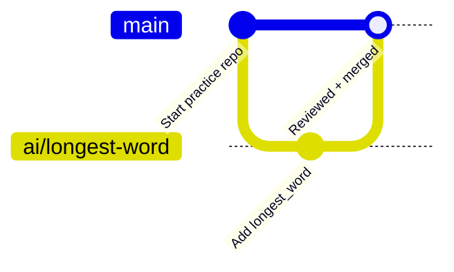

:::objectives
- Create a practice repository with a module, its tests, a `.gitignore`, and an `AGENTS.md` file.
- Make a checkpoint commit, then give an assistant a small task on its own branch.
- Read the result with `git status`, `git diff --stat`, and `git diff`, and run the tests yourself.
- Keep a good change by merging it, or throw a bad one away without losing anything.
:::

Ask an assistant to "add a function" and you may get the function, plus a reformatted file, a renamed variable, and an import you never asked for. None of that is visible in the chat reply. It's only visible if you can compare the project before and after, line by line.

This lesson builds the place where you can always do that: a tiny repository that every later module points agents at. By the end you'll have watched an assistant change it and checked the change yourself.

## What you're building

```text
practice-repo/
├── .gitignore
├── AGENTS.md
├── README.md
├── textstats.py
└── test_textstats.py
```

And this is the workflow you'll repeat all course. The assistant only ever works on a side branch, and `main` changes only after you've reviewed the work.



## Step 1: Make the folder a repository

In your `agent-course` folder, open a VS Code terminal and run:

```bash
mkdir practice-repo
cd practice-repo
git init
code .
```

`git init` creates a hidden `.git` folder that stores every snapshot. If the `code` command isn't found (common on macOS), open the folder with **File › Open Folder…** instead.

## Step 2: Add the code and its tests

Create `textstats.py`. These are three small functions with clear behavior, so it's easy to tell when a change breaks one.

```python run title="textstats.py"
"""Small text helpers that serve as a practice target for AI assistants."""


def word_count(text):
    """Return the number of whitespace-separated words in text."""
    return len(text.split())


def char_count(text, include_spaces=True):
    """Return the number of characters, optionally leaving out spaces."""
    if include_spaces:
        return len(text)
    return len(text.replace(" ", ""))


def top_words(text, n=3):
    """Return the n most common words, lowercased, as (word, count) pairs."""
    counts = {}
    for word in text.lower().split():
        word = word.strip(".,!?;:\"'()")
        if word:
            counts[word] = counts.get(word, 0) + 1
    ranked = sorted(counts.items(), key=lambda pair: (-pair[1], pair[0]))
    return ranked[:n]


if __name__ == "__main__":
    sample = "The cat sat. The cat ran! A dog sat."
    print("words:", word_count(sample))
    print("characters without spaces:", char_count(sample, include_spaces=False))
    print("top words:", top_words(sample))
```

Look at the last line of output. Three words tie at 2, and `top_words` lists them alphabetically because the sort key is `(-count, word)`. Tie rules like this are exactly the kind of detail an assistant quietly changes, so the tests pin it down. If an assistant's edit makes any function give the wrong answer, one of these fails. Save this as `test_textstats.py` in the same folder:

```python title="test_textstats.py"
import unittest

from textstats import char_count, top_words, word_count


class WordCountTests(unittest.TestCase):
    def test_counts_words_separated_by_spaces(self):
        self.assertEqual(word_count("one two three"), 3)

    def test_empty_text_has_no_words(self):
        self.assertEqual(word_count(""), 0)


class CharCountTests(unittest.TestCase):
    def test_can_leave_out_spaces(self):
        self.assertEqual(char_count("a b c", include_spaces=False), 3)


class TopWordsTests(unittest.TestCase):
    def test_ignores_case_and_punctuation(self):
        self.assertEqual(top_words("Cat cat. dog", n=1), [("cat", 2)])

    def test_breaks_ties_alphabetically(self):
        self.assertEqual(top_words("b a", n=2), [("a", 1), ("b", 1)])


if __name__ == "__main__":
    unittest.main()
```

Run the whole suite from the terminal (`python3` on macOS and Linux):

```bash
python -m unittest -v
```

```text
test_can_leave_out_spaces (test_textstats.CharCountTests.test_can_leave_out_spaces) ... ok
test_breaks_ties_alphabetically (test_textstats.TopWordsTests.test_breaks_ties_alphabetically) ... ok
test_ignores_case_and_punctuation (test_textstats.TopWordsTests.test_ignores_case_and_punctuation) ... ok
test_counts_words_separated_by_spaces (test_textstats.WordCountTests.test_counts_words_separated_by_spaces) ... ok
test_empty_text_has_no_words (test_textstats.WordCountTests.test_empty_text_has_no_words) ... ok

----------------------------------------------------------------------
Ran 5 tests in 0.001s

OK
```

`python -m unittest` finds every file whose name starts with `test` and runs each method whose name starts with `test`. Five methods, five `ok` lines. Memorize the shape of this output, because "Ran 5 tests ... OK" is the evidence you'll ask agents for in Module 4.

## Step 3: Tell people and agents how the project works

`README.md` is for humans. Two lines are enough:

```text
# practice-repo
Text helpers for practicing AI-assisted changes. Run the tests with: python -m unittest -v
```

`AGENTS.md` is a plain Markdown file of instructions for coding agents. It's an open convention, and many agent tools, VS Code's included, read it automatically from the repository root. Keep it short and specific:

```text
# Notes for AI coding agents

## Project
Text helpers in textstats.py. Standard library only.

## Commands
- Run tests: python -m unittest -v

## Rules
- Change only the files the task names.
- Don't add dependencies or new files without asking first.
- Never open, print, or edit .env or any file that holds keys.
- After your last edit, run the tests and paste the full output.
```

Finally `.gitignore`, which lists files Git should never track. A `.env` file is where secret keys usually live, so it goes first:

```text
.env
.venv/
__pycache__/
```

## Step 4: Make a checkpoint commit

```bash
git add .
git commit -m "Start practice repo"
git log --oneline
```

```text
a1b2c3d Start practice repo
```

Your hash will be different. This commit is the snapshot you can always return to, no matter what happens next.

## Step 5: Give the assistant a small task on a branch

Create the branch first, so the assistant's changes never land on `main`:

```bash
git switch -c ai/longest-word
```

Open the Chat view, choose the mode or agent that can edit files, and paste this task:

```text
Add a function longest_word(text) to textstats.py. It returns the longest
word; on a tie it returns the first one; for empty text it returns "".
Add tests for it to test_textstats.py. Do not change any other function.
When you're done, run: python -m unittest -v
and paste the full output.
```

If your assistant asks permission to edit a file or run the test command, read what it wants to do and allow it. Don't approve anything you don't recognize. No assistant working yet? Make the change by hand; the review steps below work the same.

## Step 6: Review what actually changed

Start with the summary views:

```bash
git status --short
git diff --stat
```

```text
 M test_textstats.py
 M textstats.py
 test_textstats.py | 10 +++++++++-
 textstats.py      |  9 +++++++++
 2 files changed, 18 insertions(+), 1 deletion(-)
```

Two files, both named in the task. That's the first thing to check every time: **is the list of touched files the list you expected?** A third file here, say a rewritten `README.md`, would be a reason to slow down. Then read the change itself with `git diff textstats.py`:

```diff
@@ -24,6 +24,15 @@ def top_words(text, n=3):
     return ranked[:n]
 
 
+def longest_word(text):
+    """Return the longest word in text, the first one on a tie, or "" if empty."""
+    longest = ""
+    for word in text.split():
+        if len(word) > len(longest):
+            longest = word
+    return longest
+
+
 if __name__ == "__main__":
```

Lines starting with `+` were added; there are no `-` lines, so nothing old was removed. The strict `>` is what makes ties return the first word: a later word of equal length never replaces it. Your assistant's version may look different and still be correct.

Now run the tests **yourself**, even if the assistant pasted output. You should see `Ran 7 tests` and `OK`. One more thing to notice: `longest_word("Hello, world")` returns `"Hello,"` with the comma. Is that right? The task never said, so that gap is the task writer's, not the assistant's. Module 2 is about writing tasks without gaps like that.

:::tip
In VS Code, the **Source Control** view (the branch icon in the Activity Bar) shows the same diff side by side. Click a file there to compare old and new versions.
:::

## Step 7: Keep it or throw it away

If you're happy, commit on the branch and merge into `main`:

```bash
git add .
git commit -m "Add longest_word with tests"
git switch main
git merge ai/longest-word
```

If you're not, discard the edits and delete the branch:

```bash
git restore .
git switch main
git branch -D ai/longest-word
```

`git restore .` puts every tracked file back to the last commit. If the assistant also created new files, `git clean -n` lists them, and `git clean -f` deletes them, so always run the `-n` preview first.

:::warning
Uncommitted changes don't stay behind on a branch. If you run `git switch main` before you commit or restore, the edited files come with you to `main`. Commit or restore first, then switch.
:::

:::video e9lnsKot_SQ
What to watch for: the working directory, the staging area, and the repository as three separate places. Plain `git diff` compares your working files with the staging area, so once you `git add` a change it disappears from that view; `git diff --staged` shows it again.
:::

:::try
Before moving on, run `git log --oneline --graph --all`. If you merged, both commits now sit on `main`. Because `main` hadn't moved since you branched, Git simply slid `main` forward to the branch's commit (a fast-forward) instead of making a separate merge commit. If you threw the change away, you'll see only the checkpoint.
:::
