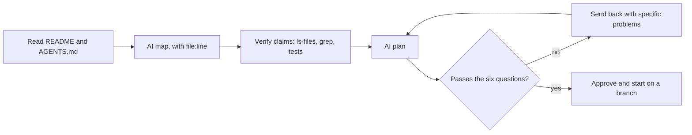

:::objectives
- Ask an AI for a read-only map of a repository, with a file and line for every claim.
- Sort the map's claims by how hard they are to verify, and check them with `git ls-files`, `git grep`, and the test suite.
- Review an agent's plan for grounding, scope, order, verification, risky steps, and hidden assumptions.
- Rewrite a bad plan into one you'd approve.
:::

The task was one sentence: *"late_fee charges 25 cents when a book comes back on time; fix it."* The agent's reply opened with a plan:

```text
Plan: modernize the bookshelf app
1. Replace Flask with FastAPI across the app.
2. Move storage from SQLite to PostgreSQL.
3. Rewrite routes.py with async handlers.
4. Delete the migrations/ folder, which the new setup won't need.
5. Update requirements.txt.
6. Done.
```

It hasn't opened the file with the bug. It hasn't read the repository's instructions, which forbid touching `migrations/`. It has no step that runs a test. And it reads confidently enough that a tired reviewer might type "sounds good." This module is about the two habits that stop that: **verify what the agent says about the code**, and **read its plan like a reviewer** before a single file changes.

## Start with what the repository says about itself

Most repositories explain themselves, if anyone reads them. Before trusting any map, human or AI, look at:

- **`README.md`** for what the project is and how to run it.
- **`AGENTS.md`**, `CONTRIBUTING.md`, or similar for rules: test commands, style, off-limits folders.
- **Dependency files** (`requirements.txt`, `pyproject.toml`, `package.json`) for the real stack.
- **Entry points and routes**, where requests or commands come in.
- **Tests**, both for how to run them and for what behavior someone cared enough to pin down.
- **CI configuration** (`.github/workflows/`) for the checks that run on every push.

Then give the AI a **read-only** mapping task. Saying "read-only" up front means a mapping question can't turn into an edit:

```text
Read-only: do not edit any file or run anything except search and the tests.
Map this repository for someone about to fix a bug in late_fee:
- what each top-level folder and file is for
- where late_fee is defined and every place it is called
- how to run the tests, and which behaviors they cover
- any rules in AGENTS.md or README.md
Cite file:line for every claim. Mark anything you inferred rather than read.
```

## A map is a list of claims

Whatever comes back, treat each sentence as a claim to check, not a fact. Claims come in kinds, and they don't cost the same to verify:

| Kind of claim | Example | How hard to verify |
| --- | --- | --- |
| Something exists | "Routes are in `app/routes.py`" | Easy: list the files |
| Something is defined somewhere | "`late_fee` is in `app/pricing.py`" | Easy: one search |
| Behavior | "`late_fee` caps the fee at 500" | Medium: read the code or run it |
| Absence | "Nothing calls `late_fee` outside the tests" | Hard: you have to search everywhere, and dynamic calls can hide |

Absence claims are where AI maps go wrong most often. A model that read three files and didn't see a call will happily report "it's never called," because from where it stood that looked true.

## Check claims with search and with tests

Here's the bookshelf repository from the hook, built from plain strings so you can run it anywhere. Save and run it locally if you want to try the Git commands below on a real folder.

```python run title="make_bookshelf.py"
from pathlib import Path

FILES = {
    "README.md": "# bookshelf\nA tiny library API built with Flask.\n",
    "AGENTS.md": (
        "Run tests: python -m unittest discover -s tests\n"
        "Never edit files in migrations/ without asking first.\n"
    ),
    "requirements.txt": "flask==3.0.3\n",
    "app/__init__.py": "",
    "app/pricing.py": (
        "def late_fee(days_late):\n"
        '    """Fee in cents: 25 per day late, capped at 500. On time costs nothing."""\n'
        "    return min(25 * (days_late + 1), 500)\n"
    ),
    "app/storage.py": (
        "import sqlite3\n"
        "\n"
        'DB_PATH = "bookshelf.db"\n'
        "\n"
        "\n"
        "def load_books():\n"
        "    with sqlite3.connect(DB_PATH) as db:\n"
        '        return db.execute("SELECT id, title, out FROM books").fetchall()\n'
        "\n"
        "\n"
        "def mark_returned(book_id):\n"
        "    with sqlite3.connect(DB_PATH) as db:\n"
        '        db.execute("UPDATE books SET out = 0 WHERE id = ?", (book_id,))\n'
    ),
    "app/routes.py": (
        "from flask import Flask, jsonify\n"
        "\n"
        "from app import storage\n"
        "from app.pricing import late_fee\n"
        "\n"
        "app = Flask(__name__)\n"
        "\n"
        "\n"
        '@app.get("/books")\n'
        "def list_books():\n"
        "    return jsonify(storage.load_books())\n"
        "\n"
        "\n"
        '@app.post("/books/<int:book_id>/return/<int:days_late>")\n'
        "def return_book(book_id, days_late):\n"
        "    storage.mark_returned(book_id)\n"
        '    return jsonify({"fee_cents": late_fee(days_late)})\n'
    ),
    "migrations/001_create_books.sql": "CREATE TABLE books (id INTEGER PRIMARY KEY, title TEXT, out INTEGER);\n",
    "tests/__init__.py": "",
    "tests/test_pricing.py": (
        "import unittest\n"
        "\n"
        "from app.pricing import late_fee\n"
        "\n"
        "\n"
        "class LateFeeTests(unittest.TestCase):\n"
        "    def test_fee_is_capped(self):\n"
        "        self.assertEqual(late_fee(40), 500)\n"
    ),
}

root = Path("bookshelf")
for name, text in FILES.items():
    path = root / name
    path.parent.mkdir(parents=True, exist_ok=True)
    path.write_text(text)

for path in sorted(root.rglob("*")):
    if path.is_file():
        print(path.relative_to(root).as_posix())
```

In a real repository, `git ls-files` prints that same list: every file Git tracks, which skips ignored clutter like `__pycache__/`. And `git grep -n` searches only those files, with line numbers:

```bash
git grep -n "late_fee("
```

```text
app/pricing.py:1:def late_fee(days_late):
app/routes.py:17:    return jsonify({"fee_cents": late_fee(days_late)})
tests/test_pricing.py:8:        self.assertEqual(late_fee(40), 500)
```

Suppose the AI's map said four things. This script checks each one against the files, with a small `grep` that works like `git grep -n`, and prints its evidence:

```python run title="check_claims.py"
import re
from pathlib import Path

root = Path("bookshelf")
SKIP = {".git", "__pycache__"}  # folders git grep wouldn't search either
files = {}
for path in sorted(root.rglob("*")):
    if path.is_file() and not SKIP & set(path.parts):
        files[path.relative_to(root).as_posix()] = path.read_text()


def grep(pattern):
    """Like `git grep -n`: every (file, line number, text) that matches a regex."""
    hits = []
    for name, text in files.items():
        for number, line in enumerate(text.splitlines(), start=1):
            if re.search(pattern, line):
                hits.append(f"{name}:{number}: {line.strip()}")
    return hits


def report(claim, holds, evidence):
    print(("TRUE " if holds else "FALSE"), claim)
    for line in evidence or ["(no matches)"]:
        print("       ", line)


# What the AI said in its repository map:
defined = grep(r"def late_fee\(")
report("late_fee is defined in app/pricing.py",
       any(hit.startswith("app/pricing.py:") for hit in defined), defined)

report("Books are stored in SQLite through app/db.py",
       "app/db.py" in files, grep(r"sqlite3"))

calls = [hit for hit in grep(r"late_fee\(") if "def late_fee" not in hit]
report("late_fee is only called from the tests",
       all(hit.startswith("tests/") for hit in calls), calls)

zero = grep(r"late_fee\(0\)")
report("No test checks late_fee(0), the on-time case", not zero, zero)
```

Two of four claims are false, and they're false in instructive ways. The SQLite claim is *half* right: the database is real, but `app/db.py` doesn't exist. That's the most common shape of an AI mistake, the right idea at a plausible but wrong path. The "only called from tests" claim misses `routes.py:17`, the line customers actually hit. An agent that believed it might "fix" `late_fee` in a way that only the test exercises.

The last claim is true, and it's the most useful one: no test covers the on-time case, which is exactly why the bug survived. The fix should start by adding that test.

:::tip
Searches find text, not meaning. `late_fee` could also be reached through `getattr(module, "late_" + "fee")`, a template, or a config file. A search with no hits is strong evidence of absence in a small Python repo and weaker evidence in a large one.
:::

## Read the plan like a reviewer

Now go back to the plan from the hook and put it through six questions:

| Question | What to look for | The bookshelf plan |
| --- | --- | --- |
| **Grounded?** | Does each step name files that exist, and did the agent read them? | Never mentions `app/pricing.py`, the file with the bug |
| **Scoped?** | Does every step serve the task? | Steps 1–5 are a rewrite; none of them fixes `late_fee` |
| **Ordered?** | Read, reproduce, change, verify, in that order? | No reading, no reproducing the bug |
| **Verified?** | Is there a step with a named test command? | The last step is "Done" |
| **Risky steps?** | Deletes, schema or dependency changes, anything Git can't undo? | Deletes `migrations/` (forbidden by `AGENTS.md`) and swaps the database |
| **Assumptions?** | What must be true for this to work? | That you want a rewrite, and that live data can move to PostgreSQL |

A plan that fails "grounded" usually fails everything else, because a plan written before reading the code is a plan for some *other* repository. Here's one you'd approve:

```text
1. Read AGENTS.md for the test command and rules.
2. Read app/pricing.py and tests/test_pricing.py.
3. Run: python -m unittest discover -s tests   (expect 1 test, OK)
4. Add test: late_fee(0) == 0. Run again; expect it to FAIL (reproduces the bug).
5. Change late_fee so 0 days late costs 0 and each later day costs 25.
6. Add tests for late_fee(1) == 25 and late_fee(40) == 500; run the suite.
7. Report the diff and full test output.
Assumption to confirm: "on time" means days_late == 0, never negative.
Out of scope: routes.py, storage.py, migrations/, requirements.txt.
```

Step 4 is the one to look for in every bug-fix plan: a test that fails *before* the change. If the new test passes before you've fixed anything, it isn't testing the bug.



:::video zAe-sau06io
What to watch for: an agent doesn't know your codebase in advance; it builds a picture by searching and reading files during the session. Anything it didn't open is a gap in that picture, which is why its claims need checking.
:::

:::warning
**Trusting "I've reviewed the codebase."** That sentence doesn't say which files were read. Ask for the list, and compare it with `git ls-files`. Agents often read only the first part of long files, so ask about line ranges, too.
:::

:::warning
**Approving a plan because each step sounds reasonable.** "Update requirements.txt" is a fine step in general. Check each step against *this* task. A step that doesn't move the task forward is scope creep, however sensible it sounds.
:::

:::quiz
Q: An AI's map says "`format_date` is unused; it's safe to delete." What should you do before believing it?
- [ ] Nothing; the AI searched the code
  You don't know what it searched. An absence claim is the hardest kind to trust.
- [x] Run `git grep -n "format_date"` and look for indirect uses like templates or `getattr`
  A search over every tracked file is the minimum. Indirect references are why "no hits" is evidence, not proof.
- [ ] Delete it and see if the app still starts
  Starting proves very little; the caller might run only on one rarely used page.

Q: In `check_claims.py`, why is the SQLite claim marked FALSE even though the app really uses SQLite?
- [ ] The regex for `sqlite3` was wrong
  The regex found three matches, all in `app/storage.py`.
- [x] The claim names `app/db.py`, which doesn't exist
  The idea was right and the location was invented. An agent acting on it would edit or create the wrong file.
- [ ] SQLite isn't a real database
  It's a real, widely used database; that's not the issue.

Q: Which step most clearly shows a plan was written before reading the code?
- [x] It never names the file that contains the function in the task
  A grounded plan starts from the code involved. Missing it means the plan came from general knowledge, not this repo.
- [ ] It ends by updating dependencies
  That's out of scope here, but plans written after reading can also over-reach.
- [ ] It has six steps
  Length says nothing about grounding.
:::

:::takeaways
- Read `README.md`, `AGENTS.md`, dependency files, entry points, and tests before trusting any map of a repo.
- Ask for maps read-only, with `file:line` for each claim and inferences marked.
- Check claims with `git ls-files`, `git grep -n`, and the tests; absence claims need the most care.
- A plan passes review when it's grounded, scoped, ordered, verified, honest about risky steps, and explicit about assumptions.
- A good bug-fix plan adds a test that fails before the change.
:::

## Further reading

- [git grep](https://git-scm.com/docs/git-grep): flags worth knowing are `-n` (line numbers), `-w` (whole words), and `-e` (several patterns).
- [AGENTS.md](https://agents.md/): the open format for repository instructions aimed at coding agents, with examples of what to put in one.
- [git ls-files](https://git-scm.com/docs/git-ls-files): list tracked files, or with `--others --exclude-standard`, untracked ones an agent may have created.
