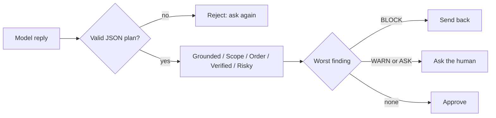

:::objectives
- Ask a model for a plan as structured JSON and handle replies that aren't.
- Check each step against the repository's real file list to catch invented paths.
- Enforce the task's scope and the repository's protected folders.
- Flag edits made before reading, plans with no final test run, and steps that need a human's approval.
:::

Reading a plan carefully works, but it's slow, and the mistakes in the previous lesson were mechanical: a file that doesn't exist, an edit outside scope, a forbidden folder, no test step. Mechanical mistakes are what code is for. You'll build `plan_check.py`, a reviewer that catches them in milliseconds so your own attention goes to the questions code can't answer.

Here's the end result. Given the "modernize" plan from the Notes lesson, the checker prints this (the full program at the bottom produces it):

```text
modernize plan:
  BLOCK step 1: read app/models.py: no such file in the repo
  BLOCK step 2: edit app/routes.py: outside the task's scope
  ...
  BLOCK step 6: no test run after the last change
  verdict: send the plan back (13 findings)
focused plan:
  verdict: approve and start on a branch (0 findings)
```



## Step 1: The repo and its real file list

The checker needs the truth to compare against. In a real repository that's `git ls-files`, which you'd call from Python like this:

```python
import subprocess

files = set(subprocess.run(["git", "ls-files"], capture_output=True, text=True).stdout.splitlines())
```

Here, so everything runs without Git, `tracked_files` walks a folder and skips what Git would skip. The repository is the bookshelf app, trimmed to one line per file because only the names matter today.

```python run
from pathlib import Path

REPO = {
    "AGENTS.md": "Run tests: python -m unittest discover -s tests\nNever edit migrations/ without asking.\n",
    "README.md": "# bookshelf\n",
    "requirements.txt": "flask==3.0.3\n",
    "app/__init__.py": "",
    "app/pricing.py": "def late_fee(days_late):\n    return min(25 * (days_late + 1), 500)\n",
    "app/routes.py": "from app.pricing import late_fee\n",
    "app/storage.py": "import sqlite3\n",
    "migrations/001_create_books.sql": "CREATE TABLE books (id INTEGER PRIMARY KEY);\n",
    "tests/__init__.py": "",
    "tests/test_pricing.py": "from app.pricing import late_fee\n",
}
root = Path("bookshelf")
for name, text in REPO.items():
    (root / name).parent.mkdir(parents=True, exist_ok=True)
    (root / name).write_text(text)


def tracked_files(root):
    """Stand-in for `git ls-files`: every file under root, as forward-slash paths."""
    return {
        path.relative_to(root).as_posix()
        for path in root.rglob("*")
        if path.is_file() and ".git" not in path.parts and "__pycache__" not in path.parts
    }


FILES = tracked_files(root)
print(len(FILES), "files:", ", ".join(sorted(FILES)))
```

`as_posix()` matters on Windows, where paths use backslashes. Without it, `app\pricing.py` would never match the `app/pricing.py` in a plan.

## Step 2: Ask for the plan as data

You can't check a paragraph with code. So the prompt asks for a fixed shape, which most models (local ones included) follow when you're this specific:

```text
Plan the task below. Do not edit anything yet.
Reply with only JSON, in this shape:
{"steps": [{"action": "read|edit|create|delete|run",
            "path": "file, for read/edit/create/delete",
            "command": "shell command, for run",
            "why": "one short reason"}]}
Task: late_fee charges 25 cents when a book is returned on time; fix it.
```

Models don't always comply, so parsing has to handle a reply that isn't JSON. The scripted model below returns the "modernize" plan first, then a chatty prose reply, to test both paths.

```python run
import json


class ScriptedModel:
    def __init__(self, replies):
        self.replies = list(replies)

    def respond(self, prompt):
        return self.replies.pop(0)


MODERNIZE = json.dumps({"steps": [
    {"action": "read", "path": "app/models.py"},
    {"action": "edit", "path": "app/routes.py", "why": "replace Flask with FastAPI"},
    {"action": "create", "path": "app/db.py", "why": "PostgreSQL connection"},
    {"action": "edit", "path": "app/storage.py", "why": "use PostgreSQL"},
    {"action": "delete", "path": "migrations/001_create_books.sql", "why": "not needed"},
    {"action": "edit", "path": "requirements.txt", "why": "swap flask for fastapi"},
]})
model = ScriptedModel([MODERNIZE, "Sure! Here's my plan:\n1. Fix late_fee"])


def parse_plan(text):
    """Turn the model's reply into a list of steps, or explain why we can't."""
    try:
        plan = json.loads(text)
    except json.JSONDecodeError as exc:
        return None, f"reply is not valid JSON ({exc.msg} at line {exc.lineno})"
    steps = plan.get("steps") if isinstance(plan, dict) else None
    if not isinstance(steps, list) or not steps:
        return None, "reply has no list of steps"
    return steps, None


steps, error = parse_plan(model.respond("plan the fix"))
print(len(steps), "steps, error:", error)
print(parse_plan(model.respond("plan the fix")))
```

The first reply parses into six steps. The second fails cleanly with a reason you could send straight back to the model. Notice `isinstance(plan, dict)`: a reply of `[1, 2]` is valid JSON too, and without that guard `plan.get` would crash.

## Step 3: Is every step grounded in real files?

Reading, editing, or deleting a file that doesn't exist means the plan was written from imagination. Creating a file that already exists means it would be overwritten. Both are hard stops, so they get the severity **BLOCK**.

```python run
CHANGES = {"edit", "create", "delete"}


def check_grounded(steps, files):
    findings = []
    for number, step in enumerate(steps, start=1):
        action, path = step.get("action"), step.get("path")
        if action in {"read", "edit", "delete"} and path not in files:
            findings.append(("BLOCK", number, f"{action} {path}: no such file in the repo"))
        elif action == "create" and path in files:
            findings.append(("BLOCK", number, f"create {path}: file already exists"))
    return findings


for finding in check_grounded(steps, FILES):
    print(finding)
```

One hit: `app/models.py` is invented. Every other path in this bad plan is real, which is a useful reminder that grounding alone doesn't make a plan good.

## Step 4: Does every change stay inside the task?

The task allows two files. `AGENTS.md` protects `migrations/`. `fnmatch` handles patterns like `migrations/*`, so the scope can be a list of globs instead of exact names.

```python run
import fnmatch

TASK = {
    "allowed": ["app/pricing.py", "tests/test_pricing.py"],
    "protected": ["migrations/*"],
}


def matches(path, patterns):
    return any(fnmatch.fnmatch(path, pattern) for pattern in patterns)


def check_scope(steps, task):
    findings = []
    for number, step in enumerate(steps, start=1):
        if step.get("action") not in CHANGES:
            continue
        action, path = step["action"], step["path"]
        if matches(path, task["protected"]):
            findings.append(("BLOCK", number, f"{action} {path}: protected by AGENTS.md"))
        elif not matches(path, task["allowed"]):
            findings.append(("BLOCK", number, f"{action} {path}: outside the task's scope"))
    return findings


for finding in check_scope(steps, TASK):
    print(finding)
```

Every change in the plan is out of bounds, and none of them touches `app/pricing.py`. Protected paths are checked first, so the migration gets the more specific message.

## Step 5: Does the plan read before it edits?

An edit to a file the agent hasn't read is a guess about what's in it. That's worth fixing but not always fatal (an agent may have read the file in an earlier session), so it's a **WARN**.

```python run
def check_reads_first(steps):
    findings, read = [], set()
    for number, step in enumerate(steps, start=1):
        if step.get("action") == "read":
            read.add(step.get("path"))
        elif step.get("action") in {"edit", "delete"} and step.get("path") not in read:
            findings.append(("WARN", number, f"{step['action']} {step['path']} without reading it first"))
    return findings


for finding in check_reads_first(steps):
    print(finding)
```

## Step 6: Does a test run come after the last change?

A plan whose last step is an edit ends with an unverified claim. The check finds the last change and looks for a test command after it.

```python run
def is_test_run(step):
    command = step.get("command", "")
    return step.get("action") == "run" and ("unittest" in command or "pytest" in command)


def check_verified(steps):
    changes = [n for n, step in enumerate(steps, start=1) if step.get("action") in CHANGES]
    if not changes:
        return []
    tests_after = [n for n, step in enumerate(steps, start=1) if is_test_run(step) and n > changes[-1]]
    if not tests_after:
        return [("BLOCK", changes[-1], "no test run after the last change")]
    return []


print(check_verified(steps))
```

"After the **last** change" is the important part. A test run in the middle of a plan proves the code worked at that moment, before the remaining edits.

## Step 7: Flag steps a human must approve

Some steps can be correct and still need a person to say yes. Deletions get flagged, because a file Git can restore may still have had effects outside the repo (a migration that already ran against a real database, say). Dependency files get flagged, because they change what every install downloads. These are **ASK** findings.

```python run
DEPENDENCY_FILES = {"requirements.txt", "pyproject.toml", "package.json"}


def check_risky(steps):
    findings = []
    for number, step in enumerate(steps, start=1):
        action, path = step.get("action"), step.get("path")
        if action == "delete":
            findings.append(("ASK", number, f"delete {path}: deletions need a human's OK"))
        elif action in CHANGES and path in DEPENDENCY_FILES:
            findings.append(("ASK", number, f"{action} {path}: changes what every install pulls in"))
    return findings


for finding in check_risky(steps):
    print(finding)
```

## Step 8: One verdict

`check_plan` runs all five checks, sorts the findings by step so they read in order, and turns the worst severity into a verdict. Then it runs on the modernize plan and on the focused plan from the Notes lesson.

```python run
def check_plan(steps, files, task):
    findings = (check_grounded(steps, files) + check_scope(steps, task) + check_reads_first(steps)
                + check_verified(steps) + check_risky(steps))
    findings.sort(key=lambda finding: finding[1])
    for level, number, message in findings:
        print(f"  {level:<5} step {number}: {message}")
    levels = {level for level, _, _ in findings}
    if "BLOCK" in levels:
        verdict = "send the plan back"
    elif levels:
        verdict = "ask the human about the flagged steps"
    else:
        verdict = "approve and start on a branch"
    print(f"  verdict: {verdict} ({len(findings)} findings)")
    return verdict


FOCUSED = json.dumps({"steps": [
    {"action": "read", "path": "AGENTS.md"},
    {"action": "read", "path": "app/pricing.py"},
    {"action": "read", "path": "tests/test_pricing.py"},
    {"action": "run", "command": "python -m unittest discover -s tests"},
    {"action": "edit", "path": "tests/test_pricing.py", "why": "add late_fee(0) == 0"},
    {"action": "run", "command": "python -m unittest discover -s tests", "why": "expect 1 failure"},
    {"action": "edit", "path": "app/pricing.py", "why": "no charge on day 0"},
    {"action": "run", "command": "python -m unittest discover -s tests"},
]})

print("modernize plan:")
check_plan(steps, FILES, TASK)
print("focused plan:")
check_plan(parse_plan(FOCUSED)[0], FILES, TASK)
```

Thirteen findings against zero. A checker this simple can't tell you the focused plan's *fix* is right. It tells you the plan is shaped like a plan you could review, which is what you want from code before a human spends attention on it.

:::try
Delete the last step (the final `run`) from `FOCUSED` and run the cell again. Which check fires, and on which step number? Then move the `read app/pricing.py` step to the end. What changes?
:::

## The finished checker

```python run title="plan_check.py"
import fnmatch
import json
from pathlib import Path

CHANGES = {"edit", "create", "delete"}
DEPENDENCY_FILES = {"requirements.txt", "pyproject.toml", "package.json"}


def tracked_files(root):
    return {
        path.relative_to(root).as_posix()
        for path in Path(root).rglob("*")
        if path.is_file() and ".git" not in path.parts and "__pycache__" not in path.parts
    }


def parse_plan(text):
    try:
        plan = json.loads(text)
    except json.JSONDecodeError as exc:
        return None, f"reply is not valid JSON ({exc.msg} at line {exc.lineno})"
    steps = plan.get("steps") if isinstance(plan, dict) else None
    if not isinstance(steps, list) or not steps:
        return None, "reply has no list of steps"
    return steps, None


def matches(path, patterns):
    return any(fnmatch.fnmatch(path, pattern) for pattern in patterns)


def is_test_run(step):
    command = step.get("command", "")
    return step.get("action") == "run" and ("unittest" in command or "pytest" in command)


def check_plan(steps, files, task):
    findings, read = [], set()
    changes = [n for n, step in enumerate(steps, start=1) if step.get("action") in CHANGES]
    for number, step in enumerate(steps, start=1):
        action, path = step.get("action"), step.get("path")
        if action in {"read", "edit", "delete"} and path not in files:
            findings.append(("BLOCK", number, f"{action} {path}: no such file in the repo"))
        elif action == "create" and path in files:
            findings.append(("BLOCK", number, f"create {path}: file already exists"))
        if action in CHANGES:
            if matches(path, task["protected"]):
                findings.append(("BLOCK", number, f"{action} {path}: protected by AGENTS.md"))
            elif not matches(path, task["allowed"]):
                findings.append(("BLOCK", number, f"{action} {path}: outside the task's scope"))
        if action == "read":
            read.add(path)
        elif action in {"edit", "delete"} and path not in read:
            findings.append(("WARN", number, f"{action} {path} without reading it first"))
        if action == "delete":
            findings.append(("ASK", number, f"delete {path}: deletions need a human's OK"))
        elif action in CHANGES and path in DEPENDENCY_FILES:
            findings.append(("ASK", number, f"{action} {path}: changes what every install pulls in"))
    if changes and not any(is_test_run(s) for s in steps[changes[-1]:]):
        findings.append(("BLOCK", changes[-1], "no test run after the last change"))
    findings.sort(key=lambda finding: finding[1])
    for level, number, message in findings:
        print(f"  {level:<5} step {number}: {message}")
    levels = {level for level, _, _ in findings}
    verdict = ("send the plan back" if "BLOCK" in levels
               else "ask the human about the flagged steps" if levels
               else "approve and start on a branch")
    print(f"  verdict: {verdict} ({len(findings)} findings)")
    return verdict


if __name__ == "__main__":
    FILES = tracked_files("bookshelf")
    TASK = {"allowed": ["app/pricing.py", "tests/test_pricing.py"], "protected": ["migrations/*"]}
    TEST = "python -m unittest discover -s tests"
    plans = {
        "modernize": {"steps": [
            {"action": "read", "path": "app/models.py"},
            {"action": "edit", "path": "app/routes.py"},
            {"action": "create", "path": "app/db.py"},
            {"action": "edit", "path": "app/storage.py"},
            {"action": "delete", "path": "migrations/001_create_books.sql"},
            {"action": "edit", "path": "requirements.txt"},
        ]},
        "focused": {"steps": [
            {"action": "read", "path": "AGENTS.md"},
            {"action": "read", "path": "app/pricing.py"},
            {"action": "read", "path": "tests/test_pricing.py"},
            {"action": "run", "command": TEST},
            {"action": "edit", "path": "tests/test_pricing.py"},
            {"action": "run", "command": TEST},
            {"action": "edit", "path": "app/pricing.py"},
            {"action": "run", "command": TEST},
        ]},
    }
    for name, plan in plans.items():
        print(f"{name} plan:")
        steps, error = parse_plan(json.dumps(plan))
        if error:
            print("  rejected:", error)
        else:
            check_plan(steps, FILES, TASK)
```

The finished version folds the five checks into one pass over the steps. `steps[changes[-1]:]` is the slice *after* the last change, because step numbers start at 1 while list indexes start at 0.

:::quiz
Q: Why is "edit before reading" a WARN while "read a file that doesn't exist" is a BLOCK?
- [x] A missing file proves the plan was built on something false; an unread edit is only a risk
  The agent may know the file from earlier work, but no plan can be right about a file that isn't there.
- [ ] WARN findings are checked later
  All findings are computed at once; severity is about what each one proves.
- [ ] Reading files is optional for agents
  Reading is how an agent learns the code. It's flagged because skipping it is risky.

Q: The scope check compares paths against `task["allowed"]`. Why not just trust the plan's `why` fields?
- [ ] `why` fields are always empty
  They're often filled in, and they can sound perfectly reasonable.
- [x] A reason is text the model wrote; the scope is a rule you wrote
  "Swap flask for fastapi" explains the step but doesn't make it part of this task. Rules you control beat explanations you don't.
- [ ] `fnmatch` can't read text
  It could match text, but that isn't the point of the scope check.
:::

:::takeaways
- Ask for plans as JSON so code can check them, and reject replies that don't parse, with a reason.
- Compare every path against the real file list (`git ls-files`) to catch invented files.
- Scope and protected paths are your rules; the model's reasons don't override them.
- A test run must come after the last change, not just somewhere in the plan.
- Use severities: BLOCK sends a plan back, WARN and ASK go to a human, and a clean result still means "review the diff later."
:::

## Ideas to extend it

- Read the protected patterns from `AGENTS.md` instead of hard-coding them, for example from lines that start with `Never edit`.
- Add a check that every bug-fix plan edits a test file *before* it edits the code it tests.
- Cap the plan size: more than 10 changes for a one-function bug is itself a finding.
- Feed the findings back to a scripted model as a message and check its second plan.

## Further reading

- [git ls-files](https://git-scm.com/docs/git-ls-files): the real source of the file list, including how to list untracked files that an agent created.
- [json](https://docs.python.org/3/library/json.html): `JSONDecodeError` and its `msg`, `lineno`, and `colno` attributes, useful for telling a model exactly where its reply broke.
