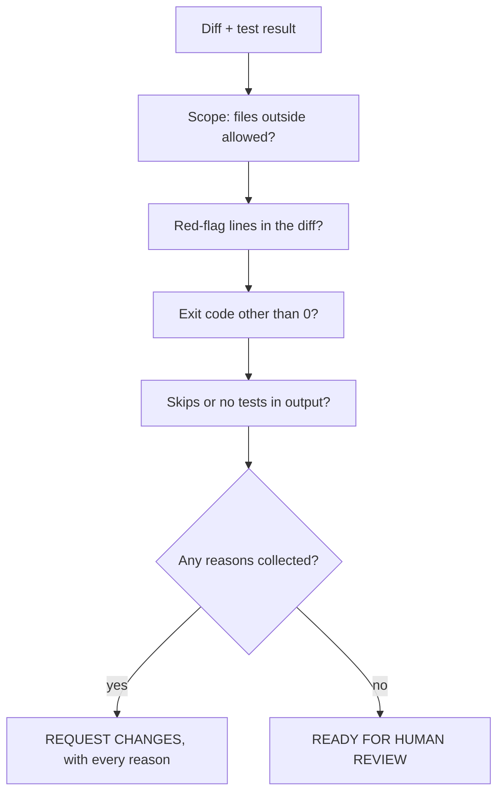

:::objectives
- Turn a unified diff into a list of added, modified, and deleted files, and compare it with the task's scope.
- Find weakened tests, skipped tests, and silenced failures, by eye and with code.
- Write tests that catch a fix that passes the obvious case and fails real inputs.
- Judge evidence reports, write a review comment an agent can act on, and combine the checks into a review gate.
:::

These exercises go from reading to tooling: first you practice spotting problems in diffs and reports, then you write the small scripts that spot them for you. All the diffs are short on purpose, so you can check your code's answers by eye.

## Warm-up

:::quiz
Q: In a diff, which line was in the old file *and* is still in the new one?
- [ ] `-        return total / n`
  A leading `-` means the line was removed.
- [x] `         return total / n` (leading space)
  A leading space marks a context line: unchanged, shown so you can see where the change sits.
- [ ] `+        return total / n`
  A leading `+` means the line is new.

Q: A diff contains `--- /dev/null` followed by `+++ b/helpers.py`. What happened to `helpers.py`?
- [x] It was created
  There was no old version (`/dev/null` is "nothing"), so the whole file is new.
- [ ] It was deleted
  A deleted file is the reverse: `+++ /dev/null`.
- [ ] It was renamed
  Renames appear as `rename from` and `rename to` lines in `git diff` output.
:::

### Exercise 1: Which files does this diff touch?

Write `files_in_diff(diff_text)` that returns a dictionary from each path to `"added"`, `"modified"`, or `"deleted"`, then mark the files outside the task's scope (`bills.py`, `test_bills.py`).

```text
modified  bills.py
added     bills_helpers.py  <- outside scope
deleted   old_bills.py  <- outside scope
```

:::hint
Each file has a `--- ` line followed by a `+++ ` line. Remember the old path from the first, then decide from the pair: old `/dev/null` means added, new `/dev/null` means deleted. Strip the `a/` and `b/` prefixes with `[2:]`.
:::

:::solution
```python run title="files_in_diff.py"
DIFF = """\
diff --git a/bills.py b/bills.py
--- a/bills.py
+++ b/bills.py
@@ -1,2 +1,4 @@
 def split_bill(total_cents, people):
-    share = total_cents // people
+    if people < 1:
+        raise ValueError("people must be at least 1")
+    share, extra = divmod(total_cents, people)
diff --git a/bills_helpers.py b/bills_helpers.py
--- /dev/null
+++ b/bills_helpers.py
@@ -0,0 +1,2 @@
+def cents(x):
+    return int(x * 100)
diff --git a/old_bills.py b/old_bills.py
--- a/old_bills.py
+++ /dev/null
@@ -1,2 +0,0 @@
-def split(total, n):
-    return total / n
"""


def files_in_diff(diff_text):
    """Return {path: 'modified' | 'added' | 'deleted'} for every file in a unified diff."""
    files, old = {}, None
    for line in diff_text.splitlines():
        if line.startswith("--- "):
            old = line[4:]
        elif line.startswith("+++ "):
            new = line[4:]
            if old == "/dev/null":
                files[new[2:]] = "added"
            elif new == "/dev/null":
                files[old[2:]] = "deleted"
            else:
                files[new[2:]] = "modified"
    return files


ALLOWED = {"bills.py", "test_bills.py"}
for path, status in files_in_diff(DIFF).items():
    note = "" if path in ALLOWED else "  <- outside scope"
    print(f"{status:<9} {path}{note}")
```

Both out-of-scope files deserve a question. The new helper has a float bug of its own (you'll meet it in Exercise 3), and the deleted file might still be imported somewhere, which a search for `old_bills` would tell you. Checking for lines that start with `--- ` and `+++ ` also works for diffs from tools other than Git.
:::

### Exercise 2: Spot the weakened test

The agent says it "made the checkout tests more robust." Here's the test-file part of its diff:

```diff
--- a/tests/test_checkout.py
+++ b/tests/test_checkout.py
@@ -12,7 +12,8 @@ class CheckoutTests(unittest.TestCase):
     def test_total_with_coupon(self):
         total = checkout(cart_with([1999, 500]), code="SAVE5")
-        self.assertEqual(total, 1999)
+        self.assertAlmostEqual(total, 1999, delta=50)
 
+    @unittest.skipIf(sys.platform == "win32", "rounding differs on Windows")
     def test_total_in_euros(self):
         total = checkout(cart_with([1000]), currency="EUR")
         self.assertEqual(total, 920)
```

What has this change done to the suite, and what would you ask the agent?

:::hint
What range of totals does `delta=50` accept? Is integer arithmetic on cents ever different between operating systems?
:::

:::solution
- **`assertAlmostEqual(..., delta=50)` accepts anything from 1949 to 2049.** A checkout total is money in whole cents; it's either right or wrong. The test went from "exactly 1999" to "within 50 cents of it", so a coupon applied twice, or not at all, could now pass. The likely story: the code started returning a slightly wrong number, and the test was loosened until it passed.
- **The skip hides a real bug behind a false reason.** Integer arithmetic doesn't differ by platform. If the euro total really varies on Windows, the code is probably using floats somewhere, which is a bug to fix, not a platform to skip.
- **Neither change is "more robust."** Both make the suite accept more wrong answers.

What to ask: *"What value does `checkout` return now for the coupon case, and why isn't it exactly 1999? Please restore the exact assertion and remove the skip; if a test fails, show me the failing output instead of changing the test."*
:::

### Exercise 3: Catch the float bug

Bug report: *"`to_cents("19.99")` crashes because the form sends strings."* The agent's fix converts with `float` first, and `to_cents("5")` returns 500, so it looks done. Write tests with realistic prices that fail on the agent's version and pass on a correct one. Sample output:

```text
agent's version:
    AssertionError: 1998 != 1999 : to_cents('19.99')
    AssertionError: 28 != 29 : to_cents('0.29')
    FAILED (failures=2)
exact version:
    OK
```

:::hint
`0.29` has no exact binary representation, so `0.29 * 100` is `28.999999999999996`, and `int()` cuts that down to 28. Test several prices with cents. For the correct version, `decimal.Decimal` parses the string `"19.99"` exactly.
:::

:::solution
```python run title="to_cents_tests.py"
import io
import unittest
from decimal import Decimal


def to_cents_agent(dollars):
    """Agent's fix for 'to_cents("19.99") crashes': convert to float first."""
    return int(float(dollars) * 100)


def to_cents_exact(dollars):
    """Decimal parses '19.99' exactly, so no cents are lost."""
    return int(Decimal(dollars) * 100)


def tests_for(to_cents):
    class ToCentsTests(unittest.TestCase):
        def test_prices_typed_into_a_form(self):
            for text, cents in [("19.99", 1999), ("0.29", 29), ("1.10", 110), ("5", 500)]:
                with self.subTest(text=text):
                    self.assertEqual(to_cents(text), cents, f"to_cents({text!r})")

    return unittest.defaultTestLoader.loadTestsFromTestCase(ToCentsTests)


def check(label, to_cents):
    result = unittest.TextTestRunner(stream=io.StringIO()).run(tests_for(to_cents))
    print(label)
    for _, trace in result.failures + result.errors:
        print("   ", trace.strip().splitlines()[-1])
    print("   ", "OK" if result.wasSuccessful() else f"FAILED (failures={len(result.failures)})")


check("agent's version:", to_cents_agent)
check("exact version:", to_cents_exact)
```

`tests_for` builds the same test class around either function, so one test suite can judge both versions side by side. The agent's version passes `"5"` and `"1.10"` (because `1.1 * 100` lands just *above* 110) and fails the two prices that land just below. That's the signature of a plausible-but-wrong fix: right on the inputs someone happened to try. Passing the third argument to `assertEqual` puts the input in the failure message, so you can see which price broke without opening a traceback.
:::

### Exercise 4: Judge the evidence

Five agents reported their test runs as dictionaries. Write `evidence_problems(report)` that lists every reason not to trust a report: missing output, a command other than the project's (`python -m unittest -v`), a nonzero exit code, `FAILED`, `NO TESTS RAN`, or `skipped=` in the output, and a run that happened before the last edit.

```text
report A: trustworthy
report B: exit code 1, not 0; output contains 'FAILED'
report C: ran 'python -m unittest test_bills.SplitBillTests.test_even_split', not the project's command
report D: output contains 'skipped='; tests ran before the last edit
report E: no test output included
```

:::hint
Collect problems in a list rather than returning at the first one; a reviewer wants all of them. Use `report.get(...)` so a missing key counts as a problem instead of raising `KeyError`.
:::

:::solution
```python run title="evidence_check.py"
TEST_COMMAND = "python -m unittest -v"


def evidence_problems(report):
    problems = []
    tail = report.get("output_tail", "")
    if not tail:
        problems.append("no test output included")
    if report.get("command") != TEST_COMMAND:
        problems.append(f"ran {report.get('command')!r}, not the project's command")
    if report.get("exit_code") != 0:
        problems.append(f"exit code {report.get('exit_code')}, not 0")
    for marker in ("FAILED", "NO TESTS RAN", "skipped="):
        if marker in tail:
            problems.append(f"output contains {marker!r}")
    if not report.get("ran_after_last_edit"):
        problems.append("tests ran before the last edit")
    return problems


REPORTS = {
    "A": {"command": "python -m unittest -v", "exit_code": 0,
          "output_tail": "Ran 9 tests in 0.004s\n\nOK", "ran_after_last_edit": True},
    "B": {"command": "python -m unittest -v", "exit_code": 1,
          "output_tail": "Ran 9 tests in 0.004s\n\nFAILED (failures=1)", "ran_after_last_edit": True},
    "C": {"command": "python -m unittest test_bills.SplitBillTests.test_even_split", "exit_code": 0,
          "output_tail": "Ran 1 test in 0.000s\n\nOK", "ran_after_last_edit": True},
    "D": {"command": "python -m unittest -v", "exit_code": 0,
          "output_tail": "Ran 9 tests in 0.003s\n\nOK (skipped=2)", "ran_after_last_edit": False},
    "E": {"command": "python -m unittest -v", "exit_code": 0, "ran_after_last_edit": True},
}
for name, report in REPORTS.items():
    problems = evidence_problems(report)
    print(f"report {name}:", "trustworthy" if not problems else "; ".join(problems))
```

Report C is the sneakiest: exit code 0 and `OK`, but it ran a single test chosen by the agent, probably the one it knew would pass. Report E claims success with nothing to show for it. Only A is evidence, and even A is evidence about *the tests that exist*, which is why you still read the diff.
:::

### Exercise 5: Flag risky lines automatically

Write `audit_diff(diff_text)` that reports each risky line with its line number in the diff. On **added** lines, look for bare or broad `except`, test skips, `|| true`, `# type: ignore`, and `# noqa`. On **removed** lines, look for removed assertions and removed test methods.

```text
diff line 8: broad except can hide real errors: +        except Exception:
diff line 13: a test was removed: -    def test_failed_upload_is_reported(self):
diff line 14: an assertion was removed: -        self.assertEqual(sync([BAD_ORDER]), ["order 7 failed"])
diff line 15: test skipped: +    @unittest.skip("flaky")
diff line 22: '|| true' makes a failing command succeed: +python -m unittest -v || true
```

:::hint
Use two dictionaries of `regex: reason`, one for `+` lines and one for `-` lines. Skip the `+++` and `---` header lines first, and match against `line[1:]` so the `+` or `-` doesn't interfere with patterns that start with `^\s*`.
:::

:::solution
```python run title="audit_diff.py"
import re

RISKY_ADDED = {
    r"^\s*except\s*:": "bare except catches everything, even Ctrl+C",
    r"^\s*except\s+Exception\b": "broad except can hide real errors",
    r"@(unittest\.)?skip": "test skipped",
    r"\|\|\s*true\b": "'|| true' makes a failing command succeed",
    r"#\s*type:\s*ignore": "type checker silenced",
    r"#\s*noqa": "linter silenced",
}
RISKY_REMOVED = {
    r"^\s*(self\.)?assert": "an assertion was removed",
    r"^\s*def test_": "a test was removed",
}


def audit_diff(diff_text):
    findings = []
    for number, line in enumerate(diff_text.splitlines(), start=1):
        if line.startswith(("+++", "---")):
            continue
        if line.startswith("+"):
            rules = RISKY_ADDED
        elif line.startswith("-"):
            rules = RISKY_REMOVED
        else:
            continue
        for pattern, why in rules.items():
            if re.search(pattern, line[1:]):
                findings.append(f"diff line {number}: {why}: {line.strip()}")
    return findings


DIFF = """\
--- a/sync.py
+++ b/sync.py
@@ -8,2 +8,5 @@ def sync(orders):
     for order in orders:
-        upload(order)
+        try:
+            upload(order)
+        except Exception:
+            pass
--- a/test_sync.py
+++ b/test_sync.py
@@ -3,4 +3,3 @@ class SyncTests(unittest.TestCase):
-    def test_failed_upload_is_reported(self):
-        self.assertEqual(sync([BAD_ORDER]), ["order 7 failed"])
+    @unittest.skip("flaky")
     def test_empty_list(self):
         self.assertEqual(sync([]), [])
--- a/ci.sh
+++ b/ci.sh
@@ -1 +1 @@
-python -m unittest -v
+python -m unittest -v || true
"""
for finding in audit_diff(DIFF):
    print(finding)
```

Read the findings as a story: uploads now fail silently, the test that would have noticed was deleted, another test was skipped, and CI was told to ignore failures. Each line alone might have an innocent explanation. Four in one diff is a pattern. An auditor like this produces false alarms too (a `# noqa` can be legitimate), so its job is to point your eyes, not to reject changes by itself.
:::

### Exercise 6: Write the review comment

You ran Exercise 5's auditor on an agent's diff and got those five findings. Write the review comment you'd send back to the agent (or a teammate). It should be specific enough to act on without a follow-up question.

:::hint
Good review comments name the file and line, say what's wrong and why it matters, and say what you want instead. Separate what must change from what you're merely curious about.
:::

:::solution
```text
Requesting changes. Must fix before I review again:

1. sync.py, `except Exception: pass` around upload(order): this hides every
   upload failure, including the one in the bug report. Let the error reach
   the caller, or record which order failed and return that list.
2. test_sync.py: test_failed_upload_is_reported was deleted. Restore it;
   it is the test this change must make pass.
3. test_sync.py, @unittest.skip("flaky"): remove the skip. If the test is
   flaky, show me two runs with different results and we'll fix the cause.
4. ci.sh, `|| true`: revert. CI must fail when tests fail.

When you resubmit, include the full output of `python -m unittest -v`
and its exit code, run after your last edit.
```

Notice what the comment *doesn't* do: guess at motives, or say "this is bad." Each item points at a line, states the consequence, and asks for one concrete change. Ending with the evidence you expect saves a round trip.
:::

### Challenge: A review gate

Combine the ideas into `review_gate(diff_text, allowed, exit_code, output_tail)`. It should request changes, listing every reason, if the diff touches files outside `allowed`, contains a red-flag line, the tests exited nonzero, or the output reports skips or no tests. Otherwise it should say the change is ready for **human** review. Test it on a clean diff and a bad one.



:::hint
Don't return early: walk through every check, appending reasons to one list, and decide at the end. For the scope check, collect the `+++ b/` paths into a set and subtract `allowed`.
:::

:::solution
```python run title="review_gate.py"
import re

RED_FLAGS = {
    "+": [(r"^\s*except(\s+Exception\b)?\s*:", "broad or bare except"),
          (r"@(unittest\.)?skip", "test skipped"),
          (r"\|\|\s*true\b", "'|| true' hides a failing command")],
    "-": [(r"^\s*(self\.)?assert", "assertion removed"),
          (r"^\s*def test_", "test removed")],
}


def changed_files(diff_text):
    return {line[6:] for line in diff_text.splitlines() if line.startswith("+++ b/")}


def red_flags(diff_text):
    found = []
    for line in diff_text.splitlines():
        if line[:1] in RED_FLAGS and not line.startswith(("+++", "---")):
            found += [why for pattern, why in RED_FLAGS[line[0]] if re.search(pattern, line[1:])]
    return found


def review_gate(diff_text, allowed, exit_code, output_tail):
    reasons = [f"{path} is outside the task's scope" for path in sorted(changed_files(diff_text) - allowed)]
    reasons += red_flags(diff_text)
    if exit_code != 0:
        reasons.append(f"tests exited with {exit_code}")
    if "skipped=" in output_tail or "NO TESTS RAN" in output_tail:
        reasons.append(f"test output says: {output_tail.splitlines()[-1]}")
    if reasons:
        print("REQUEST CHANGES")
        for reason in reasons:
            print("  -", reason)
    else:
        print("READY FOR HUMAN REVIEW (the gate found nothing; now read the diff)")


GOOD = """\
--- a/bills.py
+++ b/bills.py
@@ -1,2 +1,4 @@
 def split_bill(total_cents, people):
-    share = total_cents // people
+    if people < 1:
+        raise ValueError("people must be at least 1")
+    share, extra = divmod(total_cents, people)
--- a/test_bills.py
+++ b/test_bills.py
@@ -8,0 +9,3 @@
+    def test_zero_people(self):
+        with self.assertRaises(ValueError):
+            split_bill(1000, 0)
"""
BAD = """\
--- a/bills.py
+++ b/bills.py
@@ -1,2 +1,5 @@
 def split_bill(total_cents, people):
-    share = total_cents // people
+    try:
+        share = total_cents // people
+    except Exception:
+        return []
--- a/test_bills.py
+++ b/test_bills.py
@@ -5,2 +4,0 @@
-    def test_extra_cents_go_first(self):
-        self.assertEqual(split_bill(1003, 4), [251, 251, 251, 250])
--- a/README.md
+++ b/README.md
@@ -1 +1 @@
-# bills
+# bills (now with AI fixes!)
"""
ALLOWED = {"bills.py", "test_bills.py"}
review_gate(GOOD, ALLOWED, 0, "Ran 7 tests in 0.002s\n\nOK")
print()
review_gate(BAD, ALLOWED, 0, "Ran 5 tests in 0.002s\n\nOK (skipped=1)")
```

The bad diff's tests "pass" with exit code 0, and the gate still finds five reasons to send it back. That's the point of checking the diff and the evidence together: either one alone can look fine. The gate's best outcome is deliberately modest. It never says "approve," only "ready for human review," because it can't tell whether `divmod` is the right fix; it can only tell that nothing obviously wrong happened on the way.
:::
