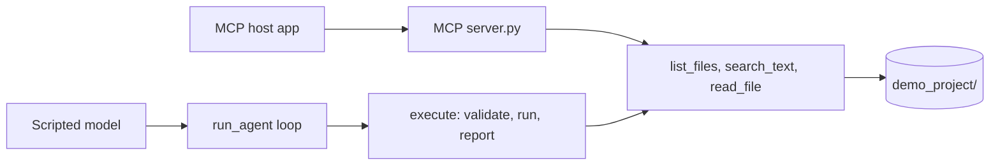

:::objectives
- Turn three Python functions into tool definitions with schemas, and run every call through one validating `execute()` function.
- Write a tool-calling loop that feeds results back to the model, recovers from bad calls, and stops at a turn limit.
- Package the same tools as an MCP server with the official Python SDK.
- Watch real stdio framing between a client and a server, then connect a server to Claude Desktop or VS Code.
:::

By the end of this lesson you'll have one set of tools reachable two ways. Your own harness will call them directly, with a fake model doing the asking. A real MCP host will call them through a server. The tools, schemas, and safety checks are the same in both.



The cells in this lesson share variables like a notebook, so run them in order. On your own machine, paste them into one file (`tool_agent.py`) as you go; the complete file is at the end.

## Step 1: Make a small project to explore

The agent needs something to look at. This cell writes a tiny inventory service with a few `TODO` comments, then resolves the project root once so every later path check compares like with like.

```python run title="tool_agent.py"
from pathlib import Path

ROOT = Path("demo_project").resolve()
files = {
    "README.md": "# Inventory service\nRun the tests with: python -m unittest\n",
    "src/inventory.py": (
        "def restock(stock, item, qty):\n"
        "    # TODO: reject negative quantities\n"
        "    stock[item] = stock.get(item, 0) + qty\n"
        "    return stock\n"
    ),
    "src/report.py": (
        "def summary(stock):\n"
        "    # TODO: sort items by name\n"
        "    return ', '.join(f'{k}={v}' for k, v in stock.items())\n"
    ),
    "tests/test_inventory.py": "import unittest\n",
}
for name, text in files.items():
    path = ROOT / name
    path.parent.mkdir(parents=True, exist_ok=True)
    path.write_text(text)

print(sorted(str(p.relative_to(ROOT)) for p in ROOT.rglob("*") if p.is_file()))
```

`Path(...).resolve()` matters more than it looks. On macOS, temporary folders live behind a symlink (`/var` points to `/private/var`), so an unresolved root and a resolved file path can disagree about whether one is inside the other.

## Step 2: Write the tools and their definitions

Each tool is a plain function plus a definition the model will see. The schema checks the *shape* of arguments. The function checks *location*, because a glob like `src/../../*` is a perfectly well-shaped string.

```python run title="tool_agent.py"
def inside_root(relative):
    """Resolve a project-relative path; refuse anything that lands outside ROOT."""
    target = (ROOT / relative).resolve()
    if not target.is_relative_to(ROOT):
        raise ValueError(f"{relative!r} is outside the project")
    return target


def list_files(glob):
    found = []
    for path in ROOT.glob(glob):
        if path.is_file() and path.resolve().is_relative_to(ROOT):
            found.append(str(path.resolve().relative_to(ROOT)))
    return sorted(found)


def search_text(pattern, glob, max_results=20):
    hits = []
    for name in list_files(glob):
        for number, line in enumerate((ROOT / name).read_text().splitlines(), start=1):
            if pattern in line:
                hits.append(f"{name}:{number}: {line.strip()}")
    return hits[:max_results]


def read_file(path, max_lines=100):
    lines = inside_root(path).read_text().splitlines()
    return "\n".join(lines[:max_lines])


GLOB = {
    "type": "string",
    "pattern": "^[A-Za-z0-9_*][A-Za-z0-9_*./-]*$",
    "maxLength": 100,
    "description": "Glob relative to the project root, e.g. src/*.py or **/*.md",
}
TOOLS = {
    "list_files": {
        "description": "List project files matching a glob. Read-only.",
        "input_schema": {
            "type": "object",
            "properties": {"glob": GLOB},
            "required": ["glob"],
            "additionalProperties": False,
        },
        "fn": list_files,
    },
    "search_text": {
        "description": "Find lines containing a plain-text pattern. Returns 'file:line: text' strings. Read-only.",
        "input_schema": {
            "type": "object",
            "properties": {
                "pattern": {"type": "string", "minLength": 1, "maxLength": 100},
                "glob": GLOB,
                "max_results": {"type": "integer", "minimum": 1, "maximum": 50},
            },
            "required": ["pattern", "glob"],
            "additionalProperties": False,
        },
        "fn": search_text,
    },
    "read_file": {
        "description": "Return the first max_lines lines of one project file. Read-only.",
        "input_schema": {
            "type": "object",
            "properties": {
                "path": {"type": "string", "maxLength": 200},
                "max_lines": {"type": "integer", "minimum": 1, "maximum": 400},
            },
            "required": ["path"],
            "additionalProperties": False,
        },
        "fn": read_file,
    },
}

print(search_text("TODO", "src/*.py"))
print(list_files("../*"))
```

The second line of output is the interesting one. `ROOT.glob("../*")` really does walk up into the parent folder (try it in a Python shell), and `list_files` throws those results away because their resolved paths aren't under `ROOT`. The glob pattern in the schema also has to start with a letter, digit, `_`, or `*`, which rules out absolute patterns like `/etc/*`.

## Step 3: Route every call through one `execute()`

The model will call tools by name with a JSON object. One function handles every call: look up the tool, validate, run, and package the outcome. It never raises, so a bad call can't crash the agent.

```python run title="tool_agent.py"
from jsonschema import Draft202012Validator

VALIDATORS = {name: Draft202012Validator(tool["input_schema"]) for name, tool in TOOLS.items()}


def execute(call):
    """Run one tool call. Always returns a result dict; never raises."""
    name, args = call["name"], call["arguments"]
    if name not in TOOLS:
        content = f"Unknown tool {name!r}. Available tools: {', '.join(TOOLS)}."
        return {"call_id": call["id"], "is_error": True, "content": content}
    problems = [f"{e.json_path}: {e.message}" for e in VALIDATORS[name].iter_errors(args)]
    if problems:
        content = "Invalid arguments. " + " ".join(problems)
        return {"call_id": call["id"], "is_error": True, "content": content}
    try:
        output = TOOLS[name]["fn"](**args)
    except (ValueError, OSError) as exc:
        return {"call_id": call["id"], "is_error": True, "content": f"{name} failed: {exc}"}
    return {"call_id": call["id"], "is_error": False, "content": output}


tests = [
    {"id": "c1", "name": "search_text", "arguments": {"pattern": "TODO", "glob": "**/*.py", "max_results": 5}},
    {"id": "c2", "name": "search_text", "arguments": {"pattern": "TODO", "glob": "**/*.py", "max_results": "all"}},
    {"id": "c3", "name": "read_file", "arguments": {"path": "../../etc/passwd"}},
    {"id": "c4", "name": "run_shell", "arguments": {"command": "ls"}},
]
for call in tests:
    print(execute(call))
```

Four calls, four different outcomes. `c1` works. `c2` fails validation and says exactly which field and why. `c3` passes the schema (it's a short string) but `inside_root` catches the escape at run time. `c4` names a tool that doesn't exist, and the error lists the real ones so the model can recover. Catching only `ValueError` and `OSError` is deliberate: a genuine bug in a tool, like a `TypeError`, should still crash loudly while you're developing.

## Step 4: A scripted model and the loop

`ScriptedModel` plays the model's part. Each turn it returns the next pre-written reply, either `{"type": "text", ...}` or a tool call. A real adapter would send `messages` and `tools` to a provider and translate its reply into the same two shapes, which is the only code you'd change.

```python run title="tool_agent.py"
class ScriptedModel:
    """Stands in for a real model: returns pre-written replies, one per turn."""

    def __init__(self, replies):
        self.replies = list(replies)

    def respond(self, messages, tools):
        if not self.replies:
            return {"type": "text", "text": "(the script ran out of replies)"}
        return self.replies.pop(0)


def short(value, width=72):
    text = repr(value)
    return text if len(text) <= width else text[: width - 3] + "..."


def run_agent(task, model, max_turns=6):
    tool_list = [
        {"name": name, "description": t["description"], "input_schema": t["input_schema"]}
        for name, t in TOOLS.items()
    ]
    messages = [{"role": "user", "content": task}]
    for turn in range(1, max_turns + 1):
        reply = model.respond(messages, tool_list)
        messages.append({"role": "assistant", "content": reply})
        if reply["type"] == "text":
            print(f"[{turn}] answer: {reply['text']}")
            return messages
        result = execute(reply)
        status = "ERROR" if result["is_error"] else "ok"
        print(f"[{turn}] {reply['name']}{short(reply['arguments'], 75)} -> {status} {short(result['content'], 60)}")
        messages.append({"role": "tool", "content": result})
    print(f"[stop] reached max_turns={max_turns} without an answer")
    return messages
```

The loop appends *both* sides of every exchange: the model's reply and the tool result. Real APIs require that pairing, and they match each result to its call by id.

## Step 5: Run it, including a mistake and a runaway

Here the script imitates a realistic session: the first call has a bad argument, the model reads the error and fixes it, opens a file, and answers.

```python run title="tool_agent.py"
script = [
    {"type": "tool_call", "id": "t1", "name": "search_text",
     "arguments": {"pattern": "TODO", "glob": "src/*.py", "max_results": "all"}},
    {"type": "tool_call", "id": "t2", "name": "search_text",
     "arguments": {"pattern": "TODO", "glob": "src/*.py", "max_results": 10}},
    {"type": "tool_call", "id": "t3", "name": "read_file",
     "arguments": {"path": "src/inventory.py", "max_lines": 4}},
    {"type": "text", "text": "2 TODOs in src/. inventory.py line 2 asks to reject negative quantities; "
                             "report.py line 2 asks to sort items by name."},
]
history = run_agent("List the TODOs in src/ and explain the first one.", ScriptedModel(script))
print(len(history), "messages in the transcript")
```

Now a model that never stops asking for the same thing. Without the cap, this would loop as long as the script lasted (a real model could go on far longer, and every turn costs money).

```python run title="tool_agent.py"
stuck = [{"type": "tool_call", "id": f"s{i}", "name": "list_files", "arguments": {"glob": "*.md"}}
         for i in range(10)]
run_agent("Find the docs.", ScriptedModel(stuck), max_turns=3)
```

:::try
Change `"max_results": 10` in `t2` to `"max_results": 999` and run the cell again. Which rule fires, and what would a real model need to read in the error to fix it on the next turn?
:::

## Step 6: Serve the same tools over MCP

Your loop talks to your tools directly. To let *any* MCP host use them, wrap them in a server. With the official Python SDK, the function signature becomes the schema: type hints give types, `Field(...)` adds the constraints, the docstring becomes the description, and the SDK rejects bad arguments before your code runs.

This code uses version 2 of the SDK (the current stable line), and it can't run on this page. Install the SDK into your course environment first with `python -m pip install "mcp[cli]"`; without it, the first `mcp` import fails with an error.

```python title="server.py"
from pathlib import Path
from typing import Annotated

from pydantic import Field

from mcp.server import MCPServer
from mcp.server.mcpserver.exceptions import ToolError
from mcp.types import ToolAnnotations

ROOT = (Path(__file__).parent / "demo_project").resolve()
READ_ONLY = ToolAnnotations(read_only_hint=True, open_world_hint=False)
Glob = Annotated[
    str,
    Field(pattern=r"^[A-Za-z0-9_*][A-Za-z0-9_*./-]*$", max_length=100,
          description="Glob relative to the project root, e.g. src/*.py"),
]

mcp = MCPServer("Project explorer")


def inside_root(relative: str) -> Path:
    target = (ROOT / relative).resolve()
    if not target.is_relative_to(ROOT):
        raise ToolError(f"{relative!r} is outside the project")
    return target


@mcp.tool(annotations=READ_ONLY)
def list_files(glob: Glob) -> list[str]:
    """List project files matching a glob. Read-only."""
    return sorted(
        str(p.resolve().relative_to(ROOT))
        for p in ROOT.glob(glob)
        if p.is_file() and p.resolve().is_relative_to(ROOT)
    )


@mcp.tool(annotations=READ_ONLY)
def search_text(
    pattern: Annotated[str, Field(min_length=1, max_length=100)],
    glob: Glob,
    max_results: Annotated[int, Field(ge=1, le=50)] = 20,
) -> list[str]:
    """Find lines containing a plain-text pattern. Returns 'file:line: text' strings."""
    hits = []
    for name in list_files(glob):
        for number, line in enumerate((ROOT / name).read_text().splitlines(), start=1):
            if pattern in line:
                hits.append(f"{name}:{number}: {line.strip()}")
    return hits[:max_results]


@mcp.tool(annotations=READ_ONLY)
def read_file(
    path: Annotated[str, Field(max_length=200)],
    max_lines: Annotated[int, Field(ge=1, le=400)] = 100,
) -> str:
    """Return the first max_lines lines of one project file."""
    return "\n".join(inside_root(path).read_text().splitlines()[:max_lines])


if __name__ == "__main__":
    mcp.run()  # no arguments means the stdio transport
```

Three things to notice. Raising `ToolError` sends the message back as a result with `isError: true`, the same contract as your `execute()`; returning an error string instead would look like success. `ToolAnnotations` are *hints* for the host (this tool doesn't change anything, and it only touches a closed set of files); hosts may use them to skip a confirmation, so never mark a tool read-only when it isn't. And `mcp.run()` sits under the `__main__` guard because tools like `mcp dev` import your file and start the server themselves.

:::warning
Most MCP tutorials from before mid-2026, including the video below, use SDK version 1, which spelled the import `from mcp.server.fastmcp import FastMCP` and created the server with `FastMCP("Demo")`. On version 2 that import raises `ModuleNotFoundError: No module named 'mcp.server.fastmcp'`. Swap in `from mcp.server import MCPServer` and `MCPServer("Demo")`; the `@mcp.tool()` decorators work the same way. If you need to stay on version 1, pin it with `pip install "mcp[cli]<2"`.
:::

:::video jLM6n4mdRuA
What to watch for: how a decorated Python function becomes a tool, and the moment the presenter edits Claude Desktop's config so the app launches the server. Notice which parts of the server are type hints and docstrings, since those become the schema the model sees.
:::

## Step 7: Watch the bytes on the stdio wire

The SDK hides the protocol, which is the point of an SDK. Seeing it once makes debugging far easier, so this cell writes a deliberately tiny *toy* server that speaks MCP's stdio framing (one JSON-RPC message per line) and drives it the way a host would. It's not a complete MCP server: it skips `server/discover`, version checks, and input validation.

```python run title="tool_agent.py"
import json
import subprocess
import sys
import textwrap

Path("toy_server.py").write_text(textwrap.dedent('''
    import json, sys

    TOOLS = [{"name": "count_todos", "description": "Count TODO markers in a piece of text.",
              "inputSchema": {"type": "object", "properties": {"text": {"type": "string"}},
                              "required": ["text"], "additionalProperties": False}}]

    for line in sys.stdin:                      # one JSON-RPC message per line
        request = json.loads(line)
        method, params = request["method"], request.get("params", {})
        if method == "tools/list":
            reply = {"result": {"resultType": "complete", "tools": TOOLS}}
        elif method == "tools/call" and params.get("name") == "count_todos":
            count = params["arguments"]["text"].count("TODO")
            reply = {"result": {"resultType": "complete", "isError": False,
                                "content": [{"type": "text", "text": f"{count} TODOs"}]}}
        else:
            reply = {"error": {"code": -32602, "message": f"Unknown tool: {params.get('name')}"}}
        print(json.dumps({"jsonrpc": "2.0", "id": request["id"], **reply}), flush=True)
        print("handled", method, file=sys.stderr)   # logs go to stderr, never stdout
'''))

META = {"io.modelcontextprotocol/protocolVersion": "2026-07-28",
        "io.modelcontextprotocol/clientCapabilities": {}}
requests = [
    {"jsonrpc": "2.0", "id": 1, "method": "tools/list", "params": {"_meta": META}},
    {"jsonrpc": "2.0", "id": 2, "method": "tools/call",
     "params": {"name": "count_todos", "arguments": {"text": "TODO a\nfine\nTODO b"}, "_meta": META}},
    {"jsonrpc": "2.0", "id": 3, "method": "tools/call",
     "params": {"name": "delete_repo", "arguments": {}, "_meta": META}},
]
wire = "".join(json.dumps(r) + "\n" for r in requests)

# Closing stdin when input runs out is how a stdio client asks the server to exit.
proc = subprocess.run([sys.executable, "toy_server.py"], input=wire,
                      capture_output=True, text=True, timeout=10)
for line in proc.stdout.splitlines():
    print("server ->", line[:140] + ("..." if len(line) > 140 else ""))
print("stderr  :", proc.stderr.splitlines())
```

Every reply carries the `id` of the request it answers, which is how a client matches responses when several requests are in flight. The unknown tool gets a JSON-RPC *protocol* error (code `-32602`), not a result, because there's no tool to report a result from. And the log lines arrived on stderr, where they can't corrupt the stream.

## Step 8: Connect the real server to a host

Put `server.py` next to a copy of `demo_project/`, then check it in three stages.

First, run it yourself. A stdio server prints nothing and waits for a host to speak, so silence is success; press **Ctrl+C** to stop. Then open it in the MCP Inspector, a browser tool that acts like a host (it needs Node.js, because it runs through `npx`):

```bash
python server.py
mcp dev server.py
```

In the Inspector's **Tools** tab you should see your three tools, each with a form built from its schema. Call `read_file` with `../../etc/passwd` and confirm you get an error result.

**Claude Desktop.** Open the **Claude** menu in your system's menu bar, choose **Settings…**, then **Developer**, then **Edit Config**. That opens `claude_desktop_config.json` (in `~/Library/Application Support/Claude/` on macOS, `%APPDATA%\Claude\` on Windows). Add an entry whose command starts your server, using absolute paths, because the app launches it from its own working directory:

```json
{
  "mcpServers": {
    "project-explorer": {
      "command": "/Users/you/agent-course/.venv/bin/python",
      "args": ["/Users/you/agent-course/mcp_demo/server.py"]
    }
  }
}
```

On Windows the command looks like `C:\\Users\\you\\agent-course\\.venv\\Scripts\\python.exe` (JSON needs the doubled backslashes). Fully quit Claude Desktop, not just its window, and reopen it. The server then appears under **Connectors** in the menu next to the message box. Alternatively, `mcp install server.py` writes the entry for you using `uv`.

**VS Code.** Run **MCP: Add Server** from the Command Palette, choose a command (stdio) server, and give it the same command and arguments. Recent versions store it in an `mcpServers` entry like the one above with `"type": "stdio"` added, while older setups used `.vscode/mcp.json` with a top-level `servers` key. VS Code's MCP configuration reference says which file your version reads. Approve the trust prompt only after checking the command, then ask Copilot Chat in agent mode to list the TODOs in the project.

```text
Expected in the host:
  project-explorer  connected
  tools: list_files, read_file, search_text
Asking "what TODOs are in src/?" triggers search_text, and the host shows the
arguments and asks before running it (unless you've allowed it already).
```

If the server doesn't show up, the cause is almost always one of three things: a relative path in the config, a host still running its old config (restart it fully), or something printing to stdout. Claude Desktop writes each server's stderr to `mcp-server-<name>.log` in `~/Library/Logs/Claude` (macOS) or `%APPDATA%\Claude\logs` (Windows).

## The finished harness

Steps 1 through 5 as one file you can run and extend in the next modules:

```python title="tool_agent.py"
from pathlib import Path

from jsonschema import Draft202012Validator

ROOT = Path("demo_project").resolve()
for name, text in {
    "README.md": "# Inventory service\n",
    "src/inventory.py": "def restock(stock, item, qty):\n    # TODO: reject negative quantities\n    return stock\n",
    "src/report.py": "def summary(stock):\n    # TODO: sort items by name\n    return str(stock)\n",
}.items():
    (ROOT / name).parent.mkdir(parents=True, exist_ok=True)
    (ROOT / name).write_text(text)


def inside_root(relative):
    target = (ROOT / relative).resolve()
    if not target.is_relative_to(ROOT):
        raise ValueError(f"{relative!r} is outside the project")
    return target


def list_files(glob):
    return sorted(str(p.resolve().relative_to(ROOT)) for p in ROOT.glob(glob)
                  if p.is_file() and p.resolve().is_relative_to(ROOT))


def search_text(pattern, glob, max_results=20):
    hits = [f"{name}:{n}: {line.strip()}"
            for name in list_files(glob)
            for n, line in enumerate((ROOT / name).read_text().splitlines(), start=1)
            if pattern in line]
    return hits[:max_results]


def read_file(path, max_lines=100):
    return "\n".join(inside_root(path).read_text().splitlines()[:max_lines])


GLOB = {"type": "string", "pattern": "^[A-Za-z0-9_*][A-Za-z0-9_*./-]*$", "maxLength": 100}


def schema(properties, required):
    return {"type": "object", "properties": properties, "required": required,
            "additionalProperties": False}


TOOLS = {
    "list_files": {"description": "List project files matching a glob. Read-only.",
                   "input_schema": schema({"glob": GLOB}, ["glob"]), "fn": list_files},
    "search_text": {"description": "Find lines containing a plain-text pattern. Read-only.",
                    "input_schema": schema({"pattern": {"type": "string", "minLength": 1, "maxLength": 100},
                                            "glob": GLOB,
                                            "max_results": {"type": "integer", "minimum": 1, "maximum": 50}},
                                           ["pattern", "glob"]),
                    "fn": search_text},
    "read_file": {"description": "Return the first max_lines lines of one project file. Read-only.",
                  "input_schema": schema({"path": {"type": "string", "maxLength": 200},
                                          "max_lines": {"type": "integer", "minimum": 1, "maximum": 400}},
                                         ["path"]),
                  "fn": read_file},
}
VALIDATORS = {name: Draft202012Validator(t["input_schema"]) for name, t in TOOLS.items()}


def execute(call):
    name, args = call["name"], call["arguments"]
    if name not in TOOLS:
        return {"call_id": call["id"], "is_error": True, "content": f"Unknown tool {name!r}."}
    problems = [f"{e.json_path}: {e.message}" for e in VALIDATORS[name].iter_errors(args)]
    if problems:
        return {"call_id": call["id"], "is_error": True, "content": "Invalid arguments. " + " ".join(problems)}
    try:
        return {"call_id": call["id"], "is_error": False, "content": TOOLS[name]["fn"](**args)}
    except (ValueError, OSError) as exc:
        return {"call_id": call["id"], "is_error": True, "content": f"{name} failed: {exc}"}


class ScriptedModel:
    def __init__(self, replies):
        self.replies = list(replies)

    def respond(self, messages, tools):
        return self.replies.pop(0) if self.replies else {"type": "text", "text": "(script ended)"}


def run_agent(task, model, max_turns=6):
    tools = [{"name": n, "description": t["description"], "input_schema": t["input_schema"]}
             for n, t in TOOLS.items()]
    messages = [{"role": "user", "content": task}]
    for turn in range(1, max_turns + 1):
        reply = model.respond(messages, tools)
        messages.append({"role": "assistant", "content": reply})
        if reply["type"] == "text":
            print(f"[{turn}] answer: {reply['text']}")
            return messages
        result = execute(reply)
        print(f"[{turn}] {reply['name']} -> {'ERROR' if result['is_error'] else 'ok'}: {result['content']}")
        messages.append({"role": "tool", "content": result})
    print(f"[stop] reached max_turns={max_turns}")
    return messages


if __name__ == "__main__":
    run_agent("List the TODOs in src/.", ScriptedModel([
        {"type": "tool_call", "id": "t1", "name": "search_text",
         "arguments": {"pattern": "TODO", "glob": "src/*.py"}},
        {"type": "text", "text": "There are 2 TODOs in src/."},
    ]))
```

:::quiz
Q: Why does `execute()` return an error result for invalid arguments instead of raising an exception?
- [ ] Exceptions are slower than dictionaries
  Speed isn't the concern here; one exception per bad call costs nothing noticeable.
- [x] The model can read the error on its next turn and fix the call
  A result keeps the conversation going. An exception would end the run and teach the model nothing.
- [ ] JSON Schema can't produce exceptions
  `jsonschema.validate()` raises `ValidationError`; we chose `iter_errors()` so we could collect every problem.

Q: `read_file("../../etc/passwd")` passes the schema. Which part of the build stops it?
- [ ] The `maxLength` of 200
  The path is only 16 characters long.
- [ ] `additionalProperties: false`
  That rule rejects unknown fields; `path` is a known field.
- [x] `inside_root`, which resolves the path and checks it's still under `ROOT`
  Containment depends on the filesystem, so it's checked in code at the moment the tool runs.

Q: In the MCP server, what happens if `read_file` *returns* `"Error: path not found"` instead of raising `ToolError`?
- [x] The host sees a successful result whose text happens to say "Error"
  Without `isError: true`, clients and models have no reliable signal that the call failed.
- [ ] The SDK detects the word "Error" and sets `isError` for you
  The SDK doesn't inspect return values for words; raising is the signal.
- [ ] The host disconnects from the server
  Nothing in the protocol failed, so the connection stays up.
:::

:::takeaways
- One `execute()` that looks up, validates, runs, and packages every call gives you a single place to enforce rules later.
- Schemas check shape; code checks location and anything else that depends on the real world.
- The loop must append both the model's call and the tool's result, and stop at a turn cap you control.
- With the Python SDK, type hints plus `Field` constraints become the MCP `inputSchema`; raise `ToolError` for errors the model should see.
- On stdio, the host launches your command and owns stdin and stdout, so use absolute paths and keep logs on stderr.
:::

## Ideas to extend it

- Add a `max_bytes` limit to `read_file` so one call can't pull a 50 MB log into the context.
- Detect repeated identical calls in `run_agent` and stop after the third, with a reason the transcript records.
- Add an MCP **resource** to the server, for example `project://readme` returning the README, and see where the Inspector lists it.
- Write a second adapter class with the same `respond(messages, tools)` method that talks to a local model server you trust, and keep `ScriptedModel` for tests.

## Further reading

- [Connect to a real host](https://py.sdk.modelcontextprotocol.io/get-started/real-host/): the Python SDK's guide to Claude Desktop, Claude Code, Cursor, and VS Code configs, with the common failure modes.
- [Tools in the Python SDK](https://py.sdk.modelcontextprotocol.io/servers/tools/): how type hints, `Field`, and annotations turn into the schema clients see.
- [MCP Inspector](https://modelcontextprotocol.io/docs/tools/inspector): the official tool for testing a server without a full host.
