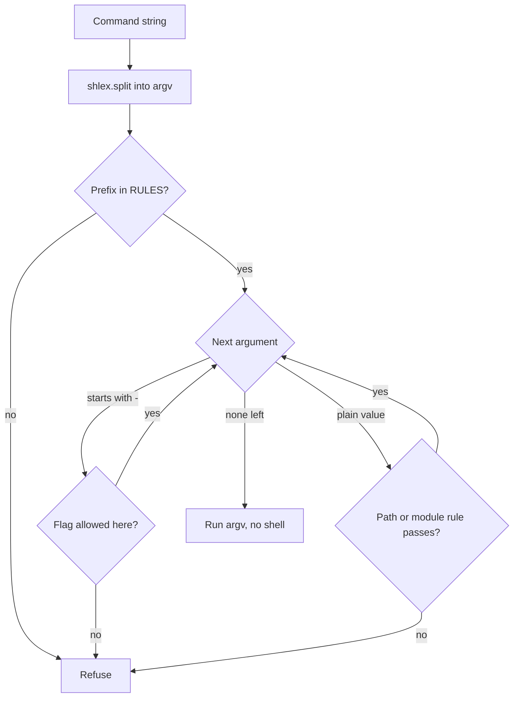

:::objectives
- Choose allow, ask, or deny for each tool a task might use, and justify each choice.
- Find inputs that slip past a weak path guard, then write one that holds.
- Write command rules that check subcommands and flags, not just the program name.
- Make approvals single-use and bound to one exact call, and keep inherited secrets out of child processes.
:::

Every exercise here starts from a guard that *looks* fine. Your job is to attack it first and fix it second, because a permission check you haven't tried to break is a guess. Run the attacks for real: several of these bugs pass every "normal" input and only fail on the one an attacker (or a confused model) would send.

## Warm-up: what does joining do?

Before stepping through, write down the three strings you expect in `joined`. Pay attention to the second and third.

:::trace Predict each joined path, then check
```python
from pathlib import PurePosixPath

root = PurePosixPath("/work/repo")
requests = ["docs/a.md", "/etc/passwd", "docs/../../secrets"]
joined = [str(root / r) for r in requests]
print(joined)
```
:::

The second request replaced the root entirely, because it's absolute. The third kept its `..` parts: `PurePosixPath` never touches the disk, so it can't resolve anything. A check that only looks at whether the string starts with `/work/repo` would wave the third one through.

### Exercise 1: Who gets what for a bug fix?

The task is "make the failing test in `tests/test_stats.py` pass by fixing `src/stats.py`." For each tool, choose **allow**, **ask**, or **deny**, and write one sentence of reasoning: `read_file`, `search_code`, `edit_file` (limited to `src/` and `tests/`), `run_tests`, `install_package`, `git_commit` (on the task branch), `git_push`, `open_pull_request`, `http_get` (any URL).

:::hint
For each tool, ask two questions. Does this task plausibly need it? If it goes wrong, can Git undo it on your machine, or does it touch something outside?
:::

:::solution
| Tool | Decision | Why |
|---|---|---|
| `read_file` | allow | Reading inside the sandbox is how the agent understands the bug. |
| `search_code` | allow | Same tier as reading; no side effects. |
| `edit_file` (`src/`, `tests/`) | allow | Local, scoped, and reversible with `git restore`. Review happens on the diff. |
| `run_tests` | allow | The task can't be verified without it. Run it as a named command with a scrubbed environment. |
| `install_package` | ask | Sometimes needed, but it runs third-party code and changes the dependency list. A person should see the exact package and version. |
| `git_commit` | allow | Local to the task branch and easy to undo. |
| `git_push` | ask | Leaves your machine and is visible to others. |
| `open_pull_request` | ask | External and public; a person should read the summary first. |
| `http_get` (any URL) | deny | A bug fix inside a repo doesn't need the open web, and an unrestricted fetch is both an injection source and a way to send data out. |

Reasonable people differ on `install_package` (some teams deny it and add dependencies themselves) and on `git_commit`. What matters is that every choice has a reason tied to *this* task.
:::

### Exercise 2: Break this guard, then fix it

This guard normalizes the path before checking it, so `..` tricks seem handled:

```python
def is_safe_buggy(root, user_path):
    full = os.path.normpath(os.path.join(root, user_path))
    return full.startswith(str(root))
```

Find **two** different inputs that return `True` but point outside `root`. Hint: one involves a neighboring folder, and one involves something already inside the repo. Then write `is_safe` that refuses both.

:::hint
`normpath` works on text alone. It never looks at the disk, so it can't know that `docs/old` is a symlink. And `startswith` compares characters, not folder names: what other folders start with the characters `repo`?
:::

:::solution
```python run title="break_the_guard.py"
import os
import tempfile
from pathlib import Path

base = Path(tempfile.mkdtemp()).resolve()
root = base / "repo"
(root / "docs").mkdir(parents=True)
(root / "docs" / "guide.md").write_text("ok\n")
(base / "repo-backup").mkdir()
(base / "repo-backup" / "prod.env").write_text("TOKEN=fake\n")
os.symlink(base / "repo-backup", root / "docs" / "old")  # a link inside the repo that leads out


def is_safe_buggy(root, user_path):
    full = os.path.normpath(os.path.join(root, user_path))
    return full.startswith(str(root))


def is_safe(root, user_path):
    root = Path(root).resolve()
    return (root / user_path).resolve().is_relative_to(root)


for attempt in ["docs/guide.md", "../repo-backup/prod.env", "docs/old/prod.env",
                "/etc/passwd", "docs/../../repo/docs/guide.md"]:
    print(f"{attempt:32} buggy={is_safe_buggy(root, attempt)!s:5}  fixed={is_safe(root, attempt)}")
```

`../repo-backup/prod.env` normalizes to `/…/repo-backup/prod.env`, which starts with the characters of `/…/repo`. `docs/old/prod.env` looks like it's inside the repo, and as text it is, but the folder is a symlink to the backup. `resolve()` follows the link and collapses `..`, and `is_relative_to` compares whole folder names, so both escapes fail. The last attempt is a trick in the other direction: it wanders out and back in, and both versions correctly allow it.
:::

### Exercise 3: Secrets inside the sandbox

Containment isn't enough when the secrets live *in* the repo. Write `is_secret_path(rel)` that blocks `.env` files at any depth (but allows `.env.example`, which is documentation), `*.pem` and `*.key` files, anything matching `id_rsa`, anything in `.git/`, and any folder named `secrets`. It must not block innocent names that merely contain those letters.

```text
.env                     BLOCK
.env.local               BLOCK
.env.example             ok
services/api/.env        BLOCK
docs/env.md              ok
certs/server.pem         BLOCK
.git/config              BLOCK
config/secrets/db.yaml   BLOCK
src/keyboard.py          ok
home/.ssh/id_rsa.pub     BLOCK
```

:::hint
Use `fnmatchcase` patterns on the project-relative path. Since `*` matches `/` in `fnmatch`, `*/.env` catches a `.env` in any subfolder. Check a short list of exceptions before the block list.
:::

:::solution
```python run title="secret_paths.py"
from fnmatch import fnmatchcase

ALLOW_ANYWAY = [".env.example", "*/.env.example"]
SECRET = [".env", ".env.*", "*/.env", "*/.env.*", "*.pem", "*.key", "*id_rsa*",
          ".git/*", "secrets/*", "*/secrets/*"]


def is_secret_path(rel):
    if any(fnmatchcase(rel, pattern) for pattern in ALLOW_ANYWAY):
        return False
    return any(fnmatchcase(rel, pattern) for pattern in SECRET)


for rel in [".env", ".env.local", ".env.example", "services/api/.env", "docs/env.md",
            "certs/server.pem", ".git/config", "config/secrets/db.yaml",
            "src/keyboard.py", "home/.ssh/id_rsa.pub"]:
    print(f"{rel:24} {'BLOCK' if is_secret_path(rel) else 'ok'}")
```

`*.key` doesn't catch `src/keyboard.py` because the pattern needs the name to *end* in `.key`. Keep the exceptions list tiny and specific: every entry is a hole you've chosen to open. Even with this check, assume a secret that's in the repo will eventually leak somewhere, and keep real credentials out of working copies entirely.
:::

### Exercise 4: Check flags, not just programs

Write `check_command(command)` that allows only these, with only the listed flags:

- `git status` with optional `--short`
- `git diff` with optional `--stat`, `--name-only`, `--cached`, and file paths that stay in the project
- `git log` with optional `--oneline` and `-n N` where N is at most 20
- `python3 -m unittest` with optional `-v` and dotted module names

Each of the last six commands below must be refused, with a reason:

```text
git status --short                         ok
git diff --stat docs/setup.md              ok
git log -n 5 --oneline                     ok
python3 -m unittest -v tests.test_stats    ok
git -c core.fsmonitor=./evil.sh status     refused: not an allowed command
git diff --output=/tmp/stolen.txt          refused: flag '--output=/tmp/stolen.txt' is not allowed
git log -n 500                             refused: -n must be followed by a number up to 20
git status; rm -rf .                       refused: not an allowed command
git diff ../other-repo/secrets.txt         refused: path '../other-repo/secrets.txt' leaves the project
python3 -m unittest tests/../../x          refused: 'tests/../../x' is not a module name
```

Two of those are worth knowing about beyond this exercise. Git's `-c` option sets any config value for one command, and settings such as `core.fsmonitor` name a program for Git to run. And `git diff --output=<file>` writes the diff to a file of your choosing. Both look harmless next to a prefix like `git status`.

:::hint
Parse with `shlex.split`. Match the command prefix first, then walk the remaining arguments one at a time. Anything starting with `-` must be on that subcommand's flag list; `-n` consumes the next argument too. Everything else is a path or module name, checked by its own rule.
:::

:::solution
```python run title="command_rules.py"
import shlex

RULES = {
    ("git", "status"): {"flags": {"--short"}, "paths": False},
    ("git", "diff"): {"flags": {"--stat", "--name-only", "--cached"}, "paths": True},
    ("git", "log"): {"flags": {"--oneline"}, "paths": False, "max_count": 20},
    ("python3", "-m", "unittest"): {"flags": {"-v"}, "paths": False, "modules": True},
}


def check_command(command):
    try:
        argv = shlex.split(command)
    except ValueError as exc:
        return f"refused: cannot parse ({exc})"
    for prefix, rule in RULES.items():
        if tuple(argv[: len(prefix)]) == prefix:
            break
    else:
        return "refused: not an allowed command"
    rest = argv[len(prefix):]
    i = 0
    while i < len(rest):
        arg = rest[i]
        if arg == "-n" and "max_count" in rule:
            if i + 1 >= len(rest) or not rest[i + 1].isdigit() or int(rest[i + 1]) > rule["max_count"]:
                return f"refused: -n must be followed by a number up to {rule['max_count']}"
            i += 2
            continue
        if arg.startswith("-"):
            if arg not in rule["flags"]:
                return f"refused: flag {arg!r} is not allowed"
        elif rule.get("modules"):
            if not all(part.isidentifier() for part in arg.split(".")):
                return f"refused: {arg!r} is not a module name"
        elif rule["paths"]:
            if arg.startswith("/") or ".." in arg.split("/"):
                return f"refused: path {arg!r} leaves the project"
        else:
            return f"refused: unexpected argument {arg!r}"
        i += 1
    return "ok"


for command in [
    "git status --short",
    "git diff --stat docs/setup.md",
    "git log -n 5 --oneline",
    "python3 -m unittest -v tests.test_stats",
    "git -c core.fsmonitor=./evil.sh status",
    "git diff --output=/tmp/stolen.txt",
    "git log -n 500",
    "git status; rm -rf .",
    "git diff ../other-repo/secrets.txt",
    "python3 -m unittest tests/../../x",
]:
    print(f"{command:42} {check_command(command)}")
```

`git status; rm -rf .` fails at the very first check: `shlex.split` produces `['git', 'status;', 'rm', '-rf', '.']`, and `status;` isn't `status`. Because the harness later runs this argument list *without* a shell, the `;` would never have separated two commands anyway. The `while` loop (instead of `for`) is there so `-n` can consume its number.
:::



### Exercise 5: Approvals that can't be reused

Write an `ApprovalBook` with `grant(call, uses=1)` and `consume(call)`. An approval must cover exactly one call (same tool, same arguments) and work only once. Two calls whose arguments differ only in key order are the same call.

```text
same call, keys reordered  -> run
same call again            -> needs a new approval
same tool, new branch      -> needs a new approval
```

:::hint
Fingerprint each call with `hashlib.sha256` over `json.dumps(call, sort_keys=True)`. Store a count of remaining uses per fingerprint, and decrement it on every successful `consume`.
:::

:::solution
```python run title="approval_book.py"
import hashlib
import json


def fingerprint(call):
    canonical = json.dumps(call, sort_keys=True, separators=(",", ":"))
    return hashlib.sha256(canonical.encode()).hexdigest()


class ApprovalBook:
    """Approvals that cover one exact call, a limited number of times."""

    def __init__(self):
        self.remaining = {}

    def grant(self, call, uses=1):
        self.remaining[fingerprint(call)] = uses

    def consume(self, call):
        key = fingerprint(call)
        if self.remaining.get(key, 0) < 1:
            return False
        self.remaining[key] -= 1
        return True


book = ApprovalBook()
push = {"name": "git_push", "arguments": {"remote": "origin", "branch": "docs/fix"}}
book.grant(push)

attempts = [
    ("same call, keys reordered", {"arguments": {"branch": "docs/fix", "remote": "origin"}, "name": "git_push"}),
    ("same call again", push),
    ("same tool, new branch", {"name": "git_push", "arguments": {"remote": "origin", "branch": "main"}}),
]
for label, call in attempts:
    print(f"{label:26} -> {'run' if book.consume(call) else 'needs a new approval'}")
```

`sort_keys=True` canonicalizes nested dictionaries too, so key order never matters, while any change in a value produces a completely different hash. Single use matters for retries: if a push fails halfway and the agent tries again, a person should see that second attempt.
:::

### Exercise 6: Prove the secrets stay behind

Your harness's process has `AWS_SECRET_ACCESS_KEY` and `GITHUB_TOKEN` in its environment (use fake values). Write `child_env(allowed)` that builds an environment from a list of permitted variable names, then *prove* it works: run a child Python process both ways and have the child report which variables it can see.

```text
inherited: {'PATH': True, 'AWS_SECRET_ACCESS_KEY': True, 'GITHUB_TOKEN': True}
scrubbed:  {'PATH': True, 'AWS_SECRET_ACCESS_KEY': False, 'GITHUB_TOKEN': False}
```

:::hint
`subprocess.run(argv)` with no `env=` argument passes the parent's whole environment. Pass `env=child_env([...])` for the scrubbed run. The child can be `[sys.executable, "-c", "..."]`.
:::

:::solution
```python run title="scrubbed_env.py"
import os
import subprocess
import sys

# Pretend the developer's shell exported these. The values are fake.
os.environ["AWS_SECRET_ACCESS_KEY"] = "fake-aws-secret"
os.environ["GITHUB_TOKEN"] = "fake-github-token"

ALLOWED_VARS = ["PATH", "LANG", "HOME"]


def child_env(allowed):
    return {name: os.environ[name] for name in allowed if name in os.environ}


probe = "import os; print({n: n in os.environ for n in ['PATH', 'AWS_SECRET_ACCESS_KEY', 'GITHUB_TOKEN']})"
inherited = subprocess.run([sys.executable, "-c", probe], capture_output=True, text=True)
scrubbed = subprocess.run([sys.executable, "-c", probe], env=child_env(ALLOWED_VARS),
                          capture_output=True, text=True)
print("inherited:", inherited.stdout.strip())
print("scrubbed: ", scrubbed.stdout.strip())
```

The default is the dangerous one: forget `env=` and every secret in your shell reaches every test, script, and package install the agent triggers. Some tools genuinely need a credential (a `git push` needs a token). Give those a separate, narrowly scoped credential at the moment of the call, rather than leaving a broad one in the environment all session.
:::

### Challenge: A test suite for your policy

Policies drift. Someone widens a pattern "temporarily," and nothing tells you that `.env` became readable. Write a compact `decide(tool, path=None)` for a docs-only profile and a `unittest` suite that pins its behavior: docs are readable and writable, source files aren't writable, a `.env` inside `docs/` is refused, `..` and absolute-path escapes are refused, `git_push` asks, `deploy` and unknown tools are denied. Print the results to stdout.

:::hint
Without touching the disk, `posixpath.normpath` collapses `..`, and a normalized path that starts with `/` or `../` has escaped. Name each test after the rule it protects, so a failure message reads like a broken promise.
:::

:::solution
```python run title="test_docs_profile.py"
import posixpath
import sys
import unittest
from fnmatch import fnmatchcase

PROFILE = {
    "tiers": {"read_file": "read", "write_file": "write", "git_push": "external", "deploy": "external"},
    "rules": {"read": "allow", "write": "allow", "external": "ask"},
    "denied": {"deploy"},
    "readable": ["docs/*", "README.md"],
    "writable": ["docs/*.md"],
    "never": [".env", "*/.env", "*.pem", ".git/*"],
}


def decide(tool, path=None):
    if tool in PROFILE["denied"]:
        return "deny"
    tier = PROFILE["tiers"].get(tool)
    if tier is None:
        return "deny"
    if path is not None:
        clean = posixpath.normpath(path)
        if clean.startswith("/") or clean == ".." or clean.startswith("../"):
            return "deny"
        if any(fnmatchcase(clean, p) for p in PROFILE["never"]):
            return "deny"
        scope = PROFILE["readable"] if tier == "read" else PROFILE["writable"]
        if not any(fnmatchcase(clean, p) for p in scope):
            return "deny"
    return PROFILE["rules"][tier]


class DocsOnlyProfile(unittest.TestCase):
    def test_reads_docs(self):
        self.assertEqual(decide("read_file", "docs/setup.md"), "allow")

    def test_writes_markdown_in_docs(self):
        self.assertEqual(decide("write_file", "docs/setup.md"), "allow")

    def test_refuses_source_writes(self):
        self.assertEqual(decide("write_file", "src/app.py"), "deny")

    def test_refuses_env_inside_docs(self):
        self.assertEqual(decide("read_file", "docs/.env"), "deny")

    def test_refuses_dotdot_escape(self):
        self.assertEqual(decide("read_file", "docs/../../etc/passwd"), "deny")

    def test_refuses_absolute_path(self):
        self.assertEqual(decide("read_file", "/etc/passwd"), "deny")

    def test_push_needs_a_human(self):
        self.assertEqual(decide("git_push"), "ask")

    def test_deploy_is_denied(self):
        self.assertEqual(decide("deploy"), "deny")

    def test_unknown_tool_is_denied(self):
        self.assertEqual(decide("run_shell"), "deny")


suite = unittest.defaultTestLoader.loadTestsFromTestCase(DocsOnlyProfile)
unittest.TextTestRunner(stream=sys.stdout, verbosity=2).run(suite)
```

Now try to break it on purpose: add `"*"` to `writable` and rerun. `test_refuses_source_writes` fails, and `test_refuses_env_inside_docs` still passes because the never-list is checked first. Keep a suite like this next to every profile, and run it in CI so a policy change has to pass the same review as code.
:::
