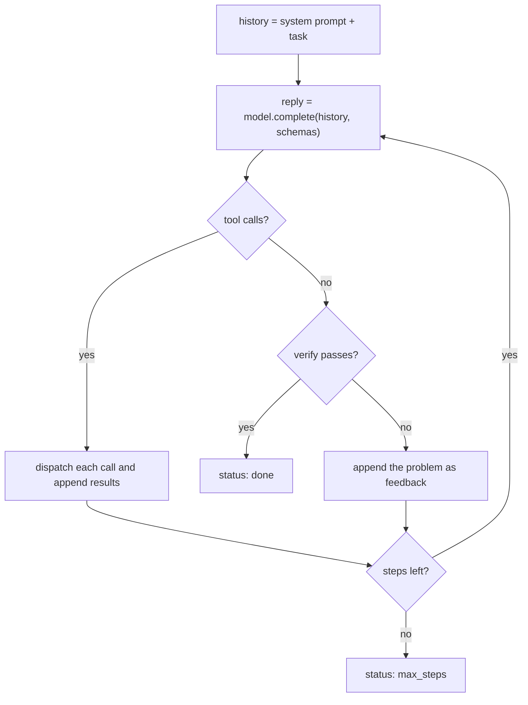

:::objectives
- Register Python functions as tools with a decorator that also produces their JSON Schema.
- Validate tool arguments and return every failure as a structured result instead of an exception.
- Write file tools that refuse any path outside the workspace folder.
- Write `run_agent`, a loop with a step limit, named statuses, and a `verify` hook that rejects false claims of success.
:::

You'll finish this lesson with three new files in `harness/` and an agent that can read and fix files in `workspace/`. Here's the loop you're building. Every box is a few lines of `loop.py`:



The files, when you're done:

```text
harness-lab/
├── harness/
│   ├── model.py      from Module 1
│   ├── chat_api.py   from Module 1
│   ├── tools.py      the registry: schemas, validation, dispatch
│   ├── files.py      list_files, read_file, write_file, locked to one folder
│   └── loop.py       run_agent and RunResult
├── workspace/        what the agent works on
└── run_demo.py       runs one task with the scripted or a real model
```

## Step 1: Bring in the model

The loop needs a model, and this page needs the scripted one from Module 1. Here's `harness/model.py`, unchanged:

```python run title="harness/model.py"
"""The one interface every model in the harness speaks:

    reply = model.complete(messages, tools)

messages  a list of dicts such as {"role": "user", "content": "..."}
tools     a list of tool schemas (Module 2 builds these)
reply     {"role": "assistant", "content": "...",
           "tool_calls": [{"id": "...", "name": "...", "args": {...}}],
           "usage": {"input_tokens": 0, "output_tokens": 0}}
"""
import copy
import itertools
import json


def estimate_tokens(text):
    """About 4 characters per token in English. Rough, but fine for budgets."""
    return max(1, len(text) // 4)


_ids = itertools.count(1)


def say(text):
    """A scripted reply that is a final answer."""
    return {"role": "assistant", "content": text, "tool_calls": []}


def call(name, **args):
    """A scripted reply that asks for one tool call."""
    return {"role": "assistant", "content": "",
            "tool_calls": [{"id": f"call_{next(_ids)}", "name": name, "args": args}]}


class ScriptedModel:
    """Replies from a list you write in advance: offline, free, identical every run."""

    name = "scripted"

    def __init__(self, script):
        self.script = list(script)
        self.seen = []  # a copy of the messages it was shown, one list per call

    def complete(self, messages, tools=None):
        self.seen.append(copy.deepcopy(messages))
        if not self.script:
            raise RuntimeError("ScriptedModel ran out of replies")
        reply = self.script.pop(0)
        if callable(reply):  # a reply can be a function of what the model was shown
            reply = reply(messages)
        shown = json.dumps(messages) + json.dumps(tools or [])
        written = reply["content"] + json.dumps(reply["tool_calls"])
        usage = {"input_tokens": estimate_tokens(shown), "output_tokens": estimate_tokens(written)}
        return {**reply, "usage": usage}
```

## Step 2: The tool registry

A registry holds every tool by name. Its `tool` decorator records the function together with its parameter specs, so the schema the model sees and the function that runs can't drift apart. Parameters are required unless you say otherwise, which keeps the common case short.

```python run title="harness/tools.py"
"""Tools the model may call: a schema it can read, a validator, and a dispatcher that never raises."""
from dataclasses import dataclass

TYPES = {"string": str, "integer": int, "number": (int, float),
         "boolean": bool, "array": list, "object": dict}


@dataclass
class Tool:
    name: str
    description: str
    params: dict      # {"path": {"type": "string", "description": "..."}}
    required: list
    fn: object        # the Python function to run

    def schema(self):
        return {"name": self.name, "description": self.description,
                "parameters": {"type": "object", "properties": self.params,
                               "required": self.required, "additionalProperties": False}}


def check_args(tool, args):
    """List what's wrong with args. An empty list means they are valid."""
    if not isinstance(args, dict):
        return ["arguments must be a JSON object"]
    problems = [f"missing required argument '{name}'" for name in tool.required if name not in args]
    for name, value in args.items():
        spec = tool.params.get(name)
        if spec is None:
            problems.append(f"unknown argument '{name}'")
            continue
        bool_as_number = isinstance(value, bool) and spec["type"] in ("integer", "number")
        if bool_as_number or not isinstance(value, TYPES[spec["type"]]):
            problems.append(f"'{name}' should be {spec['type']}, got {type(value).__name__}")
    return problems


def error(kind, message):
    return {"ok": False, "error": {"type": kind, "message": message}}


class ToolRegistry:
    def __init__(self):
        self.tools = {}

    def tool(self, name, description, params, required=None):
        """Decorator that registers a Python function as a tool."""
        def register(fn):
            needed = list(params) if required is None else required
            self.tools[name] = Tool(name, description, params, needed, fn)
            return fn
        return register

    def schemas(self):
        return [tool.schema() for tool in self.tools.values()]

    def dispatch(self, call):
        """Run one tool call. Every outcome, good or bad, comes back as a dict."""
        tool = self.tools.get(call["name"])
        if tool is None:
            return error("unknown_tool", f"no tool named '{call['name']}'; available: {', '.join(self.tools)}")
        problems = check_args(tool, call["args"])
        if problems:
            return error("bad_arguments", "; ".join(problems))
        try:
            return {"ok": True, "result": tool.fn(**call["args"])}
        except Exception as exc:  # the tool itself failed: report it, don't crash the run
            return error(type(exc).__name__, str(exc))
```

`dispatch` has exactly three exits, and only one of them runs your function. Unknown names and bad arguments are refused before any code runs. The `try` wraps only the tool function, so a bug in the registry itself still crashes where your tests can see it. Try it with a throwaway tool:

```python run
registry = ToolRegistry()

@registry.tool("repeat", "Repeat a word several times.",
               {"word": {"type": "string"}, "times": {"type": "integer"}})
def repeat(word, times):
    if times > 5:
        raise ValueError("times must be 5 or less")
    return " ".join([word] * times)

print(json.dumps(registry.schemas()[0]["parameters"]))
for args in [{"word": "hi", "times": 3}, {"word": "hi", "times": True},
             {"word": "hi"}, {"word": "hi", "times": 50}]:
    print(args, "->", registry.dispatch({"name": "repeat", "args": args}))
print(registry.dispatch({"name": "shout", "args": {}}))
```

The first call is the only one that ran cleanly. `True` was caught because the `bool` test comes first. The `times: 50` call did run, raised inside the tool, and came back as `ValueError` with the tool's own message. That's why tool authors should raise with clear messages: the message goes straight to the model.

## Step 3: File tools locked to the workspace

The agent's file tools get one folder and nothing else. `add_file_tools` registers three tools bound to a root folder. Each path is resolved first, which follows `..` and symlinks, and then checked to be inside the root. The file needs no imports from the rest of the harness.

```python run title="harness/files.py"
"""File tools that only ever touch one workspace folder."""
from pathlib import Path


def add_file_tools(registry, root):
    root = Path(root).resolve()

    def inside(path):
        target = (root / path).resolve()
        if not target.is_relative_to(root):
            raise PermissionError(f"'{path}' is outside the workspace")
        return target

    @registry.tool("list_files", "List every file in the workspace.", {})
    def list_files():
        return sorted(p.relative_to(root).as_posix() for p in root.rglob("*") if p.is_file())

    @registry.tool("read_file", "Read a UTF-8 text file from the workspace.",
                   {"path": {"type": "string", "description": "Path relative to the workspace"}})
    def read_file(path):
        target = inside(path)
        if not target.is_file():
            raise FileNotFoundError(f"no file named '{path}'; call list_files to see what exists")
        return target.read_text(encoding="utf-8")

    @registry.tool("write_file", "Create or replace a UTF-8 text file in the workspace.",
                   {"path": {"type": "string"}, "content": {"type": "string"}})
    def write_file(path, content):
        target = inside(path)
        target.parent.mkdir(parents=True, exist_ok=True)
        target.write_text(content, encoding="utf-8")
        return f"wrote {len(content)} characters to {path}"
```

`read_file` raises its own `FileNotFoundError` with a relative path and a hint, instead of Python's default message with your full home folder in it. Set up a workspace with two files and try the tools directly, including two escape attempts:

```python run
from pathlib import Path

Path("workspace").mkdir(exist_ok=True)
Path("workspace/notes.txt").write_text("Project: weather bot\nDeadline: June 3\nOwner: Priya\n")
Path("workspace/calc.py").write_text("def add(a, b):\n    return a - b\n")
Path("secret.txt").write_text("not for the agent\n")

registry = ToolRegistry()
add_file_tools(registry, "workspace")
for name, args in [("list_files", {}), ("read_file", {"path": "notes.md"}),
                   ("read_file", {"path": "../secret.txt"}),
                   ("read_file", {"path": "/etc/hosts"})]:
    print(name, args.get("path", ""), "->", registry.dispatch({"name": name, "args": args}))
```

Both escapes failed with `PermissionError`. The second is the sneaky one: joining an absolute path onto a folder with `/` throws the folder away (`Path("workspace") / "/etc/hosts"` is just `/etc/hosts`), which is why the check happens after resolving, on the final path. Module 3 adds the case this check misses: code the agent *runs* isn't limited by your file tools at all.

## Step 4: The loop

Now `harness/loop.py`. It has no imports from the rest of the harness: the model and the registry are passed in, so tests can hand it anything with the right methods.

```python run title="harness/loop.py"
"""The runtime loop: ask the model, run the tools it asks for, stop when a rule says so."""
import json
from dataclasses import dataclass


@dataclass
class RunResult:
    status: str      # "done", "max_steps", or "model_error"
    answer: str
    steps: int
    messages: list


SYSTEM = ("You are a careful coding assistant. Use the tools to inspect and change files in "
          "the workspace. When the task is finished, reply with a short summary and no tool calls.")


def run_agent(model, registry, task, system=SYSTEM, max_steps=8, verify=None):
    messages = [{"role": "system", "content": system}, {"role": "user", "content": task}]
    for step in range(1, max_steps + 1):
        try:
            reply = model.complete(messages, registry.schemas())               # plan
        except Exception as exc:
            return RunResult("model_error", f"{type(exc).__name__}: {exc}", step, messages)
        messages.append({"role": "assistant", "content": reply["content"],
                         "tool_calls": reply["tool_calls"]})
        if reply["tool_calls"]:
            for call in reply["tool_calls"]:                                   # act
                outcome = registry.dispatch(call)
                messages.append({"role": "tool", "tool_call_id": call["id"],  # observe
                                 "name": call["name"], "content": json.dumps(outcome)})
            continue
        problem = verify() if verify else None                                 # verify
        if problem is None:
            return RunResult("done", reply["content"], step, messages)
        messages.append({"role": "user", "content": f"Verification failed: {problem}"})
    return RunResult("max_steps", "", max_steps, messages)
```

Decisions worth seeing:

- **The assistant message is appended before its results**, with `usage` left out. That order is what OpenAI-style APIs require, and usage is bookkeeping, not conversation.
- **A model error ends the run with a status**, not a traceback. Module 3 wraps the model so temporary errors get retried before they ever reach this `except`.
- **`verify` returns `None` or a problem.** A string, not a boolean, because the problem goes back to the model as feedback it can act on.

## Step 5: Run a task

A small helper prints a run as a transcript:

```python run
def show(result):
    for message in result.messages[1:]:
        if message["role"] == "tool":
            print(f"  tool   <- {message['content'][:88]}")
        elif message["role"] == "assistant" and message["tool_calls"]:
            for c in message["tool_calls"]:
                print(f"  model  -> {c['name']}({c['args']})")
        else:
            who = "model" if message["role"] == "assistant" else message["role"]
            print(f"  {who:<6} :  {message['content']}")
    print(f"status={result.status}  steps={result.steps}\n")

model = ScriptedModel([
    call("list_files"),
    call("read_file", path="notes.txt"),
    say("The deadline is June 3, and Priya owns the project."),
])
show(run_agent(model, registry, "When is the project deadline, and who owns it?"))
```

Three steps, three model calls, status `done`. Now make the model clumsy. It misspells an argument, guesses a file name, tries to escape the workspace, and only then gets it right:

```python run
clumsy = ScriptedModel([
    call("read_file", paht="notes.txt"),
    call("read_file", path="notes.md"),
    call("read_file", path="../secret.txt"),
    call("read_file", path="notes.txt"),
    say("The deadline is June 3."),
])
show(run_agent(clumsy, registry, "When is the deadline?"))
```

Three failures, zero crashes. Each error went back to the model as a `tool` message, and with a real model each message is a hint toward the fix. Now a model that never stops:

```python run
looping = ScriptedModel([call("list_files") for _ in range(20)])
result = run_agent(looping, registry, "Tidy up the workspace.", max_steps=4)
print(result.status, result.steps, "model calls:", len(looping.seen))
```

Four calls, then `max_steps`. Sixteen scripted replies were never used, because the limit lives in the harness and doesn't depend on the model choosing to stop.

## Step 6: Don't trust "done"

The task: fix `calc.py` so `add(2, 3)` returns 5. This scripted model claims success immediately, the way real models sometimes do. Running code safely is Module 3's job, so for now `verify` checks the file's text:

```python run
def calc_is_fixed():
    source = Path("workspace/calc.py").read_text()
    return None if "a + b" in source else "calc.py still does not add a and b"

eager = ScriptedModel([
    say("Fixed! add() works now."),
    call("read_file", path="calc.py"),
    call("write_file", path="calc.py", content="def add(a, b):\n    return a + b\n"),
    say("Changed a - b to a + b in calc.py."),
])
show(run_agent(eager, registry, "Fix calc.py so add(2, 3) returns 5.", verify=calc_is_fixed))
```

The first "Fixed!" failed verification, and the feedback went into the history as a user message. The model read the file, wrote the fix, and the second claim passed. Without `verify`, the run would have ended at step 1 with status `done` and a broken file. A text check is crude: it would accept `return a + b - 1`. In Module 3, `verify` runs real tests in a sandbox.

## The finished program

`run_demo.py` in the project root ties it together. It starts with these imports:

```text
import sys
from pathlib import Path
from harness.chat_api import ChatAPIModel
from harness.files import add_file_tools
from harness.loop import run_agent
from harness.model import ScriptedModel, call, say
from harness.tools import ToolRegistry
```

```python run title="run_demo.py"
import sys


def main(live=False):
    workspace = Path("workspace")
    workspace.mkdir(exist_ok=True)
    (workspace / "calc.py").write_text("def add(a, b):\n    return a - b\n")
    registry = ToolRegistry()
    add_file_tools(registry, workspace)
    if live:
        model = ChatAPIModel()
    else:
        model = ScriptedModel([
            call("read_file", path="calc.py"),
            call("write_file", path="calc.py", content="def add(a, b):\n    return a + b\n"),
            say("Changed a - b to a + b in calc.py."),
        ])
    result = run_agent(model, registry, "Fix calc.py so add(2, 3) returns 5.", verify=calc_is_fixed)
    show(result)
    return result


main(live="--live" in sys.argv)
```

Copy `show` and `calc_is_fixed` from above into the same file. `python run_demo.py` runs the scripted version; `python run_demo.py --live` gives the same task to your real model. Compare the two transcripts. A small local model may read the file first, skip straight to writing, or need the verification feedback, and `show` makes each of those visible.

:::video H5o1P8RMiMw
What to watch for: how this harness registers tools and runs its loop. Compare it with yours: where does it validate arguments, what happens when a tool fails, and what makes the loop stop?
:::

:::quiz
Q: Why does `dispatch` wrap only `tool.fn(**call["args"])` in `try`, not the whole method?
- [x] So tool failures go back to the model, while a bug in the registry itself still crashes and shows up in tests
  A broad `try` would turn your own mistakes into polite messages that nobody reads.
- [ ] Because the unknown-tool and validation checks can't raise
  They could, if you introduced a bug; that's exactly why they stay outside the `try`.
- [ ] To make `dispatch` faster
  A `try` block costs almost nothing in Python; the reason is about which errors you want to see.

Q: Why does `verify` return a problem string instead of `True` or `False`?
- [ ] Strings are easier to print
  Printing isn't the point; the string goes into the conversation.
- [x] The problem goes back to the model as feedback, so it can fix what was wrong
  "calc.py still does not add a and b" points the next step; `False` would give the model nothing to act on.
- [ ] So `run_agent` can tell verification apart from a tool error
  Statuses already do that; the string is for the model.

Q: The model calls `read_file` with path `/Users/you/.ssh/id_rsa`. What does the workspace check do?
- [ ] Nothing, because the path doesn't contain `..`
  The check doesn't look for `..`; it checks where the resolved path ends up.
- [x] Refuses it: `root / path` with an absolute path is just that path, which resolves outside the root
  The check runs on the final resolved path, so absolute paths, `..`, and symlinks are all caught the same way.
:::

:::takeaways
- The registry's decorator keeps each tool's schema and function together, so they can't drift apart.
- `dispatch` validates first, runs second, and always returns `ok: true` or `ok: false` with a message written for the model.
- File tools resolve every path and refuse anything outside the workspace, whatever the path looks like.
- `run_agent` appends each call before its results, ends every run with a named status, and accepts "done" only after `verify` agrees.
:::

## Ideas to extend it

- Add a `search_files(pattern)` tool that returns matching lines with file names and line numbers, and give it an optional `max_results` parameter (pass `required=["pattern"]`).
- Make `run_agent` accept a `stop_on` callback that sees each reply and can end the run early, then use it to stop on any reply containing "I can't".
- Write `tests/test_loop.py` with one test per status: `done`, `max_steps`, `model_error`, and a run where verification fails once then passes.

## Further reading

- [pathlib: Path.resolve and Path.is_relative_to](https://docs.python.org/3/library/pathlib.html): exactly how resolving follows `..` and symlinks, which is what makes the workspace check work.
- [dataclasses](https://docs.python.org/3/library/dataclasses.html): the `@dataclass` decorator behind `Tool` and `RunResult`.
- [Writing effective tools for agents](https://www.anthropic.com/engineering/writing-tools-for-agents): how tool descriptions and error messages change what an agent does next.
