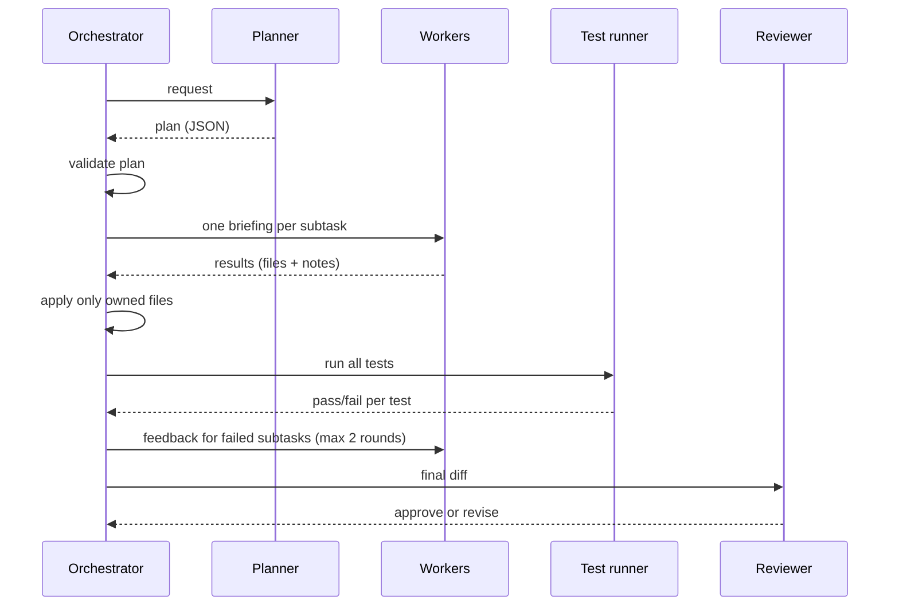

:::objectives
- Validate a planner's JSON plan for unknown workers, missing checks, overlapping file ownership, and attempts to edit tests.
- Brief each worker with only its task, its files, and its acceptance checks.
- Apply worker results through a single writer that drops edits outside a subtask's files.
- Review with deterministic tests first and a model reviewer last, with a cap on revisions.
- Account for tokens per agent so you can see what the split cost.
:::

You'll build the pipeline from the last lesson's second diagram and run it on a tiny shop codebase with two failing tests and a README to update. Every agent is a `ScriptedModel`, so the run is offline and identical each time, but the pipeline code doesn't know that: it would drive real models the same way.



By the end, the run log will show a worker's buggy first attempt being sent back with the exact failing assertion, a docs worker's out-of-scope edit being dropped, and a final test gate before the reviewer is asked anything.

## Step 1: The codebase and the model interface

The first cell repeats the scripted model from `harness/model.py` so this page runs by itself, then sets up four files. `test_shop.py` was written by a person and describes what "done" means; no agent is allowed to edit it.

```python run
import copy, json

def estimate_tokens(text):
    return max(1, len(text) // 4)

def say(text):
    return {"role": "assistant", "content": text, "tool_calls": []}

class ScriptedModel:
    name = "scripted"
    def __init__(self, script):
        self.script, self.seen = list(script), []
    def complete(self, messages, tools=None):
        self.seen.append(copy.deepcopy(messages))
        if not self.script:
            raise RuntimeError("ScriptedModel ran out of replies")
        reply = self.script.pop(0)
        if callable(reply):
            reply = reply(messages)
        shown = json.dumps(messages) + json.dumps(tools or [])
        written = reply["content"] + json.dumps(reply["tool_calls"])
        usage = {"input_tokens": estimate_tokens(shown), "output_tokens": estimate_tokens(written)}
        return {**reply, "usage": usage}

REPO = {
    "inventory.py": "STOCK = {}\n\ndef add_stock(item, qty):\n    STOCK[item] = STOCK.get(item, 0) + qty\n    return STOCK[item]\n",
    "pricing.py": 'def format_price(cents):\n    return "$" + str(cents / 100)\n',
    "README.md": "# Shop\n\nCall add_stock(item, qty) to add items.\n",
    "test_shop.py": """import unittest
from inventory import add_stock, STOCK
from pricing import format_price

class TestShop(unittest.TestCase):
    def setUp(self):
        STOCK.clear()
    def test_add_stock(self):
        self.assertEqual(add_stock("pen", 3), 3)
    def test_add_stock_rejects_negative(self):
        with self.assertRaises(ValueError):
            add_stock("pen", -2)
    def test_format_price(self):
        self.assertEqual(format_price(1050), "$10.50")
        self.assertEqual(format_price(5), "$0.05")
""",
}
REQUEST = ("Make test_shop.py pass: add_stock must reject negative quantities and format_price "
           "must always show two decimals. Document the new ValueError in the README.")
```

## Step 2: Script the team

Each agent replies with JSON. The planner returns a plan in which every subtask names a worker, the files it owns, and acceptance checks that a program can verify: a test that must pass, or text a file must contain. The code worker's second reply is a deliberate bug, and the docs worker oversteps by "tidying" a file it doesn't own. Those are the two failures the pipeline has to handle.

```python run
def scripted(name, replies):
    model = ScriptedModel([say(json.dumps(r)) for r in replies])
    model.name = name
    return model

PLAN = {"subtasks": [
    {"id": "t1", "worker": "code", "files": ["inventory.py"],
     "task": "Make add_stock raise ValueError when qty is negative",
     "acceptance": [{"test": "test_add_stock_rejects_negative"}, {"test": "test_add_stock"}]},
    {"id": "t2", "worker": "code", "files": ["pricing.py"],
     "task": "Make format_price always show exactly two decimals",
     "acceptance": [{"test": "test_format_price"}]},
    {"id": "t3", "worker": "docs", "files": ["README.md"],
     "task": "Document that add_stock raises ValueError for negative quantities",
     "acceptance": [{"file": "README.md", "contains": "ValueError"}]},
]}

def make_team():
    """Fresh scripted agents. Each reply is listed in the order the pipeline will ask."""
    planner = scripted("planner", [PLAN])
    code_worker = scripted("code_worker", [
        {"files": {"inventory.py": REPO["inventory.py"].replace(
            "def add_stock(item, qty):\n", 'def add_stock(item, qty):\n    if qty < 0:\n        raise ValueError(f"qty must be >= 0, got {qty}")\n')},
         "notes": "Guard clause before the update."},
        {"files": {"pricing.py": 'def format_price(cents):\n    return "$" + str(round(cents / 100, 2))\n'},
         "notes": "Round to two places."},
        {"files": {"pricing.py": 'def format_price(cents):\n    return f"${cents // 100}.{cents % 100:02d}"\n'},
         "notes": "Integer math, zero-padded cents; round() drops trailing zeros."},
    ])
    docs_worker = scripted("docs_worker", [
        {"files": {"README.md": REPO["README.md"] + "\nadd_stock raises ValueError if qty is negative.\n",
                   "inventory.py": "STOCK = {}\n# docs worker was here\n"},
         "notes": "Added a sentence. Also tidied inventory.py."},
    ])
    reviewer = scripted("reviewer", [
        {"verdict": "approve", "notes": "Changes stay inside owned files; the README sentence matches the code."},
    ])
    return {"planner": planner, "workers": {"code": code_worker, "docs": docs_worker}, "reviewer": reviewer}
print("files:", list(REPO), "| repo size ~", estimate_tokens(json.dumps(REPO)), "tokens")
```

`make_team` builds fresh agents each time, because a scripted model's replies are used up as it's called. The script order matches the order the pipeline will ask: all three subtasks first, then the one revision.

## Step 3: Get a plan and validate it

The planner's output is a proposal, not a command. Before any worker runs, check it against your policy: every worker exists, every subtask has checks, no two subtasks own the same file, and nobody owns a test.

```python run
def make_plan(planner, request, workers):
    reply = planner.complete([{"role": "system", "content": f"Split the request into subtasks for workers {list(workers)}. "
                                                           "Each subtask owns its files. Reply with JSON."},
                              {"role": "user", "content": request}])
    return json.loads(reply["content"]), reply["usage"]

def plan_problems(plan, repo, workers):
    problems, owner = [], {}
    for sub in plan["subtasks"]:
        if sub["worker"] not in workers:
            problems.append(f"{sub['id']}: no worker called {sub['worker']!r}")
        if not sub.get("acceptance"):
            problems.append(f"{sub['id']}: no acceptance checks")
        for path in sub["files"]:
            if path.startswith("test_"):
                problems.append(f"{sub['id']}: tests are not editable ({path})")
            elif path not in repo:
                problems.append(f"{sub['id']}: unknown file {path}")
            elif path in owner:
                problems.append(f"{sub['id']}: {path} is already owned by {owner[path]}")
            else:
                owner[path] = sub["id"]
    return problems

team = make_team()
plan, usage = make_plan(team["planner"], REQUEST, team["workers"])
for sub in plan["subtasks"]:
    print(sub["id"], sub["worker"], sub["files"], "-", sub["task"])
print("problems:", plan_problems(plan, REPO, team["workers"]) or "none")
bad = {"subtasks": [{"id": "x1", "worker": "code", "files": ["pricing.py"], "task": "...", "acceptance": [{"test": "t"}]},
                    {"id": "x2", "worker": "security", "files": ["pricing.py", "test_shop.py"], "task": "...", "acceptance": []}]}
print("bad plan:", plan_problems(bad, REPO, team["workers"]))
```

The real plan passes. The bad one fails four ways, and each failure would have caused a real problem: work routed to an agent that doesn't exist, a subtask nobody can declare finished, two workers editing `pricing.py`, and a worker allowed to rewrite the tests it's graded by.

## Step 4: Brief each worker with only what it needs

A briefing has the subtask, the files that subtask owns, the acceptance checks, and (on a retry) the reviewer's feedback. It doesn't include the planner's conversation, the other subtasks, or files the worker can't change.

```python run
def brief(sub, repo, feedback=None):
    """Only what this subtask needs: its task, its files, its checks, and any review feedback."""
    lines = [f"Task {sub['id']}: {sub['task']}",
             f"You may change only: {', '.join(sub['files'])}. Reply with JSON: files (path -> new content), notes.",
             f"Done when: {json.dumps(sub['acceptance'])}"]
    for path in sub["files"]:
        lines.append(f"--- {path}\n{repo[path]}")
    if feedback:
        lines.append(f"Reviewer feedback on your last attempt:\n{feedback}")
    return [{"role": "user", "content": "\n".join(lines)}]

for sub in plan["subtasks"]:
    print(f"{sub['id']} briefing ~{estimate_tokens(json.dumps(brief(sub, REPO)))} tokens")
```

Here the whole repository is only about 200 tokens, so the savings look small. In a real project the repository might be 200,000 tokens while each briefing stays near 100, and every token a worker doesn't see is also an instruction it can't be misled by.

## Step 5: Apply results through one writer

Workers don't write files. They return results, and the orchestrator applies them. That makes the orchestrator the single writer from the last lesson, so it can enforce ownership in one place.

```python run
def apply_result(sub, reply, repo):
    """The orchestrator is the only writer. Changes outside the subtask's files are dropped."""
    result = json.loads(reply["content"])
    applied, rejected = [], []
    for path, text in result["files"].items():
        if path in sub["files"]:
            repo[path] = text
            applied.append(path)
        else:
            rejected.append(path)
    return applied, rejected

sub = plan["subtasks"][2]                      # the docs subtask
reply = team["workers"]["docs"].complete(brief(sub, REPO))
applied, rejected = apply_result(sub, reply, dict(REPO))
print("applied:", applied, "| rejected:", rejected)
print("worker's notes:", json.loads(reply["content"])["notes"])
```

The README change is applied and the edit to `inventory.py` is dropped, while the subtask itself continues. Dropping is gentler than failing the whole subtask, but it should never be silent: the pipeline logs every rejected path, and a worker that keeps reaching outside its files is a signal worth alerting on.

## Step 6: Review with tests first

The reviewer's first job is mechanical. Write the files to a temporary directory, run `python -I -m unittest -v` in a subprocess, and read each test's status from the output. It's Module 3's `run_tests_in` idea with one change: the verbose output gives a status per test, so failures can be traced to the subtask that owns them. Then map tests back to subtasks through their acceptance checks. Here are the tests before any agent has touched the code:

```python run
import os, re, subprocess, sys, tempfile

def run_tests(repo):
    with tempfile.TemporaryDirectory() as workdir:
        for path, text in repo.items():
            with open(os.path.join(workdir, path), "w") as f:
                f.write(text)
        done = subprocess.run([sys.executable, "-I", "-m", "unittest", "-v"], cwd=workdir,
                              capture_output=True, text=True, timeout=30)
    log = done.stderr
    status = dict(re.findall(r"^(test_\w+) \(.*\) \.\.\. (ok|FAIL|ERROR)$", log, re.MULTILINE))
    reasons = {}
    for name in status:
        found = re.search(rf"^(?:FAIL|ERROR): {name} .*?^(\w+(?:Error|Exception): .*?)$", log, re.MULTILINE | re.DOTALL)
        if found:
            reasons[name] = found.group(1)
    return status, reasons

def check(sub, repo, status, reasons):
    """Deterministic acceptance checks. Returns a list of failures (empty means pass)."""
    failures = []
    for rule in sub["acceptance"]:
        if "test" in rule and status.get(rule["test"]) != "ok":
            failures.append(f"{rule['test']}: {reasons.get(rule['test'], status.get(rule['test'], 'not run'))}")
        if "contains" in rule and rule["contains"] not in repo[rule["file"]]:
            failures.append(f"{rule['file']} does not mention {rule['contains']}")
    return failures

status, reasons = run_tests(REPO)
print("before any work:", status)
print(reasons)
```

`reasons` holds the one line from each failure that a worker can act on, such as `'$10.5' != '$10.50'`. That line becomes the feedback in the worker's next briefing. A reviewer note that just says "tests fail" gives the worker nothing to fix.

## The finished pipeline

`run_pipeline` puts the steps in order. Subtasks that pass their checks leave the `pending` dictionary; failed ones get their failures as feedback, up to `MAX_REVISIONS` extra attempts, and then a person. After the loop, a final gate re-runs every test, because a fix to one subtask can break another. Only then does the model reviewer see the diff, and its job is the part tests can't judge: whether the change stayed in scope and the docs match the code.

```python run
MAX_REVISIONS = 2

def run_pipeline(request, repo, team):
    repo = dict(repo)
    tokens = {}
    def spend(agent, reply):
        tokens[agent.name] = tokens.get(agent.name, 0) + reply["usage"]["input_tokens"] + reply["usage"]["output_tokens"]

    plan, usage = make_plan(team["planner"], request, team["workers"])
    tokens["planner"] = usage["input_tokens"] + usage["output_tokens"]
    problems = plan_problems(plan, repo, team["workers"])
    if problems:
        return {"status": "plan rejected", "problems": problems}

    log = []
    pending = {sub["id"]: None for sub in plan["subtasks"]}   # id -> feedback for the next attempt
    attempts = {sub["id"]: 0 for sub in plan["subtasks"]}
    while pending:
        for sub in plan["subtasks"]:
            if sub["id"] not in pending:
                continue
            worker = team["workers"][sub["worker"]]
            reply = worker.complete(brief(sub, repo, pending[sub["id"]]))
            spend(worker, reply)
            attempts[sub["id"]] += 1
            applied, rejected = apply_result(sub, reply, repo)
            log.append(f"{sub['id']} attempt {attempts[sub['id']]}: {worker.name} changed {applied}"
                       + (f", REJECTED edits to {rejected}" if rejected else ""))
        status, reasons = run_tests(repo)
        for sub in plan["subtasks"]:
            if sub["id"] not in pending:
                continue
            failures = check(sub, repo, status, reasons)
            if not failures:
                del pending[sub["id"]]
                log.append(f"{sub['id']} passed its checks")
            elif attempts[sub["id"]] > MAX_REVISIONS:
                return {"status": "needs a human", "subtask": sub["id"], "failures": failures, "log": log}
            else:
                pending[sub["id"]] = "\n".join(failures)
                log.append(f"{sub['id']} sent back: {failures[0]}")

    status, _ = run_tests(repo)                      # a revision can break another subtask
    if any(result != "ok" for result in status.values()):
        return {"status": "needs a human", "failures": status, "log": log}
    log.append(f"final gate: all {len(status)} tests pass")
    diff_summary = {path: "changed" for path in repo if repo[path] != REPO[path]}
    review = team["reviewer"].complete([{"role": "user", "content": f"Request: {request}\nPlan: {json.dumps(plan)}\n"
                                                             f"Changed files: {json.dumps({p: repo[p] for p in diff_summary})}"}])
    spend(team["reviewer"], review)
    verdict = json.loads(review["content"])
    return {"status": verdict["verdict"], "notes": verdict["notes"], "log": log, "tokens": tokens, "repo": repo}

result = run_pipeline(REQUEST, REPO, make_team())
print("\n".join(result["log"]))
print("status:", result["status"], "|", result["notes"])
print("tokens by agent:", result["tokens"])
print(result["repo"]["pricing.py"])
```

Read the log from the top. `t2`'s first attempt used `round()`, which turns 10.50 into 10.5; the test caught it, the feedback quoted the assertion, and the second attempt switched to integer math. `t3`'s stray edit was rejected without derailing the subtask. The token line shows where the money went: the code worker made three calls, and the reviewer's single call was large because it read every changed file. With real models and a larger codebase, that table is what tells you whether the split paid for itself.

:::quiz
Q: Why do the deterministic tests run before the model reviewer is called?
- [x] Tests are cheap and exact, so the model reviewer only spends tokens on changes that already work
  Asking a model to judge code that fails its tests wastes a call, and the model might approve it anyway.
- [ ] The model reviewer can't read code
  It can; it reads every changed file. The order is about cost and trust, not ability.
- [ ] Tests need the reviewer's approval to run
  The tests run without any model involved.

Q: After `t2`'s revision passes `test_format_price`, why does the pipeline re-run all the tests instead of finishing?
- [ ] To double-check that the scripted worker is deterministic
  The final gate is there for real models too; determinism isn't the concern.
- [x] A change made for one subtask can break a test another subtask already passed
  `t1` passed earlier, but `t2`'s files could affect it. Only a full run at the end shows the combined result works.
- [ ] unittest only reports the first failure
  `-v` reports every test's status.

Q: The docs worker returned edits to `README.md` and `inventory.py`, but owns only `README.md`. What did the orchestrator do, and why?
- [ ] Applied both, since the worker explained the change in its notes
  Notes aren't permission. Ownership comes from the validated plan.
- [ ] Failed the whole subtask and asked the planner to start over
  That throws away a correct README change; the pipeline only drops the out-of-scope part.
- [x] Applied the README change, dropped the `inventory.py` edit, and logged it
  Enforcing ownership at the single writer keeps workers from colliding, and the log makes repeated overreach visible.
:::

:::takeaways
- Treat the planner's output as a proposal and validate it: known workers, checks on every subtask, disjoint file ownership, no editable tests.
- Brief workers with their subtask, their files, their checks, and specific feedback, nothing more.
- Let workers return results and a single orchestrator apply them, dropping and logging anything outside a subtask's files.
- Review with tests first, cap revisions, re-run everything at the end, and only then ask a model reviewer about scope and quality.
- Record tokens per agent; that's how you find out whether the split was worth it.
:::

## Ideas to extend it

- Run the workers for independent subtasks in parallel with `concurrent.futures.ThreadPoolExecutor`, and measure how much wall-clock time it saves.
- Give each subtask a token budget in its briefing and stop a worker that exceeds it.
- Write every handoff and result to a JSONL trace with a shared `trace_id`, using the trace format from Module 4.
- Add a router in front of the planner so one-file requests skip planning and go straight to a single worker.

## Further reading

- [unittest: Command-Line Interface](https://docs.python.org/3/library/unittest.html#command-line-interface): how `python -m unittest -v` discovers tests and what its output means.
- [concurrent.futures](https://docs.python.org/3/library/concurrent.futures.html): the standard-library way to run independent workers in parallel, for the first extension above.
- [Building effective agents](https://www.anthropic.com/research/building-effective-agents): the orchestrator-workers and evaluator-optimizer patterns this pipeline combines.
