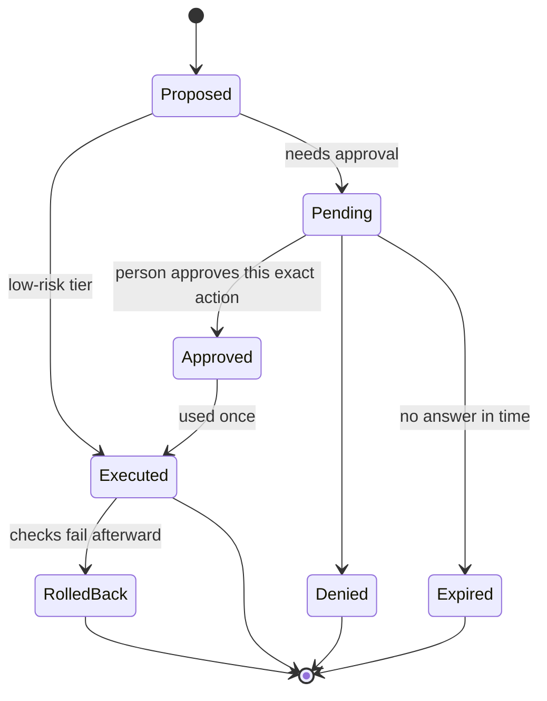

:::objectives
- Share one budget for steps, tokens, dollars, and time across a team, with a slice per agent, checked before each call.
- Detect delegation cycles, rounds without progress, and agents that keep editing after the checks pass.
- Require human approval for irreversible actions, bound to the exact action, single use, and expiring.
- Give each agent a credential with only the scopes its role needs, kept out of the model's context.
- Keep a tamper-evident audit log, and gate releases on a written checklist with a rollback plan.
:::

Picture the log of an overnight run. At 2:14 a.m. every test passed. The team kept going anyway: the reviewer asked for a refactor, the worker made it, a test broke, and the planner handed the fix back to the worker, over and over. By 7 a.m. there were 1,900 model calls, 62 commits on the branch, and one force-push to `main`, which the worker's token allowed and nobody had approved.

Every agent behaved reasonably one step at a time. What was missing was the harness around them: a budget for the whole run, a rule for "done", a check that rounds were making progress, an approval step before an irreversible push, and a token too narrow to push to `main` at all. Module 2 gave one agent a step limit, a `stuck` rule for repeated calls, and a token budget. This lesson scales those ideas up to a team and to actions in the real world.

## One budget for the whole team

Separate per-agent limits don't add up to a run limit. Five agents with 50 steps each can still make 250 calls, and a planner that spawns workers can multiply that further. So the budget belongs to the **run**, and each agent draws from a **slice** of what's left. The budget covers four things, because each fails differently: steps (runaway loops), tokens (huge contexts), dollars (expensive models), and wall-clock time (calls that hang).

Check the budget **before** a call, using an estimate of its size. Checking after, as Module 2's `BudgetModel` did, lets the last call push you over.

```python run
import time

class OverBudget(Exception):
    pass

class RunBudget:
    """One budget for a whole run, shared by every agent. Each agent can get a slice."""
    def __init__(self, steps, tokens, dollars, seconds, parent=None, name="run"):
        self.limits = {"steps": steps, "tokens": tokens, "dollars": dollars}
        self.used = {"steps": 0, "tokens": 0, "dollars": 0.0}
        self.deadline = time.monotonic() + seconds
        self.parent, self.name = parent, name

    def reserve(self, tokens, dollars):
        """Call BEFORE a model call, with an estimate. Raises if it would go over."""
        if time.monotonic() > self.deadline:
            raise OverBudget(f"{self.name}: out of time")
        wanted = {"steps": 1, "tokens": tokens, "dollars": dollars}
        for kind, amount in wanted.items():
            if self.used[kind] + amount > self.limits[kind]:
                raise OverBudget(f"{self.name}: {kind} would reach {self.used[kind] + amount:g} of {self.limits[kind]:g}")
        if self.parent:
            self.parent.reserve(tokens, dollars)
        for kind, amount in wanted.items():
            self.used[kind] += amount

    def child(self, name, share):
        """A slice for one agent: a fraction of whatever this budget has left."""
        left = {k: self.limits[k] - self.used[k] for k in self.limits}
        seconds = max(0.0, self.deadline - time.monotonic())
        return RunBudget(int(left["steps"] * share), int(left["tokens"] * share),
                         left["dollars"] * share, seconds * share, parent=self, name=name)

run = RunBudget(steps=40, tokens=60_000, dollars=0.50, seconds=600)
worker = run.child("worker-1", share=0.25)
print("worker limits:", worker.limits)
try:
    for call in range(1, 20):
        worker.reserve(tokens=1_500 + 400 * call, dollars=0.01)
except OverBudget as stop:
    print(f"stopped before call {call}: {stop}")
print("run used:", run.used)
```

The worker hit its own slice first: call 6 would have taken it to 17,400 tokens against a 15,000 limit, so the call never happened. Every reservation was also charged to the parent run, so `run.used` shows the true total. `time.monotonic()` is used for the deadline because, unlike the wall clock, it never jumps when the computer's clock is adjusted.

## Loops that exact-repeat checks miss

Module 2's `is_stuck` catches one agent calling the same tool with the same arguments again and again. Teams loop in ways that look like work:

- **Delegation cycles.** A task passes from planner to coder to tester and back to coder, and nobody does it.
- **No progress.** Every round makes a different edit, but the same tests keep failing.
- **Not stopping when done.** The checks pass, and the team keeps "improving" things, which is how the overnight run broke a passing build.

A delegation cycle is easy to see if you track the chain of agents a task has passed through. Step through it:

:::trace Catch a task coming back to an agent that already passed it on
```python
path = ["planner"]
handoffs = ["coder", "tester", "coder"]
for receiver in handoffs:
    if receiver in path:
        print("cycle:", " -> ".join(path + [receiver]))
        break
    path.append(receiver)
```
:::

Revisions are different: a reviewer sending work back with a specific failure is fine, and Module 6 capped those. A cycle is the same task bouncing without anyone doing it.

The other two need a measure of progress. Here it's the set of failing tests: a round counts as progress only if fewer tests fail than ever before. The monitor also remembers every state it has seen, and declares "done" the moment nothing fails, so the harness can stop accepting edits.

```python run
import hashlib, json

class ProgressMonitor:
    """Stops a run that keeps acting without changing anything that matters."""
    def __init__(self, patience=3):
        self.patience, self.best, self.stale, self.seen = patience, None, 0, set()

    def check(self, files, failing_tests):
        state = hashlib.sha256(json.dumps([files, sorted(failing_tests)], sort_keys=True).encode()).hexdigest()
        if not failing_tests:
            return "done: all checks pass, stop editing"
        if state in self.seen:
            return "stop: returned to an earlier state"
        self.seen.add(state)
        if self.best is None or len(failing_tests) < self.best:
            self.best, self.stale = len(failing_tests), 0
            return "continue"
        self.stale += 1
        return "stop: no progress" if self.stale >= self.patience else "continue"

rounds = [
    ({"app.py": "v1"}, ["test_a", "test_b"]),
    ({"app.py": "v2"}, ["test_b"]),
    ({"app.py": "v3"}, ["test_b"]),
    ({"app.py": "v4"}, ["test_b", "test_c"]),
    ({"app.py": "v5"}, ["test_b"]),
]
monitor = ProgressMonitor(patience=3)
for number, (files, failing) in enumerate(rounds, 1):
    verdict = monitor.check(files, failing)
    print(f"round {number}: failing {failing} -> {verdict}")
    if verdict != "continue":
        break
```

Round 4 fixed nothing and broke `test_c`; round 5 undid that, which is still no better than round 2. Three rounds without a new best is the stop. Measuring progress by your own checks, not by the agents' reports, is what makes this work: agents are very good at describing activity as progress.

## Approvals for actions you can't take back

Sort every tool into tiers. Reading files and running tests in the sandbox happen automatically. Writes inside the agent's own branch or workspace also happen automatically, because they're logged and easy to undo. Anything that leaves the sandbox or can't be undone (pushing to a shared branch, deleting, sending a message, spending money, changing permissions) waits for a person. Anything not on the list is denied.

An approval must be bound to **the exact action**, not to a tool. "Yes, push" for `fix/dates` must not also allow a push to `main`. So the approval is stored under a hash of the tool and its arguments, used once, and expires.

```python run
RISK = {"read_file": "auto", "run_tests": "auto", "write_file": "auto",
        "git_push": "approve", "delete_branch": "approve", "send_email": "approve"}

def action_id(tool, args):
    return hashlib.sha256(json.dumps([tool, args], sort_keys=True).encode()).hexdigest()[:12]

class ApprovalGate:
    def __init__(self, ttl_seconds=900):
        self.ttl, self.approved = ttl_seconds, {}   # action id -> (approver, expires)

    def approve(self, tool, args, approver, now):
        self.approved[action_id(tool, args)] = (approver, now + self.ttl)

    def allow(self, agent, tool, args, now):
        tier = RISK.get(tool, "deny")
        if tier == "auto":
            return True, "low risk"
        if tier == "deny":
            return False, f"{tool} is not on the list"
        grant = self.approved.pop(action_id(tool, args), None)   # pop: single use
        if grant is None:
            return False, "needs approval for this exact action"
        approver, expires = grant
        if approver == agent:
            return False, "an agent can't approve its own action"
        if now > expires:
            return False, "approval expired"
        return True, f"approved by {approver}"

gate = ApprovalGate()
gate.approve("git_push", {"branch": "fix/dates"}, approver="maya", now=0)
for tool, args, t in [("read_file", {"path": "dates.py"}, 10),
                      ("git_push", {"branch": "main"}, 20),
                      ("git_push", {"branch": "fix/dates"}, 30),
                      ("git_push", {"branch": "fix/dates"}, 40),
                      ("drop_database", {}, 50)]:
    print(f"{tool}({args}) ->", gate.allow("worker-1", tool, args, now=t))
```

The push to `main` is refused because the approval was for a different branch. The second push to `fix/dates` is refused because the approval was used up. And `drop_database` isn't on the list at all, so it's denied without asking anyone, which is the right default for tools you didn't plan for.



Approval doesn't replace a way back. Before any approved change, record how to undo it: the commit to revert, the backup to restore. A person approving a push is betting the change is good; rollback is what you do when the bet loses.

## Least privilege: one narrow credential per agent

The overnight force-push happened because the worker held a token that *could* push to `main`. The OWASP Top 10 for LLM applications names this risk **excessive agency** and traces it to three causes: excessive functionality, excessive permissions, and excessive autonomy. The fix for permissions is a separate credential per agent, scoped to its role, expiring soon, and never placed in the model's context. Tools look the token up; the model only sees tool names.

```python run
import secrets

ROLE_SCOPES = {
    "planner": {"repo:read"},
    "worker": {"repo:read", "branch:write"},
    "reviewer": {"repo:read", "pr:comment"},
    "release": {"repo:read", "main:merge"},
}

class CredentialBroker:
    """Issues short-lived tokens per agent. The model never sees them; tools look them up."""
    def __init__(self):
        self.tokens = {}

    def issue(self, agent, role, now, ttl=1800):
        token = secrets.token_hex(8)
        self.tokens[token] = {"agent": agent, "scopes": ROLE_SCOPES[role], "expires": now + ttl}
        return token

    def check(self, token, scope, now):
        grant = self.tokens.get(token)
        if grant is None or now > grant["expires"]:
            return False, "no valid token"
        if scope not in grant["scopes"]:
            return False, f"{grant['agent']} lacks {scope}"
        return True, "ok"

broker = CredentialBroker()
tokens = {name: broker.issue(name, role, now=0) for name, role in
          [("planner", "planner"), ("worker-1", "worker"), ("reviewer", "reviewer")]}
for agent, scope, now in [("worker-1", "branch:write", 60), ("reviewer", "branch:write", 60),
                          ("worker-1", "main:merge", 60), ("worker-1", "branch:write", 4000)]:
    print(f"{agent:9} {scope:13} at t={now:>4}:", broker.check(tokens[agent], scope, now))
```

Even if a prompt injection convinced the reviewer to push code, its token can't write. Even if the worker were told to merge, it lacks `main:merge`. And a token stolen from a log is useless an hour later. The same idea exists in real tools: GitHub's fine-grained personal access tokens are limited to chosen repositories and permissions with an expiration date, and a GitHub Actions workflow can shrink its automatic token like this:

```yaml
# .github/workflows/agent-checks.yml (excerpt)
permissions:
  contents: read        # the job can read the code but not push
  pull-requests: write  # it can comment on the pull request
```

:::video rAEqP9VEhe8
Computerphile on prompt injection, including instructions hidden in content a model reads. Watch for how text the model merely reads can steer what it does; that's the argument for limiting what each agent's credentials allow.
:::

## An audit log that can't be quietly edited

Module 4's traces are for debugging. An **audit log** answers a different question: who did what, and who allowed it. That makes it a target, since the record of a bad push is exactly what an attacker or a misbehaving agent would want to change. A hash chain makes edits detectable: each entry stores the hash of the previous one, so changing any entry breaks every hash after it.

```python run
class AuditLog:
    """Append-only, hash-chained JSON lines. Editing any entry breaks every hash after it."""
    def __init__(self):
        self.lines = []

    def append(self, **event):
        prev = json.loads(self.lines[-1])["hash"] if self.lines else "0" * 16
        body = json.dumps({"prev": prev, **event}, sort_keys=True)
        entry = {"prev": prev, **event, "hash": hashlib.sha256(body.encode()).hexdigest()[:16]}
        self.lines.append(json.dumps(entry, sort_keys=True))

    def verify(self):
        prev = "0" * 16
        for number, line in enumerate(self.lines, 1):
            entry = json.loads(line)
            claimed = entry.pop("hash")
            body = json.dumps(entry, sort_keys=True)
            if entry["prev"] != prev or hashlib.sha256(body.encode()).hexdigest()[:16] != claimed:
                return f"broken at entry {number}"
            prev = claimed
        return f"ok, {len(self.lines)} entries"

log = AuditLog()
log.append(actor="worker-1", action="git_push", target="fix/dates", decision="approved by maya")
log.append(actor="worker-1", action="git_push", target="main", decision="denied: needs approval")
log.append(actor="release", action="merge", target="main", decision="approved by maya")
print(log.verify())
log.lines[1] = log.lines[1].replace("denied: needs approval", "approved by maya")
print("after editing entry 2:", log.verify())
```

Editing entry 2 to turn a denial into an approval is caught immediately. The chain has a limit: someone who can rewrite the *whole* file can recompute every hash. So store the latest hash somewhere agents can't write, such as a separate service or a signed commit, and check against it.

## A release checklist

Nothing an agent team makes should reach `main` without passing a written gate. A good one is short enough to run every time:

1.  All tests pass from a clean checkout, not the agent's workspace.
2.  The hidden eval doesn't regress: the paired interval from Module 5 doesn't fall below zero.
3.  The diff touches only paths the plan allowed, and no test files.
4.  A secret scan of the diff finds nothing.
5.  Every risky action has a matching approval in the audit log, and the chain verifies.
6.  The run stayed within its budget.
7.  The rollback plan is written down: the commit to revert, or the tag to redeploy.

On GitHub, branch protection rules can enforce parts of this mechanically, such as requiring a pull request, passing status checks, and an approving review before a merge.

:::warning
**Putting the budget or the rules in the prompt.** "You have 20 steps" and "never push to main" are requests, and a confused or injected model can ignore them. Limits and permissions have to live in the harness code and the credentials, where the model can't argue with them.
:::

:::warning
**Approving a tool instead of an action.** A button that says "allow `git_push` for this session" turns one approval into unlimited pushes to any branch. Bind each approval to a hash of the tool and its exact arguments, make it single use, and give it an expiry.
:::

:::quiz
Q: A person approved `git_push` with `{"branch": "fix/dates"}`. The agent then calls `git_push` with `{"branch": "main"}`. What does the gate do?
- [ ] Allows it, since `git_push` was approved
  That treats the approval as covering the tool. The gate binds approvals to the exact arguments.
- [x] Refuses it, because no approval matches this exact action
  The approval is stored under a hash of the tool and its arguments, and `main` produces a different hash.
- [ ] Refuses it, because the approval expired
  It would also fail if expired, but the first reason is that it's a different action.

Q: A run's failing tests go: `[a, b]`, `[b]`, `[b]`, `[b, c]`, `[b]`. Why does the progress monitor stop at round 5 even though every round changed the code?
- [x] Three rounds in a row failed to beat the best result so far
  The best was one failing test in round 2. Rounds 3, 4, and 5 never did better, and patience was 3.
- [ ] Round 5 has the same files as round 2
  The files differ each round; the stop is about results, not files.
- [ ] `test_c` appeared, which always stops the run
  A new failure isn't a stop rule by itself; it's one more round without progress.

Q: Why give the reviewer agent a token without `branch:write`, if its prompt already says not to edit code?
- [ ] Tokens without write access are cheaper
  Cost has nothing to do with it.
- [x] Prompts can be ignored or overridden by injected text, but a token can't do what it lacks permission for
  Least privilege holds even when the model is confused or attacked. The prompt is a request; the credential is a limit.
- [ ] Reviewers never need to read the repository
  The reviewer does need `repo:read`; it just doesn't need to write.
:::

:::takeaways
- One budget per run (steps, tokens, dollars, time), sliced per agent and checked before each call.
- Watch for delegation cycles, rounds without progress on your own checks, and teams that keep editing after everything passes.
- Approvals are for irreversible actions, bound to the exact action, single use, and expiring, with a rollback plan recorded first.
- Each agent gets its own short-lived credential with only its role's scopes, held by tools and never shown to the model.
- A hash-chained audit log makes edits detectable, and a short release checklist decides what reaches `main`.
:::

## Further reading

- [LLM06:2025 Excessive Agency](https://genai.owasp.org/llmrisk/llm062025-excessive-agency/): OWASP's description of the risk, its three causes, and mitigations, including requiring user approval.
- [Controlling permissions for GITHUB_TOKEN](https://docs.github.com/en/actions/writing-workflows/choosing-what-your-workflow-does/controlling-permissions-for-github_token): how to narrow the token a GitHub Actions job gets.
- [About protected branches](https://docs.github.com/en/repositories/configuring-branches-and-merges-in-your-repository/managing-protected-branches/about-protected-branches): the branch rules that can require reviews and passing checks before a merge.
