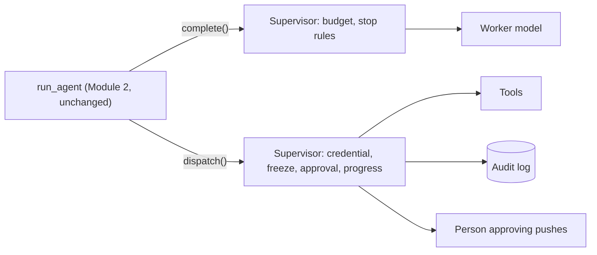

:::objectives
- Reproduce the overnight failure: an agent that breaks a passing fix and pushes to `main`.
- Wrap the model and the tool registry in one `Supervisor` without changing the agent loop.
- Enforce a budget before each call, freeze edits once every test passes, and stop runs with no progress.
- Check a scoped credential and ask a person before any push, and log every decision in a hash-chained audit log.
- Roll the workspace back to its best state when a run is stopped.
:::

You'll take a worker agent that does exactly what the opening story of the last lesson described (fixes a bug, keeps "tidying" after the tests pass, and pushes to `main`) and put a supervisor around it. The agent loop from Module 2 stays the same. The supervisor sits on both of its seams: it looks like a model to the loop, and it looks like a tool registry too.



At the end, the same scripted worker will finish with the fix on its own branch, `main` untouched, two blocked actions in a verified audit log, and a second agent that flails will be stopped and rolled back.

## Step 1: Bring in the earlier pieces

This cell repeats short versions of `say`, `call`, and `ScriptedModel` from Module 1 and `ToolRegistry` and `run_agent` from Module 2, so the page runs on its own. One addition to `run_agent`: a `StopRun` exception that carries a status name, so a supervisor can end a run with `budget` or `no_progress` instead of a generic `model_error`.

```python run
import copy, hashlib, itertools, json, time
from dataclasses import dataclass
from pathlib import Path

def estimate_tokens(text):
    return max(1, len(text) // 4)

_ids = itertools.count(1)

def say(text):
    return {"role": "assistant", "content": text, "tool_calls": []}

def call(name, **args):
    return {"role": "assistant", "content": "", "tool_calls": [{"id": f"call_{next(_ids)}", "name": name, "args": args}]}

class ScriptedModel:
    name = "scripted"
    def __init__(self, script):
        self.script, self.seen = list(script), []
    def complete(self, messages, tools=None):
        self.seen.append(copy.deepcopy(messages))
        if not self.script:
            raise RuntimeError("ScriptedModel ran out of replies")
        reply = self.script.pop(0)
        shown = json.dumps(messages) + json.dumps(tools or [])
        written = reply["content"] + json.dumps(reply["tool_calls"])
        return {**reply, "usage": {"input_tokens": estimate_tokens(shown), "output_tokens": estimate_tokens(written)}}

def error(kind, message):
    return {"ok": False, "error": {"type": kind, "message": message}}

class ToolRegistry:
    def __init__(self):
        self.tools = {}
    def tool(self, name, description, params):
        def register(fn):
            self.tools[name] = {"name": name, "description": description, "params": params, "fn": fn}
            return fn
        return register
    def schemas(self):
        return [{"name": t["name"], "description": t["description"],
                 "parameters": {"type": "object", "properties": t["params"], "required": list(t["params"])}}
                for t in self.tools.values()]
    def dispatch(self, call):
        tool = self.tools.get(call["name"])
        if tool is None:
            return error("unknown_tool", f"no tool named '{call['name']}'")
        try:
            return {"ok": True, "result": tool["fn"](**call["args"])}
        except Exception as exc:
            return error(type(exc).__name__, str(exc))

@dataclass
class RunResult:
    status: str
    answer: str
    steps: int
    messages: list

class StopRun(Exception):
    """Raised by a supervisor to end a run with a named status."""
    def __init__(self, status, message):
        super().__init__(message)
        self.status = status

def run_agent(model, registry, task, max_steps=12):
    messages = [{"role": "system", "content": "You are a careful coding agent."}, {"role": "user", "content": task}]
    for step in range(1, max_steps + 1):
        try:
            reply = model.complete(messages, registry.schemas())
        except StopRun as stop:
            return RunResult(stop.status, str(stop), step, messages)
        except Exception as exc:
            return RunResult("model_error", f"{type(exc).__name__}: {exc}", step, messages)
        messages.append({"role": "assistant", "content": reply["content"], "tool_calls": reply["tool_calls"]})
        if not reply["tool_calls"]:
            return RunResult("done", reply["content"], step, messages)
        for c in reply["tool_calls"]:
            outcome = registry.dispatch(c)
            messages.append({"role": "tool", "tool_call_id": c["id"], "name": c["name"], "content": json.dumps(outcome)})
    return RunResult("max_steps", "", max_steps, messages)
```

## Step 2: The project, and a run with no supervisor

The workspace holds `dates.py`, whose leap-year rule forgets that 1900 wasn't a leap year. The "remote" is a dictionary of branches, and `git_push` copies the file into it. Tests run in-process here because the code is scripted; a real harness would use Module 3's sandbox. The worker's script is the overnight run in miniature.

```python run
BUGGY = '''def days_in_month(year, month):
    if month == 2:
        return 29 if year % 4 == 0 else 28
    return 30 if month in (4, 6, 9, 11) else 31
'''
FIXED = '''def is_leap(year):
    return year % 4 == 0 and (year % 100 != 0 or year % 400 == 0)

def days_in_month(year, month):
    if month == 2:
        return 29 if is_leap(year) else 28
    return 30 if month in (4, 6, 9, 11) else 31
'''
TIDIED = '''def days_in_month(year, month):
    return 28 + (month == 2 and year % 4 == 0) if month == 2 else 30 + (month not in (4, 6, 9, 11))
'''
CASES = {"test_feb_leap": ((2024, 2), 29), "test_feb_common": ((2023, 2), 28),
         "test_century": ((1900, 2), 28), "test_april": ((2024, 4), 30)}

def make_project(root="workspace"):
    """A fresh workspace with the buggy file, a fake remote, and the tools an agent may call."""
    root = Path(root)
    root.mkdir(exist_ok=True)
    (root / "dates.py").write_text(BUGGY)
    remote = {"main": BUGGY}                      # branch -> pushed dates.py
    registry = ToolRegistry()

    @registry.tool("read_file", "Read a workspace file.", {"path": {"type": "string"}})
    def read_file(path):
        return (root / path).read_text()

    @registry.tool("write_file", "Replace a workspace file.", {"path": {"type": "string"}, "content": {"type": "string"}})
    def write_file(path, content):
        (root / path).write_text(content)
        return f"wrote {path}"

    @registry.tool("run_tests", "Run the test suite.", {})
    def run_tests():
        return {"failing": failing_tests(root)}

    @registry.tool("git_push", "Push the workspace to a branch.", {"branch": {"type": "string"}})
    def git_push(branch):
        remote[branch] = (root / "dates.py").read_text()
        return f"pushed to {branch}"

    return root, remote, registry

def failing_tests(root):
    namespace = {}
    exec((Path(root) / "dates.py").read_text(), namespace)   # scripted code; real runs use Module 3's sandbox
    return [name for name, (args, want) in CASES.items() if namespace["days_in_month"](*args) != want]

def overnight_worker():
    return ScriptedModel([
        call("read_file", path="dates.py"),
        call("write_file", path="dates.py", content=FIXED),
        call("run_tests"),
        call("write_file", path="dates.py", content=TIDIED),
        call("git_push", branch="main"),
        call("git_push", branch="fix/dates"),
        say("Fixed the century leap-year bug, tidied up, and pushed."),
    ])

root, remote, registry = make_project()
print("failing before:", failing_tests(root))
result = run_agent(overnight_worker(), registry, "Fix the failing test in dates.py")
print("status:", result.status, "| steps:", result.steps)
print("failing now:   ", failing_tests(root))
print("main has the tidy-up:", remote["main"] == TIDIED)
```

The run ended with status `done` and a confident summary. Meanwhile the "tidy" edit put the century bug back, nobody re-ran the tests, and the broken file is now on `main`. The loop did its job; nothing told it which actions needed permission or when to stop editing.

## Step 3: A credential per agent

Each tool call needs a scope, and pushing to `main` needs a different scope from pushing to a feature branch. The broker issues a short-lived token per agent with only its role's scopes.

```python run
import secrets

ROLE_SCOPES = {"worker": {"repo:read", "branch:write"}, "reviewer": {"repo:read"}, "release": {"repo:read", "main:merge"}}

def scope_needed(tool, args):
    if tool == "git_push":
        return "main:merge" if args["branch"] in ("main", "master") else "branch:write"
    return {"read_file": "repo:read", "run_tests": "repo:read", "write_file": "branch:write"}[tool]

class CredentialBroker:
    def __init__(self):
        self.grants = {}
    def issue(self, agent, role, ttl_seconds=1800):
        token = secrets.token_hex(8)
        self.grants[token] = {"agent": agent, "scopes": ROLE_SCOPES[role], "expires": time.monotonic() + ttl_seconds}
        return token
    def check(self, token, scope):
        grant = self.grants.get(token)
        if grant is None or time.monotonic() > grant["expires"]:
            return "no valid credential"
        return None if scope in grant["scopes"] else f"{grant['agent']} lacks {scope}"

broker = CredentialBroker()
worker_token = broker.issue("worker-1", "worker")
for tool, args in [("write_file", {"path": "dates.py"}), ("git_push", {"branch": "fix/dates"}), ("git_push", {"branch": "main"})]:
    print(tool, args, "->", broker.check(worker_token, scope_needed(tool, args)) or "allowed")
```

The worker can write files and push its own branch. It can't touch `main`, however it's asked and whoever approves.

## Step 4: Approvals and the audit log

Pushes are in the `approve` tier. `ScriptedHuman` stands in for the person who answers, so the run stays offline; in a real system the run would pause, notify someone, and resume when they answer. The person sees the exact call, arguments included, and their answer covers only that call. The audit log is the hash-chained log from the Notes lesson.

```python run
TIERS = {"read_file": "auto", "run_tests": "auto", "write_file": "auto", "git_push": "approve"}

class ScriptedHuman:
    """Stands in for the person who answers approval requests."""
    def __init__(self, name, answers):
        self.name, self.answers = name, list(answers)
    def decide(self, request):
        answer = self.answers.pop(0)
        print(f"    [approval] {self.name} sees: {request}  -> {answer}")
        return answer == "approve"

class AuditLog:
    def __init__(self):
        self.lines = []
    def append(self, **event):
        prev = json.loads(self.lines[-1])["hash"] if self.lines else "0" * 16
        body = json.dumps({"prev": prev, **event}, sort_keys=True)
        self.lines.append(json.dumps({"prev": prev, **event, "hash": hashlib.sha256(body.encode()).hexdigest()[:16]}, sort_keys=True))
    def verify(self):
        prev = "0" * 16
        for number, line in enumerate(self.lines, 1):
            entry = json.loads(line)
            claimed = entry.pop("hash")
            if entry["prev"] != prev or hashlib.sha256(json.dumps(entry, sort_keys=True).encode()).hexdigest()[:16] != claimed:
                return f"broken at entry {number}"
            prev = claimed
        return f"ok ({len(self.lines)} entries)"

demo = AuditLog()
demo.append(actor="worker-1", tool="git_push", args={"branch": "x"}, decision="maya said no", ok=False)
demo.append(actor="worker-1", tool="read_file", args={"path": "dates.py"}, decision="allowed", ok=True)
print(demo.verify())
```

## Step 5: The supervisor

`Supervisor` has two faces. As a model, its `complete` checks the stop flag, the deadline, and the token budget **before** passing the call through, estimating the next call's size from the messages. As a registry, its `dispatch` decides each call in a fixed order: credential first, then the freeze, then the tier and approval. Every decision is written to the audit log, allowed or not. After each test run, `track` updates progress: no failures freezes edits, fewer failures than ever sets a new best state to roll back to, and too many runs without improvement stops the run and restores that best state.

```python run
class Supervisor:
    """Wraps one agent's model and tools. run_agent from Module 2 doesn't change."""
    def __init__(self, agent, model, registry, root, *, token, broker, human, audit,
                 max_tokens=6000, max_seconds=60, patience=2):
        self.agent, self.inner_model, self.inner = agent, model, registry
        self.root, self.token, self.broker, self.human, self.audit = Path(root), token, broker, human, audit
        self.max_tokens, self.used_tokens = max_tokens, 0
        self.deadline = time.monotonic() + max_seconds
        self.patience, self.stale, self.frozen, self.stop = patience, 0, False, None
        self.best = (len(failing_tests(root)), (self.root / "dates.py").read_text())  # (failures, file) to roll back to
        self.model = self                       # the loop calls self.complete(...)

    # --- the model side: budget and stop rules, checked before every call
    def complete(self, messages, tools=None):
        if self.stop:
            raise StopRun(*self.stop)
        if time.monotonic() > self.deadline:
            raise StopRun("budget", "out of time")
        estimate = estimate_tokens(json.dumps(messages) + json.dumps(tools or [])) + 200
        if self.used_tokens + estimate > self.max_tokens:
            raise StopRun("budget", f"next call needs ~{estimate} tokens; {self.max_tokens - self.used_tokens} left")
        reply = self.inner_model.complete(messages, tools)
        self.used_tokens += reply["usage"]["input_tokens"] + reply["usage"]["output_tokens"]
        return reply

    # --- the tool side: credentials, freeze, approvals, audit, progress
    def schemas(self):
        return self.inner.schemas()

    def dispatch(self, call):
        tool, args = call["name"], call["args"]
        decision = self.decide(tool, args)
        outcome = self.inner.dispatch(call) if decision == "allowed" else error("denied", decision)
        if decision == "allowed" and tool == "run_tests":
            self.track(outcome["result"]["failing"])
        self.audit.append(actor=self.agent, tool=tool, args=args if tool != "write_file" else {"path": args["path"]},
                          decision=decision, ok=outcome["ok"])
        return outcome

    def decide(self, tool, args):
        problem = self.broker.check(self.token, scope_needed(tool, args))
        if problem:
            return problem
        if self.frozen and tool == "write_file":
            return "all checks pass, so edits are frozen; finish or push"
        if TIERS.get(tool, "deny") == "deny":
            return f"{tool} is not allowed"
        if TIERS[tool] == "approve":
            if not self.human.decide(f"{self.agent} wants {tool}({json.dumps(args)})"):
                return f"{self.human.name} said no"
            return "allowed"   # approved for this exact call only
        return "allowed"

    def track(self, failing):
        if not failing:
            self.frozen = True
        elif len(failing) < self.best[0]:
            self.best, self.stale = (len(failing), (self.root / "dates.py").read_text()), 0
        else:
            self.stale += 1
            if self.stale >= self.patience:
                (self.root / "dates.py").write_text(self.best[1])        # roll back to the best state
                self.stop = ("no_progress", f"{self.stale} test runs without improvement; rolled back")
```

`self.model = self` is the trick that lets one object sit on both seams: `run_agent` receives `sup.model` and `sup`, calls `complete` on the first and `dispatch` on the second, and never knows it's being supervised. File contents are left out of the audit entries for `write_file`: the log records that a write happened and who decided it, and the content belongs in the trace.

## The finished run

Same worker, same script, now supervised. The person approves the one push request they're shown.

```python run
def supervised_run(model, human_answers, task, **limits):
    root, remote, registry = make_project()
    audit = AuditLog()
    sup = Supervisor("worker-1", model, registry, root, token=broker.issue("worker-1", "worker"),
                     broker=broker, human=ScriptedHuman("maya", human_answers), audit=audit, **limits)
    result = run_agent(sup.model, sup, task)
    return result, remote, audit, sup

result, remote, audit, sup = supervised_run(overnight_worker(), ["approve"], "Fix the failing test in dates.py")
print("status:", result.status, "|", result.answer)
print("failing now:", failing_tests("workspace"), "| fix/dates has the fix:", remote["fix/dates"] == FIXED,
      "| main untouched:", remote["main"] == BUGGY)
print("tokens used:", sup.used_tokens)
for line in audit.lines:
    e = json.loads(line)
    print(f"  {e['tool']:10} {json.dumps(e['args']):26} {e['decision']}")
print("audit chain:", audit.verify())
```

Read the audit lines in order. The fix and the test run were allowed. The tidy-up was refused because every test already passed. The push to `main` was refused by the credential before any person was bothered, so Maya only saw the push to `fix/dates`, and approved it. The worker still claimed it "tidied up", which is a good reminder to trust the audit log, not the agent's summary. The chain verifies, so you know these six lines are the ones that were written.

## Step 6: Stop a run that's going nowhere

Two more runs. In the first, a worker tries edits that don't reduce the failing tests; with `patience=2`, the second run of the tests without improvement stops it and restores the best version seen. In the second, the overnight worker gets a 900-token budget.

```python run
flailing = ScriptedModel([
    call("write_file", path="dates.py", content=BUGGY.replace("29 if", "28 if")),
    call("run_tests"),
    call("write_file", path="dates.py", content=BUGGY.replace("% 4 == 0", "% 4 == 0 or year % 100 == 0")),
    call("run_tests"),
    call("write_file", path="dates.py", content="# start over\n"),
    call("run_tests"),
])
result, remote, audit, sup = supervised_run(flailing, [], "Fix the failing test in dates.py")
print("status:", result.status, "|", result.answer)
print("dates.py restored to the original:", Path("workspace/dates.py").read_text() == BUGGY)

result, *_ = supervised_run(overnight_worker(), ["approve"], "Fix the failing test in dates.py", max_tokens=900)
print("status:", result.status, "|", result.answer, "| after", result.steps, "steps")
```

The flailing worker's third edit (`# start over`) never ran: the stop flag was set during the test run, and `complete` refused the next call. The workspace is back to the original file, which is the best state this run ever reached. The budget run stopped at its third step, before that call was made, because the supervisor estimated it would need more tokens than were left. The budget was never overspent.

:::quiz
Q: Why does `decide` check the credential before asking the person for approval?
- [x] Actions the agent can never be allowed to take shouldn't reach a person at all
  If no approval could make the push to `main` legal for this agent, asking only trains people to click "approve" on requests that don't matter.
- [ ] Credentials are faster to check than approvals
  Speed isn't the reason; the order decides what a person gets asked.
- [ ] The person can't see which branch is being pushed
  They see the exact call, arguments included.

Q: The worker's `write_file` after the green test run was refused. What would have happened without the freeze?
- [ ] Nothing, since the tests had already passed
  Passing tests don't protect later edits. That's the point of the story.
- [x] The tidy-up would have reintroduced the century bug, and nothing would have re-run the tests before the push
  That's exactly what the unsupervised run in Step 2 did.
- [ ] The audit log would have refused to record it
  The log records whatever it's given; it doesn't decide.

Q: When the flailing run is stopped, why does the supervisor restore the best state instead of the last one?
- [ ] The last state can't be read once the run stops
  It can; the file is still on disk.
- [ ] The best state is always the original file
  Here it happens to be, but if an early edit had fixed one of two failing tests, that edit would be kept.
- [x] The last state may be worse than anything earlier, and leaving it would hand the next person or agent a mess
  Rolling back to the fewest failures keeps whatever real progress the run made and throws away the rest.
:::

:::takeaways
- A supervisor can wrap the model and the registry without touching the loop, which keeps every control in one place.
- Check budgets before each call with an estimate, so a run stops short instead of overshooting.
- Freeze edits when every check passes; "done" is something the harness decides from its own checks.
- Decide each action in order: credential, freeze, tier, approval. Log every decision, allowed or not.
- When you stop a run for lack of progress, roll back to the best state you measured.
:::

## Ideas to extend it

- Store approvals under a hash of the action with an expiry, as in the Notes lesson, so a person can approve while the run is paused and the run can resume later.
- Add a reviewer agent with a `reviewer` token, and confirm it can read and run tests but every write is denied.
- Write the audit log to `traces/audit.jsonl` and the latest hash to a separate file, and make `verify` check both.
- Count denied actions per agent, and stop a run whose agent is refused three times in a row, since that's usually a confused or attacked model.

## Further reading

- [secrets: Generate secure random numbers](https://docs.python.org/3/library/secrets.html): why the broker uses `secrets.token_hex` rather than `random` for tokens.
- [time.monotonic](https://docs.python.org/3/library/time.html#time.monotonic): the clock the supervisor uses for deadlines, which never goes backward.
- [LLM Top 10 for LLM Applications](https://genai.owasp.org/llm-top-10/): OWASP's list of risks for LLM apps, including prompt injection and excessive agency, which this supervisor is built to contain.
