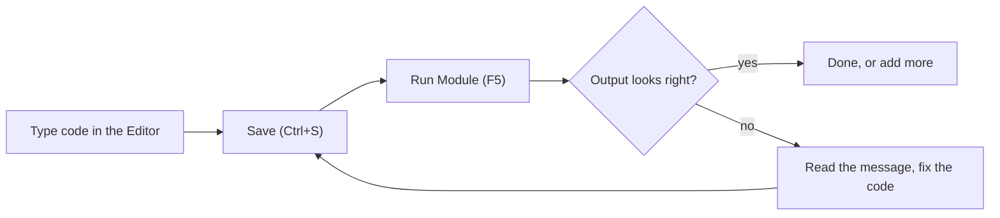

:::objectives
- Tell IDLE's Shell window and Editor window apart, and know which one to type in.
- Write a program in the Editor, save it as a `.py` file, and run it with **F5**.
- Read a `SyntaxError` and fix the line it points at.
- Run a setup check and share its output with your instructor.
:::

Try this: type `print("hi")` in the IDLE Shell, close IDLE, and open it again. Your code is gone. The Shell is a scratchpad, perfect for testing one line and useless for anything you want to keep. Real programs live in **files**, and today you make your first two.

## Two windows, two jobs

IDLE has two kinds of windows. Mixing them up causes more week-1 confusion than anything else, so learn to spot them now.

| Window | How to recognize it | What it's for |
| --- | --- | --- |
| **Shell** | Has a `>>>` prompt; the title starts with "IDLE Shell" | Quick one-line experiments, and reading your program's output |
| **Editor** | A blank page with no `>>>`; the title shows a file name | Writing whole programs that you save and run |

The rule of thumb: **write in the Editor, read the results in the Shell.** Every program in this course follows the same loop:



## Step 1: Open a new file

Open IDLE, which starts on the Shell. From the Shell's menu bar choose **File › New File**. A blank Editor window appears with `untitled` in its title bar, because it hasn't been saved yet.

## Step 2: Type a three-line program

Type these lines into the Editor yourself instead of pasting them. Your fingers need to learn where the quotes and parentheses go, and copying skips that practice.

```python run title="hello.py"
print("Hello, world!")
print("My name is Ada and I just ran my first program.")
print("Python can do math too:", 12 + 30)
```

Swap `Ada` for your own name. As you type, IDLE colors the code: text inside quotes turns green and `print` turns purple. Those colors are a free spell-checker. If the rest of a line suddenly turns green, you forgot a closing quote somewhere.

## Step 3: Save it as a .py file

Press **Ctrl+S** (Windows and Chromebook) or **Cmd+S** (Mac). Name the file `hello.py` and save it somewhere you'll find again, such as your **Documents** folder. The next lesson sets up a proper class folder.

The `.py` ending tells your computer this file is a Python program. IDLE adds it if you leave it off, but typing it yourself is a good habit.

## Step 4: Run it

Choose **Run › Run Module**, or press **F5**. (Some laptops need you to hold **Fn** while pressing F5.) The Shell jumps to the front, prints a divider line with the word `RESTART` and your file's path, and then shows your program's output, the same three lines shown under the code above.

Look closely at the last output line. You typed `12 + 30`, but Python printed `42`. Text inside quotes is printed exactly as written, while code outside the quotes is worked out first. Week 1 is about that difference.

:::tip
If IDLE asks "Source Must Be Saved. OK to Save?" when you press F5, click **OK**. IDLE always runs the saved copy of your file, so it wants your newest changes saved first.
:::

## Step 5: Run the setup check

Make one more file with **File › New File**, type this program, save it as `setup_check.py`, and run it with F5.

```python run title="setup_check.py"
# setup_check.py - proves that Python and IDLE are working
import platform

print("Hello! Python is running.")
print("Version:", platform.python_version())
print("Quick math check: 6 * 7 =", 6 * 7)
print("If you can read all four lines, your setup works.")
```

The version line shows whichever Python is installed, so yours may differ from the one above. Anything starting with 3 is fine. Two lines here are new:

-   The first line starts with `#`, which makes it a **comment**: a note for humans that Python skips entirely.
-   `import platform` borrows a ready-made toolbox from Python so the program can ask which version is running. You don't need to understand imports yet.

Copy the four output lines from your Shell and paste them into the class chat at the start of the first session. That's your proof of setup.

## Step 6: Break it on purpose

Errors are normal, and professional programmers see dozens a day. The goal is to meet your first one on purpose, when you already know the cause. Open `hello.py`, delete the closing parenthesis at the end of the first line, save, and press F5.

```python run raises title="hello.py"
print("Hello, world!"
print("This line never runs.")
```

IDLE refuses to run the file. It pops up a box with the error and highlights the spot in your code in red. The block above shows the same message the way Python prints it. Read it from the bottom up:

-   **`SyntaxError`** means Python couldn't understand the *shape* of your code, the way a sentence with no period is hard to read.
-   **`'(' was never closed`** tells you exactly what's missing.
-   **`line 1`** and the `^` mark where the problem started.

Put the `)` back, save, and run it again. You just did a complete see-it, read-it, fix-it cycle, and you'll do it hundreds of times in this course.

:::warning
The line number in an error is where Python *noticed* the problem, which isn't always where you made it. A missing `)` on line 1 can be reported on line 2. If the line it names looks fine, check the line above.
:::

## Three settings worth changing now

-   **Line numbers.** In an Editor window choose **Options › Show Line Numbers**. When an error says "line 7", you'll find line 7 instantly.
-   **Bigger text.** Choose **Options › Configure IDLE** and raise the font size on the **Fonts** tab. (On a Mac, the settings live in the **IDLE** menu instead.) Your instructor will share their screen, and you'll want to see your own code just as clearly.
-   **Shell history.** In the Shell, press **Alt+P** (**Ctrl+P** on a Mac) to bring back the previous line you typed, so you don't have to retype it.

:::video WIlQukiXs-E
Real Python tours IDLE's Shell in under six minutes. Watch how the Shell answers each line as soon as you press Enter; that instant feedback is why the Shell is the place for experiments, and the Editor is the place for programs.
:::

:::quiz
Q: You type five lines into the Shell, close IDLE, and reopen it. What happened to your code?
- [ ] It was saved automatically as `untitled.py`
  The Shell never saves anything for you. Only Editor files are saved.
- [x] It's gone
  The Shell is a scratchpad. Anything you want to keep belongs in an Editor file.
- [ ] It's in **File › Recent Files**
  Recent Files lists Editor files you opened or saved, not Shell sessions.

Q: You press F5 and nothing runs. Which window are you most likely in?
- [x] The Shell
  F5 runs the file in an Editor window. The Shell has no file to run.
- [ ] The Editor, with a saved file
  That's exactly where F5 works, so the program would run.
- [ ] Either one; F5 works the same in both
  Run Module is an Editor command. It needs a file.

Q: An error says `SyntaxError` on line 2, but line 2 looks perfect. Where should you look next?
- [ ] Line 3
  Python reads top to bottom, so the cause is rarely below where it stopped.
- [x] Line 1
  Python often notices a missing `)` or quote one line late, so check the line above.
- [ ] Nowhere; reinstall Python
  A syntax error is always about the code, never about the install.
:::

## Quick checklist

-   You can open a new Editor window with **File › New File**.
-   You saved `hello.py` and `setup_check.py` and know which folder they're in.
-   **F5** runs a file, and its output appears in the Shell.
-   You fixed a `SyntaxError` by reading the message.

## Further reading

-   [IDLE documentation](https://docs.python.org/3/library/idle.html): the official guide to every IDLE menu, including Run Module, Check Module, and the Shell.
-   [Automate the Boring Stuff, Chapter 1](https://automatetheboringstuff.com/2e/chapter1/): a free book chapter that starts with your first program and the Shell.
