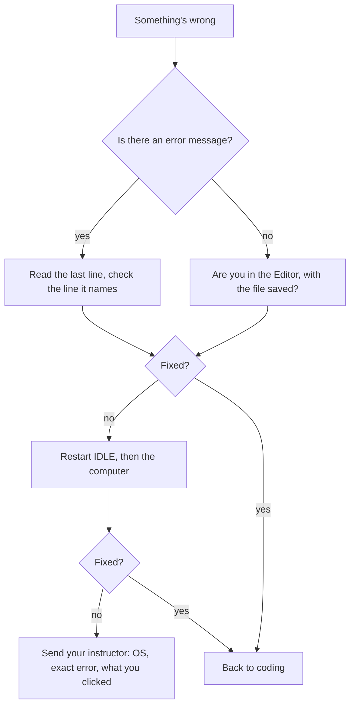

:::objectives
- Know what happens in each 90-minute class and how the three lessons each week fit around it.
- Create one course folder with a subfolder per week, and save files where you can find them.
- Name files so they run, and avoid names that break Python's own tools.
- Fix curly quotes, stray `>>>` prompts, surprise indentation, and other setup problems.
:::

Picture week 4. Your instructor says, "Open the mission briefing you wrote in week 2." You open your Desktop and find `untitled.py`, `untitled2.py`, `test.py`, another `test.py` inside Downloads, and something called `program FINAL (1).py`. Class moves on while you're still clicking through them.

Ten minutes of setup now prevents that. This page covers how each class runs, where your files should live, and how to get unstuck when your computer misbehaves.

## What a week looks like

Class meets live online once a week for 1.5 hours, and each week is one module with three lessons:

1.  **Notes** explain the week's ideas, with short examples you can run. Skim them before class and reread them after.
2.  **Code-along** builds one small program step by step. In class your instructor types it and you type the same thing in your own IDLE.
3.  **Practice** has exercises that get harder as you go, each with a hint and a solution. Try every exercise before you open its solution.


Keep IDLE open for the whole class. Watching someone else type code feels like learning, but your hands only learn it when you type it yourself, mistakes included.

:::tip
When you're stuck, paste your code **and** the complete error message into the chat. "It doesn't work" is almost impossible to help with. "Line 3 says `NameError: name 'nmae' is not defined`" usually gets fixed in seconds.
:::

## One folder for the whole course

Create a folder named `C4T-Python` with one folder inside it for each week:

```text
C4T-Python/
    setup/
        hello.py
        setup_check.py
    week1/
    week2/
    week3/
    week4/
    week5/
    week6/
    capstone/
```

Put it somewhere simple, like **Documents** on Windows or a Mac. On a Chromebook, make it inside **Linux files** in the Files app. The Linux copy of IDLE can't see your Downloads or Google Drive folders unless you share them with Linux, so files saved there seem to vanish.

Move `hello.py` and `setup_check.py` from the last lesson into `setup/`. Then open one of them in IDLE with **File › Open** from its new home, so **File › Recent Files** points to the right place.

## File names that work

Good file names are short, lowercase, and say what the program does, with underscores instead of spaces:

-   Good: `week2_mission_briefing.py`, `ex3_temperature.py`, `rocket_launch.py`
-   Bad: `untitled.py`, `My Program FINAL (2).py`, `test.py`

Two naming rules matter more than the rest.

**Always end with `.py`.** A file saved as `hello.txt` or `hello.py.txt` won't get IDLE's colors, and F5 won't run it.

**Never name a file after one of Python's own tools.** Python checks your folder before its own library, so a file of yours called `random.py` hides the real `random` tool. In week 3 you'll write a game that starts with `import random`. If a homemade `random.py` sits in the same folder, Python 3.13 and newer end the error with this line (your own folder path appears in the middle):

```text
AttributeError: module 'random' has no attribute 'choice' (consider renaming '/Users/sam/Documents/C4T-Python/week3/random.py' since it has the same name as the standard library module named 'random' and the import system gives it precedence)
```

Older versions stop after `no attribute 'choice'`, which is baffling if you don't know the cause. Avoid `random.py`, `math.py`, `turtle.py`, `string.py`, and `time.py`.

Test the new folder with a tiny program. Save it as `week1/where_am_i.py` and run it with F5:

```python run title="where_am_i.py"
# where_am_i.py
# Saved in: C4T-Python/week1/
print("This file lives in my week1 folder.")
print("Next week's files go in week2.")
```

## Fixes for the problems students hit most

### F5 does nothing

You're probably in the **Shell**, not the Editor. F5 only runs a file that's open in an Editor window. Use **File › New File** or **File › Open** first.

### Python says "invalid character" about your quotes

Code copied from a word processor, a chat app, or a slide deck often has curly quotes `“ ”` in place of straight ones `"`. They look almost the same to you, but Python only accepts the straight kind:

```python run raises title="smart.py"
print(“Good morning”)
```

The `U+201C` in the message is the code number for a left curly quote. Delete both quote marks and retype them in IDLE, which always types straight quotes.

### You pasted from the Shell and got "invalid syntax"

Copying lines out of the Shell often brings the `>>>` prompt along. In a file, the prompt is just junk characters:

```python run raises
>>> print("Hi")
```

Delete every `>>>` and keep only the code after it.

### Python says "unexpected indent"

Spaces at the start of a line *mean* something in Python, so a stray space or two breaks the program:

```python run raises title="indent.py"
print("Line one")
  print("Line two")
```

Move the second `print` back to the left edge. In week 3 you'll start indenting lines on purpose, and then the spaces will matter in the other direction.

### Windows: `python` is not recognized in a terminal

IDLE doesn't need the terminal, so you can ignore this during class. If you want it fixed, try `py` in place of `python`. If that fails too, run the Python installer again and make sure Python is added to PATH.

### Mac: `python` says "command not found"

On a Mac the terminal command is `python3`, not `python`. IDLE isn't affected.

### Chromebook: IDLE won't open, or your files are missing

Check that Linux finished setting up, then type `python3 -m idlelib` in the Terminal. If files seem to have disappeared, open the Files app and look in **Linux files**.



:::quiz
Q: Which of these file names is safest for this week's exercise?
- [ ] `random.py`
  That hides Python's own `random` tool, which you'll need for games in week 3.
- [ ] `Exercise 1 FINAL.py`
  It works, but spaces and capitals make it harder to find and type. Use underscores.
- [x] `ex1_about_me.py`
  Short, lowercase, underscores, ends in `.py`, and says what it is.
- [ ] `ex1_about_me.txt`
  A `.txt` file won't run with F5 or get IDLE's colors.

Q: You paste code from a slide and get `SyntaxError: invalid character '“' (U+201C)`. What's the fix?
- [ ] Reinstall Python
  Nothing is wrong with Python. The code has a character it doesn't accept.
- [x] Retype the quote marks in IDLE
  Curly quotes came along with the paste. IDLE types straight quotes, which Python accepts.
- [ ] Add more spaces before `print`
  Extra leading spaces cause a different error, `unexpected indent`.
:::

## Further reading

-   [Using Python on Unix platforms](https://docs.python.org/3/using/unix.html): official notes that apply to the Linux setup on Chromebooks.
-   [Python on Windows FAQ](https://docs.python.org/3/faq/windows.html): answers to the most common "how do I run a .py file" questions on Windows.
