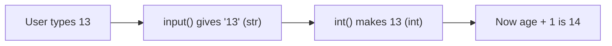

:::objectives
- Create and update variables, and read `=` as "gets".
- Tell the four basic types apart: `str`, `int`, `float`, and `bool`.
- Drop variables into text with f-strings.
- Ask the user a question with `input()`, and convert the answer with `int()` or `float()` before doing math.
:::

Here's a tiny calculator. It asks for two numbers and adds them. Type 7 and 3, and it reports the sum:

```python run input="7|3" title="adder.py"
first = input("First number: ")
second = input("Second number: ")
print("The sum is", first + second)
```

Seventy-three. Python didn't crash and didn't warn you; it just quietly did the wrong thing. By the end of this page you'll know exactly why, and the fix is a single word.

Last week every program printed the same thing every time it ran. A game needs to remember your score, though, and a quiz needs to know your answer. So this week your programs learn to **store** values and to **ask** for them.

## A variable is a name stuck on a value

Think of a variable as a sticky label. You write a name on it and press it onto a value. Later you say the name and Python hands back whatever the label is stuck to. You create one with a single equals sign:

```python run
player = "Maya"
score = 0
print(player, "has", score, "points.")

score = 10
print(player, "has", score, "points.")

score = score + 5
print(player, "has", score, "points.")
```

Read `=` as **"gets"**, not "equals". `score = 10` means "score gets 10". That's why `score = score + 5` makes sense in Python even though it's nonsense in math class. Python always works out the **right side first**, using the current value of `score`, and only then moves the label to the result. This is called **assignment**.

Step through it and watch the `score` label move from 0 to 10 to 15 in the variables panel:

:::trace Watch `score` change
```python
player = "Maya"
score = 0
score = 10
score = score + 5
print(player, "has", score, "points.")
```
:::

Notice that `print(player)` has no quotes. Without quotes, Python looks the name up and prints its value. With quotes, `print("player")` prints the word *player*.

### Rules for names

-   Letters, digits, and underscores only, and a name **can't start with a digit**. `level2` works; `2level` is a `SyntaxError`.
-   No spaces. Use underscores: `high_score`, not `high score`.
-   Capitals count. `Score` and `score` are two different variables.
-   Choose names that say what the value means. `lives` beats `x`, and `ticket_price` beats `p`.

:::video 52RHZdBSjTw
Khan Academy on variables and assignment. Watch for how the video reads a line like `x = x + 1`: right side first, then store. It's the same rule the trace above shows.
:::

## Every value has a type

A value's **type** decides what you can do with it. You can add two numbers, but you can't sensibly multiply a name by a name. Ask Python for any value's type with `type()`:

```python run
title = "Space Quest"
lives = 3
speed = 2.5
game_over = False

print(type(title))
print(type(lives))
print(type(speed))
print(type(game_over))
```

| Type | Short for | Examples | Use it for |
| --- | --- | --- | --- |
| `str` | string | `"Maya"`, `"42"`, `""` | Text of any kind |
| `int` | integer | `3`, `-10`, `0` | Whole numbers: counts, scores |
| `float` | floating-point number | `2.5`, `-0.75`, `3.0` | Numbers with a decimal point |
| `bool` | Boolean | `True`, `False` | Yes/no facts |

The details that trip people up:

-   `"42"` in quotes is a **string**: the character 4 followed by the character 2. It isn't a number until you convert it.
-   `3.0` is a float, because of the decimal point, even though it's a whole number.
-   `True` and `False` start with a capital letter and have no quotes. Next week your programs will make decisions with them.
-   Floats are stored in binary, so `0.1 + 0.2` prints `0.30000000000000004`. Every programming language does this, and it isn't a bug in your code.

## f-strings: drop variables straight into text

Put an `f` right before the opening quote and you get an **f-string**. Anything inside curly braces `{ }` gets worked out and placed into the text:

```python run
name = "Ada"
age = 13
print(f"{name} is {age} years old.")
print(f"Next year {name} will be {age + 1}.")
```

With commas, `print()` decides where the spaces go. With an f-string, you decide, so punctuation like the period after `13` sits exactly where you put it.

## input(): ask the person at the keyboard

`input()` shows a message, waits for the user to type something and press Enter, and hands back what they typed. Store that answer in a variable:

```python run input="Ada"
name = input("What is your name? ")
print("Nice to meet you,", name)
```

End your prompt with a space, like `"What is your name? "`. Otherwise the user's answer is jammed against the question mark.

## Why input() always hands you text

Here's the rule behind the 73: `input()` **always** gives back a string, even when the user types digits. Watch what happens when you try to do math with the answer:

```python run raises input="13"
age = input("How old are you? ")
print(type(age))
print(age + 1)
```

`type(age)` says `str`. Then Python refuses to add the number 1 to the text `"13"`, because "add a number to some text" has no sensible meaning.

Back to the calculator. `first` held `"7"` and `second` held `"3"`, both strings. For strings, `+` doesn't add, it **joins**: `"7" + "3"` is `"73"`. No error, because joining two strings is perfectly legal. That's what makes the bug sneaky.



## Converting between types

Every basic type has a function with the same name that converts a value into that type:

```python run
print(int("42") + 1)
print(float("3.5") * 2)
print(str(7) + " days")
print(int(9.99))
print("5" + "5")
print(5 + 5)
```

-   `int()` turns a string like `"42"` into a whole number. Given a float, it **chops off** the decimal part instead of rounding, so `int(9.99)` is `9`.
-   `float()` turns a string like `"3.5"` into a decimal number.
-   `str()` turns a number into text, so you can join it to other text with `+`.
-   `+` means different things for different types: it **adds** numbers and **joins** strings.

The usual pattern wraps `input()` inside the conversion, so the variable holds a number from the start. Here's the calculator, fixed:

```python run input="7|3" title="adder.py"
first = int(input("First number: "))
second = int(input("Second number: "))
print("The sum is", first + second)
```

That's the one-word fix, applied twice. Use `float()` instead when the answer might have a decimal point, like a height in meters or a price.

:::video y-FlANhhNiA
Khan Academy on type casting, the name for converting between types. Watch for the part where a number read from the user has to be converted before any math happens.
:::

## What usually goes wrong

:::warning
**Converting something that isn't a number.** If the user types `twelve`, `int()` gives up with `ValueError: invalid literal for int() with base 10: 'twelve'`. Typing `3.5` into `int()` causes the same error, since `int()` only reads whole numbers. Use `float()` when decimals are allowed.
:::

-   **Joining a number to a string with `+`.** `"Your score is " + 95` raises a `TypeError`. Use an f-string, a comma in `print()`, or `str(95)`.
-   **Using a variable before creating it.** Python runs top to bottom, so `print(total)` above `total = 10` raises `NameError: name 'total' is not defined`.
-   **Typos in names.** `scroe` isn't `score`. IDLE won't catch it until the line runs.

:::quiz
Q: What does this print: `x = 5`, then `x = x * 2`, then `x = x - 3`, then `print(x)`?
- [ ] `5`
  Each assignment replaces the old value, so `x` doesn't stay at 5.
- [x] `7`
  5 becomes 10, then 10 becomes 7. The right side is always worked out first using the current value.
- [ ] `x`
  No quotes around `x`, so Python prints its value, not the letter.

Q: A program runs `n = input("Pick a number: ")` and the user types `4`. What does `print(n * 3)` show?
- [ ] `12`
  That would happen if `n` were the number 4. `input()` gave back the string `"4"`.
- [x] `444`
  A string times 3 repeats the string, just like `"=" * 20`.
- [ ] A `TypeError`
  Multiplying a string by a whole number is allowed. It's adding a number to a string that fails.

Q: Which line crashes?
- [ ] `int("42")`
  The string holds only digits, so it converts to 42.
- [x] `int("3.5")`
  `int()` can't read a decimal point from a string. Use `float("3.5")`.
- [ ] `float("3")`
  `float()` happily reads whole numbers too, giving `3.0`.
- [ ] `str(3.5)`
  Any number can become a string.

Q: You're asking "How tall are you in meters?" How should you read the answer?
- [ ] `height = input("How tall are you in meters? ")`
  This leaves the answer as text, so any math with it will fail or misbehave.
- [ ] `height = int(input("How tall are you in meters? "))`
  `1.6` would crash `int()`, and heights usually have decimals.
- [x] `height = float(input("How tall are you in meters? "))`
  A float can hold `1.6`, and it works for whole numbers like `2` too.
:::

:::takeaways
-   A variable is a name for a value. `=` means "gets", and the right side is worked out first.
-   The four basic types are `str` (text), `int` (whole numbers), `float` (decimals), and `bool` (`True`/`False`).
-   f-strings like `f"{name} is {age}"` put values into text exactly where you want them.
-   `input()` always returns a string. Wrap it in `int()` or `float()` before doing math.
-   `+` adds numbers but joins strings, which is how 7 + 3 becomes 73.
:::

## Further reading

-   [Built-in types](https://docs.python.org/3/library/stdtypes.html): the official reference for `int`, `float`, `str`, and `bool`.
-   [Formatted string literals](https://docs.python.org/3/tutorial/inputoutput.html#formatted-string-literals): the official tutorial's section on f-strings.
-   [Automate the Boring Stuff, Chapter 1](https://automatetheboringstuff.com/2e/chapter1/): variables, data types, `input()`, and conversions, with plenty of examples.
