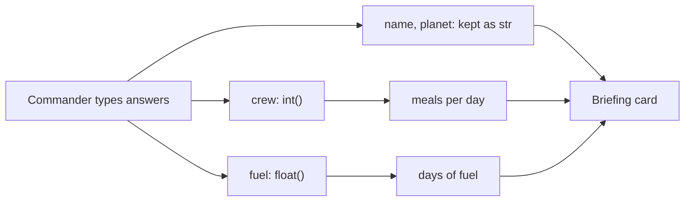

:::objectives
- Store fixed facts in variables at the top of a program so they're easy to change.
- Choose the right conversion for each `input()`: none, `int()`, or `float()`.
- Spot a quiet type bug that gives a wrong answer without any error.
- Lay out a neat report with f-strings and round long decimals with `round()`.
:::

Mission control needs a program that interviews the commander before launch and prints a briefing card. It has to remember four answers, turn some of them into numbers, do some fuel math, and print everything in tidy columns. That's every idea from this week's Notes in one program.

Here's how the data flows through it. Text comes in from the keyboard, some of it gets converted, the numbers get crunched, and everything lands on the card:



In IDLE, create `week2/mission_briefing.py` and follow along.

## Step 1: Store the facts that never change

Some values are known before the program even starts. Store them in variables at the top, where they're easy to find and change later.

```python run title="mission_briefing.py"
# ----- Fixed facts about the ship -----
ship_name = "Starhopper"
fuel_per_day = 3.0        # tons of fuel burned each day
supplies_ready = True

print(ship_name, fuel_per_day, supplies_ready)
```

That's three of the four basic types already: `ship_name` is a `str`, `fuel_per_day` is a `float` because of its decimal point, and `supplies_ready` is a `bool`. The `print()` at the bottom is only there to check your work. Delete it once you've seen the output.

## Step 2: Ask questions, and catch a sneaky bug

Next, ask for the commander's name, the destination, and the crew size. Each crew member eats three meals a day, so multiply to get meals per day. Run it and answer `Rivera`, `Mars`, and `4`:

```python run input="Rivera|Mars|4"
commander = input("Commander, what is your name? ")
planet = input("Which planet are we flying to? ")
crew = input("How many crew members (including you)? ")

meals_per_day = crew * 3
print("Meals per day:", meals_per_day)
```

Four hundred forty-four meals a day. There's no error message, but the answer is badly wrong. Step through the important part and watch the variables panel. Look at what `crew` actually holds: the quote marks around it give it away.

:::trace Watch what `crew` really holds
```python input="4"
crew = input("How many crew members? ")
meals_per_day = crew * 3
print("Meals per day:", meals_per_day)
```
:::

`input()` returned the **string** `"4"`, and a string times 3 repeats the string, exactly like `"=" * 32` repeats an equals sign. Quiet bugs like this are the dangerous ones, because nothing warns you. You only catch them by checking whether the answer makes sense.

Fix it by converting the answer to an `int`:

```python
crew = int(input("How many crew members (including you)? "))
```

Now `crew * 3` gives `12`. Leave `commander` and `planet` alone: they really are text, and converting them would make no sense.

:::video SOLnbKI73Wo
Khan Academy on user input. Watch for the point where the video converts what the user typed before using it as a number; it's the same fix you just made to `crew`.
:::

## Step 3: Fuel math with floats

Fuel can be a fraction, like 37.5 tons, so convert it with `float()`, not `int()`. Then divide by the fuel burned per day to see how many days it lasts. Try it with `50`:

```python run input="50"
fuel_per_day = 3.0
fuel = float(input("How many tons of fuel are loaded? "))
days_of_fuel = fuel / fuel_per_day
print("Fuel lasts:", days_of_fuel, "days")
print("Fuel lasts:", round(days_of_fuel, 1), "days")
```

Division with `/` always gives a float, and 50 divided by 3 goes on forever, so Python shows every digit it stores. `round(value, 1)` rounds to one decimal place, which a commander can actually read at a glance.

:::tip
For every `input()`, ask one question: "Will I do math with this?" If yes, wrap it in `int()` for whole numbers or `float()` for numbers that might have decimals. If no, leave it as a string.
:::

## Step 4: Print the briefing card

Now put it together. The f-strings use spaces after each label so the values line up in a neat column. Here's the complete program, run with `Rivera`, `Mars`, `4`, and `50`:

```python run title="mission_briefing.py" input="Rivera|Mars|4|50"
# mission_briefing.py
# Asks for mission details and prints a personalized briefing.
# Week 2 code-along: variables, types, input(), and conversions.

# ----- Fixed facts about the ship -----
ship_name = "Starhopper"
fuel_per_day = 3.0        # tons of fuel burned each day
supplies_ready = True

# ----- Ask the commander -----
commander = input("Commander, what is your name? ")
planet = input("Which planet are we flying to? ")
crew = int(input("How many crew members (including you)? "))
fuel = float(input("How many tons of fuel are loaded? "))

# ----- Work out the numbers -----
days_of_fuel = round(fuel / fuel_per_day, 1)
meals_per_day = crew * 3

# ----- Print the briefing -----
print()
print("=" * 32)
print(f"MISSION BRIEFING: {ship_name}")
print("=" * 32)
print(f"Commander:      {commander}")
print(f"Destination:    {planet}")
print(f"Crew on board:  {crew}")
print(f"Fuel loaded:    {fuel} tons")
print(f"Fuel lasts:     {days_of_fuel} days")
print(f"Meals per day:  {meals_per_day}")
print(f"Supplies ready: {supplies_ready}")
print("=" * 32)
print(f"Good luck, Commander {commander}!")
```

Two lines of the card are worth a closer look. The commander typed `50`, but the card says `Fuel loaded: 50.0 tons`, because `float()` always produces a number with a decimal point. And `Supplies ready: True` shows that a Boolean prints as the word `True`.

The program is organized the way most programs are: fixed facts, then input, then calculations, then output. When something goes wrong, that order tells you which section to look in.

## Step 5: Try to break it

Testing means typing what a real user might type, not just the answers you hoped for. Run it again and answer `four` for the crew size:

```python run raises title="mission_briefing.py" input="Rivera|Mars|four"
commander = input("Commander, what is your name? ")
planet = input("Which planet are we flying to? ")
crew = int(input("How many crew members (including you)? "))
```

`int()` only understands digits, so the word `four` stops the program with a `ValueError`. For now, the defense is a prompt that makes it obvious what to type. In a few weeks you'll learn how to check an answer and ask again.

Then try a few more, and predict each result before you press Enter:

-   A crew of `0`. What happens to meals per day?
-   Fuel of `37.5`. Does it still work? (It should, because fuel uses `float()`.)
-   A crew of `2.5`. Why does this crash, and is crashing actually reasonable for half a person?

:::warning
If you rename a variable, rename it **everywhere**. Changing `crew` to `crew_size` on the input line but not in the f-strings gives `NameError: name 'crew' is not defined`, pointing at the first line that still uses the old name.
:::

:::quiz
Q: Why is `crew` converted with `int()` but `fuel` with `float()`?
- [ ] `int()` is faster, so it's used wherever possible
  Speed isn't the reason. The choice depends on what values make sense.
- [x] Crew counts are whole numbers, but fuel can be a fraction like 37.5
  `int()` would crash on `37.5`, and a crew of 2.5 people should be rejected.
- [ ] `float()` only works on the last `input()` in a program
  Any `input()` can be converted with either function.

Q: Before the fix, why did 4 crew members give 444 meals with no error?
- [ ] Python multiplied 4 by 111
  No arithmetic happened at all.
- [x] `crew` held the string `"4"`, and a string times 3 repeats it
  Repeating a string is legal, so Python had nothing to complain about.
- [ ] `meals_per_day` was stored as a float
  The result was a string, `"444"`, not a number of any kind.

Q: Why store `fuel_per_day = 3.0` in a variable instead of typing `3.0` in the division?
- [x] If the ship's engines change, you edit one clearly named line
  The name also tells a reader what the 3.0 means, which a bare number doesn't.
- [ ] Python can't divide by a number typed directly
  `fuel / 3.0` works fine. The variable is for people, not for Python.
- [ ] Variables make the math more accurate
  The result is identical either way.
:::

:::takeaways
-   Put fixed facts in clearly named variables at the top of the program.
-   Convert each `input()` based on how you'll use it: `int()` for counts, `float()` for measurements, nothing for text.
-   A string times a number repeats the string, so a missing conversion can give a wrong answer without any error.
-   `/` always gives a float. `round(value, 1)` makes long decimals readable.
-   Test with answers a real user might give, including ones you expect to fail.
:::

## Make it yours

-   Ask for the mission length in days, then print how many meals the whole trip needs: `crew * 3 * mission_days`.
-   Store `fuel_needed = mission_days * fuel_per_day` and print it beside the fuel loaded, so the commander can compare the two.
-   Change `ship_name` to your own ship. Because it's a variable, you change it in one place and the card updates everywhere.

## Further reading

-   [Built-in functions](https://docs.python.org/3/library/functions.html): the official reference for `input()`, `int()`, `float()`, and `round()`.
-   [Numeric types](https://docs.python.org/3/library/stdtypes.html#numeric-types-int-float-complex): how Python's numbers behave, including what `/` does.
