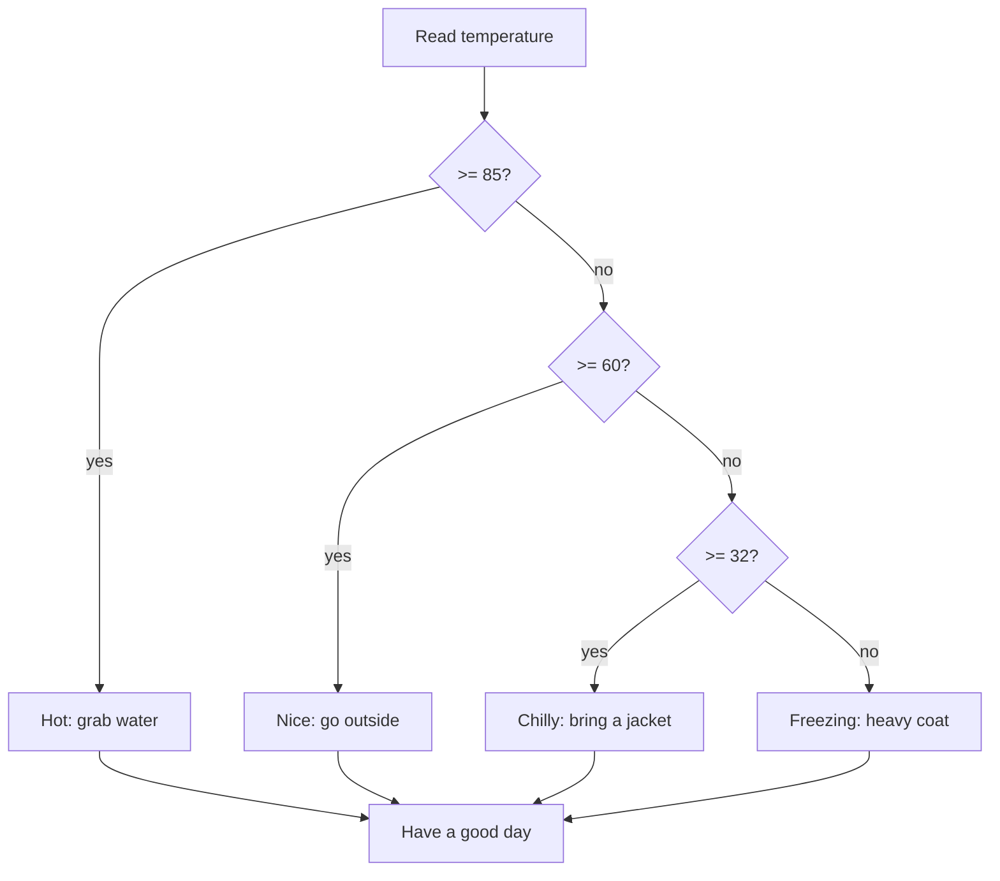

:::objectives
- Use `//`, `%`, and `**`, and predict results using the order of operations.
- Write comparisons that answer `True` or `False`.
- Make a program choose one path with `if`, `elif`, and `else`, and order the conditions correctly.
- Combine conditions with `and`, `or`, and `not`.
- Fix the classic condition bugs: `=` for `==`, missing colons, and `or` written like English.
:::

Here's a grader with a bug in it:

```python run title="grader.py"
score = 95

if score >= 70:
    print("You passed.")
elif score >= 90:
    print("Amazing, an A!")
```

A 95 should earn the A message, but it never appears, for 95 or 100 or any score at all. There's no error and no warning. By the end of this page you'll see exactly why, and the fix is swapping two lines.

Every program you've written so far ran every line, every time. Real programs choose. A thermostat turns on the heat only when it's cold. A game says "Game over" only when your lives hit zero. This week your programs learn to ask a yes/no question and pick a path.

## Three operators you haven't used yet

You know `+`, `-`, `*`, and `/`. Python has three more that turn out to be surprisingly handy:

```python run
print(7 / 2)
print(7 // 2)
print(7 % 2)
print(7 ** 2)
```

| Operator | Name | `7 ? 2` gives | Think of it as |
| --- | --- | --- | --- |
| `/` | divide | `3.5` | The exact answer, always a float |
| `//` | floor divide | `3` | How many whole groups? |
| `%` | modulo (remainder) | `1` | How many are left over? |
| `**` | power | `49` | 7 × 7 |

`//` and `%` are a team. Share 135 minutes into hours, and `//` tells you how many whole hours fit while `%` tells you the minutes left over:

```python run
minutes = 135
hours = minutes // 60
leftover = minutes % 60
print(f"{minutes} minutes is {hours} hours and {leftover} minutes.")
```

`%` is also the standard test for even numbers. `n % 2` is `0` when `n` is even and `1` when it's odd. You'll use that in the practice set.

### Which operator goes first

Python follows the order from math class: parentheses first, then `**`, then `*`, `/`, `//`, and `%`, and finally `+` and `-`. Operators at the same level go left to right.

```python run
print(2 + 3 * 4)
print((2 + 3) * 4)
print(10 - 4 - 3)
print(2 ** 3 * 2)
```

When you're not sure, add parentheses. They cost nothing and make your intent obvious to the next reader.

## Comparisons ask a yes/no question

A comparison checks something and answers with a Boolean, `True` or `False`:

```python run
age = 13
print(age == 13)
print(age != 13)
print(age > 18)
print(age <= 13)
print("cat" == "Cat")
```

The six comparisons are `==` (equal), `!=` (not equal), `<`, `>`, `<=`, and `>=`. Watch the **double** equals sign. A single `=` stores a value; `==` asks whether two values match. String comparisons are exact, so `"cat" == "Cat"` is `False` because of one capital letter.

## if: run some lines only when a condition is true

An `if` statement runs the lines under it only when its condition is `True`:

```python run
lives = 0

if lives == 0:
    print("Game over.")
    print("Press Enter to try again.")

print("Thanks for playing!")
```

Two details make it work. The `if` line ends with a **colon**. The lines that belong to it are **indented** by four spaces, and IDLE does that for you after you type the colon and press Enter. The last `print()` isn't indented, so it isn't part of the `if`: it runs no matter what. Change `lives` to `3` and run it again; only the last line prints.

## if, elif, else: pick exactly one path

Often there are more than two possibilities. `elif` (short for "else if") adds another condition to check, and `else` catches everything left over. Python checks the conditions **from the top down** and runs the block under the **first** one that's `True`. Then it skips the rest of the chain.



Here's that chart as code. Step through it with an answer of 72 and watch which lines get skipped:

:::trace Follow the chain with 72 degrees
```python input="72"
temperature = int(input("Temperature (F)? "))
if temperature >= 85:
    print("It's hot. Grab some water.")
elif temperature >= 60:
    print("Nice weather. Go outside!")
elif temperature >= 32:
    print("Chilly. Bring a jacket.")
else:
    print("Freezing! Wear a heavy coat.")
print("Have a good day.")
```
:::

72 fails the first check, passes the second, and Python jumps straight past everything else in the chain to the last line. It never even looks at `>= 32`, even though 72 is bigger than 32. The same program with 40 lands one branch lower:

```python run input="40" title="weather.py"
temperature = int(input("Temperature (F)? "))
if temperature >= 85:
    print("It's hot. Grab some water.")
elif temperature >= 60:
    print("Nice weather. Go outside!")
elif temperature >= 32:
    print("Chilly. Bring a jacket.")
else:
    print("Freezing! Wear a heavy coat.")
print("Have a good day.")
```

You can have as many `elif` branches as you need. `else` has no condition and is optional; without it, a chain can end up running nothing.

:::video q0bQrGhdPm4
Khan Academy on if-elif-else. Watch for the moment the video shows that only one branch ever runs, even when several conditions would be true.
:::

## Why the grader never says "Amazing"

Now the bug from the top makes sense. With a score of 95, Python checks `score >= 70` first. That's `True`, so it prints "You passed." and skips the rest of the chain. The `elif score >= 90` never gets a turn, for any score.

The fix is to put the **strictest condition first**:

```python run title="grader.py"
score = 95

if score >= 90:
    print("Amazing, an A!")
elif score >= 70:
    print("You passed.")
```

When conditions overlap, order them from the narrowest to the broadest.

## Combine conditions with and, or, not

-   `and` is `True` only when **both** sides are `True`.
-   `or` is `True` when **at least one** side is `True`.
-   `not` flips a Boolean: `not True` is `False`.

| `a` | `b` | `a and b` | `a or b` |
| --- | --- | --- | --- |
| `True` | `True` | `True` | `True` |
| `True` | `False` | `False` | `True` |
| `False` | `True` | `False` | `True` |
| `False` | `False` | `False` | `False` |

Here they are making real decisions at a movie theater:

```python run
age = 14
has_ticket = True
day = "Sunday"

if age >= 13 and has_ticket:
    print("Enjoy the movie!")

if day == "Saturday" or day == "Sunday":
    print("Weekend matinee: $5.")

if not has_ticket:
    print("Please buy a ticket first.")
```

The third `if` prints nothing: `has_ticket` is `True`, so `not has_ticket` is `False`. When you mix them, Python applies `not` first, then `and`, then `or`. Add parentheses to make longer conditions clear.

## The bugs everyone writes once

**Comparing input without converting it.** `input()` gives a string, and Python won't compare text to a number:

```python run raises input="15"
age = input("How old are you? ")
if age > 12:
    print("You can watch it.")
```

Fix: `age = int(input("How old are you? "))`.

**Using `=` where you meant `==`.** Python catches this one and even suggests the fix:

```python run raises
age = 13
if age = 13:
    print("Thirteen!")
```

:::warning
**Forgetting the colon** gives `SyntaxError: expected ':'`. **Forgetting to indent** the line after an `if` gives `IndentationError: expected an indented block after 'if' statement`. Both stop the program before it runs a single line, and IDLE highlights where.
:::

**Writing `or` like English.** This reads fine out loud, and it's wrong:

```python run
color = "blue"
if color == "red" or "orange":
    print("Warm color")
```

The color is blue, yet it says "Warm color". Python reads the condition as `(color == "red") or ("orange")`, and a non-empty string like `"orange"` counts as true all by itself. Repeat the comparison on both sides of `or`:

```python run
color = "blue"
if color == "red" or color == "orange":
    print("Warm color")
else:
    print("Not a warm color")
```

:::quiz
Q: What is `17 % 5`?
- [ ] `3`
  That's `17 // 5`, the number of whole fives in 17.
- [x] `2`
  Three fives make 15, and 2 is left over. `%` gives the remainder.
- [ ] `3.4`
  That's `17 / 5`, the exact division.

Q: With `x = 50`, what does this chain print? `if x > 10:` prints "big", `elif x > 40:` prints "huge", `else:` prints "small".
- [x] Only "big"
  `x > 10` is `True`, so Python runs that branch and skips the rest of the chain.
- [ ] "big" and then "huge"
  Only one branch in a chain ever runs, even if several conditions are true.
- [ ] Only "huge"
  The conditions are checked top to bottom, and `x > 10` comes first.

Q: `age = 15` and `has_pass = False`. Which condition is `True`?
- [ ] `age >= 13 and has_pass`
  `and` needs both sides, and `has_pass` is `False`.
- [x] `age >= 13 or has_pass`
  `or` needs only one side, and `age >= 13` is `True`.
- [ ] `not age >= 13`
  `age >= 13` is `True`, and `not` flips it to `False`.

Q: Why does `if color == "red" or "orange":` say "Warm color" for blue?
- [ ] Python ignores everything after `or`
  It doesn't ignore it. It evaluates `"orange"` on its own.
- [x] `"orange"` by itself counts as true, so the whole `or` is true
  Each side of `or` is its own condition. Write `color == "orange"` on the right.
- [ ] String comparisons ignore capital letters
  They don't, and capitals aren't involved here anyway.
:::

:::takeaways
-   `//` gives whole groups, `%` gives the remainder, and `**` raises to a power.
-   Comparisons like `==` and `>=` produce `True` or `False`. One `=` stores; two `==` compare.
-   An `if` line ends with a colon, and its block is indented four spaces.
-   In an `if`/`elif`/`else` chain, only the first true branch runs, so put the strictest condition first.
-   `and` needs both sides true, `or` needs one, and `not` flips. Repeat the full comparison on each side of `or`.
:::

## Further reading

-   [if statements](https://docs.python.org/3/tutorial/controlflow.html#if-statements): the official tutorial's introduction to `if`, `elif`, and `else`.
-   [Boolean operations](https://docs.python.org/3/library/stdtypes.html#boolean-operations-and-or-not): the official rules for `and`, `or`, and `not`.
-   [Automate the Boring Stuff, Chapter 2](https://automatetheboringstuff.com/2e/chapter2/): a beginner-friendly chapter on Booleans, comparisons, and flow control.
