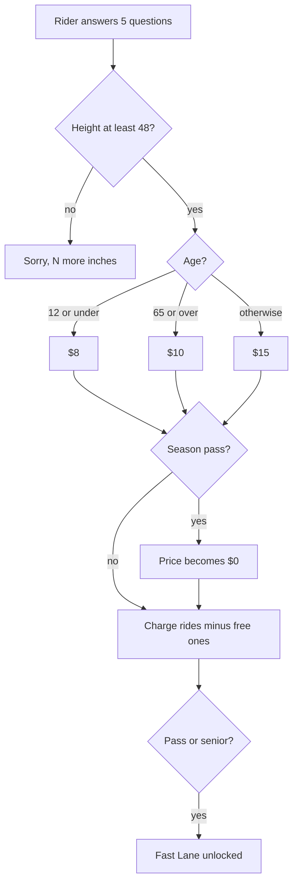

:::objectives
- Turn a list of real-world rules into `if`, `elif`, and `else` statements.
- Test every branch, especially the boundary values where the answer flips.
- Store a yes/no answer as a Boolean and use it in later conditions.
- Use `//` for a "one free in every three" deal, and parentheses to group `and` with `or`.
:::

The Thunderbolt is the tallest coaster in the park, and its ticket booth runs on Python. The park's rules:

-   Riders must be at least **48 inches** tall.
-   Kids 12 and under pay **$8** a ride, seniors 65 and up pay **$10**, and everyone else pays **$15**.
-   Season pass holders ride **free**.
-   Every **third** ride is on the house.
-   Season pass holders and seniors get the **Fast Lane**, but only if they're tall enough to ride at all.

Each rule is one small decision. Here's the whole booth as a picture before we write any of it:



You'll add one rule at a time. Save your work as `week3/coaster_booth.py`.

## Step 1: The height check

Start with the rule that matters most: too short means no ride.

```python run title="coaster_booth.py" input="Leo|52"
min_height = 48     # inches

name = input("Rider name: ")
height = int(input("Height in inches: "))

if height >= min_height:
    print(f"Welcome aboard, {name}!")
else:
    print(f"Sorry {name}, you need {min_height - height} more inches to ride.")
```

That's one side of the line. Now test the other side with a shorter rider:

```python run title="coaster_booth.py" input="Mia|44"
min_height = 48     # inches

name = input("Rider name: ")
height = int(input("Height in inches: "))

if height >= min_height:
    print(f"Welcome aboard, {name}!")
else:
    print(f"Sorry {name}, you need {min_height - height} more inches to ride.")
```

The f-string does subtraction right inside the braces, so Mia learns exactly how far she has to go. Storing `48` in `min_height` means that if the park changes the rule, you edit one line, and the message updates too.

## Step 2: Price by age

Three prices means three outcomes, which calls for `if`, `elif`, and `else`. Try this in a scratch file first:

```python run input="12"
age = int(input("Age: "))

if age <= 12:
    price = 8
elif age >= 65:
    price = 10
else:
    price = 15

print(f"Ticket price: ${price}")
```

Now test the **boundaries**, the ages where the price changes. Predict each one before you run it:

| Age typed | Price you should see | Why |
| --- | --- | --- |
| 12 | $8 | `12 <= 12` is `True` |
| 13 | $15 | Too old for the kid price, too young for the senior price |
| 64 | $15 | One year short of the senior price |
| 65 | $10 | `65 >= 65` is `True` |

Step through the senior case and watch Python skip the kid branch:

:::trace Price a 65-year-old rider
```python input="65"
age = int(input("Age: "))
if age <= 12:
    price = 8
elif age >= 65:
    price = 10
else:
    price = 15
print(f"Ticket price: ${price}")
```
:::

Bugs love boundaries. If you'd typed `age < 12` instead of `age <= 12`, a 12-year-old would pay the adult price. A 10-year-old and a 30-year-old would still get the right answer, so only a test *at* the boundary catches it.

## Step 3: Season passes as a Boolean

Ask whether the rider has a season pass. People type the answer every way imaginable: `yes`, `Yes`, `YES`. Adding `.lower()` to a string gives you an all-lowercase copy, so you only have to compare against one spelling:

```python run input="YES"
answer = input("Season pass (yes/no)? ")
has_pass = answer.lower() == "yes"
print(has_pass)
```

The comparison `answer.lower() == "yes"` produces `True` or `False`, and we store that Boolean in `has_pass`. Later code can then say `if has_pass:`, which reads almost like English. Try `no` and `Yes` too.

## Step 4: Every third ride is free

The deal is one free ride in every three. Floor division answers exactly that question: how many complete groups of three are in the number of rides?

```python run input="7"
price = 15
rides = int(input("How many rides? "))
free_rides = rides // 3        # every 3rd ride is free
total = (rides - free_rides) * price
print(f"Rides: {rides} ({free_rides} free)")
print(f"Total: ${total}")
```

Seven rides hold two complete groups of three, so `7 // 3` is `2`, and the rider pays for 5 rides at $15. The parentheses in `(rides - free_rides) * price` make the subtraction happen before the multiplication. Without them, Python would multiply first and charge something very strange.

## Step 5: The Fast Lane

Pass holders and seniors skip the line, but only if they can ride. In words: *tall enough*, **and** *(has a pass* **or** *is a senior)*. Here it is, tested on a 70-year-old who is only 44 inches tall:

```python run
min_height = 48
height = 44
age = 70
has_pass = False

if height >= min_height and (has_pass or age >= 65):
    print("Fast Lane unlocked: skip the line!")
else:
    print("No Fast Lane.")
```

Correct: she can't ride, so no Fast Lane. Now delete the parentheses and run the same rider again:

```python run
min_height = 48
height = 44
age = 70
has_pass = False

if height >= min_height and has_pass or age >= 65:
    print("Fast Lane unlocked: skip the line!")
else:
    print("No Fast Lane.")
```

Python does `and` before `or`, so without parentheses it reads the condition as `(height >= min_height and has_pass) or age >= 65`. Being 70 is enough to make that `True`, and the booth hands a Fast Lane pass to someone who isn't allowed on the ride.

:::video p7pJMvD2sag
Khan Academy on evaluating compound Boolean expressions. Watch how the video works out each small comparison first and then combines the results; try doing the same with the Fast Lane condition for a 70-year-old who is 44 inches tall.
:::

## Step 6: The complete booth

Here's everything together, organized into sections. This run is Jay: 60 inches, 16 years old, with a season pass, buying 5 rides.

```python run title="coaster_booth.py" input="Jay|60|16|YES|5"
# coaster_booth.py
# Ticket booth for the Thunderbolt roller coaster.
# Week 3 code-along: operators, if/elif/else, and/or/not.

min_height = 48     # inches

# ----- Ask the rider -----
name = input("Rider name: ")
height = int(input("Height in inches: "))
age = int(input("Age: "))
answer = input("Season pass (yes/no)? ")
has_pass = answer.lower() == "yes"
rides = int(input("How many rides? "))

# ----- Price per ride, by age -----
if age <= 12:
    price = 8
elif age >= 65:
    price = 10
else:
    price = 15

# Season pass holders pay nothing.
if has_pass:
    price = 0

# ----- Every 3rd ride is free -----
free_rides = rides // 3
total = (rides - free_rides) * price

# ----- Decision -----
print()
if height < min_height:
    print(f"Sorry {name}, you need {min_height - height} more inches to ride.")
else:
    print(f"Welcome aboard, {name}!")
    print(f"Rides: {rides} ({free_rides} free)")
    print(f"Total: ${total}")

if height >= min_height and (has_pass or age >= 65):
    print("Fast Lane unlocked: skip the line!")
```

Notice that the age chain always runs and sets a price, and *then* the season pass check can overwrite it with 0. Order is doing real work here: if the pass check came first, the age chain would overwrite the free price.

Now run your own copy for three more riders. Predict each result first, then check:

| Rider | Height | Age | Pass | Rides | What should happen |
| --- | --- | --- | --- | --- | --- |
| Leo | 52 | 13 | no | 7 | Welcome, 2 free rides, $75, no Fast Lane |
| Grandma Rose | 62 | 70 | no | 2 | Welcome, $20, Fast Lane |
| Mia | 44 | 9 | Yes | 4 | Sorry, 4 more inches, no Fast Lane |

Mia has a season pass but still gets no Fast Lane, because the `and` insists she's tall enough first. That one line encodes a rule that's easy to get wrong.

:::warning
Check your indentation carefully. The three `print()` lines under `else:` must all be indented by the same four spaces. If one isn't, you'll get an `IndentationError`, or worse, a line that runs for the wrong riders.
:::

:::quiz
Q: Why does the pass check (`if has_pass: price = 0`) come *after* the age chain?
- [x] So the age chain can't overwrite the free price
  The age chain always sets a price. Putting the pass check last lets it have the final word.
- [ ] Python requires Boolean checks to come last
  Python lets you put conditions in any order. The order here is about getting the right answer.
- [ ] It doesn't matter; both orders give the same totals
  Swap them and every pass holder pays full price again.

Q: Which test would catch someone typing `age < 12` instead of `age <= 12`?
- [ ] A rider aged 10
  10 is under 12 either way, so both versions say $8.
- [x] A rider aged 12
  `12 <= 12` is true but `12 < 12` is false, so only this boundary shows the difference.
- [ ] A rider aged 30
  Both versions charge a 30-year-old $15.

Q: A rider buys 8 rides. How many are free?
- [ ] 3
  Three free rides would need 9 rides.
- [x] 2
  `8 // 3` is 2: two complete groups of three, with 2 rides left over.
- [ ] 2.67
  `//` drops the remainder and gives a whole number.
:::

:::takeaways
-   Turn each rule into one small decision, and add them to the program one at a time.
-   Test both sides of every condition, and test the exact boundary values.
-   Storing a comparison like `answer.lower() == "yes"` in a Boolean makes later conditions read clearly.
-   `rides // 3` counts complete groups, which is exactly "one free in every three".
-   Python does `and` before `or`. Use parentheses whenever you mix them.
:::

## Make it yours

-   Add a "VIP" rule: anyone whose name is `"Ada"` rides free. Where in the program does that check have to go?
-   Kids under 5 ride free, though they're almost never 48 inches tall. Add an `elif age < 5:` branch, and work out where it must go in the chain for it to ever run.
-   Use `not` to print "Buy a season pass and ride free!" for anyone tall enough who doesn't have one.

## Further reading

-   [if statements](https://docs.python.org/3/tutorial/controlflow.html#if-statements): official examples of `if`/`elif`/`else` chains.
-   [Operator precedence](https://docs.python.org/3/reference/expressions.html#operator-precedence): the official table of which operators Python applies first, including `and`, `or`, and `not`.
-   [str.lower()](https://docs.python.org/3/library/stdtypes.html#str.lower): the string method the booth uses to accept `YES`, `Yes`, and `yes`.
