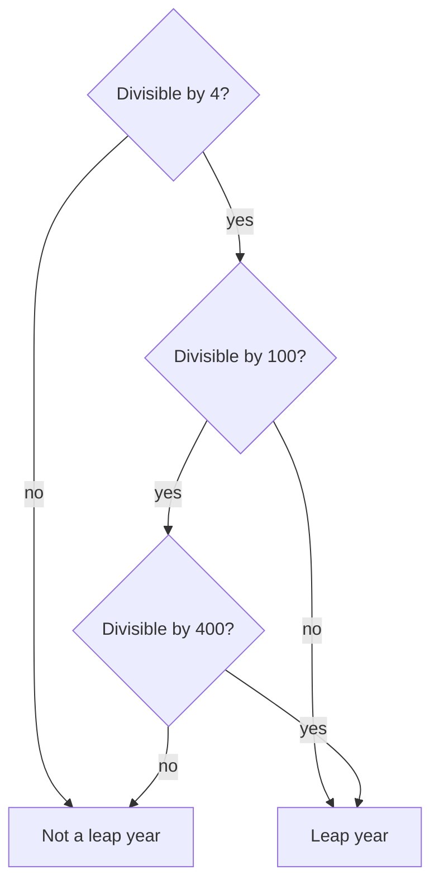

:::objectives
- Use `%` and `//` to test numbers and split amounts into parts.
- Write `if`/`elif`/`else` chains whose order gives the right answer at every boundary.
- Build complicated conditions out of small, named Boolean variables.
- Test every branch of a program, not just the first one that works.
:::

Every exercise this week asks a question and does something different depending on the answer. That means one test run is never enough. Run each program at least once for **every** branch, plus the boundary values where the answer flips. Save your files in your `week3` folder.

## Warm-up

Predict all three lines before you run this:

```python run
print(17 // 5, 17 % 5)
print(10 % 2 == 0)
print(not 3 > 2)
```

Five goes into 17 three whole times with 2 left over. Ten divided by 2 leaves no remainder, so the comparison is `True`. And `3 > 2` is `True`, which `not` flips to `False`.

### Exercise 1: Even or odd

Ask for a whole number and say whether it's even or odd. Test it with `14`, `7`, `0`, and `-3`.

```text
Enter a whole number: 14
14 is even.
```

```text
Enter a whole number: -3
-3 is odd.
```

:::hint
What's the remainder when you divide an even number by 2? Which operator gives you a remainder?
:::

:::solution
```python run title="ex1_even_odd.py" input="-3"
number = int(input("Enter a whole number: "))

if number % 2 == 0:
    print(f"{number} is even.")
else:
    print(f"{number} is odd.")
```

A number is even when dividing it by 2 leaves nothing over, so `number % 2 == 0` is the test. Zero counts as even, and negative numbers work too: in Python, `-3 % 2` is `1`.
:::

### Exercise 2: Make change

A vending machine owes a customer some cents. Ask how many, then print how many quarters (25¢), dimes (10¢), nickels (5¢), and pennies make that amount, using as few coins as possible.

```text
Cents owed: 87
Quarters: 3
Dimes: 1
Nickels: 0
Pennies: 2
```

:::hint
`cents // 25` tells you how many quarters fit. `cents % 25` tells you what's left after taking them out. Store that leftover in a variable, then do the same with 10, then with 5.
:::

:::solution
```python run title="ex2_change.py" input="87"
cents = int(input("Cents owed: "))

quarters = cents // 25
left = cents % 25
dimes = left // 10
left = left % 10
nickels = left // 5
pennies = left % 5

print(f"Quarters: {quarters}")
print(f"Dimes: {dimes}")
print(f"Nickels: {nickels}")
print(f"Pennies: {pennies}")
```

Each coin follows the same two-step pattern: `//` counts how many of that coin fit, and `%` keeps what's left for the next, smaller coin. Reusing the variable `left` makes the pattern easy to see.
:::

Step through it and watch `left` shrink from 87 to 12 to 2:

:::trace Watch the leftover cents shrink
```python input="87"
cents = int(input("Cents owed: "))
quarters = cents // 25
left = cents % 25
dimes = left // 10
left = left % 10
nickels = left // 5
pennies = left % 5
print(quarters, dimes, nickels, pennies)
```
:::

### Exercise 3: Letter grades

Ask for a test score from 0 to 100 and print the letter grade: 90 and up is an A, 80 to 89 a B, 70 to 79 a C, 60 to 69 a D, and below 60 an F.

```text
Test score (0-100): 89
Score: 89  Grade: B
```

Test the boundaries: 90, 89, 80, 79, 60, and 59.

:::hint
Start with the highest grade and work down. Each `elif` only runs when every condition above it was `False`, so by the time you check for a B you already know the score is below 90.
:::

:::solution
```python run title="ex3_grades.py" input="89"
score = int(input("Test score (0-100): "))

if score >= 90:
    grade = "A"
elif score >= 80:
    grade = "B"
elif score >= 70:
    grade = "C"
elif score >= 60:
    grade = "D"
else:
    grade = "F"

print(f"Score: {score}  Grade: {grade}")
```

The order is what makes this work. You don't need `score >= 80 and score < 90` for a B, because a score of 90 or more would already have been caught by the first branch.
:::

Step through it with 79 and count how many conditions Python checks before it finds a match:

:::trace Grade a 79
```python input="79"
score = int(input("Test score (0-100): "))
if score >= 90:
    grade = "A"
elif score >= 80:
    grade = "B"
elif score >= 70:
    grade = "C"
elif score >= 60:
    grade = "D"
else:
    grade = "F"
print(f"Score: {score}  Grade: {grade}")
```
:::

### Exercise 4: Log in

The only account has the username `coder` and the password `py4life`. Ask for both and print one of three messages:

```text
Username: coder
Password: py4life
Welcome back, coder!
```

```text
Username: coder
Password: password
Wrong password. Try again.
```

```text
Username: Coder
Password: py4life
No account with that username.
```

:::hint
Which situation needs *both* things to be right? Check that one first. A correct username with a wrong password is the next case, and everything else falls to `else`.
:::

:::solution
```python run title="ex4_login.py" input="coder|password"
username = input("Username: ")
password = input("Password: ")

if username == "coder" and password == "py4life":
    print("Welcome back, coder!")
elif username == "coder":
    print("Wrong password. Try again.")
else:
    print("No account with that username.")
```

The `and` branch must come first. If you checked `username == "coder"` on its own first, a correct login would get "Wrong password." The third sample shows that `==` is case-sensitive: `Coder` isn't `coder`.
:::

### Exercise 5: Leap year

A year is a leap year if it's divisible by 4, **except** that years divisible by 100 aren't, **unless** they're also divisible by 400. Ask for a year and say whether it's a leap year.

| Year | Leap year? | Why |
| --- | --- | --- |
| 2024 | Yes | Divisible by 4 |
| 2026 | No | Not divisible by 4 |
| 1900 | No | Divisible by 100 but not 400 |
| 2000 | Yes | Divisible by 400 |

```text
Year: 1900
1900 is not a leap year.
```

:::hint
"Divisible by 4" means `year % 4 == 0`. Store each of the three "divisible by" facts in its own Boolean variable first, then build the condition out of those names. If it helps, follow this chart with each test year:


:::

:::solution
```python run title="ex5_leap_year.py" input="1900"
year = int(input("Year: "))

divisible_by_4 = year % 4 == 0
divisible_by_100 = year % 100 == 0
divisible_by_400 = year % 400 == 0

if divisible_by_4 and (not divisible_by_100 or divisible_by_400):
    print(f"{year} is a leap year.")
else:
    print(f"{year} is not a leap year.")
```

Read the condition aloud: "divisible by 4, and either not divisible by 100 or divisible by 400." The parentheses keep the `or` together so the code says what the rule says. Run it with all four test years, and make sure each one lands on the answer in the table.
:::

:::video 276Djs2h18Y
Khan Academy on nested conditionals: an `if` inside another `if`. Watch for how each inner question only gets asked once the outer one is answered, which is another way to write the leap-year chart above.
:::

### Exercise 6: Biggest of three

Ask for three numbers (decimals allowed) and print the biggest. Don't use Python's built-in `max()`; work it out with `if`, `elif`, and `else`.

```text
First number: 4
Second number: 19
Third number: 7
The biggest number is 19.0.
```

Make sure it also works when two numbers tie for biggest, like `8`, `8`, `3`, and with negative numbers.

:::hint
If `a` is at least as big as both `b` and `c`, you're done. If it isn't, the answer must be whichever of `b` and `c` is larger, which takes only one more comparison.
:::

:::solution
```python run title="ex6_biggest.py" input="8|8|3"
a = float(input("First number: "))
b = float(input("Second number: "))
c = float(input("Third number: "))

if a >= b and a >= c:
    biggest = a
elif b >= c:
    biggest = b
else:
    biggest = c

print(f"The biggest number is {biggest}.")
```

If `a` beats or ties both others, it's the biggest. If not, the answer is whichever of `b` and `c` is larger, so the `elif` only has to compare those two. With `8`, `8`, `3`, the first branch wins and prints `8.0`. When two numbers tie for biggest, either one is a correct answer, because they're equal. Trace `3`, `5`, `8` in your head to see the `else` branch catch the biggest one.
:::

### Challenge: Rock, paper, scissors

Play one round against the computer. The computer picks at random, the player types a move, and the program announces the result. It should accept `Rock` or `ROCK` as well as `rock`, and reject anything that isn't a real move.

To make the computer choose, put these two lines at the top of your program:

```python
import random
computer = random.choice(["rock", "paper", "scissors"])
```

`random.choice` picks one item from the list in square brackets. You'll learn all about lists in week 5.

Since the computer is random, your runs will differ. Three of the possible outcomes, with the player typing `paper` each time, plus a typo:

```text
rock, paper, or scissors? paper
The computer chose scissors. The computer wins!
```

```text
rock, paper, or scissors? paper
The computer chose rock. You win!
```

```text
rock, paper, or scissors? lizard
'lizard' is not a valid move.
```

:::hint
Make two Boolean variables before any `if`. `valid` is true when the move is one of the three words. `player_wins` is true for the three winning pairs: rock beats scissors, paper beats rock, scissors beats paper. Then the `if` chain becomes short: invalid, tie, player wins, otherwise the computer wins.
:::

:::solution
```python run title="rock_paper_scissors.py" input="Paper"
# rock_paper_scissors.py
# One round of rock, paper, scissors against the computer.
import random

computer = random.choice(["rock", "paper", "scissors"])
player = input("rock, paper, or scissors? ").lower()

valid = player == "rock" or player == "paper" or player == "scissors"
player_wins = (
    (player == "rock" and computer == "scissors")
    or (player == "paper" and computer == "rock")
    or (player == "scissors" and computer == "paper")
)

if not valid:
    print(f"'{player}' is not a valid move.")
elif player == computer:
    print(f"The computer chose {computer}. It's a tie!")
elif player_wins:
    print(f"The computer chose {computer}. You win!")
else:
    print(f"The computer chose {computer}. The computer wins!")
```

Two Boolean variables do the heavy lifting. `valid` uses `or` to accept any of the three moves, and `not valid` catches everything else first. `player_wins` lists the three winning pairs, each one an `and`, joined by `or`. Wrapping a long condition in parentheses lets you split it across lines so it stays readable. After those checks, if it isn't a tie and the player didn't win, the computer must have won, so a plain `else` is enough. This run's computer move was random, so run it a few times in IDLE to see every outcome.
:::
