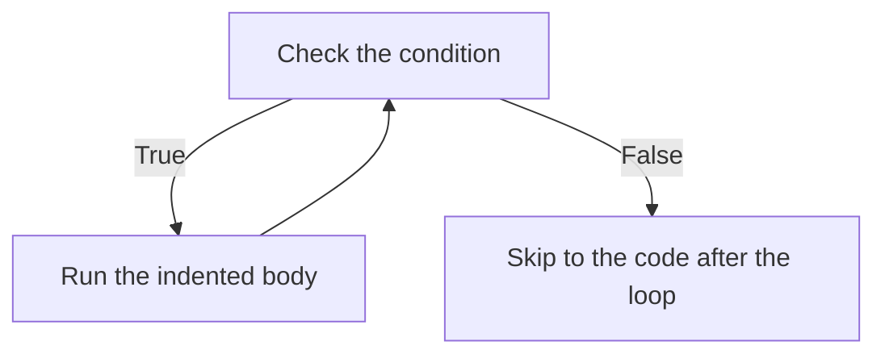

:::objectives
- Repeat a block of code a set number of times with `for` and `range()`.
- Choose the start, stop, and step of `range()` without falling into the off-by-one trap.
- Keep a running total or a count while a loop runs.
- Write a `while` loop that stops by itself, and rescue a program stuck in one that doesn't.
:::

In the opening of many *Simpsons* episodes, Bart is stuck at a chalkboard writing the same sentence over and over as punishment. By hand, that takes ages. Python can do it in two lines:

```python run title="chalkboard.py"
for i in range(5):
    print("I will not skip my Python homework.")
```

That's five copies. Change `5` to `500`, press **F5** in IDLE, and Bart's whole afternoon is done before you can blink. This is a **loop**: code that Python runs again and again. You write the instructions once, and the loop decides how many times they happen.

Python has two loops, and each one answers a different question:

-   **`for`** means "do this once for each one of these": each number, each letter, each item.
-   **`while`** means "keep doing this as long as something is still true".

## How a for loop is built

Before you look at the output, guess two things: how many `Lap` lines will print, and which number comes first?

```python run title="laps.py"
for lap in range(4):
    print("Lap", lap)
print("Race over!")
```

If you guessed four laps starting at 1, you're in good company, and you're off by one. Here's each piece:

-   `for lap in` creates a **loop variable** named `lap`. Each time around, Python puts the next value into it. You pick the name.
-   `range(4)` hands out the numbers 0, 1, 2, 3. That's four numbers, starting at **0**.
-   The colon `:` at the end of the line says "the loop body comes next".
-   The indented line is the **loop body**, the part that repeats. IDLE indents it for you after the colon.
-   `print("Race over!")` isn't indented, so it's not part of the loop. It runs once, after the last lap.

One pass through the body is called an **iteration**. Step through the program below and watch `lap` change on each one.

:::trace Watch `lap` take each value from `range(4)`
```python
for lap in range(4):
    print("Lap", lap)
print("Race over!")
```
:::

## range() starts at 0 and stops early

Think of the stop number in `range()` as a finish line you never step on. `range(4)` runs up to the line and stops right before it, so you get 0 to 3. Give it a second number and you choose where to start. Give it a third and you choose the size of each jump, called the **step**.

| You write | Numbers you get | Read it as |
| --- | --- | --- |
| `range(5)` | 0, 1, 2, 3, 4 | start at 0, stop before 5 |
| `range(1, 6)` | 1, 2, 3, 4, 5 | start at 1, stop before 6 |
| `range(0, 20, 5)` | 0, 5, 10, 15 | start at 0, add 5 each time, stop before 20 |
| `range(10, 0, -3)` | 10, 7, 4, 1 | start at 10, subtract 3 each time, stop before 0 |

A negative step counts down. Here are two of these in action:

```python run title="ranges.py"
for n in range(1, 6):
    print(f"{n} squared is {n * n}")

print("Counting down by threes:")
for n in range(10, 0, -3):
    print(n)
```

:::warning
`range(1, 10)` gives 1 to **9**, not 1 to 10. Getting the last number wrong like this is called an **off-by-one error**, and professional programmers make it all the time. The fix is the same for everyone: if you want to include the number `n`, stop at `n + 1`. So 1 to 10 is `range(1, 11)`.
:::

:::try
Make a rocket countdown that prints 10, 9, 8 and so on down to 1, then `Liftoff!`. Which three numbers go inside `range()`? (Hint: you want to include 1, so where must the countdown stop?)
:::

## A for loop can walk through a string

A string is a row of characters, and `for` can visit them one at a time. The loop variable holds one letter per iteration. Here's a cheerleader chant that spells out a team name:

```python run title="cheer.py"
team = "CATS"
for letter in team:
    print(letter + "!")
print("What does that spell?", team + "!")
```

The loop ran four times because `"CATS"` has four characters. You didn't have to count them; the loop stops when it runs out of letters. That's the big advantage of `for`: it always knows where the end is.

## Keep a running total while you loop

Picture the scorekeeper at a basketball game. The scoreboard starts at 0 before tip-off. Every basket adds points to whatever's already up there. Nobody resets the board after each shot. That's the **accumulator pattern**:

1.  Before the loop, create a variable that starts at 0.
2.  Inside the loop, add the new value to it.
3.  After the loop, the variable holds the total.

This program asks how long you practiced on three days. The run below shows what happens when someone types 20, 35, and 15:

```python run title="practice.py" input="20|35|15"
total = 0
for day in range(1, 4):
    minutes = int(input(f"Minutes practiced on day {day}: "))
    total = total + minutes
print("Total:", total, "minutes")
print("Average:", round(total / 3), "minutes a day")
```

The key line is `total = total + minutes`. Read it right to left: take the old total, add the new minutes, and store the answer back in `total`.

A **counter** is the same pattern, except you add 1 instead of a value, and usually only when an `if` says so. This one counts how many numbers from 1 to 10 divide evenly by 3. Step through it and watch `count` sit still most of the time and jump only when `n % 3 == 0`.

:::trace Watch the counter go up only when the `if` is true
```python
count = 0
for n in range(1, 11):
    if n % 3 == 0:
        count = count + 1
print(count, "numbers from 1 to 10 divide evenly by 3")
```
:::

Here's the classic accumulator bug. The total is set to 0 *inside* the loop, so the scoreboard gets wiped before every shot:

```python run title="broken_total.py" input="20|35|15"
for day in range(1, 4):
    total = 0
    minutes = int(input(f"Minutes practiced on day {day}: "))
    total = total + minutes
print("Total:", total, "minutes")
```

There's no error message, just a wrong answer: 15 minutes instead of 70. Only the last day survives, because each pass starts over from zero. Move `total = 0` above the loop and it's fixed.

## while: keep going as long as something is true

A `for` loop is like a playlist with a set number of songs. A `while` loop is "keep the music playing until someone says stop". You don't know in advance how many songs that will be.



Python checks the condition first. If it's `True`, the body runs, and then Python goes back and checks again. The moment the condition is `False`, Python skips past the loop.

```python run title="lander.py"
fuel = 3
while fuel > 0:
    print("Fuel left:", fuel)
    fuel = fuel - 1
print("Out of fuel. Landing now.")
```

The line that makes this work is `fuel = fuel - 1`. Every iteration moves `fuel` one step closer to 0, so `fuel > 0` is guaranteed to become `False` eventually. **Every `while` loop needs a line like that**, something in the body that pushes the condition toward `False`.

### Ask again until the answer makes sense

`while` shines when you can't know ahead of time how many repeats you'll need. You can't predict how many times a user will type nonsense, so you keep asking until they don't. In this run, the user typed 200, then -3, then 13:

```python run title="age_check.py" input="200|-3|13"
age = int(input("How old are you? "))
while age < 5 or age > 120:
    print("Hmm, that doesn't look right.")
    age = int(input("How old are you? "))
print("Thanks! Next year you will be", age + 1)
```

The `input()` line appears twice: once before the loop, so `age` has a value to check, and once inside, so the user gets another chance. Leave out the one inside and the loop asks nothing new, so a bad answer keeps it spinning forever.

### Leave early with break

Sometimes it's simpler to write `while True:`, a loop that would run forever on its own, and jump out with `break` when something happens. `break` ends the nearest loop immediately, even in the middle of the body.

```python run title="word_count.py" input="pizza|loop|stop"
count = 0
while True:
    word = input("Type a word (or stop): ")
    if word == "stop":
        break
    count = count + 1
print("You typed", count, "words.")
```

Notice that `stop` didn't get counted. When `break` runs, Python leaves the loop on the spot, so `count = count + 1` never happens for that word.

## When a loop never stops

If nothing in the body ever makes the condition `False`, you get an **infinite loop**. This version forgot to subtract from `fuel`, so it prints `Fuel left: 3` forever:

```python
fuel = 3
while fuel > 0:
    print("Fuel left: ", fuel)
```

:::tip
To stop a runaway program in IDLE, click in the Shell window and press **Ctrl+C** (on a Mac too, it's Control, not Command), or choose **Shell > Interrupt Execution**. You'll see `KeyboardInterrupt` and a fresh `>>>` prompt. Then look for the variable your loop forgot to update.
:::

## for or while?

Ask yourself one question: **do I know how many times this should repeat?**

| Situation | Loop | Why |
| --- | --- | --- |
| Print a times table from 1 to 12 | `for` | You know it's 12 rows. |
| Go through every letter of a word | `for` | The word knows its own length. |
| Ask for a password until it's right | `while` | It might take one try or ten. |
| Roll a die until you get a 6 | `while` | Nobody knows when the 6 shows up. |

If you can count the repeats before the loop starts, use `for`. If the loop is waiting for something to happen, use `while`.

:::video 6iF8Xb7Z3wQ
What to watch for: the same two loops from this page, `for` and `while`, explained by a different teacher in a different editor. Some of his examples loop over a list, which is next week's topic. Pause before each example runs and say out loud what you expect it to print.
:::

## Mistakes everyone makes with loops

:::warning
**Forgetting the colon.** `for lap in range(4)` with no `:` at the end stops the program before it starts, with `SyntaxError: expected ':'`. IDLE highlights the spot in red.

**Indenting the wrong lines.** Only indented lines repeat. If a line you meant to repeat isn't indented, it runs once, after the loop. If a line you meant to run once *is* indented, it repeats every time. In IDLE, select lines and use **Format > Indent Region** or **Format > Dedent Region** to move them in or out together.
:::

Here's the missing-colon error for real, so you'll recognize it:

```python run raises title="laps.py"
for lap in range(4)
    print("Lap", lap)
```

:::quiz
Q: What numbers does `range(2, 8, 2)` give you?
- [ ] 2, 4, 6, 8
  The stop number is never included, so 8 is left out.
- [x] 2, 4, 6
  Start at 2, jump by 2, and stop before reaching 8.
- [ ] 2, 3, 4, 5, 6, 7
  That's `range(2, 8)`. The third number changes the step to 2.
- [ ] 0, 2, 4, 6
  The first number sets the start, so it begins at 2, not 0.

Q: A loop runs `for n in range(1, 4):`, and its body is `total = 0` followed by `total = total + n`. After the loop, `print(total)` runs. What does it print?
- [ ] `6`
  That's the goal, but `total` is wiped back to 0 at the start of every pass.
- [x] `3`
  Each pass resets `total` to 0 and then adds `n`, so only the last value, 3, survives.
- [ ] `0`
  The reset happens before the add on each pass, so the last pass leaves 0 + 3.
- [ ] A `NameError`
  `total` is created inside the loop before it's used, so Python never complains. It's a logic error, not a crash.

Q: You want to keep asking "Play again? (y/n)" until the user types `n`. Which loop fits best?
- [ ] `for i in range(10):`
  That asks exactly 10 times, even if the user typed `n` on the first try.
- [x] `while answer != "n":`
  You can't know how many rounds someone will want, so you repeat until they say stop.
- [ ] `for letter in "n":`
  That loops once over the single letter `n`, which has nothing to do with what the user types.

Q: A program sets `count = 10`, then runs `while count > 0:` with just `print(count)` in the body. What happens?
- [ ] Nothing, it counts down from 10
  Nothing in the body changes `count`, so it stays 10.
- [x] It never stops, because `count` never changes
  `count > 0` is always `True`. The body needs `count = count - 1`.
- [ ] It prints nothing, because the condition is checked first
  The condition is `True` at the start (10 > 0), so the body does run, again and again.
:::

:::takeaways
- `for` repeats once for each value it's given: each number from `range()`, or each letter in a string.
- `range(stop)` starts at 0 and stops *before* `stop`. To include `n`, stop at `n + 1`.
- Only the indented lines under `for` or `while` repeat.
- A running total starts at 0 **before** the loop and grows inside it.
- A `while` loop needs a line in its body that moves the condition toward `False`, or a `break`.
- Stuck in an infinite loop in IDLE? Press Ctrl+C in the Shell window.
:::

## Further reading

-   [Python Tutorial: for statements and range()](https://docs.python.org/3/tutorial/controlflow.html): the official explanation, with short examples you can paste into IDLE.
-   [Automate the Boring Stuff, Chapter 2: Flow Control](https://automatetheboringstuff.com/2e/chapter2/): free online book chapter with clear diagrams of `while`, `break`, and `for` loops.
-   [Python for Everybody: Loops and Iteration](https://www.py4e.com/lessons/loops): free videos and slides from a university course that start from zero.
