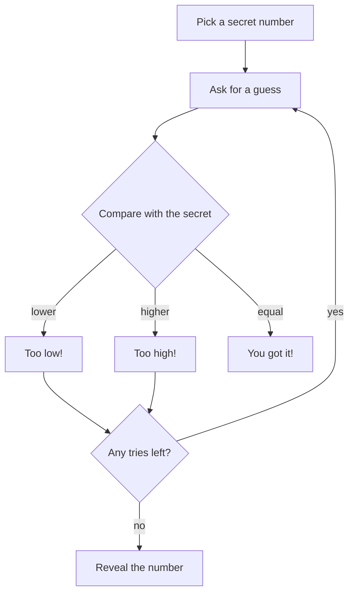

:::objectives
- Build a complete game in five small steps, running it after each one.
- Use a `while` loop that repeats until the player wins or runs out of tries.
- Count tries with a counter, and stop the loop with two conditions joined by `and`.
- Pick a secret with `random.randint()`, and make it repeatable while you test.
:::

The computer picks a secret number from 1 to 100. You guess, and it says "too high" or "too low" until you nail it or run out of tries. It's about 25 lines long, and it uses almost everything from the first four weeks: variables, `input()`, `int()`, `if`/`elif`/`else`, `and`, and this week's `while` loop.

Here's the plan for the finished game. Every box on this chart becomes a line or two of code.



We'll build it in five steps. In IDLE, choose **File > New File**, save it as `guess.py`, and press **F5** after every step. Don't skip ahead. If something breaks, the bug is almost certainly in the few lines you just added.

## Step 1: One guess, with a fixed secret

A random secret is a pain while you're building, because you never know the right answer to type. So programmers **hard-code** it: they pick a number themselves, get everything working, and switch to random at the very end.

```python run title="guess.py" input="30"
secret = 42

guess = int(input("Guess my number (1-100): "))
if guess < secret:
    print("Too low!")
elif guess > secret:
    print("Too high!")
else:
    print("You got it!")
```

The comparison works. Try it with 60 and with 42 so you see all three branches. The problem is obvious, though: you get exactly one chance, and then the program ends.

## Step 2: Keep asking until the guess is right

We want to repeat "ask, then compare" until the guess matches. Nobody knows how many guesses that will take, which is the signal to use `while`. In this run the player guesses 50, then 25, then 42:

```python run title="guess.py" input="50|25|42"
secret = 42
guess = 0

while guess != secret:
    guess = int(input("Guess my number (1-100): "))
    if guess < secret:
        print("Too low!")
    elif guess > secret:
        print("Too high!")
    else:
        print("You got it!")
```

Look at `guess = 0` before the loop. The `while` line is the very first thing to check `guess`, before the player has typed anything, so `guess` has to exist already. Starting at 0 is safe because 0 can never be the secret. Here's what happens if you leave that line out:

```python run raises title="guess.py" input="50"
secret = 42

while guess != secret:
    guess = int(input("Guess my number (1-100): "))
```

Read the last line first: `NameError: name 'guess' is not defined`. Python is saying "you asked me about `guess`, but I've never heard of it." The line number points straight at the `while`.

:::tip
Everything that should repeat (the asking *and* the comparing) must be indented under `while`. If you accidentally un-indent the `if` block, the game asks over and over but never gives a hint, because the hints only run after the loop ends.
:::

## Step 3: Count the tries

Players want to know how well they did. That's a **counter**: start at 0 before the loop, and add 1 every time the loop body runs.

```python run title="guess.py" input="50|25|42"
secret = 42
guess = 0
tries = 0

while guess != secret:
    guess = int(input("Guess my number (1-100): "))
    tries = tries + 1
    if guess < secret:
        print("Too low!")
    elif guess > secret:
        print("Too high!")
    else:
        print("You got it in", tries, "tries!")
```

Step through the same game below. Watch `guess` and `tries` change together, and notice the exact moment the `while` condition turns `False`.

:::trace Watch `guess` and `tries` on each pass
```python input="50|25|42"
secret = 42
guess = 0
tries = 0
while guess != secret:
    guess = int(input("Guess: "))
    tries = tries + 1
    if guess < secret:
        print("Too low!")
    elif guess > secret:
        print("Too high!")
print("Got it in", tries, "tries")
```
:::

## Step 4: Add a limit so you can lose

A game you can't lose isn't much of a game. We'll stop after `max_tries` guesses. Now the loop should keep going only while **both** of these are true: the guess is wrong **and** there are tries left. That's `and` from last week.

| `guess != secret` | `tries < max_tries` | Keep looping? |
| --- | --- | --- |
| True (still wrong) | True (tries left) | Yes |
| False (correct!) | True | No, the player won |
| True (still wrong) | False (out of tries) | No, the player lost |

Here's the code, tested on purpose with a losing game, because the losing path is the one you're most likely to forget to check:

```python run title="guess.py" input="10|90|50|45|43"
secret = 42
guess = 0
tries = 0
max_tries = 5

while guess != secret and tries < max_tries:
    guess = int(input("Guess my number (1-100): "))
    tries = tries + 1
    if guess < secret:
        print("Too low!")
    elif guess > secret:
        print("Too high!")
    else:
        print("You got it in", tries, "tries!")

if guess != secret:
    print("Out of tries! The number was", secret)
```

The loop can now end for two different reasons, so the `if` after it works out which one happened. If the last guess still doesn't match, the only other way out was running out of tries.

## Step 5: Make the secret random

Python comes with a toolbox called the `random` **module**. The line `import random` at the top of your file opens it up, and `random.randint(1, 100)` hands you a whole number from 1 to 100. Unlike `range()`, **both ends are included**, so 100 can come up.

That brings back the testing problem. How do you check the game works when you don't know the answer? Here's a useful secret about computer randomness: it isn't truly random. Python generates its "random" numbers from a formula that begins at a starting value called the **seed**. Give it the same seed and you get the same numbers every time. So while testing, we add `random.seed(2026)`, which makes the secret come out the same on every run.

Here's the finished game. The player in this run uses the smart strategy from the tip below:

```python run title="guess.py" input="50|25|12|18|15|16"
import random

random.seed(2026)    # testing only: delete this line for a new secret every game
secret = random.randint(1, 100)
guess = 0
tries = 0
max_tries = 7

print("I'm thinking of a number from 1 to 100.")
print("You have", max_tries, "tries. Good luck!")

while guess != secret and tries < max_tries:
    guess = int(input("Your guess: "))
    tries = tries + 1
    if guess < secret:
        print("Too low!")
    elif guess > secret:
        print("Too high!")
    else:
        print("You got it in", tries, "tries!")

    if guess != secret and tries < max_tries:
        print("Tries left:", max_tries - tries)

if guess != secret:
    print("Out of tries! The number was", secret)
```

Once it works, delete the `random.seed(2026)` line (or put `#` in front of it to turn it into a comment). Now every game has a new secret, and even you don't know it.

:::tip
Seven tries is always enough if you play smart. Guess the middle (50). If that's too high, guess the middle of what's left (25), and keep cutting the range in half. After 7 halvings, 100 possible numbers shrink to 1. That strategy is called **binary search**, and it's how computers find things fast.
:::

:::video KXJSjte_OAI
What to watch for: how each guess throws away half of the possibilities that are left. That's exactly why 7 guesses always beat a range of 1 to 100, and why the trick still works on a list of millions.
:::

## What can go wrong

**The player types a word.** `int()` only understands digits, so `fifty` crashes the game:

```python run raises title="guess.py" input="fifty"
guess = int(input("Your guess: "))
```

The last line, `ValueError: invalid literal for int() with base 10: 'fifty'`, is `int()` saying it can't turn that text into a number. In Week 6 you'll write a function that keeps asking until it gets a real number.

**Forgetting `tries = tries + 1`.** The counter never moves, `tries < max_tries` stays `True` forever, and the limit never kicks in. You can only lose by guessing wrong forever.

**Putting `secret = random.randint(1, 100)` inside the loop.** The secret changes after every guess, so "too low" followed by "too high" stops making any sense.

:::quiz
Q: Why does the game set `guess = 0` before the `while` loop?
- [ ] So the player's first guess counts as 0
  The player's guess replaces it on the very first pass, so 0 is never used as a real guess.
- [x] Because the `while` line checks `guess` before the player has typed anything
  The condition `guess != secret` runs first, so `guess` must already exist, and 0 can never be the secret.
- [ ] To reset the score between games
  There's only one game per run here. It's about giving the condition something to check.

Q: `max_tries` is 5. The player's fifth guess is wrong. What happens next?
- [ ] The loop asks for a sixth guess
  After the fifth guess, `tries < max_tries` is `5 < 5`, which is `False`, so the loop stops.
- [x] The loop ends, and the `if` after it prints "Out of tries!"
  The `and` needs both parts to be `True`. With no tries left the loop stops, and `guess != secret` is still `True`, so the loss message prints.
- [ ] The program crashes with an error
  Nothing is wrong with the code; running out of tries is a normal way for the loop to finish.

Q: Why is `random.randint(1, 100)` above the loop and not inside it?
- [x] So the secret is chosen once and stays the same for the whole game
  Inside the loop, a new secret would be picked after every guess, and the hints would point at a moving target.
- [ ] Because `random` only works outside loops
  `random.randint()` works anywhere. The problem is *when* it runs, not *where* it's allowed.
- [ ] To make the game run faster
  Speed isn't the issue. Picking a new secret every turn would make the game impossible to win on purpose.
:::

:::takeaways
- Build in small steps and run after each one, so every bug is in the last few lines you wrote.
- Hard-code values like the secret while you build, then make them random at the end.
- A `while` loop is the right choice when you can't know how many times it will repeat.
- A counter starts at 0 before the loop and goes up by 1 inside it.
- `and` lets a loop stop for more than one reason; an `if` after the loop can tell which reason it was.
- `random.randint(a, b)` includes both `a` and `b`. `random.seed()` makes "random" results repeatable for testing.
:::

## Make it yours

Pick one or more:

1.  Ask the player to choose **easy** (1 to 10), **medium** (1 to 50), or **hard** (1 to 100), and use their choice in `randint`. Don't forget the welcome message should match.
2.  When a guess is within 5 of the secret, print `So close!` along with the hint. You'll need to work out the distance with `secret - guess` and check both directions.
3.  Wrap the whole game in another `while` loop that asks `Play again? (y/n)` at the end, and print the player's best (lowest) number of tries when they quit.

## Further reading

-   [Python docs: the random module](https://docs.python.org/3/library/random.html): every function in the toolbox, including `randint`, `choice`, and `seed`.
-   [Invent Your Own Computer Games with Python, Chapter 3: Guess the Number](https://inventwithpython.com/invent4thed/chapter3.html): a free book chapter that builds the same game a different way and explains each line.
