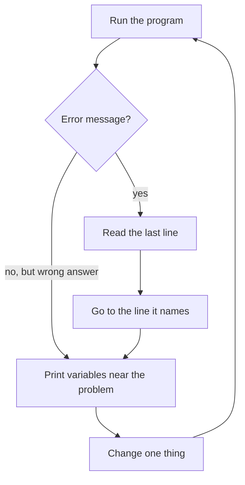

:::objectives
- Define a function with `def` and call it as many times as you like.
- Pass information in with parameters, and hand an answer back with `return`.
- Tell `print` and `return` apart, and explain where a `None` came from.
- Read a traceback from the bottom up to find what went wrong, where, and how the program got there.
:::

Your quiz program prints a banner of `=====` lines with a title at the start, between rounds, and at the end. That's the same four lines pasted into three places. Then your friend says the banner should use `*****` instead. Now you're editing three places, and you'll almost certainly miss one.

A **function** fixes this. You write the lines once, give them a name, and run them by name whenever you want. Change the function and every place that uses it changes too. You've been *using* functions since Week 1: `print()`, `input()`, `len()`, and `int()` are all functions someone else wrote. This week you write your own.

## Define it once, call it anywhere

```python run title="cheer.py"
def cheer():
    print("Go team!")
    print("You can do it!")

print("Before the game")
cheer()
print("Halftime")
cheer()
```

-   `def` means "define". It's followed by the function's name, parentheses, and a colon.
-   The indented lines underneath are the **function body**.
-   **Defining a function doesn't run it.** Python reads the body, remembers it under the name `cheer`, and moves on. The body only runs when you **call** the function by writing `cheer()`.

That's why `Before the game` prints first, even though the `def` is at the top. Step through it and watch the **call stack** on the right: each time `cheer()` is called, a new `cheer()` box appears on top of the global one, and it disappears when the function finishes.

:::trace Watch Python jump into the function and back out
```python
def cheer():
    print("Go team!")
    print("You can do it!")

print("Before the game")
cheer()
print("Halftime")
cheer()
```
:::

Python runs your file from top to bottom, so a function has to be defined *above* the first line that calls it. Call it too early and Python has never heard of it:

```python run raises title="cheer.py"
cheer()

def cheer():
    print("Go team!")
```

## Parameters: give the function something to work with

Think of a function as a form with blanks: "Hi ____!" A **parameter** is the blank, a variable in the parentheses of the `def` line. The value you fill in when you call the function is called an **argument**.

```python run title="greet.py"
def greet(name, smiles):
    print("Hi " + name + "!" + " :)" * smiles)

greet("Maya", 1)
greet("Luis", 3)
```

Arguments match parameters **by position**: the first argument goes into `name`, and the second goes into `smiles`. Swap them, `greet(3, "Luis")`, and Python tries to add `"Hi "` to the number 3. Leave one out and Python stops before the function even starts:

```python run raises title="greet.py"
def greet(name, smiles):
    print("Hi " + name + "!" + " :)" * smiles)

greet("Maya")
```

The message names the function, says how many arguments are missing, and even tells you which parameter didn't get a value.

## return: hand an answer back

`print` and `return` both seem to "give you the answer", but they're very different. `print` is like shouting the answer across the room: everyone hears it, but nobody wrote it down. `return` is like handing the answer on a sticky note to whoever asked, so they can keep it, do math with it, or pass it on.

```python run title="area.py"
def rectangle_area(width, height):
    return width * height

room = rectangle_area(4, 5)
closet = rectangle_area(2, 1.5)
print("Room:", room)
print("Closet:", closet)
print("Total floor:", room + closet)
```

`rectangle_area(4, 5)` is replaced by the value it returns, 20, and that value is stored in `room`. When Python reaches `return`, the function ends right there. Any lines after it in the body are skipped.

### print and return, side by side

This is the most common confusion with functions. Predict what `x` and `y` will be before you look:

```python run title="print_or_return.py"
def add_print(a, b):
    print(a + b)

def add_return(a, b):
    return a + b

x = add_print(2, 3)
y = add_return(2, 3)
print("x is", x)
print("y is", y)
```

`add_print` shows 5 on the screen but hands nothing back, so `x` is `None`, Python's word for "no value". `add_return` hands back 5, and `y` keeps it. The rule: **if you need to use the answer later, return it.**

Functions can return any type, including `True` and `False`. That makes `if` statements read almost like English:

```python run title="even.py"
def is_even(number):
    return number % 2 == 0

for n in range(1, 5):
    if is_even(n):
        print(n, "is even")
    else:
        print(n, "is odd")
```

### Variables inside a function stay inside

```python run raises title="double.py"
def double(n):
    answer = n * 2
    return answer

print(double(21))
print(answer)
```

`42` prints fine, and then Python crashes on the last line. `answer` is a **local variable**: it's created when `double` starts and thrown away when `double` finishes. Code outside the function can't see it. To use a function's result outside, return it and store it: `result = double(21)`.

:::video 9Os0o3wzS_I
What to watch for: `def`, parameters, and `return` explained by a different teacher. The later part of the video covers extras (like default values and `*args`) that go beyond this course, so it's fine to stop once you've seen return values in action.
:::

## Reading error messages

Red text in the Shell isn't Python being rude. It's a detailed report on exactly what went wrong and where, called a **traceback**. Here's a program where the crash happens two function calls deep:

```python run raises title="grades.py"
def average(scores):
    return sum(scores) / len(scores)

def report(name, scores):
    print(name, "averaged", average(scores))

report("Maya", [90, 80, 85])
report("Luis", [])
```

**Read a traceback from the bottom up:**

1.  **The last line says what happened.** `ZeroDivisionError: division by zero`.
2.  **The lines just above it say where.** Line 2, inside `average`.
3.  **Further up shows how you got there.** Line 8 called `report`, and line 5, inside `report`, called `average`.

Maya's line ran fine, which tells you the code works *in general* and something about Luis's input is unusual: his list is empty, so `len(scores)` is 0. Step through the program to watch the call stack grow to three boxes deep, exactly matching the three `File` lines in the traceback, right before it crashes:

:::trace Watch the call stack grow until the crash
```python raises
def average(scores):
    return sum(scores) / len(scores)

def report(name, scores):
    print(name, "averaged", average(scores))

report("Maya", [90, 80, 85])
report("Luis", [])
```
:::

:::video Qmj5UQRkL4s
What to watch for: the same bottom-up reading order, shown on different errors. Notice how the last line always names the error type, and the lines above it trace the path through the code.
:::

### Error types you'll meet

| Error | Example message | Usual cause |
| --- | --- | --- |
| `SyntaxError` | `'(' was never closed` or `expected ':'` | a missing bracket, quote, or colon |
| `IndentationError` | `expected an indented block after 'for' statement on line 1` | the body under `if`, `for`, or `def` isn't indented |
| `NameError` | `name 'scroe' is not defined. Did you mean: 'score'?` | a typo, or using a variable or function before it exists |
| `TypeError` | `can only concatenate str (not "int") to str` | mixing types, like `"You are " + 13`. Use `str(13)` or an f-string. |
| `TypeError` | `greet() missing 1 required positional argument: 'smiles'` | calling a function with too few arguments |
| `ValueError` | `invalid literal for int() with base 10: 'twelve'` | the right type with an impossible value, like `int("twelve")` |
| `IndexError` | `list index out of range` | asking for `colors[2]` when the list has only 2 items |
| `ZeroDivisionError` | `division by zero` | dividing by a variable that turned out to be 0 |

:::tip
In IDLE, a `SyntaxError` or `IndentationError` appears in a pop-up box titled **SyntaxError** before your program even starts, and IDLE marks the problem spot in red. The real mistake is often at the end of the line **just before** the red mark, such as a missing `)` or `:`. For crashes that happen while the program runs, right-click a `File ... line` row of the traceback in the Shell and choose **Go to file/line** to jump straight there.
:::

## A debugging routine that works



1.  **Read the last line** of the error. Say the error type out loud; it narrows the cause to a handful of possibilities.
2.  **Go to the line number** it names. In IDLE, **Edit > Go to Line** jumps there (**Alt+G** on Windows and Chromebook, **Cmd+J** on a Mac). **Options > Show Line Numbers** puts numbers down the side of your file.
3.  **Print your variables** right before that line to see what they really hold, not what you think they hold.
4.  **Change one thing at a time**, and run again after each change.
5.  **Still stuck?** Explain the code out loud, line by line, to a friend or a rubber duck. You'll often hear yourself say the bug.

:::warning
No error doesn't mean no bug. If the program runs but gives the wrong answer, that's a **logic error**, and Python can't spot those for you. You catch them by testing with inputs where you already know the right answer, like checking that a function says 16 slices fit in 2 pizzas.
:::

:::quiz
Q: `def double(n): return n * 2` is defined. What is `double(double(3))`?
- [ ] `6`
  That's `double(3)`. The outer call doubles that answer again.
- [x] `12`
  The inner call returns 6, and the outer call doubles 6 to 12. This only works because `double` *returns* its answer.
- [ ] `None`
  `double` returns a value, so nothing here is `None`.
- [ ] A `TypeError`
  Passing one function's result into another is completely normal Python.

Q: A function `show_total(a, b)` has just one line in its body: `print(a + b)`. What does `result = show_total(2, 3)` followed by `print(result)` display?
- [ ] `5`, then `5`
  The function prints 5, but it doesn't return anything, so `result` doesn't hold 5.
- [x] `5`, then `None`
  The `print` inside the function shows 5. Then `result` is `None`, because a function without `return` hands back nothing.
- [ ] Just `None`
  The function's own `print` still runs when it's called, so 5 appears first.

Q: A traceback has three `File` lines and ends with `TypeError: can only concatenate str (not "int") to str`. Where should you start reading?
- [ ] The first `File` line at the top
  The top shows where the chain of calls *started*, which is the least specific part.
- [x] The last line, then the `File` line just above it
  The last line says what went wrong, and the line above it says exactly where Python noticed.
- [ ] It doesn't matter; all the lines say the same thing
  Each line adds a different piece: what happened, where, and how the program got there.

Q: Inside a function you set `answer = n * 2`. Outside the function, `print(answer)` crashes. Why?
- [ ] `answer` is a reserved word in Python
  `answer` is an ordinary variable name.
- [x] `answer` is a local variable that only exists while the function runs
  Variables created inside a function vanish when it ends. Return the value and store it in a variable outside.
- [ ] The function wasn't defined with `def`
  It was; the crash is about where `answer` can be seen.
:::

:::takeaways
- `def name(parameters):` defines a function, and nothing in it runs until you call `name(...)`.
- Define functions above the code that calls them.
- Arguments fill in parameters by position. Too few gives a `TypeError` that names the missing one.
- `return` hands a value back and ends the function. A function with no `return` gives back `None`.
- Variables made inside a function are local and disappear when it finishes.
- Read tracebacks bottom up: what happened, then where, then how the program got there.
:::

## Further reading

-   [Python Tutorial: Defining Functions](https://docs.python.org/3/tutorial/controlflow.html#defining-functions): the official explanation of `def`, `return`, and `None`.
-   [Python Tutorial: Errors and Exceptions](https://docs.python.org/3/tutorial/errors.html): the difference between syntax errors and errors that happen while running, with real examples.
-   [IDLE documentation](https://docs.python.org/3/library/idle.html): every IDLE menu, including Go to Line, Show Line Numbers, and the Debug menu.
