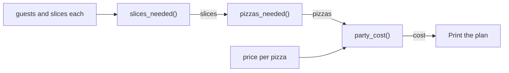

:::objectives
- Build a program out of small functions that each do one job and return an answer.
- Test each function on its own with inputs where you already know the right answer.
- Find and fix a logic error that produces no error message at all.
- Read a real `TypeError`, fix it three different ways, and write a helper that keeps asking until the input is valid.
:::

Your club is throwing a pizza party. Ten people are coming, and each will eat 2 slices. How many pizzas do you order? It isn't 20 ÷ 8 = 2.5, because nobody sells half a pizza. It isn't 2 either, because then four people go hungry. The answer is 3, and by the end of this code-along you'll have a planner that gets it right every time, for any party.

Here's how the finished planner fits together. Each box with parentheses is a function that takes something in and hands an answer on to the next step.



Create a new file in IDLE and save it as `party.py`.

## Step 1: Two tiny functions, and a test

Start with the math. Each function does exactly one job and **returns** its answer:

```python run title="party.py"
def slices_needed(people, slices_each):
    return people * slices_each

def pizzas_needed(slices):
    return slices // 8

print(pizzas_needed(16))
print(pizzas_needed(20))
```

`//` is floor division: it divides and throws away the remainder. The two `print` lines at the bottom are **test calls**, and we chose them because we already know the right answers. 16 slices fit exactly in 2 pizzas, and 20 slices need 3.

The first answer is right and the second is wrong. There's no error message, because this is a **logic error**. Python did exactly what we told it to. We just told it the wrong thing. This is why you test functions with known answers: Python can't warn you about this kind of bug.

## Step 2: Fix the logic bug

20 // 8 is 2, with 4 slices left over. Any leftover slices at all means we need one more pizza. The `%` operator gives the remainder, so:

```python run title="party.py"
def pizzas_needed(slices):
    pizzas = slices // 8
    if slices % 8 > 0:
        pizzas = pizzas + 1
    return pizzas

print(pizzas_needed(16))
print(pizzas_needed(20))
print(pizzas_needed(1))
print(pizzas_needed(0))
```

Now all four answers are right, including two **edge cases**: one slice should need 1 pizza, and zero slices should need none. Step through a single call and watch the function's own box on the call stack. `pizzas` starts at 2, gets bumped to 3, and that's the value handed back.

:::trace Watch `pizzas_needed(20)` work out its answer
```python
def pizzas_needed(slices):
    pizzas = slices // 8
    if slices % 8 > 0:
        pizzas = pizzas + 1
    return pizzas

order = pizzas_needed(20)
print("Order", order, "pizzas")
```
:::

:::tip
Good test inputs come in three kinds: an exact fit (16), a little over (17 or 20), and the smallest possible values (1 and 0). That's where most bugs hide. Testing a five-line function like this takes seconds; hunting the same bug inside a 50-line program can take an hour.
:::

## Step 3: A helper that won't take "ten" for an answer

If someone types `ten`, `int(input(...))` crashes with a `ValueError`. We'll write a helper function that keeps asking until it gets a whole number. It uses a new string method: `text.isdigit()` is `True` only when every character in `text` is a digit from 0 to 9.

```python run title="party.py" input="ten|-3|10"
def get_whole_number(prompt):
    text = input(prompt)
    while not text.isdigit():
        print("Please type a whole number, like 12.")
        text = input(prompt)
    return int(text)

guests = get_whole_number("How many guests? ")
print("Got it:", guests)
```

`-3` is rejected too, because `-` isn't a digit. For counting people, that's exactly what we want. Notice that `int(text)` only runs after the loop, once `isdigit()` has promised the conversion will work.

The `prompt` parameter is what makes this helper reusable. The same function can ask "How many guests?" and "Slices per person?" just by being called with different text.

## Step 4: Put the answer in a sentence (and meet a TypeError)

Here's a first attempt at printing the order:

```python run raises title="party.py"
def pizzas_needed(slices):
    pizzas = slices // 8
    if slices % 8 > 0:
        pizzas = pizzas + 1
    return pizzas

pizzas = pizzas_needed(20)
print("Order " + pizzas + " pizzas.")
```

Read it from the bottom up. It's a `TypeError`, so two types got mixed. The message says `+` can only join a string to another string, and `pizzas` is an int. The `^` marks point at the `+` that failed. Any of these fixes it:

-   Use commas: `print("Order", pizzas, "pizzas.")`
-   Convert first: `print("Order " + str(pizzas) + " pizzas.")`
-   Use an f-string: `print(f"Order {pizzas} pizzas.")`

## Step 5: The finished planner

Everything comes together here. In this run, the user types `ten` by mistake, then 10 guests, 2 slices each, and $13.50 a pizza:

```python run title="party.py" input="ten|10|2|13.50"
# Pizza Party Planner
# Works out how many pizzas to order and what they will cost.

SLICES_PER_PIZZA = 8


def get_whole_number(prompt):
    """Keep asking until the user types a whole number, then return it."""
    text = input(prompt)
    while not text.isdigit():
        print("Please type a whole number, like 12.")
        text = input(prompt)
    return int(text)


def slices_needed(people, slices_each):
    return people * slices_each


def pizzas_needed(slices):
    pizzas = slices // SLICES_PER_PIZZA
    if slices % SLICES_PER_PIZZA > 0:
        pizzas = pizzas + 1
    return pizzas


def party_cost(pizzas, price):
    return pizzas * price


print("=== Pizza Party Planner ===")
guests = get_whole_number("How many people are coming? ")
each = get_whole_number("Slices per person? ")
price = float(input("Price of one pizza in dollars? "))

slices = slices_needed(guests, each)
pizzas = pizzas_needed(slices)
cost = party_cost(pizzas, price)
leftover = pizzas * SLICES_PER_PIZZA - slices

print()
print("Slices needed:", slices)
print("Pizzas to order:", pizzas)
print("Leftover slices:", leftover)
print(f"Total cost: ${cost:.2f}")
print(f"Cost per person: ${cost / guests:.2f}")
```

A few new things appeared:

-   **`SLICES_PER_PIZZA = 8`** is a **constant**, a value that never changes while the program runs. Writing it in ALL CAPS tells other programmers "don't change this". If your local shop cuts pizzas into 10 slices, you edit one line instead of hunting for every 8.
-   **The text in triple quotes** under `def get_whole_number` is a **docstring**, a short note saying what the function does. It doesn't change how the program runs, but it helps anyone reading your code, including you next month.
-   **`{cost:.2f}`** inside an f-string means "show `cost` with exactly 2 decimal places". Without it, $40.50 would print as `$40.5`.
-   **All the `def`s come first**, then the main program, so every function exists before it's called.

Look at how short the main part is. Each line reads almost like a sentence, because the messy details are tucked away inside well-named functions. That's the real payoff: you can understand the whole program in ten seconds, and dig into any one function only when you need to.

:::video LWdsF79H1Pg
What to watch for: why a function that *prints* its answer can't be used in a calculation, while one that *returns* it can. Every function in this planner returns its answer for exactly that reason.
:::

:::quiz
Q: Why did we test `pizzas_needed` with 16, 20, 1, and 0 before building the rest of the program?
- [ ] Because Python requires test calls before a function can be used
  Python doesn't require tests at all. We added them to catch our own mistakes.
- [x] We already knew the right answers, so a wrong result would expose a bug right away
  That's how the `20 // 8` logic error showed up. It produced no error message, only a wrong number.
- [ ] To make the program run faster
  Test calls actually add a little work. Their value is in catching bugs early.

Q: What does the `prompt` parameter in `get_whole_number(prompt)` let you do?
- [x] Reuse one function for every question that needs a whole number
  The same code asks about guests and slices, because the question text is passed in each time.
- [ ] Skip the `while` loop when the user types correctly
  The loop is skipped when `isdigit()` is `True`, whatever the prompt says.
- [ ] Convert the answer to a decimal number
  `int(text)` makes a whole number. Decimals are handled by `float()` for the price.

Q: Shops near you cut pizzas into 10 slices. What's the smallest change that updates the whole planner?
- [ ] Edit every `8` in the file to `10`
  It works if you find them all, but that's exactly the error-prone hunt the constant avoids.
- [x] Change `SLICES_PER_PIZZA = 8` to `SLICES_PER_PIZZA = 10`
  Every function uses the constant, so one edit updates the pizza count and the leftovers together.
- [ ] Change the `//` to `/`
  That would give decimal pizzas like 2.5, which is the bug we started with.
:::

:::takeaways
- Build programs from small functions that each do one job and `return` the answer.
- Test each function on its own with inputs whose answers you already know, including edge cases like 0 and 1.
- A logic error gives no message, only a wrong answer. Tests are how you catch it.
- A helper like `get_whole_number` keeps asking until the input is valid, so `int()` never crashes.
- `TypeError: can only concatenate str (not "int") to str` is fixed with commas, `str()`, or an f-string.
- Constants in ALL CAPS and docstrings make a program easier to change and to read.
:::

## Make it yours

Predict what will happen before you try each of these:

1.  7 people, 3 slices each, $12 a pizza. That's 21 slices, so you should get 3 pizzas and 3 leftover slices. Does the planner agree?
2.  Type `0` for the number of people. `get_whole_number` accepts it, but the last line divides by `guests`. Which error do you get? Change the helper's loop so it also rejects 0.
3.  Type `twelve` for the price. Write a `get_price` function that works like `get_whole_number` but accepts one decimal point. (Hint: `text.replace(".", "", 1)` removes the first dot, and the result should be all digits.)
4.  Add a second food: drinks, with a price per bottle and one bottle per guest. Write it as a new function and add its cost to the total.

## Further reading

-   [Python Tutorial: Defining Functions](https://docs.python.org/3/tutorial/controlflow.html#defining-functions): how `def`, `return`, and docstrings work, from the official docs.
-   [Python Tutorial: Fancier Output Formatting](https://docs.python.org/3/tutorial/inputoutput.html): f-strings and format codes like `:.2f`, with examples.
-   [Python for Everybody: Functions](https://www.py4e.com/lessons/functions): free lecture videos that build functions up from scratch.
