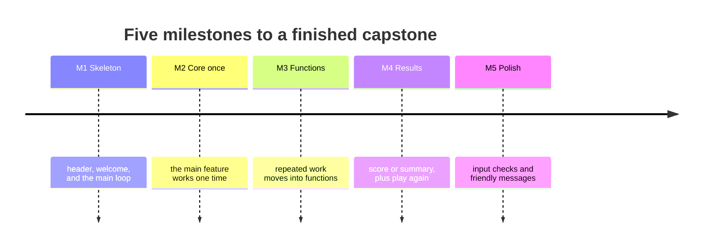
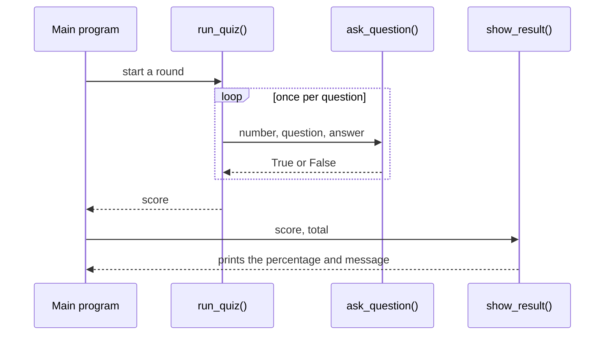

:::objectives
- Start your capstone from a skeleton file that already runs.
- Build in five milestones, so the program works at the end of every one.
- Clean up answers with `.strip()` and `.lower()` so capital letters and stray spaces don't matter.
- Follow a complete quiz from first draft to finished program, and see how its functions call each other.
:::

The fastest way to get stuck on a project is to type 100 lines and press F5 for the first time. You'll get an error on line 12, fix it, get another on line 40, and never know how many are left. Instead, build in **milestones**. Each milestone ends with a version of your program that runs. If milestone 3 breaks, the bug is in what you added since milestone 2, not anywhere in 100 lines.



:::tip
Before you start each milestone, use **File > Save As...** to save a copy with the milestone in its name: `project_m2.py`, `project_m3.py`, and so on. If something goes badly wrong, you can open the last version that worked and carry on from there.
:::

## The starter skeleton

Copy this into a new file. It already runs, and it has a home for every capstone requirement. In this test run the user answers `y`, then `maybe` (which isn't allowed), then ` N ` with spaces around a capital N:

```python run title="project.py" input="y|maybe| N "
# Project name:
# By:
# What it does:

# ---------- Data ----------
items = []


# ---------- Functions ----------
def show_welcome():
    print("=== My Project ===")
    print("Describe what your program does here.")


def get_choice(prompt, options):
    """Ask until the user types one of the options, then return it."""
    choice = input(prompt).strip().lower()
    while choice not in options:
        print("Please type one of:", options)
        choice = input(prompt).strip().lower()
    return choice


def main_feature():
    """Replace this with the heart of your program."""
    print("(Main feature goes here.)")


# ---------- Main program ----------
show_welcome()
running = True
while running:
    main_feature()
    again = get_choice("Go again? (y/n) ", ["y", "n"])
    if again == "n":
        running = False
print("Thanks for using my program!")
```

`get_choice` uses two string tools you'll want in almost every project:

-   `.strip()` removes spaces from the start and end, so `" N "` becomes `"N"`.
-   `.lower()` makes everything lowercase, so `"N"` becomes `"n"`.

Chained together, `input(prompt).strip().lower()` means the user can type `Y`, `y`, or ` y ` and your program understands all three. Then `choice not in options` is `True` whenever the answer isn't one of the allowed ones, which keeps the loop asking.

## The five milestones

| Milestone | Goal | Done when... |
| --- | --- | --- |
| **M1: Skeleton** | Fill in the header comments, the welcome message, and the main loop | it runs, and "Go again?" works |
| **M2: Core, once** | Your data in a list and the main feature working one time, even if the code is messy | one full round works with normal input |
| **M3: Functions** | Move the core into functions that take parameters and return values | the main program is short and readable |
| **M4: Results and repeat** | Score, totals, or a summary, plus play again or a menu | a whole session works from start to finish |
| **M5: Polish** | Input checking, friendly messages, and extra features | it survives your test table (next lesson) |

Now watch one project go through all five.

## Worked example: Space Trivia

**The plan:** a five-question space quiz. Questions and answers live in two lists. At the end it shows the score as a percentage with a message, lets you play again, and remembers your best score.

### M1: Skeleton

M1 is the skeleton above with the header comments filled in and the welcome changed to `=== Space Trivia ===`. It's boring, and that's fine. It runs, and the play-again loop already works.

### M2: The core, once, with no functions yet

Get the main idea working in the simplest way you can. Here that means two **parallel lists**, where `questions[0]` goes with `answers[0]`, `questions[1]` with `answers[1]`, and so on. In this run the player gets two right and one wrong:

```python run title="space_trivia.py" input="Mercury|8|Saturn"
# Space Trivia Quiz
# By: Alex
# Asks space questions, keeps score, and lets you play again.

questions = [
    "What planet is closest to the Sun?",
    "How many planets are in our solar system?",
    "What is the largest planet?",
]
answers = ["Mercury", "8", "Jupiter"]

score = 0
for i in range(len(questions)):
    reply = input(questions[i] + " ")
    if reply == answers[i]:
        print("Correct!")
        score = score + 1
    else:
        print("Not quite. The answer is", answers[i])
print("Score:", score)
```

It works, as long as you type carefully. (A bug is hiding in here, and the test table in the next lesson will catch it.) A list can be split across several lines like `questions` is, as long as the brackets match, which makes long items much easier to read.

### M3: Move the repeated work into functions

What does the program do over and over? It asks one question and checks the answer. That's the first function. It **returns** `True` or `False`, and the code that called it decides what to do about the score.

```python
def ask_question(number, question, answer):
    """Ask one question. Return True if the player got it right."""
    print()
    reply = input("Q" + str(number) + ": " + question + " ").strip().lower()
    if reply == answer.lower():
        print("Correct!")
        return True
    else:
        print("Not quite. The answer is", answer)
        return False
```

The second function runs the whole quiz once and **returns** the score:

```python
def run_quiz():
    """Ask every question once and return the score."""
    score = 0
    for i in range(len(questions)):
        if ask_question(i + 1, questions[i], answers[i]):
            score = score + 1
    return score
```

`if ask_question(...)` works because the function hands back a Boolean, just like `if is_even(n)` in the Week 6 notes.

### M4: Results and play again

`show_result` turns the score into a percentage and picks a message. `get_yes_no` is the skeleton's `get_choice` made specific to y/n answers. The main loop calls them, and it remembers the best score with the same "keep the biggest so far" pattern you used on the receipt exercise in Week 5.

### M5: Polish

The last pass added two more questions, a welcome that explains the rules, and a goodbye that shows the best score. The `.strip().lower()` cleanup inside `ask_question` from M3 means capital letters and stray spaces no longer matter.

Here's how the finished program's functions call one another during one round. The main program only talks to `run_quiz` and `show_result`; `run_quiz` does the asking by calling `ask_question` once per question.



## The finished program

In this sample session the player types `mercury` in lowercase, gets the largest planet wrong, adds stray spaces before `milky way`, shouts `MARS`, types `yes` at the play-again question (which isn't accepted), and then quits with `n`:

```python run title="space_trivia.py" input="mercury|8|Saturn|  milky way|MARS|yes|n"
# Space Trivia Quiz
# By: Alex
# Asks space questions, keeps score, and lets you play again.

questions = [
    "What planet is closest to the Sun?",
    "How many planets are in our solar system?",
    "What is the largest planet?",
    "What is the name of our galaxy?",
    "Which planet is called the Red Planet?",
]
answers = ["Mercury", "8", "Jupiter", "Milky Way", "Mars"]


def show_welcome():
    print("=== Space Trivia ===")
    print("Answer", len(questions), "questions. Capital letters don't matter.")


def ask_question(number, question, answer):
    """Ask one question. Return True if the player got it right."""
    print()
    reply = input("Q" + str(number) + ": " + question + " ").strip().lower()
    if reply == answer.lower():
        print("Correct!")
        return True
    else:
        print("Not quite. The answer is", answer)
        return False


def run_quiz():
    """Ask every question once and return the score."""
    score = 0
    for i in range(len(questions)):
        if ask_question(i + 1, questions[i], answers[i]):
            score = score + 1
    return score


def show_result(score, total):
    percent = round(score / total * 100)
    print()
    print(f"You scored {score} out of {total} ({percent}%)")
    if percent == 100:
        print("Perfect! Mission control is impressed.")
    elif percent >= 60:
        print("Nice work, space cadet!")
    else:
        print("Keep exploring and try again!")


def get_yes_no(prompt):
    """Keep asking until the user types y or n, then return it."""
    reply = input(prompt).strip().lower()
    while reply != "y" and reply != "n":
        print("Please type y or n.")
        reply = input(prompt).strip().lower()
    return reply


# ---------- Main program ----------
show_welcome()
best = 0
playing = True
while playing:
    score = run_quiz()
    show_result(score, len(questions))
    if score > best:
        best = score
    again = get_yes_no("Play again? (y/n) ")
    if again == "n":
        playing = False

print("Best score this session:", best, "out of", len(questions))
print("Thanks for playing!")
```

Typing `y` instead would start a fresh round with the score back at 0, because `run_quiz` sets `score = 0` every time it's called. Meanwhile `best` lives in the main program, outside the loop, so it remembers the highest score across rounds.

### Requirements check

-   **Variables:** `score`, `best`, `playing`, `reply`
-   **Input:** every answer, plus the play-again question
-   **Conditions:** right or wrong, the percentage message, and the y/n check
-   **Loops:** `for` over the questions, and `while` for replaying and for checking input
-   **Lists:** `questions` and `answers`
-   **Functions:** five, including `ask_question`, which takes parameters and returns a value

:::video xRlN8CFJwAM
What to watch for: another small game built from scratch in Python. As you watch, notice which parts would count toward each capstone requirement, and where you'd split the code into functions if it were your project.
:::

## When you get stuck

-   **Run after every few lines.** Small steps mean small bugs.
-   **Read the traceback from the bottom up**, then jump to the line it names (**Edit > Go to Line** in IDLE).
-   **Print your variables** where things go wrong, and delete those prints once it's fixed.
-   **Go back a milestone.** If the current version is a mess, open your last saved copy and redo just the newest piece.
-   **Ask with specifics.** "On line 23 I get `IndexError`, and `i` is 5 when it crashes" gets you an answer much faster than "it doesn't work".

:::takeaways
- Start from a skeleton that runs, and keep it running at the end of every milestone.
- Save a copy before each milestone so you can always go back to a working version.
- Get the core working once in the simplest way, *then* move repeated work into functions.
- `.strip().lower()` on every answer makes your program forgiving about spaces and capitals.
- Parallel lists keep matching data together: `questions[i]` goes with `answers[i]`.
:::

## Further reading

-   [Python docs: string methods](https://docs.python.org/3/library/stdtypes.html#string-methods): `strip()`, `lower()`, `isdigit()`, and many more you can use in your capstone.
-   [Python Tutorial: Defining Functions](https://docs.python.org/3/tutorial/controlflow.html#defining-functions): a refresher on parameters and return values.
