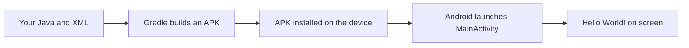

:::objectives
- Create a Java project from the **Empty Views Activity** template, not the Compose one.
- Set up an emulator or connect your own phone with USB debugging.
- Run the app, change it, and run it again.
- Confirm your JDK runs a plain-Java program from the terminal.
:::

An installed IDE proves nothing until it builds something. The test for this lesson is simple: a phone screen, real or virtual, that says **Hello from** and then your name. Getting there touches every part of the setup at once: the project template, the Gradle build, the device, and the install. If any piece is broken, you'll find out now instead of in the middle of Week 1.

## Create the project

1.  On the Welcome window, click **New Project**. (If a project is already open, use **File > New > New Project**.)
2.  Under **Phone and Tablet**, choose **Empty Views Activity** and click **Next**.
3.  Fill in the form:
    -   **Name:** `HelloC4T`
    -   **Package name:** `com.example.helloc4t` (filled in for you)
    -   **Save location:** the default `AndroidStudioProjects` folder
    -   **Language:** **Java**
    -   **Minimum SDK:** **API 24 ("Nougat"; Android 7.0)**
    -   **Build configuration language:** **Kotlin DSL (build.gradle.kts)**, the default
4.  Click **Finish**.

:::warning
The template named just **Empty Activity** sits right next to **Empty Views Activity**, and it builds screens with Jetpack Compose in Kotlin. If your form has no **Language** dropdown, you picked that one. Click **Previous** and choose **Empty Views Activity**.
:::

Your build files will be written in Kotlin DSL even though your app is Java. That's normal: the build configuration language and the app's language are two separate choices, and you'll only open the build files now and then.

Now Android Studio runs its first **Gradle sync**, downloading the libraries the template needs. Watch the progress bar at the bottom right. The first sync on a fresh install can take several minutes, and clicking around while it runs only slows it down.

## Look at what you got

Open `app > java > com.example.helloc4t > MainActivity.java`. The template wrote this for you:

```java
package com.example.helloc4t;

import android.os.Bundle;

import androidx.activity.EdgeToEdge;
import androidx.appcompat.app.AppCompatActivity;
import androidx.core.graphics.Insets;
import androidx.core.view.ViewCompat;
import androidx.core.view.WindowInsetsCompat;

public class MainActivity extends AppCompatActivity {

    @Override
    protected void onCreate(Bundle savedInstanceState) {
        super.onCreate(savedInstanceState);
        EdgeToEdge.enable(this);
        setContentView(R.layout.activity_main);
        ViewCompat.setOnApplyWindowInsetsListener(findViewById(R.id.main), (v, insets) -> {
            Insets systemBars = insets.getInsets(WindowInsetsCompat.Type.systemBars());
            v.setPadding(systemBars.left, systemBars.top, systemBars.right, systemBars.bottom);
            return insets;
        });
    }
}
```

Only one line matters today: `setContentView(R.layout.activity_main)` tells Android which screen layout to show. The rest pads the screen so your content doesn't hide under the status bar. Week 1 takes it apart line by line.

Then open `app > res > layout > activity_main.xml`. If it shows a picture of a phone, click **Code** (or **Split**) at the top right of the editor:

```xml
<?xml version="1.0" encoding="utf-8"?>
<androidx.constraintlayout.widget.ConstraintLayout xmlns:android="http://schemas.android.com/apk/res/android"
    xmlns:app="http://schemas.android.com/apk/res-auto"
    xmlns:tools="http://schemas.android.com/tools"
    android:id="@+id/main"
    android:layout_width="match_parent"
    android:layout_height="match_parent"
    tools:context=".MainActivity">

    <TextView
        android:layout_width="wrap_content"
        android:layout_height="wrap_content"
        android:text="Hello World!"
        app:layout_constraintBottom_toBottomOf="parent"
        app:layout_constraintEnd_toEndOf="parent"
        app:layout_constraintStart_toStartOf="parent"
        app:layout_constraintTop_toTopOf="parent" />

</androidx.constraintlayout.widget.ConstraintLayout>
```

This is the whole screen: a layout that fills the display, holding one piece of text pinned to all four edges, which centers it.

## Give it somewhere to run

Pick one of these. If you have both, set up both; a phone is faster, and the emulator is handy when your phone is across the room.

:::tabs
@tab Emulator
1.  Open **Device Manager** from the right-hand toolbar, or **View > Tool Windows > Device Manager**. The Standard setup sometimes creates a device for you (often named something like **Medium Phone**). If one is listed, skip to step 6.
2.  Click **+**, then **Create Virtual Device**.
3.  Pick a recent Pixel phone profile and click **Next**.
4.  Choose a system image with a recent API level and let it download. An Apple-silicon Mac needs an **arm64** image; Intel and AMD computers need **x86_64**. Android Studio normally shows the right kind first.
5.  Click **Finish**.
6.  Click the play button next to the device. The first boot is slow, often a minute or two.
@tab Your Android phone
1.  On the phone, open **Settings > About phone** and tap **Build number** seven times, until it says you're now a developer. (On some brands, Build number is under **Software information**.)
2.  Go back to Settings, open **System > Developer options**, and turn on **USB debugging**.
3.  Plug the phone into your computer with a cable that carries data. Many cheap cables only charge.
4.  Unlock your phone. When it asks **Allow USB debugging?**, tick **Always allow from this computer** and tap **Allow**.

On Windows, a few phone brands also need the maker's USB driver before they appear; the OEM USB drivers page below lists them. The phone shows up in Android Studio's device dropdown by its model name.
:::

:::video ENKzK2K4Go0
A short walkthrough of turning on USB debugging and running an app on a real phone. Watch the Build number trick and the Allow prompt; your Settings screens may be arranged a little differently by brand.
:::

## Run it

Pick your emulator or phone in the device dropdown on the toolbar, then click the green **Run** triangle (Shift + F10 on Windows and Linux, Control + R on macOS).



The first build is the slowest you'll ever see; later ones reuse most of the work. On an emulator, the screen appears in Android Studio's **Running Devices** panel. You should see a white screen with **Hello World!** in the middle.

## Prove you control it

Right now you're looking at the template, not your work. In `activity_main.xml`, change the text line:

```xml
        android:text="Hello from Maya!"
```

Use your own name, then click **Run** again. A few seconds later the screen shows your message. Press the device's home button and look in the app drawer: there's your app, with the green Android icon and the label **HelloC4T**.

:::video QI1dCZa1c2Q
A five-minute Java version of what you just did: new project, a quick project tour, Run, and editing the Hello World text. Use it to compare screens if something on yours looks different.
:::

## Prove your JDK works too

Week 2 runs plain Java programs outside Android Studio. Make a file named `Hello.java` anywhere outside your Android project, such as on your Desktop:

```java run title="Hello.java"
public class Hello {
    public static void main(String[] args) {
        System.out.println("Java is ready for Android class.");
        System.out.println("Running on Java " + System.getProperty("java.version"));
    }
}
```

In a terminal in that folder, compile it and run it:

```bash
javac Hello.java
java Hello
```

You should see the same two lines as the output above, with your own Java version on the second line. (Java 11 and newer also accept the shortcut `java Hello.java`, which compiles and runs in one step.) If both the app and this program run, your setup is done.

## If it didn't work

**The Run button is grey, or the dropdown says No Devices.** The emulator hasn't finished booting, or the phone isn't authorized. Wait for the emulator's home screen, or unlock your phone, unplug it, plug it back in, and look for the **Allow USB debugging?** prompt.

**There's no Language option when creating the project.** You picked **Empty Activity**. Go back and choose **Empty Views Activity**.

**The phone charges but never appears.** Try another cable first; it's the cause more often than anything else. Then try a different USB port, and make sure USB debugging is still on.

**The Gradle sync never finishes.** Leave it for ten minutes on a first install. If it fails with a red message, use **File > Sync Project with Gradle Files** to retry, and see the next lesson's Gradle section.

## Further reading

-   [Create and manage virtual devices](https://developer.android.com/studio/run/managing-avds): every Device Manager option, including how to edit a device's RAM.
-   [Run apps on a hardware device](https://developer.android.com/studio/run/device): developer options, USB debugging, and wireless debugging over Wi-Fi.
-   [Install OEM USB drivers](https://developer.android.com/studio/run/oem-usb): the list of phone makers' Windows drivers.
