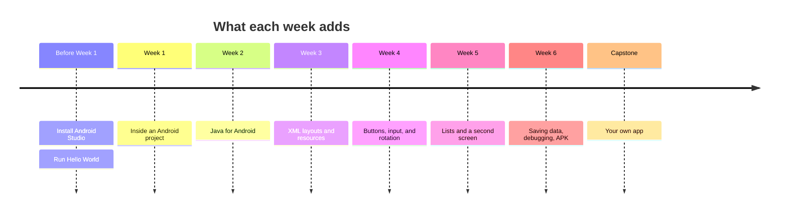
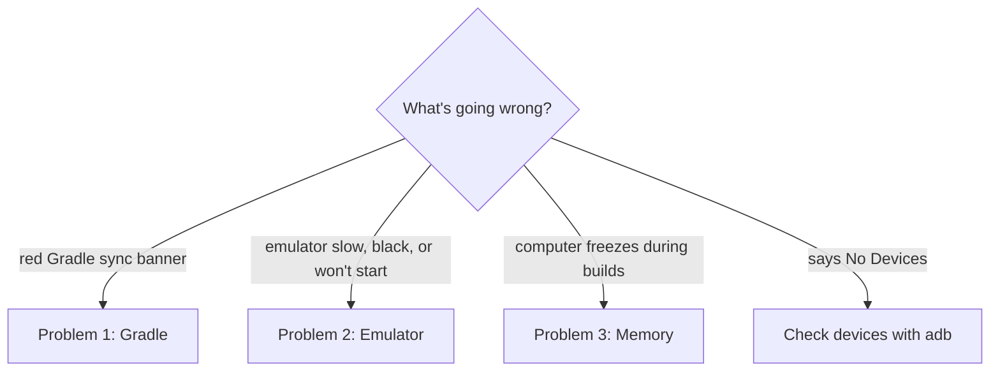

:::objectives
- Know what happens in each 90-minute class and which pages to use if you miss one.
- Name, save, and share your projects so you can find old work later.
- Ask for help with the details an instructor needs to answer in seconds.
- Fix a failed Gradle sync, a slow or broken emulator, and a computer that runs out of memory.
:::

Most first-week trouble in Android comes from one of three places: Gradle can't finish syncing, the emulator can't get hardware acceleration, or the computer runs out of memory. Each has a short list of fixes, and they're all below. First, how the class itself works, because knowing the rhythm makes it easier to keep up.

## What a class session looks like

The class meets live online once a week for 1.5 hours, for six weeks. A session usually goes like this:

1.  **Review and questions (10 minutes).** Last week's ideas, plus anything that broke while you practiced.
2.  **New ideas (25 minutes).** The week's concepts, explained with code on screen.
3.  **Code-along (40 minutes).** You build a small app alongside the instructor, one step at a time.
4.  **Practice (15 minutes).** You start the week's exercises with help on hand.

Each week on this site has three matching pages: **Notes** (the concepts), **Code-along** (the app you build), and **Practice** (exercises with hints and solutions you can reveal). If you miss a class, those three pages cover everything that happened.



Three habits that keep class time for coding:

-   **Open Android Studio and start your emulator five minutes early.** A cold emulator can take two minutes to boot, and nobody wants to wait for that live.
-   **Mute unless you're talking, and unmute when you're stuck.** Saying "my build failed" out loud is how a whole class learns the fix.
-   **Share your screen with the error showing.** A red error message usually tells the instructor exactly what's wrong in seconds.

## Keep your projects where you can find them

Android Studio saves as you type, so there's no Save button to forget. What matters is where projects live and what they're called.

-   Keep every project in the default `AndroidStudioProjects` folder in your home folder.
-   Make a **new project for each week's code-along**, named so you'll recognize it in a month: `Week1Hello`, `Week3BusinessCard`, and so on. One project reused for everything makes it impossible to look back at earlier work.
-   To send a project to an instructor or move it to another computer, use **File > Export > Export to Zip File**. It leaves out the big `build` folders, which Gradle recreates anyway.
-   To reopen a project, use **File > Open** and select the project's top folder, the one containing `settings.gradle.kts`, not the `app` folder inside it.

:::tip
If you already know Git, turn on version control for each project and commit at the end of every class. The template already includes a sensible `.gitignore`, so build output stays out of your history.
:::

## How to ask for help and get a fast answer

"It doesn't work" can mean a hundred things. A good help request has three parts:

1.  **What you did:** "I pressed Run with the emulator selected."
2.  **What happened, word for word:** the **first** red line in the **Build** window, copied or screenshotted, not a summary of it.
3.  **What you already tried:** "I synced again and restarted Android Studio."

The first error matters most. One mistake often causes a cascade of later errors that disappear once the first one is fixed, so scroll up and click the top red line in the Build window before you read anything else.

## Find your problem



## Problem 1: Gradle sync fails

Symptoms: a banner saying **Gradle sync failed**, red messages in the **Build** window, or red underlines under every `import androidx...` line.

Work through these in order and stop when it's fixed:

1.  **Check your connection.** The first sync downloads libraries, and school or library networks sometimes block those downloads. Try home Wi-Fi or a phone hotspot.
2.  **Sync again.** Use **File > Sync Project with Gradle Files**. A sync that was interrupted halfway often succeeds on the second try.
3.  **Check the Gradle JDK.** Open **Settings** (**Android Studio > Settings** on macOS) and go to **Build, Execution, Deployment > Build Tools > Gradle**. Set **Gradle JDK** to the bundled JetBrains Runtime, usually labeled **jbr-21**. A missing or wrong JDK here causes errors such as `Unsupported class file major version`.
4.  **Clear caches.** **File > Invalidate Caches**, tick the options, then **Invalidate and Restart**.
5.  **Read the first error, not the last.** In the Build window, click the top red line. The real cause is almost always there.

## Problem 2: the emulator is slow or won't start

The emulator needs your CPU's virtualization features. Without them it either refuses to start or crawls.

:::tabs
@tab Windows
1.  Restart into your BIOS or UEFI settings (usually F2, F10, F12, or Del while the computer boots; it varies by brand) and enable **Intel Virtualization Technology (VT-x)** or **AMD SVM**.
2.  Back in Windows, open the Start menu, search for **Turn Windows features on or off**, tick **Windows Hypervisor Platform**, click **OK**, and restart.
3.  Task Manager's **Performance > CPU** page should now say **Virtualization: Enabled**.
@tab macOS
Apple-silicon and recent Intel Macs have acceleration built in. If an emulator won't boot on an Apple chip, check that its system image is **arm64**: in Device Manager, open the device's menu and look at its details. Delete any x86_64 device and create a new one.
@tab Linux
The emulator uses KVM. On Ubuntu, install it and add yourself to the `kvm` group, then log out and back in:

```bash
sudo apt install qemu-kvm
sudo adduser $USER kvm
```
@tab Chromebook
ChromeOS can't run the Android Emulator from Android Studio. Run your apps on a phone over USB instead; it's faster anyway.
:::

The emulator can check acceleration for you. Run it from the SDK's `emulator` folder, using your own SDK location from the install lesson (this is the Linux default):

```bash
~/Android/Sdk/emulator/emulator -accel-check
```

When everything is right, the output includes a line saying that **WHPX** (Windows), **Hypervisor.Framework** (macOS), or **KVM** (Linux) is installed and usable.

## Problem 3: not enough memory

If your computer freezes, or the emulator closes itself during a build, you're out of RAM.

-   Close browser tabs, games, and video apps you don't need. A browser with many tabs can use several gigabytes on its own.
-   Give the emulator less memory: in Device Manager, edit the device, open the advanced settings, and set **RAM** to 2 GB.
-   Turn on **File > Power Save Mode** while you're reading rather than typing; it pauses background code analysis.
-   Best of all, run on your phone and close the emulator entirely.

## Check devices with adb

When Android Studio insists there's no device, `adb` (Android Debug Bridge, in the SDK's `platform-tools` folder) gives a straight answer. Run the line for your system in a terminal:

:::tabs
@tab Windows
```powershell
& "$env:LOCALAPPDATA\Android\Sdk\platform-tools\adb.exe" devices
```
@tab macOS
```bash
~/Library/Android/sdk/platform-tools/adb devices
```
@tab Linux and Chromebook
```bash
~/Android/Sdk/platform-tools/adb devices
```
:::

A healthy result lists each device with the word `device` after it:

```text
List of devices attached
emulator-5554	device
```

If a phone shows `unauthorized`, unlock it and accept the **Allow USB debugging?** prompt. If nothing is listed at all, swap the cable or the USB port, since a charge-only cable is the usual cause.

:::warning
Don't fix a broken setup by downloading SDK folders or Gradle files from forums or video descriptions. Almost every problem above is solved inside Android Studio's own settings, and copied files usually bring new errors with them.
:::

## Further reading

-   [Troubleshoot known issues with Android Studio](https://developer.android.com/studio/known-issues): Google's list of current bugs and their workarounds.
-   [Android Debug Bridge (adb)](https://developer.android.com/tools/adb): everything `adb` can do beyond listing devices.
-   [Troubleshoot the Android Emulator](https://developer.android.com/studio/run/emulator-troubleshooting): fixes for an emulator that won't boot, stays black, or runs slowly.
