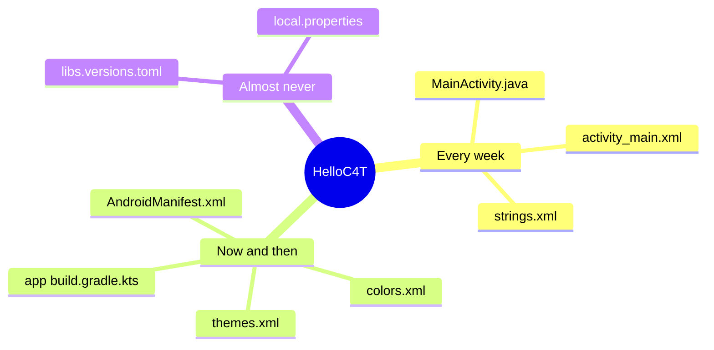
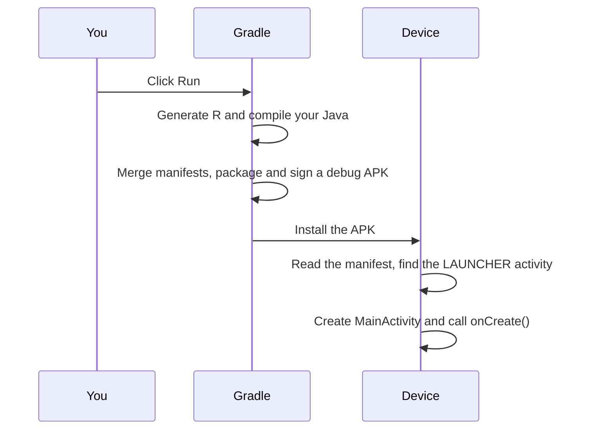

:::objectives
- Find your way around the **Android** view of a project: `java`, `res`, `manifests`, and Gradle Scripts.
- Explain what each line of the template's `MainActivity.java` does, and why there's no `main()`.
- Read the manifest and the app's `build.gradle.kts` well enough to change the app's name, version, and minimum Android version.
- Describe the steps between clicking **Run** and seeing your app on screen.
:::

Open a brand-new project and the Project panel already shows folders called `manifests`, `java`, `res`, and Gradle Scripts, plus a file named `libs.versions.toml` that looks like a typo. It's a lot. The good news: you'll edit about three of these files every week, a few now and then, and the rest almost never. Knowing which is which is most of what makes Android Studio feel manageable.

## The Android view sorts files by job

The **Project** panel on the left has a dropdown at the top. Keep it on **Android**. That view groups files by what they do rather than how they sit on disk:

```text
app
├── manifests
│   └── AndroidManifest.xml
├── java
│   ├── com.example.helloc4t
│   │   └── MainActivity.java
│   ├── com.example.helloc4t (androidTest)
│   └── com.example.helloc4t (test)
└── res
    ├── drawable
    ├── layout
    │   └── activity_main.xml
    ├── mipmap
    ├── values
    │   ├── colors.xml
    │   ├── strings.xml
    │   └── themes
    └── xml
Gradle Scripts
├── build.gradle.kts (Project: HelloC4T)
├── build.gradle.kts (Module :app)
├── proguard-rules.pro
├── gradle.properties
├── gradle-wrapper.properties
├── libs.versions.toml
├── local.properties
└── settings.gradle.kts
```

Four areas, four jobs. `java` holds your code. `res` (short for resources) holds everything that isn't code: layouts, text, colors, images. `manifests` describes the app to the Android system. Gradle Scripts say how to build it all. The two `(test)` folders are for automated tests, which this course doesn't use.



## MainActivity.java: code that Android calls

An **Activity** is one screen of an app plus the Java code behind it. Here's the template's activity again, with a comment on every important line:

```java
package com.example.helloc4t;                      // must match the folder it lives in

import android.os.Bundle;

import androidx.activity.EdgeToEdge;
import androidx.appcompat.app.AppCompatActivity;
import androidx.core.graphics.Insets;
import androidx.core.view.ViewCompat;
import androidx.core.view.WindowInsetsCompat;

public class MainActivity extends AppCompatActivity {   // a screen, with support-library extras

    @Override
    protected void onCreate(Bundle savedInstanceState) {  // Android calls this when the screen starts
        super.onCreate(savedInstanceState);               // let AppCompatActivity do its setup first
        EdgeToEdge.enable(this);                          // draw behind the status and navigation bars
        setContentView(R.layout.activity_main);           // show res/layout/activity_main.xml
        ViewCompat.setOnApplyWindowInsetsListener(findViewById(R.id.main), (v, insets) -> {
            Insets systemBars = insets.getInsets(WindowInsetsCompat.Type.systemBars());
            v.setPadding(systemBars.left, systemBars.top, systemBars.right, systemBars.bottom);
            return insets;                                // pad the layout so the bars don't cover it
        });
    }
}
```

Look for `main()` and you won't find one. In a console program, your code starts at the top and runs to the bottom. In an Android app, **Android** creates your Activity object and calls its methods when things happen: the screen opens, the user leaves, the phone rotates. Your job is to fill in those methods. `onCreate()` is the first one called, which is why setup code goes there.

```mermaid caption="The states every Activity moves through. onCreate() is just the first stop; Week 4 uses the rest."
stateDiagram-v2
    [*] --> Created: onCreate()
    Created --> Started: onStart()
    Started --> Resumed: onResume()
    Resumed --> Paused: onPause()
    Paused --> Resumed: onResume()
    Paused --> Stopped: onStop()
    Stopped --> Started: onRestart()
    Stopped --> Destroyed: onDestroy()
    Destroyed --> [*]
```

Resumed is the state you see as "the app is open". Press Home and the activity slides to Stopped; come back and it climbs to Resumed again.

Every `androidx...` import comes from **AndroidX**, Google's current support libraries. If an online tutorial imports `android.support.v7...`, it predates 2018 and won't compile in a new project.

## R: how your Java finds your XML

`R.layout.activity_main` and `R.id.main` aren't variables you wrote. On every build, Android generates a class named `R` holding a number for every resource. Add `res/layout/settings.xml` and `R.layout.settings` exists after the next build. Give a view `android:id="@+id/main"` and `R.id.main` appears. The `+` in `@+id` means "create this ID if it doesn't exist yet."

That's also why one typo in an XML file can turn your Java red. If the resources fail to compile, `R` isn't regenerated, and every line that uses it suddenly can't find its symbol. Fix the XML first; the Java errors vanish with it.

## activity_main.xml: what the screen looks like

Layouts describe a screen in XML. Each tag is a **View** (something visible, like `TextView`) or a **ViewGroup** that arranges other views (like `ConstraintLayout`). Attributes come in three families:

-   `android:` attributes are built into Android, such as `android:text`.
-   `app:` attributes come from libraries, such as ConstraintLayout's `app:layout_constraintTop_toTopOf`.
-   `tools:` attributes only affect the preview in Android Studio and are stripped from the real app.

The layout editor has three modes at its top right: **Code**, **Split**, and **Design**. Use **Split** while you're learning, so you can type XML on one side and watch the preview change on the other.

## res/values: text, colors, and themes

-   `strings.xml` holds the app's text. The template defines one string, `app_name`.
-   `colors.xml` holds named colors; you start with `black` and `white`.
-   `themes/themes.xml` sets the app's overall look. The template's theme is based on `Theme.Material3.DayNight.NoActionBar`: Material Design 3 styling, automatic dark mode, and no title bar.

Week 3 is built on these files.

## AndroidManifest.xml: the app's ID card

Before Android runs a line of your code, it reads the manifest:

```xml
<?xml version="1.0" encoding="utf-8"?>
<manifest xmlns:android="http://schemas.android.com/apk/res/android"
    xmlns:tools="http://schemas.android.com/tools">

    <application
        android:allowBackup="true"
        android:dataExtractionRules="@xml/data_extraction_rules"
        android:fullBackupContent="@xml/backup_rules"
        android:icon="@mipmap/ic_launcher"
        android:label="@string/app_name"
        android:roundIcon="@mipmap/ic_launcher_round"
        android:supportsRtl="true"
        android:theme="@style/Theme.HelloC4T"
        tools:targetApi="31">
        <activity
            android:name=".MainActivity"
            android:exported="true">
            <intent-filter>
                <action android:name="android.intent.action.MAIN" />

                <category android:name="android.intent.category.LAUNCHER" />
            </intent-filter>
        </activity>
    </application>

</manifest>
```

-   `android:label` is the name under the app icon. It points at `@string/app_name`, so you rename the app in `strings.xml`, not here.
-   `android:icon` and `android:roundIcon` point at the launcher icons in `res/mipmap`.
-   Every Activity needs its own `<activity>` tag. Forget one and the app crashes the moment you try to open that screen.
-   The `MAIN` action plus the `LAUNCHER` category mark the Activity that opens when someone taps the icon.
-   `android:exported="true"` lets the home-screen launcher, which is a different app, start this Activity.

## Gradle: the recipe for building your app

Gradle compiles your Java, packs in your resources, pulls in libraries, and produces an **APK**, the file that gets installed on a phone. New projects write the recipe in **Kotlin DSL** files (`.kts`), even for Java apps. You don't need to know Kotlin to read them; treat them as settings.

The one you'll open most is **build.gradle.kts (Module :app)**. Trimmed to the parts that matter:

```kotlin
plugins {
    alias(libs.plugins.android.application)
}

android {
    namespace = "com.example.helloc4t"
    compileSdk = 36

    defaultConfig {
        applicationId = "com.example.helloc4t"
        minSdk = 24
        targetSdk = 36
        versionCode = 1
        versionName = "1.0"
    }
}

dependencies {
    implementation(libs.appcompat)
    implementation(libs.material)
    implementation(libs.activity)
    implementation(libs.constraintlayout)
}
```

-   `applicationId` is the app's unique ID on a phone and on Google Play.
-   `minSdk = 24` means the app installs on Android 7.0 and newer.
-   `compileSdk` and `targetSdk` are the newest Android version you build against. Your numbers may be higher, and newer versions of Android Studio may write it as `compileSdk { version = release(36) }`; both mean the same thing.
-   `versionName` is the version people see. `versionCode` is a whole number that must go up with every release.

The `libs.` names come from the **version catalog**, `gradle/libs.versions.toml`, which keeps every library's name and version in one place. Dashes in the catalog become dots in the build file, so `android-application` in the catalog is `libs.plugins.android.application` here.

:::warning
Edit a Gradle file and a yellow bar appears saying the files have changed. Click **Sync Now** before you build. Building with unsynced Gradle files is a classic cause of `Cannot resolve symbol` errors that make no sense.
:::

## What happens when you press Run



If a change doesn't seem to show up, the build probably failed quietly at the first step. Open the **Build** window at the bottom and read the first red line.

Next to **Run** sit the **Apply Changes** buttons, which push small edits without reinstalling. They're quick, but when anything looks odd, a plain **Run** is the reliable choice.

:::video d2GLtZjaGhY
A guided tour of the same four areas in under twelve minutes, with chapters for the manifest (0:42), the java folder (1:42), resources (3:40), and the Gradle files (8:50). His project is written in Kotlin, so his activity file ends in `.kt`; the folders, manifest, resources, and Gradle settings he walks through are the same in a Java project. If his build files end in `.gradle` rather than `.gradle.kts`, that's the older format for the same settings.
:::

:::quiz
Q: You change `app_name` in `strings.xml` to `Pocket Planner`. Which file connects that string to the label under the app icon?
- [ ] `MainActivity.java`
  The Activity never mentions the app's name; it only shows a layout.
- [x] `AndroidManifest.xml`
  Its `android:label="@string/app_name"` attribute points at the string, so the label changes without editing the manifest itself.
- [ ] `build.gradle.kts (Module :app)`
  That file holds `applicationId`, the app's hidden unique ID, not the name people see.

Q: You add a new `TextView` with `android:id="@+id/score"`, but another XML file has a typo and the build fails. Why does `R.id.score` turn red in your Java?
- [ ] IDs only work in layouts named `activity_main.xml`
  Any layout can define IDs.
- [x] `R` is regenerated only when all the resources compile, so the new ID doesn't exist yet
  Fix the XML typo, rebuild, and `R.id.score` appears.
- [ ] You need to write `R.id.+score`
  The `+` belongs in the XML only, where it means "create this ID".

Q: A classmate creates a second Activity class but never adds it to the manifest. What happens?
- [ ] The build fails with a compile error
  Java compiles it happily; the compiler doesn't check the manifest for you.
- [ ] Android adds it to the manifest automatically on the next Run
  Android Studio's **New > Activity** wizard adds it for you, but a class you create by hand isn't registered anywhere.
- [x] The app runs, then crashes when that screen is opened
  Android refuses to start an Activity the manifest doesn't list, so the crash comes at runtime.

Q: Who calls `onCreate()` in `MainActivity`?
- [ ] Your `main()` method
  Android apps don't have a `main()` you write.
- [ ] Gradle, at the end of the build
  Gradle builds and installs the app, but it doesn't run your code.
- [x] Android, when the screen is starting
  The system creates the Activity and calls its lifecycle methods for you.
:::

:::takeaways
- `java` holds code, `res` holds layouts, text, colors, and images, `manifests` describes the app, and Gradle Scripts build it.
- Android calls your Activity's methods; `onCreate()` runs first and is where you pick the layout with `setContentView`.
- `R` is generated from your resources, so a broken XML file breaks every `R.` reference in your Java.
- Every Activity must be listed in the manifest, and the one with `MAIN` and `LAUNCHER` opens from the icon.
- After any Gradle edit, click **Sync Now** before building.
:::

## Further reading

-   [Projects overview](https://developer.android.com/studio/projects): Google's map of every folder and file in a project.
-   [App manifest overview](https://developer.android.com/guide/topics/manifest/manifest-intro): what else the manifest declares, such as permissions.
-   [The activity lifecycle](https://developer.android.com/guide/components/activities/activity-lifecycle): the full story behind the state diagram above, for when you reach Week 4.
