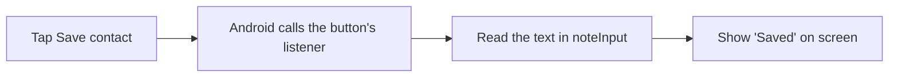

:::objectives
- Combine a `ConstraintLayout` page with a `LinearLayout` inside a `MaterialCardView`.
- Create a vector icon with Vector Asset Studio and tint it from a color resource.
- Keep every string, color, and size in `res/values`, named by role.
- Line views up by constraining them to another view instead of the parent.
:::

Business cards make a perfect first real screen: small enough to finish in one class, but with every ingredient of a production layout. Here's what you're building, imitated in HTML so you can see the goal (yours will be real Android views):

```html preview height="460" title="Business card target"
<div class="phone">
  <div class="card">
    <svg viewBox="0 0 24 24" width="72" height="72" aria-hidden="true"><path fill="#0B6E4F" d="M12 2a10 10 0 1 0 0 20 10 10 0 0 0 0-20zm0 4a3 3 0 1 1 0 6 3 3 0 0 1 0-6zm0 14.2a7.2 7.2 0 0 1-6-3.2c0-2 4-3.1 6-3.1s6 1.1 6 3.1a7.2 7.2 0 0 1-6 3.2z"/></svg>
    <h1>Maya Patel</h1>
    <p class="role">Android Developer in Training</p>
    <hr>
    <p class="info">maya@example.com</p>
    <p class="info">San Jose, California</p>
  </div>
  <div class="note">Add a note about this contact</div>
  <div class="button">Save contact</div>
</div>
<style>
  body { margin: 0; display: grid; place-items: center; min-height: 100vh; background: #dfe5ec; font-family: Roboto, system-ui, sans-serif; }
  .phone { width: 240px; height: 420px; border: 8px solid #222; border-radius: 26px; background: #F1F4F8; padding: 18px; box-sizing: border-box; }
  .card { background: #fff; border-radius: 12px; box-shadow: 0 2px 6px rgba(0,0,0,.18); padding: 16px; text-align: center; }
  h1 { font-size: 18px; color: #1F2933; margin: 4px 0 0; }
  .role { color: #0B6E4F; font-size: 12px; margin: 2px 0 0; }
  hr { border: 0; height: 1px; background: #D9E2EC; margin: 12px 0; }
  .info { color: #52606D; font-size: 12px; text-align: left; margin: 0 0 6px; }
  .note { margin-top: 22px; border-bottom: 2px solid #52606D; color: #52606D; font-size: 12px; padding: 6px 2px; }
  .button { margin-top: 10px; background: #0B6E4F; color: #fff; text-align: center; border-radius: 20px; padding: 9px; font-size: 13px; font-weight: 500; }
</style>
```

The note box and button won't do anything yet. In Week 4 you'll bring them to life with Java, and they get IDs today so that's easy.

## Step 1: Create the project

New project, **Empty Views Activity**, named `Week3BusinessCard`. Choose Java, API 24 as the minimum SDK, and Kotlin DSL for the build files, then let the sync finish.

## Step 2: Make an avatar icon

You need an image, and Android Studio can draw one for you:

1.  Right-click `res` and choose **New > Vector Asset**.
2.  Leave **Asset type** on **Clip art**. Click the icon next to **Clip art**, search for `account circle`, select it, and click **OK**.
3.  Change **Name** to `ic_avatar`.
4.  Click **Next**, then **Finish**.

You now have `res/drawable/ic_avatar.xml`. It's a **vector drawable**: the picture is stored as shapes instead of pixels, so it stays sharp at any size and takes almost no space.

## Step 3: The resource files

Text first. Replace `res/values/strings.xml` (use your own details if you like):

```xml
<resources>
    <string name="app_name">Business Card</string>
    <string name="card_name">Maya Patel</string>
    <string name="card_title">Android Developer in Training</string>
    <string name="card_email">maya@example.com</string>
    <string name="card_location">San Jose, California</string>
    <string name="avatar_description">Profile picture of Maya Patel</string>
    <string name="note_hint">Add a note about this contact</string>
    <string name="save_contact">Save contact</string>
</resources>
```

Then the palette. Keep `black` and `white` in `res/values/colors.xml` and add the rest:

```xml
<?xml version="1.0" encoding="utf-8"?>
<resources>
    <color name="black">#FF000000</color>
    <color name="white">#FFFFFFFF</color>
    <color name="brand">#FF0B6E4F</color>
    <color name="page_background">#FFF1F4F8</color>
    <color name="card_background">#FFFFFFFF</color>
    <color name="text_primary">#FF1F2933</color>
    <color name="text_secondary">#FF52606D</color>
    <color name="divider">#FFD9E2EC</color>
</resources>
```

These names describe each color's **job** (`brand`, `divider`), not its look (`green`, `light_grey`). That pays off the day you rebrand: change `brand` to purple and the name still makes sense, while a color called `green` holding purple would confuse everyone.

Finally, create `res/values/dimens.xml` with **right-click values > New > Values Resource File**:

```xml
<?xml version="1.0" encoding="utf-8"?>
<resources>
    <dimen name="screen_margin">24dp</dimen>
    <dimen name="card_padding">24dp</dimen>
    <dimen name="card_corner">16dp</dimen>
    <dimen name="avatar_size">96dp</dimen>
    <dimen name="space_small">8dp</dimen>
    <dimen name="space_medium">16dp</dimen>
    <dimen name="space_large">32dp</dimen>
    <dimen name="text_name">24sp</dimen>
    <dimen name="text_body">16sp</dimen>
</resources>
```

## Step 4: Plan the tree, then write the layout

Before typing XML, sketch the tree. Three big blocks sit on the page, and the card holds a column of its own:

```mermaid caption="The business card's view tree: a flat page with one nested column inside the card"
flowchart TD
    R["ConstraintLayout (id main)"] --> C[MaterialCardView]
    R --> N["EditText: note"]
    R --> S["Button: Save contact"]
    C --> L["LinearLayout, vertical"]
    L --> I["ImageView: avatar"]
    L --> T1["TextView: name"]
    L --> T2["TextView: title"]
    L --> D["View: divider line"]
    L --> T3["TextView: email"]
    L --> T4["TextView: location"]
```

Open `res/layout/activity_main.xml` in **Split** view and replace everything with this. Read it through once before running; the explanation follows.

```xml
<?xml version="1.0" encoding="utf-8"?>
<androidx.constraintlayout.widget.ConstraintLayout xmlns:android="http://schemas.android.com/apk/res/android"
    xmlns:app="http://schemas.android.com/apk/res-auto"
    xmlns:tools="http://schemas.android.com/tools"
    android:id="@+id/main"
    android:layout_width="match_parent"
    android:layout_height="match_parent"
    android:background="@color/page_background"
    tools:context=".MainActivity">

    <com.google.android.material.card.MaterialCardView
        android:id="@+id/card"
        android:layout_width="0dp"
        android:layout_height="wrap_content"
        android:layout_marginStart="@dimen/screen_margin"
        android:layout_marginTop="@dimen/screen_margin"
        android:layout_marginEnd="@dimen/screen_margin"
        app:cardBackgroundColor="@color/card_background"
        app:cardCornerRadius="@dimen/card_corner"
        app:cardElevation="4dp"
        app:layout_constraintEnd_toEndOf="parent"
        app:layout_constraintStart_toStartOf="parent"
        app:layout_constraintTop_toTopOf="parent">

        <LinearLayout
            android:layout_width="match_parent"
            android:layout_height="wrap_content"
            android:gravity="center_horizontal"
            android:orientation="vertical"
            android:padding="@dimen/card_padding">

            <ImageView
                android:id="@+id/avatarImage"
                android:layout_width="@dimen/avatar_size"
                android:layout_height="@dimen/avatar_size"
                android:contentDescription="@string/avatar_description"
                app:srcCompat="@drawable/ic_avatar"
                app:tint="@color/brand" />

            <TextView
                android:id="@+id/nameText"
                android:layout_width="wrap_content"
                android:layout_height="wrap_content"
                android:layout_marginTop="@dimen/space_small"
                android:text="@string/card_name"
                android:textColor="@color/text_primary"
                android:textSize="@dimen/text_name"
                android:textStyle="bold" />

            <TextView
                android:id="@+id/titleText"
                android:layout_width="wrap_content"
                android:layout_height="wrap_content"
                android:text="@string/card_title"
                android:textColor="@color/brand"
                android:textSize="@dimen/text_body" />

            <View
                android:layout_width="match_parent"
                android:layout_height="1dp"
                android:layout_marginTop="@dimen/space_medium"
                android:layout_marginBottom="@dimen/space_medium"
                android:background="@color/divider" />

            <TextView
                android:id="@+id/emailText"
                android:layout_width="match_parent"
                android:layout_height="wrap_content"
                android:text="@string/card_email"
                android:textColor="@color/text_secondary"
                android:textSize="@dimen/text_body" />

            <TextView
                android:id="@+id/locationText"
                android:layout_width="match_parent"
                android:layout_height="wrap_content"
                android:layout_marginTop="@dimen/space_small"
                android:text="@string/card_location"
                android:textColor="@color/text_secondary"
                android:textSize="@dimen/text_body" />
        </LinearLayout>
    </com.google.android.material.card.MaterialCardView>

    <EditText
        android:id="@+id/noteInput"
        android:layout_width="0dp"
        android:layout_height="wrap_content"
        android:layout_marginTop="@dimen/space_large"
        android:hint="@string/note_hint"
        android:importantForAutofill="no"
        android:inputType="textCapSentences|textMultiLine"
        android:minHeight="48dp"
        android:textColor="@color/text_primary"
        android:textColorHint="@color/text_secondary"
        app:layout_constraintEnd_toEndOf="@id/card"
        app:layout_constraintStart_toStartOf="@id/card"
        app:layout_constraintTop_toBottomOf="@id/card" />

    <Button
        android:id="@+id/saveButton"
        android:layout_width="0dp"
        android:layout_height="wrap_content"
        android:layout_marginTop="@dimen/space_small"
        android:text="@string/save_contact"
        app:backgroundTint="@color/brand"
        app:layout_constraintEnd_toEndOf="@id/card"
        app:layout_constraintStart_toStartOf="@id/card"
        app:layout_constraintTop_toBottomOf="@id/noteInput" />

</androidx.constraintlayout.widget.ConstraintLayout>
```

## How the layout fits together

**Two containers, each doing what it's best at.** The outer `ConstraintLayout` places the three big blocks. Inside the card, a vertical `LinearLayout` stacks six views, which is far simpler than writing constraints for every line of text.

**The card.** `MaterialCardView` comes from the Material Components library, which the template already includes through `implementation(libs.material)` in your app's Gradle file, so there's nothing to add. Its `app:card...` attributes set the color, corner radius, and shadow. Underneath, a card is a `FrameLayout`, which piles its children on top of each other, so it gets exactly one child: the `LinearLayout` that does the stacking.

**Width 0dp, constrained to the card.** The card stretches between the screen edges minus its 24dp margins. The note field and button use the same `0dp` trick, but they constrain to `@id/card` instead of the parent, so their edges line up exactly with the card's. Change the card's margins later and everything stays aligned.

**Centering inside the card.** `android:gravity="center_horizontal"` on the `LinearLayout` centers the avatar, name, and title. The email and location are `match_parent` wide, so they fill the row and their text starts at the left edge, like a printed card.

**A divider from a plain View.** A `View` that's 1dp tall with a background color is the simplest line you can draw.

**The image.** `app:srcCompat` loads the vector drawable on every Android version, and `app:tint` recolors it brand green. TalkBack, Android's screen reader, reads the `contentDescription` aloud.

**The note field.** `textCapSentences|textMultiLine` combines two input types with `|`: the keyboard capitalizes the first letter, and the box grows as you type more lines. `importantForAutofill="no"` tells autofill there's nothing to suggest. The explicit text and hint colors keep it readable in dark mode, since this page stays light either way.

:::warning
If the avatar line turns red with `Cannot resolve symbol '@drawable/ic_avatar'`, the vector asset was saved under another name. Check `res/drawable`, then either rename the file (right-click > **Refactor > Rename**) or change the reference to match.
:::

## Step 5: Run it

Run the app. You should see a light grey-blue page with a white card near the top: a green person icon, **Maya Patel** in bold, the green title under it, a thin divider, and the email and location in grey. Below the card sits a text field with the hint **Add a note about this contact**, then a full-width green **Save contact** button.

Tap the text field: the keyboard opens, and the first letter you type is capitalized. Tap the button: it ripples and does nothing else, which is correct for now. Next week, that tap will run code:



## Step 6: Prove the resources are doing their job

1.  In `colors.xml`, change `brand` to `#FF6A1B9A` (purple) and run again. The icon, the title, and the button all change together.
2.  In `dimens.xml`, change `avatar_size` to `128dp`. The avatar grows, and everything below it moves down to make room.
3.  Open **Design** view and pick a different device from the toolbar dropdown, such as a small phone or a tablet. The card always stretches to fit, because its width comes from constraints, not a fixed number.

Put the values back, or keep the ones you like, before moving on.

:::video fis26HvvDII start=8:59:58
The "Snackbar and CardView" chapter of MeiCode's Java course on freeCodeCamp. Skip ahead to the CardView half to see another card built in Java and XML, and compare the attributes he sets with the `app:card...` ones you used. The course was recorded in 2020, so some library names look older than `MaterialCardView`.
:::

:::quiz
Q: The note field and button use `app:layout_constraintStart_toStartOf="@id/card"` instead of `"parent"`. What does that buy you?
- [ ] Nothing; it's the same as constraining to the parent
  It looks the same today, but not after you change the card's margins.
- [x] Their edges always line up with the card's, even if the card's margins change
  They follow the card, so one margin edit moves all three blocks together.
- [ ] It makes them part of the card
  They're still children of the `ConstraintLayout`; they're only positioned relative to the card.

Q: Why does the card contain a `LinearLayout` instead of the six views directly?
- [x] A card piles its children on top of each other, so one child does the stacking
  `MaterialCardView` is a `FrameLayout` underneath, which overlaps its children.
- [ ] Cards can't hold `TextView`s
  They can hold any view; they just don't arrange several of them.
- [ ] `LinearLayout` is required for `app:tint` to work
  Tinting belongs to the `ImageView` and works in any container.

Q: You change `brand` from green to purple in `colors.xml`. What changes on screen?
- [ ] Only the button
  The button isn't the only view that uses `@color/brand`.
- [x] The avatar icon, the job title, and the button
  All three refer to `@color/brand`, so one edit recolors them together.
- [ ] Nothing until you edit the layout too
  The layout already points at the name, and the name now holds purple.
:::

:::takeaways
- Use `ConstraintLayout` for the page and a `LinearLayout` wherever a simple stack is clearer.
- Vector Asset Studio makes crisp icons, and `app:tint` colors them from a resource.
- Name colors by job, like `brand` and `divider`, and keep every size in `dimens.xml`.
- Constraining to another view's edges keeps blocks aligned when things change.
- Give views IDs now if Java will need them later.
:::

## Ideas to extend it

-   Add a phone number line and a small `ic_email` vector icon next to the email, inside a horizontal `LinearLayout`.
-   Give the card a thin brand-colored border with `app:strokeColor` and `app:strokeWidth`.
-   Make a `values-night/colors.xml` so the page turns dark in dark mode, then check that the note field's text and hint colors still read well against it.

## Further reading

-   [Create a card-based layout](https://developer.android.com/develop/ui/views/layout/cardview): cards in the View system, with corner and elevation attributes.
-   [Add multi-density vector graphics](https://developer.android.com/studio/write/vector-asset-studio): everything Vector Asset Studio can import, including your own SVG files.
-   [Linear layout](https://developer.android.com/develop/ui/views/layout/linear): weights, orientation, and gravity in Google's own words.
