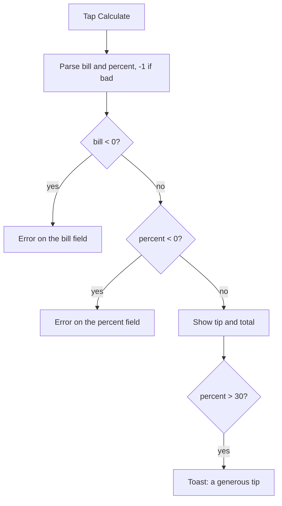

:::objectives
- Test an app's math as plain Java before any Android code exists.
- Read two `EditText` fields, validate them, and show the result in a `TextView`.
- Store views in fields so more than one method can use them.
- Keep a result across rotation with `onSaveInstanceState`, then prove it by breaking it.
:::

A restaurant bill is a perfect first interactive app: two inputs, one button, one answer, and endless ways for a user to type something odd. Here's the finished screen after typing `42.50` and `18` and tapping **Calculate**:

```text
+--------------------------------+
| 42.50                          |
| 18                             |
| [         CALCULATE          ] |
|                                |
| Tip: $7.65  Total: $50.15      |
+--------------------------------+
```

Leave the bill empty and the bill field shows a red error instead of crashing. Turn the phone sideways and the answer is still there. Every tap follows the same path through the code:



## Step 1: Create the project

In Android Studio choose **File > New > New Project > Empty Views Activity**, then fill in:

-   **Name:** Tip Calculator
-   **Package name:** `com.example.tipcalculator`
-   **Language:** Java
-   **Minimum SDK:** API 24
-   **Build configuration language:** Kotlin DSL

Wait for the Gradle sync to finish (the progress bar at the bottom goes quiet) before editing anything. Editing during a sync is the fastest way to get confusing red errors that vanish on their own a minute later.

## Step 2: Get the math right first

An Android app has a lot of moving parts: layouts, ids, listeners, the emulator. A bug in the formula would hide among all of them. So start with a plain Java class that only does math. Before you run it, work out 18% of $42.50 in your head (10% is 4.25, so 18% is a bit under double that).

```java run title="TipMath.java"
import java.util.Locale;

public class TipMath {

    static double tipAmount(double bill, double percent) {
        return bill * percent / 100.0;
    }

    static String describe(double bill, double percent) {
        double tip = tipAmount(bill, percent);
        double total = bill + tip;
        return String.format(Locale.US, "Tip: $%.2f  Total: $%.2f", tip, total);
    }

    public static void main(String[] args) {
        System.out.println(describe(42.50, 18));
        System.out.println(describe(100, 15));
        System.out.println(describe(23.99, 20));
    }
}
```

Look at the third line of output. 20% of 23.99 is really 4.798, and `%.2f` rounds it to two decimal places, which is what money needs. `Locale.US` is there because formatting follows the phone's language settings: on a phone set to German, the same format prints `7,65` with a comma. Pinning the locale keeps the dollar format predictable.

The formula works. If the app shows a wrong number later, the bug is in how you connected things, not in the math.

## Step 3: Add the strings

Open `app/src/main/res/values/strings.xml` and replace it with:

```xml
<resources>
    <string name="app_name">Tip Calculator</string>
    <string name="bill_hint">Bill amount, like 42.50</string>
    <string name="percent_hint">Tip percent, like 18</string>
    <string name="calculate">Calculate</string>
    <string name="result_placeholder">Enter a bill and a tip percent</string>
    <string name="error_bill">Enter a bill amount</string>
    <string name="error_percent">Enter a tip percent</string>
</resources>
```

The two error messages live here too, so Java can fetch them with `getString(R.string.error_bill)` instead of hard-coding English inside the code.

## Step 4: Build the layout

Replace `app/src/main/res/layout/activity_main.xml`. Keep `android:id="@+id/main"` on the root: the template's Java uses that id to pad the screen away from the status bar.

```xml
<?xml version="1.0" encoding="utf-8"?>
<LinearLayout xmlns:android="http://schemas.android.com/apk/res/android"
    xmlns:tools="http://schemas.android.com/tools"
    android:id="@+id/main"
    android:layout_width="match_parent"
    android:layout_height="match_parent"
    android:orientation="vertical"
    android:padding="24dp"
    tools:context=".MainActivity">

    <EditText
        android:id="@+id/bill_input"
        android:layout_width="match_parent"
        android:layout_height="wrap_content"
        android:hint="@string/bill_hint"
        android:importantForAutofill="no"
        android:inputType="numberDecimal" />

    <EditText
        android:id="@+id/percent_input"
        android:layout_width="match_parent"
        android:layout_height="wrap_content"
        android:layout_marginTop="12dp"
        android:hint="@string/percent_hint"
        android:importantForAutofill="no"
        android:inputType="number" />

    <Button
        android:id="@+id/calculate_button"
        android:layout_width="match_parent"
        android:layout_height="wrap_content"
        android:layout_marginTop="16dp"
        android:text="@string/calculate" />

    <TextView
        android:id="@+id/result_text"
        android:layout_width="match_parent"
        android:layout_height="wrap_content"
        android:layout_marginTop="24dp"
        android:text="@string/result_placeholder"
        android:textSize="22sp" />

</LinearLayout>
```

`numberDecimal` gives the bill a keyboard with a decimal point. `number` gives the percent whole digits only. Click the **Split** or **Design** button in the top right of the editor: you should see two empty fields with grey hints, a full-width button, and the placeholder sentence.

## Step 5: Wire it up in Java

Replace `MainActivity.java` with the code below. The top of `onCreate` is the template's code, unchanged. The new parts are the three fields, the end of `onCreate`, `calculate()`, `parseOrMinusOne()`, and `onSaveInstanceState()`.

```java
package com.example.tipcalculator;

import android.os.Bundle;
import android.widget.Button;
import android.widget.EditText;
import android.widget.TextView;
import android.widget.Toast;

import androidx.activity.EdgeToEdge;
import androidx.annotation.NonNull;
import androidx.appcompat.app.AppCompatActivity;
import androidx.core.graphics.Insets;
import androidx.core.view.ViewCompat;
import androidx.core.view.WindowInsetsCompat;

import java.util.Locale;

public class MainActivity extends AppCompatActivity {

    private static final String KEY_RESULT = "result";

    private EditText billInput;
    private EditText percentInput;
    private TextView resultText;

    @Override
    protected void onCreate(Bundle savedInstanceState) {
        super.onCreate(savedInstanceState);
        EdgeToEdge.enable(this);
        setContentView(R.layout.activity_main);
        ViewCompat.setOnApplyWindowInsetsListener(findViewById(R.id.main), (v, insets) -> {
            Insets systemBars = insets.getInsets(WindowInsetsCompat.Type.systemBars());
            v.setPadding(systemBars.left, systemBars.top, systemBars.right, systemBars.bottom);
            return insets;
        });

        billInput = findViewById(R.id.bill_input);
        percentInput = findViewById(R.id.percent_input);
        resultText = findViewById(R.id.result_text);
        Button calculateButton = findViewById(R.id.calculate_button);

        if (savedInstanceState != null) {
            resultText.setText(savedInstanceState.getString(KEY_RESULT));
        }

        calculateButton.setOnClickListener(v -> calculate());
    }

    private void calculate() {
        double bill = parseOrMinusOne(billInput.getText().toString());
        double percent = parseOrMinusOne(percentInput.getText().toString());

        if (bill < 0) {
            billInput.setError(getString(R.string.error_bill));
            return;
        }
        if (percent < 0) {
            percentInput.setError(getString(R.string.error_percent));
            return;
        }

        double tip = bill * percent / 100.0;
        double total = bill + tip;
        resultText.setText(String.format(Locale.US, "Tip: $%.2f  Total: $%.2f", tip, total));

        if (percent > 30) {
            Toast.makeText(this, "That's a generous tip!", Toast.LENGTH_SHORT).show();
        }
    }

    private double parseOrMinusOne(String text) {
        try {
            return Double.parseDouble(text.trim());
        } catch (NumberFormatException e) {
            return -1;
        }
    }

    @Override
    protected void onSaveInstanceState(@NonNull Bundle outState) {
        super.onSaveInstanceState(outState);
        outState.putString(KEY_RESULT, resultText.getText().toString());
    }
}
```

Look at where the views are declared. `billInput`, `percentInput`, and `resultText` are **fields** at the top of the class, not local variables inside `onCreate`, because `calculate()` and `onSaveInstanceState()` need them too. A local variable disappears when `onCreate` returns. The button stays local because only `onCreate` touches it.

The `return` after each `setError` matters just as much. Without it, the method would keep going and do math with `-1`, showing a negative tip right under the error.

## Step 6: Run it and check the answers

Click **Run 'app'** and try each row. Your screen should match:

```text
Bill 42.50, percent 18   ->  Tip: $7.65  Total: $50.15
Bill empty, percent 18   ->  red error on the bill field: "Enter a bill amount"
Bill 100, percent empty  ->  red error on the percent field: "Enter a tip percent"
Bill 100, percent 40     ->  Tip: $40.00  Total: $140.00, plus the Toast "That's a generous tip!"
```

The first line matches the plain Java test from Step 2 exactly, which is the payoff for running it first.

## Step 7: Prove that rotation works

Calculate a tip, then rotate. On an emulator, use the rotate buttons in the emulator's toolbar; on a phone, switch on auto-rotate in quick settings first. The result is still there.

Now break it on purpose, because seeing the failure is how you know the fix is doing something. Comment out the `outState.putString(...)` line, run again, calculate, and rotate. The result snaps back to "Enter a bill and a tip percent," while the two typed numbers stay put. That's the rule from the notes in action: an `EditText` with an id saves its own text, and a `TextView` you changed in code doesn't. Put the line back.

:::tip
Want to watch the rebuild happen? Add `Log.d("TipCalc", "onCreate, saved = " + (savedInstanceState != null));` near the top of `onCreate` and type `tag:TipCalc` in the Logcat search bar. You'll see `saved = false` at launch and `saved = true` after every rotation.
:::

:::video TcTgbVudLyQ
What to watch for: which method writes a value into the Bundle and where it gets read back. It's the same two-part pattern as Step 7.
:::

## When it doesn't work

-   **App crashes on launch:** an id in Java doesn't match the XML. `R.id.bill_input` must match `@+id/bill_input` letter for letter.
-   **Nothing happens on tap:** `setOnClickListener` is missing, or it's attached to a different view.
-   **Red `R` everywhere in the editor:** an XML file has an error, so `R` couldn't be generated. Fix the XML (look for a red underline) and the Java errors disappear.
-   **A negative tip appears:** a `return` is missing after one of the `setError` calls.

:::quiz
Q: Why are `billInput` and `resultText` fields instead of local variables in `onCreate`?
- [ ] Fields run faster than local variables
  Speed has nothing to do with it here.
- [x] `calculate()` and `onSaveInstanceState()` need them, and a local variable disappears when `onCreate` returns
  Right. Only `onCreate` uses the button, so it can stay local.
- [ ] `findViewById` only works when you assign the result to a field
  It works either way; the question is which methods can see the variable afterwards.

Q: You comment out `outState.putString(KEY_RESULT, ...)`, calculate a tip, and rotate. What do you see?
- [ ] Everything resets, including both numbers you typed
  The two `EditText` fields have ids, so they save their own text.
- [ ] Nothing changes at all
  The result `TextView` was set in code, and nothing saved it.
- [x] The two numbers stay, and the result goes back to the placeholder sentence
  The new Activity rebuilds the TextView from XML, and nothing put the old result back.

Q: Why test `TipMath` as plain Java before building the screen?
- [ ] Android Studio can't run code that does math
  It can. Plain Java is just faster to check and has fewer places for a bug to hide.
- [x] Once the formula is proven, a wrong number in the app must come from the wiring
  That splits one hard problem (where's the bug?) into two easy ones.
:::

:::takeaways
- Prove the logic in plain Java first; then app bugs can only be wiring bugs.
- Validate every field and `return` right after `setError`, so bad input never reaches the math.
- Views that more than one method needs belong in fields.
- `EditText` fields with ids survive rotation on their own; results you set in code need `onSaveInstanceState`.
- Break a fix on purpose once, so you know it's really what's doing the work.
:::

## Ideas to extend it

-   **Split the bill:** add a third field for the number of people and show each person's share.
-   **Quick buttons:** add 15%, 18%, and 20% buttons that fill in the percent field with `setText`.
-   **Round up:** add a button that rounds the total up to the next whole dollar with `Math.ceil` and works out the tip that makes that happen.

## Further reading

-   [Toasts overview](https://developer.android.com/guide/topics/ui/notifiers/toasts): durations, and when a Toast is the wrong tool.
-   [Handle configuration changes](https://developer.android.com/guide/topics/resources/runtime-changes): why rotation recreates the Activity and what else triggers it, like switching to dark mode.
