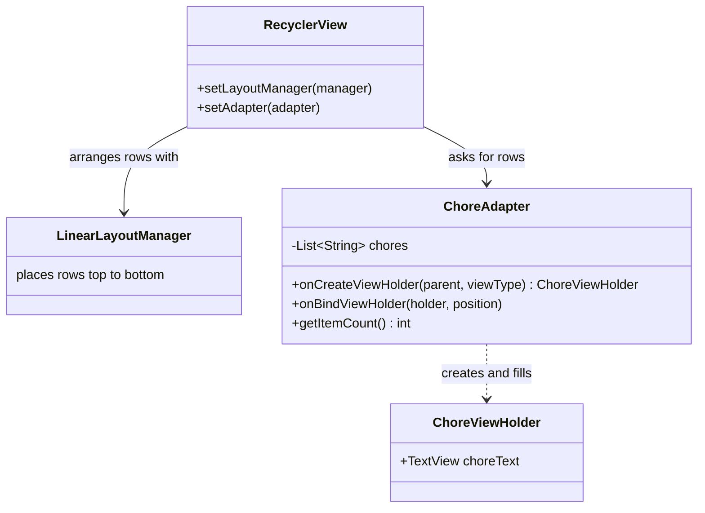

:::objectives
- Explain what RecyclerView recycles, and why that keeps a 500-item list fast.
- Build the four pieces of a list: row layout, ViewHolder, Adapter, and LayoutManager.
- Add RecyclerView 1.4.0 to a project through the version catalog.
- Create a second Activity and open it with an explicit Intent.
- Pass values with Intent extras and read them safely on the other screen.
:::

Open your contacts, your messages, or a music app. Same shape every time: a long list you can fling with your thumb, and tapping a row opens a screen about that one thing. That list-then-detail pattern covers a huge share of the apps on your phone. This week you learn both halves.

## Why not just stack 500 TextViews?

You could put 500 TextViews inside a `ScrollView`. Android would build all 500 before showing the screen, even though about 10 fit on it at once. The app would open slowly and hold hundreds of views in memory that nobody is looking at.

`RecyclerView` takes a smarter approach. Picture a sushi conveyor belt: the restaurant doesn't own a plate for every piece of sushi it will ever serve. Empty plates come back around, get loaded with something new, and go out again. RecyclerView does that with row views. When a row scrolls off the top, it takes that same view object, fills it with the next item's data, and slides it in at the bottom.

You can watch the idea in a toy model. This is plain Java, not the real RecyclerView: it pretends 10 rows fit on screen and scrolls through 500 songs, counting how many row objects it ever creates.

```java run title="RecyclingModel.java"
import java.util.ArrayDeque;

public class RecyclingModel {
    static int created = 0;
    static int bound = 0;

    // Stands in for the views of one row.
    static class Row {
        final int id;
        String text;

        Row() {
            created++;
            id = created;
        }
    }

    public static void main(String[] args) {
        int items = 500;
        int visible = 10;
        ArrayDeque<Row> onScreen = new ArrayDeque<>();
        ArrayDeque<Row> spare = new ArrayDeque<>();

        for (int position = 0; position < items; position++) {
            if (onScreen.size() == visible) {
                spare.push(onScreen.removeFirst());   // top row scrolls away
            }
            Row row = spare.isEmpty() ? new Row() : spare.pop();
            row.text = "Song #" + position;           // fill it with this item
            bound++;
            onScreen.addLast(row);
            if (position < 2 || position == 10 || position == 499) {
                System.out.println("position " + position + " uses row object #" + row.id);
            }
        }
        System.out.println("Items shown: " + bound);
        System.out.println("Row objects created: " + created);
    }
}
```

Position 10 lands in row object #1, the one that held position 0 before it scrolled away. 500 items were shown, but only 10 row objects ever existed. The real RecyclerView keeps a few spare rows ready, so it creates a handful more than that, but the shape is the same: **create about a screenful, fill (bind) once for every item shown**.

## The four pieces of every list

A RecyclerView never works alone. It always needs these four:

1.  **Row layout:** an XML file describing one row.
2.  **ViewHolder:** a small object that holds the views inside one row, so `findViewById` runs once per row object instead of on every scroll.
3.  **Adapter:** the bridge between your data (say, a `List<String>`) and the rows. It creates ViewHolders and fills them.
4.  **LayoutManager:** decides where rows go. `LinearLayoutManager` stacks them in a vertical list.



### Add the library

RecyclerView lives in the `androidx.recyclerview` library. The template's Material library already depends on an older version, so code may compile with nothing added, but you'd be stuck with whatever version Material happens to bring. Add it yourself so you control it. In `gradle/libs.versions.toml`, add one line to the existing `[versions]` section and one to the existing `[libraries]` section (don't create second copies of those headers):

```toml
[versions]
recyclerview = "1.4.0"

[libraries]
recyclerview = { group = "androidx.recyclerview", name = "recyclerview", version.ref = "recyclerview" }
```

Then in `app/build.gradle.kts`, inside `dependencies { }`:

```kotlin
implementation(libs.recyclerview)
```

Click **Sync Now** in the bar that appears at the top of the editor.

### Piece 1: the row layout

Right-click `res/layout`, choose **New > Layout Resource File**, and create `item_chore.xml`:

```xml
<?xml version="1.0" encoding="utf-8"?>
<TextView xmlns:android="http://schemas.android.com/apk/res/android"
    android:id="@+id/chore_text"
    android:layout_width="match_parent"
    android:layout_height="wrap_content"
    android:padding="16dp"
    android:textSize="18sp" />
```

The row height must be `wrap_content`. A row with `match_parent` height fills the whole screen, so you see exactly one item and assume the list is broken.

### Pieces 2 and 3: the Adapter and its ViewHolder

```java
package com.example.chores;

import android.view.LayoutInflater;
import android.view.View;
import android.view.ViewGroup;
import android.widget.TextView;

import androidx.annotation.NonNull;
import androidx.recyclerview.widget.RecyclerView;

import java.util.List;

public class ChoreAdapter extends RecyclerView.Adapter<ChoreAdapter.ChoreViewHolder> {

    private final List<String> chores;

    public ChoreAdapter(List<String> chores) {
        this.chores = chores;
    }

    @NonNull
    @Override
    public ChoreViewHolder onCreateViewHolder(@NonNull ViewGroup parent, int viewType) {
        View row = LayoutInflater.from(parent.getContext())
                .inflate(R.layout.item_chore, parent, false);
        return new ChoreViewHolder(row);
    }

    @Override
    public void onBindViewHolder(@NonNull ChoreViewHolder holder, int position) {
        holder.choreText.setText(chores.get(position));
    }

    @Override
    public int getItemCount() {
        return chores.size();
    }

    public static class ChoreViewHolder extends RecyclerView.ViewHolder {
        final TextView choreText;

        public ChoreViewHolder(@NonNull View itemView) {
            super(itemView);
            choreText = itemView.findViewById(R.id.chore_text);
        }
    }
}
```

Map the three methods onto the toy model:

-   `onCreateViewHolder` is `new Row()`. It **inflates** a fresh row (turns the XML into real view objects) and wraps it in a ViewHolder. It runs only about a screenful of times.
-   `onBindViewHolder` is `row.text = ...`. It puts the data for `position` into a row that already exists, and runs every time a row scrolls into view. Keep it quick.
-   `getItemCount` tells RecyclerView where the list ends. It never asks for a position past this number.

The `false` in `inflate(..., parent, false)` means "use the parent to work out sizes, but don't attach the row yet." RecyclerView attaches rows itself. Pass `true` and it crashes with `IllegalStateException: ViewHolder views must not be attached when created`.

### Piece 4: connect it in the Activity

In `activity_main.xml`:

```xml
<androidx.recyclerview.widget.RecyclerView
    android:id="@+id/chore_list"
    android:layout_width="match_parent"
    android:layout_height="match_parent" />
```

In `MainActivity.onCreate`:

```java
List<String> chores = new ArrayList<>();
chores.add("Feed the cat");
chores.add("Take out recycling");
chores.add("Finish math homework");

RecyclerView choreList = findViewById(R.id.chore_list);
choreList.setLayoutManager(new LinearLayoutManager(this));
ChoreAdapter adapter = new ChoreAdapter(chores);
choreList.setAdapter(adapter);
```

You need imports for `RecyclerView`, `LinearLayoutManager`, `ArrayList`, and `List`; click each red name and press **Alt+Enter** (**Option+Return** on a Mac). Run it and the screen shows three rows:

```text
Feed the cat
Take out recycling
Finish math homework
```

:::warning
A blank screen with no crash almost always means `setLayoutManager` is missing. Logcat says so, if you look: `E/RecyclerView: No layout manager attached; skipping layout`.
:::

### Changing the list later

The adapter reads from your list, but it doesn't watch it. If you add an item after `setAdapter`, tell the adapter which position changed, and it animates just that row in:

```java
chores.add("Water the plants");
adapter.notifyItemInserted(chores.size() - 1);
```

There are matching `notifyItemRemoved(position)` and `notifyItemChanged(position)` methods. Forget to call one, and the screen keeps showing the old list until something else forces a redraw.

:::video QW0o21ZjmDM
What to watch for: the explanation of how the adapter, the ViewHolder, and the layout manager split up the work. It's Google's own course material from before AndroidX, so some imports in it start with `android.support` instead of `androidx`; use the names from this lesson.
:::

## Opening a second screen

In an app built with Views, each screen is usually its own Activity. Create one with **File > New > Activity > Empty Views Activity** and name it `DetailActivity`. Android Studio creates three things: the Java file, its layout `activity_detail.xml`, **and** an entry in `AndroidManifest.xml`:

```xml
<activity
    android:name=".DetailActivity"
    android:exported="false" />
```

Every Activity must be listed inside `<application>` in the manifest. Create the class by hand with **New > Java Class** instead, and the first attempt to open it crashes with `android.content.ActivityNotFoundException: Unable to find explicit activity class {...}; have you declared this activity in your AndroidManifest.xml`. The `exported="false"` part means other apps can't open this screen directly, which is what you want for a page inside your own app.

### An explicit Intent names the screen to open

An `Intent` is a message to Android: "please do this." An **explicit** Intent names the exact Activity class. You can clip data to it with `putExtra`, like sticky notes on an envelope:

```java
Intent intent = new Intent(this, DetailActivity.class);
intent.putExtra("chore_name", "Feed the cat");
intent.putExtra("minutes", 5);
startActivity(intent);
```

You never call `new DetailActivity()` yourself. Android creates it, runs its lifecycle, and keeps your list screen stopped underneath it, ready to come back.

```mermaid caption="Android carries the Intent and its extras from one screen to the next"
sequenceDiagram
    participant Main as MainActivity
    participant Android
    participant Detail as DetailActivity
    Main->>Main: new Intent(this, DetailActivity.class)
    Main->>Main: putExtra(name and minutes)
    Main->>Android: startActivity(intent)
    Android->>Detail: create it and call onCreate
    Detail->>Detail: getIntent().getStringExtra(...)
    Note over Main: stopped, not destroyed
    Detail->>Android: Back gesture or finish()
    Android->>Main: onRestart, onStart, onResume
```

### Reading extras on the other side

In `DetailActivity.onCreate`:

```java
String name = getIntent().getStringExtra("chore_name");
int minutes = getIntent().getIntExtra("minutes", 0);
if (name == null) {
    name = "Unknown chore";
}
```

`getStringExtra` returns `null` when the key is missing, so check it. `getIntExtra` makes you supply a default for the same reason. The keys must match **exactly** on both sides, and a typo doesn't cause an error; it just gives you `null` or the default. The fix is to type each key once, as a constant in `DetailActivity` such as `public static final String EXTRA_NAME = "com.example.chores.NAME";`, and use the constant on both sides. Starting the key with your package name is the convention Android's docs use.

### Going back

The system Back gesture (or button) finishes `DetailActivity` and returns to the list, scrolled exactly where you left it, because the list screen was only stopped. To do the same from a button of your own, call `finish()`.

:::video WztFcaz4yS8
What to watch for: the two halves of passing data, `putExtra` on the sending screen and `getStringExtra` on the receiving one. The video is in Java, like this course.
:::

:::quiz
Q: A list has 500 items and about 10 rows fit on screen. You scroll from top to bottom. Roughly how many times does `onCreateViewHolder` run?
- [x] A dozen or so
  RecyclerView creates about a screenful of rows plus a few spares, then reuses them.
- [ ] 500
  That's how many times `onBindViewHolder` runs, filling rows with each item's data.
- [ ] Once
  One row object can't be on screen in ten places at once.

Q: Your list screen is blank, nothing crashes, and Logcat shows `No layout manager attached; skipping layout`. What's the fix?
- [ ] Call `adapter.notifyItemInserted(0)`
  The adapter is fine. RecyclerView doesn't know where to put the rows.
- [x] Call `setLayoutManager(new LinearLayoutManager(this))` on the RecyclerView
  Without a LayoutManager, RecyclerView skips layout entirely.
- [ ] Change the row height to `match_parent`
  That would make each row fill the screen, a different bug.

Q: The sender calls `putExtra("choreName", name)` and `DetailActivity` calls `getStringExtra("chore_name")`. What does the detail screen get?
- [ ] An error at compile time
  Keys are plain strings, so the compiler can't check them.
- [ ] A crash when the screen opens
  Nothing crashes at this point.
- [x] `null`, because no extra has that exact key
  That's why the lesson keeps each key in one constant used on both sides.

Q: You made `DetailActivity` with **New > Java Class**, and tapping a row crashes with `ActivityNotFoundException`. What's missing?
- [x] An `<activity android:name=".DetailActivity" />` entry in `AndroidManifest.xml`
  Every Activity must be declared in the manifest. The Activity wizard adds it for you; a plain Java class doesn't.
- [ ] A call to `new DetailActivity()` before `startActivity`
  Android creates Activities itself. Never call their constructor.
- [ ] An extra on the Intent
  Extras are optional; an Intent with none opens the screen fine.
:::

:::takeaways
- RecyclerView creates about a screenful of rows and rebinds them as you scroll, so long lists stay fast.
- Every list needs a row layout, a ViewHolder, an Adapter, and a LayoutManager.
- `onCreateViewHolder` makes rows, `onBindViewHolder` fills them, `getItemCount` says where the list ends.
- Tell the adapter when the list changes with `notifyItemInserted` and friends.
- An explicit Intent opens a named Activity; extras carry data, keyed by constants so a typo can't break them.
- Every Activity must be in the manifest.
:::

## Further reading

-   [Create dynamic lists with RecyclerView](https://developer.android.com/develop/ui/views/layout/recyclerview): the official guide, including how to make grids.
-   [Intents and intent filters](https://developer.android.com/guide/components/intents-filters): explicit versus implicit Intents, which you'll meet in the practice.
-   [RecyclerView release notes](https://developer.android.com/jetpack/androidx/releases/recyclerview): where to check the newest version number.
