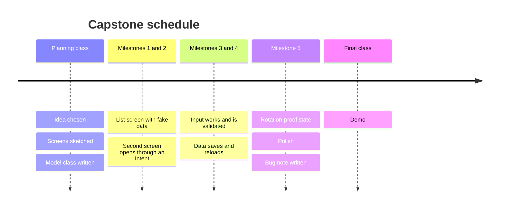

:::objectives
- List the five things your capstone app must do and the three things you hand in.
- Pick an idea that fits the requirements and the time you have.
- Sketch every screen and the moves between them before writing XML.
- Write and test your model class first, as plain Java.
- Decide which data is saved for good and which only needs to survive rotation.
:::

For six weeks you've built apps someone else designed: a tip calculator, a planet list, a note that remembers. Now you decide what the app is. The capstone is a chance to make something you'd actually keep on your own phone, and it uses every skill from the course in one project.

## The brief

Build an Android app in Java, with XML layouts, that someone could pick up and use without you explaining it. It must have:

1.  **Two or more screens** (Activities), with navigation between them using an Intent.
2.  **User input**: at least one `EditText` or other control the user fills in, validated so bad input can't crash the app.
3.  **State that survives rotation**: rotate at any moment and nothing the user sees resets. At least one value must be saved with `onSaveInstanceState` (or a `ViewModel`), not only views that save themselves.
4.  **A scrolling list** built with `RecyclerView`.
5.  **Saved data**: close the app completely, reopen it, and the user's data is still there. SharedPreferences is enough.

### What you hand in

-   **A project that builds and runs.** A fresh copy should open in Android Studio, sync, and run with no errors.
-   **A short demo** (2 to 3 minutes) in the final class, showing each requirement working, live or as a screen recording.
-   **A bug note**: a few sentences about one real bug you hit, how you found it (Logcat, a stack trace, a breakpoint), and how you fixed it.

## Picking an idea

The ideas that work best share one shape: **a list of things the user creates, plus a screen to add or view one**. That shape hits every requirement almost automatically. The list is your RecyclerView, the add screen is your input and your Intent, and the items are your saved data. Here are five ideas at three levels of difficulty:

| Idea | Level | The list shows | The second screen | What gets saved | A stretch feature |
| --- | --- | --- | --- | --- | --- |
| Book or movie list | Starter | Titles with a star rating | Add or edit a title, rating, and short review | Every title, rating, and review | Sort by rating |
| Flashcards | Starter | The cards in your deck | Quiz mode: tap to flip, mark right or wrong | Cards and your best score | Shuffle the deck |
| Habit tracker | Standard | Habits with current streaks | Add a habit, or mark one done today | Habits and streaks | Reset a streak if a day is missed |
| Homework planner | Standard | Assignments by due date | Add or edit an assignment | The assignment list | Highlight anything due tomorrow |
| Workout log | Stretch | Past workouts, newest first | Log a workout with type and minutes | History of every workout | Weekly total minutes at the top |

You can also invent your own. Test it against the brief with three questions: which screen is the list, what does the user type, and what gets saved? If you can't answer all three in one sentence each, the idea needs another pass.

:::tip
Pick something small that you'd really use. A finished, polished habit tracker beats a half-built social network every time, and it makes a much better demo.
:::

### Ideas that cause trouble

-   **Anything that needs the internet** (weather, chat, logins). Networking wasn't part of this course and can eat your whole schedule.
-   **Games with real-time movement.** Those need a custom drawing loop, not Views and layouts.
-   **Huge amounts of data**, like thousands of items or photos. SharedPreferences is built for small amounts.

## Plan before you build

Ten minutes on paper saves hours of rewriting XML. Copy this template into a `PLAN.md` file in your project's top folder (or onto paper) and fill it in:

```text
App name:
Who it's for, in one sentence:

1. Screens (name each Activity, list its views, draw arrows between them)

2. One item (the model class): fields and their types

3. Saved for good (SharedPreferences):
   Survives rotation (Bundle or ViewModel):

4. Every input field, and the worst things a user could type into it:
```

### 1. What are the screens?

Sketch each screen as a box with its views inside, and draw an arrow for every way to move between screens, labeled with what triggers it. For a habit tracker, the map might be:

```mermaid caption="A screen map for a habit tracker: boxes are Activities, arrows are what the user does"
flowchart LR
    M["MainActivity: count, habit list, Add button"] -->|"tap Add"| A["AddHabitActivity: name field, Save button"]
    A -->|"tap Save or Back"| M
    M -->|"tap a habit"| D["HabitDetailActivity: streak, Done today button"]
    D -->|"Back"| M
```

Every arrow out of `MainActivity` will become an Intent, and every arrow back becomes `finish()` or the Back gesture. If your sketch has an arrow you can't explain that way, sort it out now, while it's only a drawing.

:::video fw42BYQmuJ4
What to watch for: how a rough paper sketch lets someone "use" an app before any code exists. Try it with a friend: hand them your screen sketches, ask them to add a habit, and watch where they get confused.
:::

### 2. What is one item?

Write the model class first. It forces you to decide exactly what data you're storing, before any screen depends on it. For a habit tracker:

```java run title="Habit.java"
public class Habit {
    private final String name;
    private int streak;

    public Habit(String name) {
        this.name = name;
        this.streak = 0;
    }

    public String getName() {
        return name;
    }

    public int getStreak() {
        return streak;
    }

    public void markDone() {
        streak++;
    }

    public static void main(String[] args) {
        Habit reading = new Habit("Read 20 pages");
        reading.markDone();
        reading.markDone();
        Habit water = new Habit("Drink water");
        System.out.println(reading.getName() + ": " + reading.getStreak() + "-day streak");
        System.out.println(water.getName() + ": " + water.getStreak() + "-day streak");
    }
}
```

The `main` method exists only so you can test the class here, before Android is involved. Delete it when you move `Habit` into your project, and add your `package` line at the top. Notice that `name` is `final` but `streak` isn't: a habit's name stays fixed after it's created, while its streak changes. Making those choices on purpose is what the model class is for.

### 3. What gets saved, and what survives rotation?

Make two short lists:

-   **Saved for good** (SharedPreferences): the items themselves, plus any settings.
-   **Survives rotation** (Bundle or ViewModel): whatever the user is in the middle of, like which sort order is selected, a quiz score in progress, or a half-filled form that isn't in an `EditText`.

If something is on the first list, it's automatically safe through rotation too, as long as you reload it in `onCreate` or `onResume`.

### 4. What can go wrong with input?

For every field, write what a careless or mischievous user might type: nothing, only spaces, a huge number, letters in a number field, a 500-character name, an emoji. Decide now what the app does in each case. You'll test exactly these cases in the final lesson.

## Schedule



The next lesson walks through each milestone with a starter skeleton you can rename and reshape to fit your idea.

:::takeaways
- The capstone needs two screens, validated input, rotation-proof state, a RecyclerView, and saved data.
- "A list of things the user creates, plus a screen to add or view one" fits every requirement.
- Sketch the screens and arrows first; every arrow becomes an Intent or a Back.
- Write and test the model class before any layout.
- List your inputs and their worst cases now, so testing later is a checklist, not a guess.
:::

## Further reading

-   [Core app quality guidelines](https://developer.android.com/docs/quality-guidelines/core-app-quality): what Android expects from a well-made app, useful as a self-check.
-   [Principles of navigation](https://developer.android.com/guide/navigation/principles): how users expect Back and moving between screens to behave.
