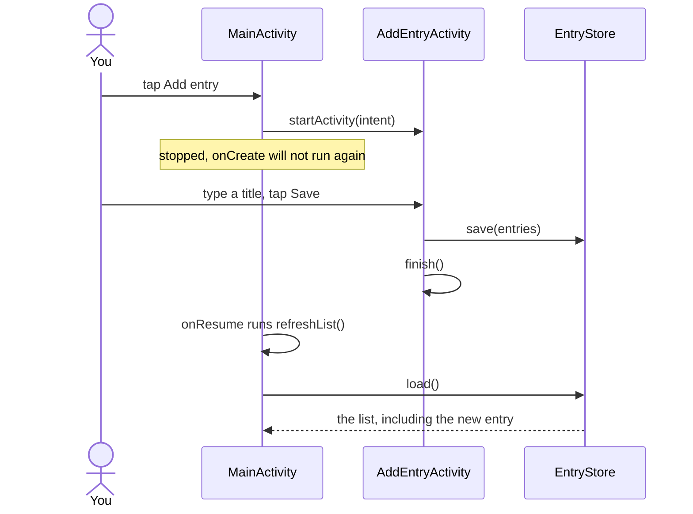

:::objectives
- Build a large app in small milestones, each ending with something you can run.
- Adapt a starter skeleton (list screen, add and edit screen, storage) to your own idea.
- Save a list of objects by encoding it as one string, and test that code as plain Java.
- Reload the list in `onResume` so it updates after the second screen closes.
- Keep a screen setting through rotation with `onSaveInstanceState`.
:::

Big projects fail in one way more than any other: everything gets written at once, nothing runs, and there are forty red errors with no clue which one matters. The cure is **milestones**. Each one below ends with a **checkpoint**, something you run and see working, before you move on. If a checkpoint fails, the bug is in the code you wrote since the last one, which is never very much code.

The skeleton is a generic "entries" app: a list of items that each have a title and a note. Rename it to fit your idea (`Entry` becomes `Habit`, `Recipe`, `Workout`) and add fields as you go. Here's how its six classes fit together once all five milestones are done:

```mermaid caption="The finished skeleton: two screens, one adapter, and a small storage layer"
classDiagram
    class MainActivity {
        -EntryAdapter adapter
        -boolean sortAz
        +onResume()
        -refreshList()
        -openEditor(entry)
    }
    class AddEntryActivity {
        +EXTRA_INDEX
        -saveAndClose()
    }
    class EntryAdapter {
        +setEntries(list)
        +onBindViewHolder(holder, position)
    }
    class EntryStore {
        +load() List
        +save(list)
    }
    class EntryCodec {
        +encode(list) String
        +decode(text) List
    }
    class Entry {
        -String title
        -String note
    }
    MainActivity --> EntryAdapter : shows rows with
    MainActivity --> EntryStore : loads from
    MainActivity ..> AddEntryActivity : opens with an Intent
    AddEntryActivity --> EntryStore : saves to
    EntryStore --> EntryCodec : converts with
    EntryAdapter --> Entry : displays
    EntryCodec --> Entry : reads and writes
```

## Milestone 0: Project setup

Create an **Empty Views Activity** project (Java, API 24). The code below uses the package `com.example.capstone`; change every `package` line to match yours.

Add RecyclerView to `gradle/libs.versions.toml`. The `[versions]` and `[libraries]` headers already exist, so add one line under each:

```toml
[versions]
recyclerview = "1.4.0"

[libraries]
recyclerview = { group = "androidx.recyclerview", name = "recyclerview", version.ref = "recyclerview" }
```

Then add `implementation(libs.recyclerview)` inside `dependencies { }` in `app/build.gradle.kts`, and click **Sync Now**.

**Checkpoint:** the sync succeeds and the untouched template app runs.

## Milestone 1: The model and the list

`Entry.java`:

```java
package com.example.capstone;

public class Entry {
    private final String title;
    private final String note;

    public Entry(String title, String note) {
        this.title = title;
        this.note = note;
    }

    public String getTitle() {
        return title;
    }

    public String getNote() {
        return note;
    }
}
```

`res/layout/item_entry.xml`, one row of the list:

```xml
<?xml version="1.0" encoding="utf-8"?>
<LinearLayout xmlns:android="http://schemas.android.com/apk/res/android"
    android:layout_width="match_parent"
    android:layout_height="wrap_content"
    android:background="?attr/selectableItemBackground"
    android:orientation="vertical"
    android:padding="16dp">

    <TextView
        android:id="@+id/entry_title"
        android:layout_width="wrap_content"
        android:layout_height="wrap_content"
        android:textSize="18sp"
        android:textStyle="bold" />

    <TextView
        android:id="@+id/entry_note"
        android:layout_width="wrap_content"
        android:layout_height="wrap_content" />

</LinearLayout>
```

`EntryAdapter.java`. Unlike the Planet Facts adapter, this one owns its own list and has a `setEntries` method, because the capstone reloads the whole list from storage each time you return to the screen:

```java
package com.example.capstone;

import android.view.LayoutInflater;
import android.view.View;
import android.view.ViewGroup;
import android.widget.TextView;

import androidx.annotation.NonNull;
import androidx.recyclerview.widget.RecyclerView;

import java.util.ArrayList;
import java.util.List;

public class EntryAdapter extends RecyclerView.Adapter<EntryAdapter.EntryViewHolder> {

    public interface OnEntryClickListener {
        void onEntryClick(Entry entry);
    }

    private final List<Entry> entries = new ArrayList<>();
    private final OnEntryClickListener listener;

    public EntryAdapter(OnEntryClickListener listener) {
        this.listener = listener;
    }

    public void setEntries(List<Entry> newEntries) {
        entries.clear();
        entries.addAll(newEntries);
        notifyDataSetChanged();
    }

    @NonNull
    @Override
    public EntryViewHolder onCreateViewHolder(@NonNull ViewGroup parent, int viewType) {
        View row = LayoutInflater.from(parent.getContext())
                .inflate(R.layout.item_entry, parent, false);
        return new EntryViewHolder(row);
    }

    @Override
    public void onBindViewHolder(@NonNull EntryViewHolder holder, int position) {
        Entry entry = entries.get(position);
        holder.titleText.setText(entry.getTitle());
        holder.noteText.setText(entry.getNote());
        holder.itemView.setOnClickListener(v -> listener.onEntryClick(entry));
    }

    @Override
    public int getItemCount() {
        return entries.size();
    }

    public static class EntryViewHolder extends RecyclerView.ViewHolder {
        final TextView titleText;
        final TextView noteText;

        public EntryViewHolder(@NonNull View itemView) {
            super(itemView);
            titleText = itemView.findViewById(R.id.entry_title);
            noteText = itemView.findViewById(R.id.entry_note);
        }
    }
}
```

`notifyDataSetChanged()` tells RecyclerView "everything may have changed, redraw it all." It's the simplest choice when the whole list is replaced at once. Android Studio may underline it with a lint warning suggesting the more specific `notifyItem...` methods; that's a performance hint, not an error, and fine to leave for now.

`res/layout/activity_main.xml`, with a count and a sort button on top, the list in the middle, and an Add button at the bottom:

```xml
<?xml version="1.0" encoding="utf-8"?>
<LinearLayout xmlns:android="http://schemas.android.com/apk/res/android"
    xmlns:tools="http://schemas.android.com/tools"
    android:id="@+id/main"
    android:layout_width="match_parent"
    android:layout_height="match_parent"
    android:orientation="vertical"
    android:padding="16dp"
    tools:context=".MainActivity">

    <LinearLayout
        android:layout_width="match_parent"
        android:layout_height="wrap_content"
        android:gravity="center_vertical"
        android:orientation="horizontal">

        <TextView
            android:id="@+id/count_text"
            android:layout_width="0dp"
            android:layout_height="wrap_content"
            android:layout_weight="1"
            android:textSize="16sp" />

        <Button
            android:id="@+id/sort_button"
            android:layout_width="wrap_content"
            android:layout_height="wrap_content" />

    </LinearLayout>

    <androidx.recyclerview.widget.RecyclerView
        android:id="@+id/entry_list"
        android:layout_width="match_parent"
        android:layout_height="0dp"
        android:layout_weight="1" />

    <Button
        android:id="@+id/add_button"
        android:layout_width="match_parent"
        android:layout_height="wrap_content"
        android:text="Add entry" />

</LinearLayout>
```

For this milestone, fill the list with fake data so you can see it working before any saving exists. In `MainActivity.onCreate`, after the template code:

```java
RecyclerView entryList = findViewById(R.id.entry_list);
entryList.setLayoutManager(new LinearLayoutManager(this));
EntryAdapter adapter = new EntryAdapter(entry ->
        Toast.makeText(this, entry.getTitle(), Toast.LENGTH_SHORT).show());
entryList.setAdapter(adapter);

List<Entry> fake = new ArrayList<>();
fake.add(new Entry("Shoot hoops", "30 minutes"));
fake.add(new Entry("Spanish", "Flashcards, unit 4"));
adapter.setEntries(fake);
```

If a class name turns red, click it and press **Alt+Enter** (**Option+Return** on a Mac) to add the import. This snippet needs `RecyclerView`, `LinearLayoutManager`, `Toast`, `ArrayList`, and `List`.

**Checkpoint:** two rows appear, and tapping one shows its title in a Toast.

## Milestone 2: The add and edit screen

Create **File > New > Activity > Empty Views Activity** named `AddEntryActivity`. Check that the manifest now has `<activity android:name=".AddEntryActivity" android:exported="false" />`.

`res/layout/activity_add_entry.xml`:

```xml
<?xml version="1.0" encoding="utf-8"?>
<LinearLayout xmlns:android="http://schemas.android.com/apk/res/android"
    xmlns:tools="http://schemas.android.com/tools"
    android:id="@+id/main"
    android:layout_width="match_parent"
    android:layout_height="match_parent"
    android:orientation="vertical"
    android:padding="24dp"
    tools:context=".AddEntryActivity">

    <EditText
        android:id="@+id/title_input"
        android:layout_width="match_parent"
        android:layout_height="wrap_content"
        android:hint="Title"
        android:importantForAutofill="no"
        android:inputType="textCapSentences"
        android:maxLength="60" />

    <EditText
        android:id="@+id/note_input"
        android:layout_width="match_parent"
        android:layout_height="wrap_content"
        android:layout_marginTop="12dp"
        android:hint="Note (optional)"
        android:importantForAutofill="no"
        android:inputType="textCapSentences" />

    <Button
        android:id="@+id/save_button"
        android:layout_width="match_parent"
        android:layout_height="wrap_content"
        android:layout_marginTop="16dp"
        android:text="Save" />

</LinearLayout>
```

`android:maxLength="60"` stops a giant title from wrecking your list rows. The note is single-line on purpose; Milestone 3 explains why newlines would cause trouble in storage.

You'll write this Activity's Java in Milestone 3, once there's somewhere to save to. For now, just open it from the Add button in `MainActivity`:

```java
Button addButton = findViewById(R.id.add_button);
addButton.setOnClickListener(v -> startActivity(new Intent(this, AddEntryActivity.class)));
```

This needs `android.content.Intent` and `android.widget.Button` imported.

**Checkpoint:** tapping **Add entry** opens the new screen, and Back returns to the list.

## Milestone 3: Saving and loading

SharedPreferences stores strings, not lists of objects. So saving is split in two: plain-Java code that turns a list of entries into one `String` and back (easy to test), and a tiny Android class that stores that string.

The format is simple: one entry per line, with the title and note separated by a tab character. Here's the code that does it, inside a test program that runs on this page. The test carries its own copy of `Entry` at the bottom so it can run alone.

```java run title="CodecCheck.java"
import java.util.ArrayList;
import java.util.List;

public class CodecCheck {
    public static void main(String[] args) {
        List<Entry> entries = new ArrayList<>();
        entries.add(new Entry("Shoot hoops", "30 minutes"));
        entries.add(new Entry("Spanish", "Line one\nline two"));
        entries.add(new Entry("Stretch", ""));

        String saved = EntryCodec.encode(entries);
        for (Entry e : EntryCodec.decode(saved)) {
            System.out.println("[" + e.getTitle() + "] [" + e.getNote() + "]");
        }
        System.out.println(EntryCodec.decode("").size() + " entries from an empty save");
    }
}

class EntryCodec {

    // One entry per line; title and note separated by a tab.
    static String encode(List<Entry> entries) {
        StringBuilder sb = new StringBuilder();
        for (Entry entry : entries) {
            if (sb.length() > 0) {
                sb.append('\n');
            }
            sb.append(clean(entry.getTitle())).append('\t').append(clean(entry.getNote()));
        }
        return sb.toString();
    }

    static List<Entry> decode(String saved) {
        List<Entry> entries = new ArrayList<>();
        if (saved == null || saved.isEmpty()) {
            return entries;
        }
        for (String line : saved.split("\n")) {
            String[] parts = line.split("\t", -1);
            String note = parts.length > 1 ? parts[1] : "";
            entries.add(new Entry(parts[0], note));
        }
        return entries;
    }

    // Tabs and newlines would break the format, so turn them into spaces.
    private static String clean(String text) {
        return text.replace('\t', ' ').replace('\n', ' ');
    }
}

class Entry {
    private final String title;
    private final String note;

    Entry(String title, String note) {
        this.title = title;
        this.note = note;
    }

    String getTitle() { return title; }
    String getNote() { return note; }
}
```

Read the output against the input. The Spanish note had a newline in it, and `clean` turned it into a space, because a raw newline would have split that entry into two broken lines on reload. The empty Stretch note came back as an empty note instead of vanishing, thanks to the `-1` in `split("\t", -1)`, which tells Java to keep empty pieces at the end. And an empty save gives zero entries, not one blank one.

Now copy the `EntryCodec` class (the middle class above) into a new file `EntryCodec.java` in your project, with `package com.example.capstone;` as the first line. It doesn't need to be `public`, because every class that uses it is in the same package. Don't copy the test's `Entry`; you already have the real one.

`EntryStore.java` is the only part that touches Android storage:

```java
package com.example.capstone;

import android.content.Context;
import android.content.SharedPreferences;

import java.util.List;

public class EntryStore {

    private static final String PREFS_NAME = "capstone_data";
    private static final String KEY_ENTRIES = "entries";

    private final SharedPreferences prefs;

    public EntryStore(Context context) {
        prefs = context.getSharedPreferences(PREFS_NAME, Context.MODE_PRIVATE);
    }

    public List<Entry> load() {
        return EntryCodec.decode(prefs.getString(KEY_ENTRIES, ""));
    }

    public void save(List<Entry> entries) {
        prefs.edit().putString(KEY_ENTRIES, EntryCodec.encode(entries)).apply();
    }
}
```

Now `AddEntryActivity.java`. It adds a new entry, or edits an existing one when it receives an index extra:

```java
package com.example.capstone;

import android.os.Bundle;
import android.widget.Button;
import android.widget.EditText;

import androidx.activity.EdgeToEdge;
import androidx.appcompat.app.AppCompatActivity;
import androidx.core.graphics.Insets;
import androidx.core.view.ViewCompat;
import androidx.core.view.WindowInsetsCompat;

import java.util.List;

public class AddEntryActivity extends AppCompatActivity {

    public static final String EXTRA_INDEX = "com.example.capstone.INDEX";

    private EntryStore store;
    private EditText titleInput;
    private EditText noteInput;
    private int editIndex;

    @Override
    protected void onCreate(Bundle savedInstanceState) {
        super.onCreate(savedInstanceState);
        EdgeToEdge.enable(this);
        setContentView(R.layout.activity_add_entry);
        ViewCompat.setOnApplyWindowInsetsListener(findViewById(R.id.main), (v, insets) -> {
            Insets systemBars = insets.getInsets(WindowInsetsCompat.Type.systemBars());
            v.setPadding(systemBars.left, systemBars.top, systemBars.right, systemBars.bottom);
            return insets;
        });

        store = new EntryStore(this);
        titleInput = findViewById(R.id.title_input);
        noteInput = findViewById(R.id.note_input);
        editIndex = getIntent().getIntExtra(EXTRA_INDEX, -1);

        List<Entry> entries = store.load();
        boolean editing = editIndex >= 0 && editIndex < entries.size();
        if (editing && savedInstanceState == null) {
            titleInput.setText(entries.get(editIndex).getTitle());
            noteInput.setText(entries.get(editIndex).getNote());
        }

        Button saveButton = findViewById(R.id.save_button);
        saveButton.setOnClickListener(v -> saveAndClose());
    }

    private void saveAndClose() {
        String title = titleInput.getText().toString().trim();
        if (title.isEmpty()) {
            titleInput.setError("Give it a title");
            return;
        }
        Entry entry = new Entry(title, noteInput.getText().toString().trim());

        List<Entry> entries = store.load();
        if (editIndex >= 0 && editIndex < entries.size()) {
            entries.set(editIndex, entry);
        } else {
            entries.add(entry);
        }
        store.save(entries);
        finish();
    }
}
```

Look at `savedInstanceState == null` in `onCreate`. When editing, the fields are filled from storage only the first time the screen opens. After a rotation the `EditText` fields already hold whatever the user had typed, and refilling them from storage would wipe out their changes.

**Checkpoint:** add an entry and tap **Save**. The screen closes, but the new entry doesn't appear yet, because `MainActivity` still shows fake data. That's Milestone 4.

## Milestone 4: Connect the list to saved data, plus rotation state

The list has to refresh every time you come back from the add screen. `onCreate` won't do it, because `MainActivity` was only stopped while the other screen was open. But `onResume` runs every time the screen comes back to the front:



Replace `MainActivity.java` with the full version. It reloads in `onResume`, passes an index extra for editing, and keeps a sort toggle across rotation with a Bundle:

```java
package com.example.capstone;

import android.content.Intent;
import android.os.Bundle;
import android.widget.Button;
import android.widget.TextView;

import androidx.activity.EdgeToEdge;
import androidx.annotation.NonNull;
import androidx.appcompat.app.AppCompatActivity;
import androidx.core.graphics.Insets;
import androidx.core.view.ViewCompat;
import androidx.core.view.WindowInsetsCompat;
import androidx.recyclerview.widget.LinearLayoutManager;
import androidx.recyclerview.widget.RecyclerView;

import java.util.ArrayList;
import java.util.Comparator;
import java.util.List;

public class MainActivity extends AppCompatActivity {

    private static final String KEY_SORT_AZ = "sort_az";

    private EntryStore store;
    private EntryAdapter adapter;
    private TextView countText;
    private Button sortButton;
    private List<Entry> allEntries = new ArrayList<>();
    private boolean sortAz = false;

    @Override
    protected void onCreate(Bundle savedInstanceState) {
        super.onCreate(savedInstanceState);
        EdgeToEdge.enable(this);
        setContentView(R.layout.activity_main);
        ViewCompat.setOnApplyWindowInsetsListener(findViewById(R.id.main), (v, insets) -> {
            Insets systemBars = insets.getInsets(WindowInsetsCompat.Type.systemBars());
            v.setPadding(systemBars.left, systemBars.top, systemBars.right, systemBars.bottom);
            return insets;
        });

        if (savedInstanceState != null) {
            sortAz = savedInstanceState.getBoolean(KEY_SORT_AZ, false);
        }

        store = new EntryStore(this);
        countText = findViewById(R.id.count_text);
        sortButton = findViewById(R.id.sort_button);

        RecyclerView entryList = findViewById(R.id.entry_list);
        entryList.setLayoutManager(new LinearLayoutManager(this));
        adapter = new EntryAdapter(this::openEditor);
        entryList.setAdapter(adapter);

        sortButton.setOnClickListener(v -> {
            sortAz = !sortAz;
            refreshList();
        });

        Button addButton = findViewById(R.id.add_button);
        addButton.setOnClickListener(v -> startActivity(new Intent(this, AddEntryActivity.class)));
    }

    @Override
    protected void onResume() {
        super.onResume();
        refreshList();
    }

    private void refreshList() {
        allEntries = store.load();
        List<Entry> shown = new ArrayList<>(allEntries);
        if (sortAz) {
            shown.sort(Comparator.comparing(Entry::getTitle, String.CASE_INSENSITIVE_ORDER));
        }
        adapter.setEntries(shown);
        countText.setText(allEntries.size() + " entries");
        sortButton.setText(sortAz ? "Sort: A-Z" : "Sort: newest last");
    }

    private void openEditor(Entry entry) {
        Intent intent = new Intent(this, AddEntryActivity.class);
        intent.putExtra(AddEntryActivity.EXTRA_INDEX, allEntries.indexOf(entry));
        startActivity(intent);
    }

    @Override
    protected void onSaveInstanceState(@NonNull Bundle outState) {
        super.onSaveInstanceState(outState);
        outState.putBoolean(KEY_SORT_AZ, sortAz);
    }
}
```

Why `allEntries.indexOf(entry)` instead of the row's position? When the list is sorted, the first row on screen might be entry 3 in storage. The sorted copy holds the **same** `Entry` objects as `allEntries`, just in a different order, so `indexOf` finds each one's real storage index. The sort setting is the capstone's rotation requirement in action: it isn't saved for good (a fresh launch starts unsorted), but it must survive turning the phone.

**Checkpoint:** add three entries, edit one, swipe the app away and reopen it (all three are still there), switch to A-Z, and rotate (still A-Z).

## Milestone 5: Make it yours

Now turn the skeleton into your app, one change at a time, running after each:

-   Rename `Entry` and its fields, and add what your idea needs (a number, a date as text, a true-or-false flag). Update `EntryCodec` to write and read each new field as one more tab-separated piece, and run the plain-Java test again before trying it in the app.
-   Move hard-coded text ("Add entry", "Title") into `strings.xml`.
-   Add a delete option: a long press, or a **Delete** button on the edit screen that calls `entries.remove(editIndex)`, then saves and finishes.
-   Show a friendly message when the list is empty, instead of a blank screen.
-   Keep a running bug log in a text file as you go. Your bug note for the demo comes straight out of it.

:::tip
Zip a copy of your project folder (or make a Git commit, if you use Git) after every checkpoint that passes. If a later change breaks everything, you can go back to the last version that worked instead of untangling forty errors.
:::

## Further reading

-   [Save UI states](https://developer.android.com/topic/libraries/architecture/saving-states): a table of which kind of storage survives what, worth checking against your plan.
-   [Save simple data with SharedPreferences](https://developer.android.com/training/data-storage/shared-preferences): everything `EntryStore` relies on.
