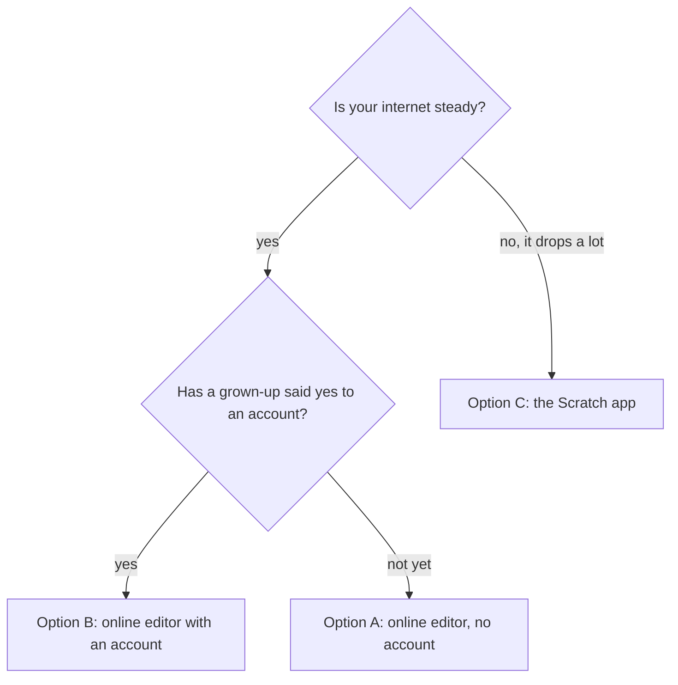

:::objectives
- Check that your computer, browser, and speakers are ready for class.
- Open the Scratch editor in the way that fits your home: no account, an account, or the app.
- Pick a safe username with a grown-up, if you make an account.
- Run a three-block test and know for sure that it worked.
:::

Here's your goal for today, and it takes about ten minutes. You click a little green flag, an orange cat on your screen says "Hello!", and then it meows. That's it. If you can make that happen, your computer is ready for six weeks of games and animations.

Scratch is a free coding tool created at the MIT Media Lab and run today by the Scratch Foundation, a nonprofit. Instead of typing code, you snap colored blocks together, a bit like LEGO bricks that give orders. You can't break your computer with it, and nothing in this class costs money.

## What you need

| You need | Why it matters |
| --- | --- |
| A laptop or desktop (Windows, Mac, or Chromebook) | Dragging blocks is easiest on a big screen. |
| An up-to-date web browser: Chrome, Edge, Firefox, or Safari | Scratch runs inside the browser, so an old browser is the most common reason it won't load. |
| Internet | For the live class call and for the online editor. |
| A mouse (nice to have) | A trackpad works, but it's easy to drop a block in the wrong spot. |
| Headphones (nice to have) | Your projects will meow, beep, and play music. Headphones keep that out of the class call. |

A tablet can run the online editor, but our games in Weeks 2 and 3 use the arrow keys, so a keyboard helps a lot. Phones are too small for the editor.

## Pick how you'll open Scratch

There are three ways in. All three give you the same Scratch 3 editor with the same blocks, so you won't miss anything whichever you choose. The only real difference is **where your projects get saved**.



| Option | Where your work is saved | Needs internet? |
| --- | --- | --- |
| A: online, no account | Only where you save it yourself, as a file | Yes |
| B: online, with account | Online, in your account, from any computer | Yes |
| C: the Scratch app | As a file on your computer | No |

### Option A: the online editor, no account

This is the fastest way to start, and it's what most students use on the first day.

1.  Open your browser.
2.  Type `scratch.mit.edu/projects/editor` into the address bar and press Enter.
3.  You'll know it worked when you see an orange cat standing in a white rectangle on the right, and a column of colored circles down the left side.

Bookmark that page so you can get back in one click.

The catch: without an account, Scratch forgets your project the moment you close the tab. You'll save your work as a file on your computer. The lesson after next shows exactly how.

### Option B: the online editor, with an account

A free account saves your projects online, so you can open them from home, school, or a friend's house. It also lets you share projects with the Scratch community later in the course.

:::warning
**Make your account with a parent or guardian, not on your own.** Scratch asks for an email address. For kids, that's a grown-up's email, and Scratch sends that grown-up a link to confirm the account. In some places a parent has to give permission before the account works at all.
:::

1.  Go to `scratch.mit.edu` and click **Join Scratch** at the top.
2.  Make a username. Scratch asks you not to use any part of your real name, and that's good advice: your username shows up on everything you share. "PixelTiger42" is great. "MayaJohnson2015" tells strangers your name and your age.
3.  Make a password. Keep it secret from everyone except your grown-up.
4.  Answer the next questions together, such as your country and the month and year you were born. Scratch doesn't show these on your profile.
5.  Enter your grown-up's email address. They open the email from Scratch and click the link inside.
6.  Back on the site, click **Create** at the top to open the editor.

When you're signed in, your username appears in the top-right corner of the editor. That's how you know your work is being saved to your account.

### Option C: the Scratch app (works offline)

If your internet is slow or keeps dropping, install the app. Go to `scratch.mit.edu/download` first, then follow the steps for your computer:

:::tabs
@tab Windows
1.  On the download page, choose **Windows**.
2.  Click the **Microsoft Store** link, then click **Get** or **Install** in the Store. (If the page also offers a direct download, running that `.exe` file works too.)
3.  Open **Scratch 3** from the Start menu.
@tab macOS
1.  On the download page, choose **macOS**.
2.  Get it from the **Mac App Store**, or use the direct download: open the `.dmg` file and drag **Scratch 3** into your **Applications** folder.
3.  Open Scratch from Launchpad or the Applications folder.
@tab Chromebook
1.  On the download page, choose **ChromeOS** and follow the link to the **Google Play Store**.
2.  Install the app and open it from your launcher.
3.  School Chromebooks often block new apps. If yours does, use Option A instead; it works on every Chromebook.
:::

The app doesn't sign in to a Scratch account, so you'll save projects as files. On a Chromebook the app keeps projects inside itself, and you get a file out through the three-dot menu on a project.

:::tip
Can't decide? Start with **Option A** today. You can make an account later with your grown-up, and every file you saved will still open in it.
:::

## The three-block test

Time to prove it all works. You'll build a script that is exactly three blocks long. A **script** is a stack of blocks that runs from top to bottom.

1.  On the far left, click the yellow **Events** circle. Drag `when green flag clicked` into the big empty area in the middle.
2.  Click the purple **Looks** circle. Drag `say [Hello!] for (2) seconds` and drop it just under the first block. When it's close, a gray shadow shows where it will land. Let go and it clicks into place.
3.  Click the pink **Sound** circle. Snap `play sound (Meow v) until done` under that.

Your script should look like this:

```scratch title="Your test script"
when green flag clicked
say [Hello!] for (2) seconds
play sound (Meow v) until done
```

Now click the **green flag** above the stage (the white area where the cat lives). A speech bubble saying "Hello!" pops up over the cat. Two seconds later it disappears, and you hear a meow.

Bubble and meow? You're ready for Week 1.

:::try
Click inside the white bubble of the `say` block, type your own name instead of "Hello!", and click the flag again. Then change the `2` to `5`. Notice the meow waits until the bubble is gone.
:::

## When the test doesn't work

These are the problems students really hit on day one, with the fix for each.

### Nothing happens when I click the flag

Look closely at your blocks. If there's a gap between two of them, they aren't connected, and a loose block never runs. Drag the lower block up until it clicks. Also check that `when green flag clicked` is at the **top** of the stack. That yellow block with the rounded top is what listens for the flag.

### I see the bubble but hear no meow

Turn up your computer's volume. Then look at the browser tab for a speaker icon with a line through it: that means the tab is muted, and clicking the icon unmutes it. If you use headphones, check they're plugged in all the way.

### The page is blank, gray, or never finishes loading

Update your browser, or try a different one. Very old browsers like Internet Explorer can't run Scratch 3 at all. On a school computer, the network might block Scratch; ask your teacher, or use the app at home.

### The website keeps asking me to sign in

You never have to sign in to use the editor. Go straight to `scratch.mit.edu/projects/editor` instead of the home page.

### My blocks keep landing in the wrong place

That's almost always a trackpad. Plug in a mouse if you have one. If not, press and hold firmly, drag slowly, and watch for the gray shadow before you let go.

:::video LjOfOQkpPnU
What to watch for: the kinds of things people build with Scratch, from stories to games, and how they share them with the online community. Pause on a project you'd like to make yourself.
:::

## Staying safe on Scratch

Scratch has millions of users, many of them kids, and it has rules called the Community Guidelines to keep it friendly. The most important one for you: never put your full name, address, school, phone number, or passwords in a project, a comment, or your profile. If something online makes you uncomfortable, stop, and tell a grown-up or your teacher. Every project and comment on Scratch also has a **Report** button.

## Further reading

-   [Download the Scratch app](https://scratch.mit.edu/download): the official install steps and FAQ for each kind of computer.
-   [Scratch for parents](https://scratch.mit.edu/parents/): what Scratch is and how accounts work, written for grown-ups. Good to read together.
-   [Scratch Community Guidelines](https://scratch.mit.edu/community_guidelines): the short list of rules everyone on Scratch agrees to.
