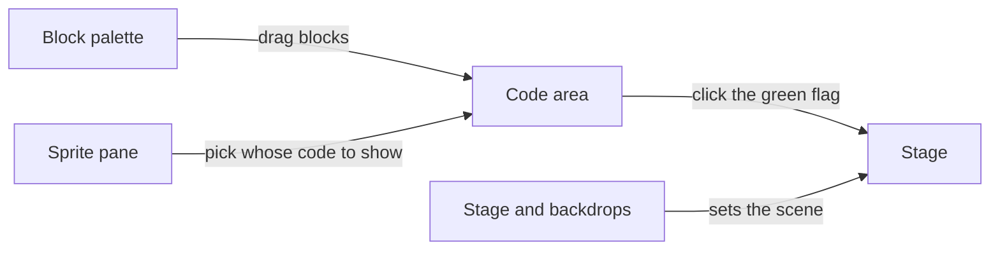

:::objectives
- Name the five areas of the Scratch editor and say what each one is for.
- Find a block by its color and drag it into a script.
- Build, run, and fix a short project called "Meet Me".
- Check that your project starts the same way every time you click the flag.
:::

Twenty minutes from now, this is what you'll have. You click the green flag. The cat jumps to the left edge of the stage, slides into the middle, and says "Hi! I'm Sam." Then it tells everyone something you love, flips upside down, flips back, and meows. Your own name and your own facts go in, of course.

Here's the whole thing. It's eight blocks:

```scratch title="The finished Meet Me script"
when green flag clicked
go to x: (-150) y: (0)
glide (2) secs to x: (0) y: (0)
say [Hi! I'm Sam.] for (2) seconds
say [I love soccer and pizza.] for (2) seconds
turn right (180) degrees
wait (0.5) seconds
turn right (180) degrees
play sound (Meow v) until done
```

Don't worry if it looks like a lot. By the end of the tour you'll know where every one of those blocks lives.

## The five areas of the editor

Open the editor (`scratch.mit.edu/projects/editor`, or the Scratch app). Your screen splits into five areas. Here's how they work together:



### 1. The block palette (left)

Down the far left is a column of colored circles. Each one is a **category** of blocks: Motion (blue), Looks (purple), Sound (pink), Events (yellow), Control (orange), Sensing (light blue), Operators (green), Variables (dark orange), and My Blocks (red). Click a circle and the list jumps to those blocks.

The colors are your map. If you see a purple block in someone's project, you know to look for it in Looks.

### 2. The code area (middle)

The big empty space. You drag blocks here and snap them into scripts. You can have lots of scripts in one code area, each one sitting on its own.

### 3. The stage (top right)

The white rectangle where your project plays. Above it sit the **green flag** (start) and the **red stop sign** (stop everything). Small buttons in the top-right corner switch between a small stage, a normal stage, and full screen.

### 4. The sprite pane (bottom right)

Every character or object in a project is a **sprite**. The cat is a sprite called `Sprite1`. This pane lists all your sprites, and the boxes above them show the selected sprite's name, its position (`x` and `y`), whether it's showing, its size, and its direction. The cat-face button in the corner adds a new sprite.

### 5. The Stage button and the three tabs

To the right of the sprite pane is the **Stage** button, where you choose a **backdrop**, the picture behind everything. At the top left of the editor are three tabs: **Code**, **Costumes**, and **Sounds**. They always show the code, pictures, or sounds of whatever is selected right now.

:::tip
Code belongs to the sprite that's highlighted in the sprite pane. If your blocks suddenly "vanished," you probably clicked a different sprite or the Stage. Click the cat again and your code is back.
:::

## Build "Meet Me", one step at a time

Each step adds a few blocks, then you click the green flag to see what changed. Testing after every step is a habit real programmers have: when something breaks, you know it was the last thing you added.

### Step 1: Start with a hat block

Every script needs a **hat block** on top. It has a rounded top, and it decides *when* the script runs. From **Events**, drag out `when green flag clicked`.

### Step 2: Put the cat on its starting mark

From **Motion**, snap `go to x: () y: ()` under the hat. Click each white bubble and type a number: `-150` for x and `0` for y.

```scratch
when green flag clicked
go to x: (-150) y: (0)
```

Click the green flag. The cat jumps to the left side of the stage. Drag the cat somewhere else and click the flag again: it jumps right back. Next week you'll learn what x and y really mean. For now, `-150` is "over on the left."

### Step 3: Slide in and say hello

Add `glide (1) secs to x: () y: ()` from **Motion**, then two `say [] for () seconds` blocks from **Looks**. Change the glide time to `2`, and type your own words in the bubbles.

```scratch
when green flag clicked
go to x: (-150) y: (0)
glide (2) secs to x: (0) y: (0)
say [Hi! I'm Sam.] for (2) seconds
say [I love soccer and pizza.] for (2) seconds
```

Click the flag. The cat jumps left, slides to the middle over two seconds, then shows each bubble for two seconds.

### Step 4: Flip and meow

From **Motion**, add `turn right (15) degrees` (in the editor it shows a curved arrow instead of the word "right"). Change 15 to `180`. Then add a `wait (1) seconds` from **Control**, set it to `0.5`, and add a second turn. Finish with `play sound (Meow v) until done` from **Sound**.

Why the wait? Scratch is fast. Two turns in a row, with nothing between them, both happen before the screen even redraws, so you'd never see the cat flip. The half-second wait lets you see it upside down before it turns back. Two half-turns of 180 degrees make one full circle, so the cat ends facing the way it started.

### Step 5: Pick a backdrop

Hover over the **Choose a Backdrop** button (bottom right, under the Stage button) and click it. Pick any picture you like. Then click the cat in the sprite pane so your code shows again.

### Step 6: Name your project

Signed in to an account? Click the title box at the top of the editor (it says **Untitled**) and type **Meet Me**. No account? You'll give the project its name when you save it as a file in the next lesson.

:::try
Make the cat introduce you with **three** facts instead of two. Then try changing the glide time from `2` to `0.5`. Does it look like the cat is sneaking or sprinting?
:::

## Proof it works

Click the green flag twice in a row and check every box both times:

-   The cat starts on the left every time, even if you dragged it away.
-   It glides to the middle.
-   Both speech bubbles show your words.
-   It flips upside down, flips back, and meows.
-   There's a backdrop behind it.

All five, twice? Your Scratch setup works. Save it right now: **File > Save to your computer**, or **File > Save now** if you have an account.

## What usually goes wrong

-   **The glide doesn't go where you expect.** There are two glide blocks in Motion. You may have grabbed `glide (1) secs to (random position v)`. Swap it for the one with x and y.
-   **The cat stays upside down.** You have only one `turn right (180) degrees`. Add the second one after the wait.
-   **The cat never flips at all.** The `wait` is missing between the two turns.
-   **The cat runs off somewhere strange.** Check the minus sign. `-150` is the left side and `150` is the right.
-   **A block won't snap.** Drag it by its left edge and drop it so its top lines up just under the block above.
-   **I clicked a block in the palette and the cat moved.** That's not a bug. Clicking any block runs it once, which is a handy way to test one block by itself.

:::video zM9MYI6bVMk
What to watch for: the Scratch Team builds an "About Me" project, the same idea as Meet Me but with more sprites. Pick one trick you like from it and add it to your project.
:::

:::quiz Predict before you click
Q: You delete the `go to x: (-150) y: (0)` block, then click the green flag twice. Where does the cat start the second run?
- [ ] On the left, at x: -150
  Nothing sends it there anymore. That was the job of the block you deleted.
- [x] In the middle, where the first run's glide left it
  Scratch remembers where a sprite ended. Without a starting block, the second run begins wherever the first one finished.
- [ ] It doesn't move, because the script won't run
  The script still runs. Only the starting position is missing.

Q: You move the `play sound (Meow v) until done` block so it sits right under the hat block, above everything else. What do you notice?
- [x] The meow plays first, and the cat waits until it ends before it moves
  "Until done" means the script waits for the sound to finish before running the next block.
- [ ] The meow plays at the same time as the glide
  That's what a sound block without "until done" would do. This one makes the rest of the script wait.
- [ ] No sound plays
  The sound still plays. Blocks run top to bottom, so it just plays earlier.
:::

## Further reading

-   [Scratch Editor on the Scratch Wiki](https://en.scratch-wiki.info/wiki/Scratch_Editor): a labeled guide to every part of the screen.
-   [Getting Started tutorial](https://scratch.mit.edu/projects/editor/?tutorial=getStarted): the official step-by-step tutorial that opens right inside the editor, with short videos for each step.
