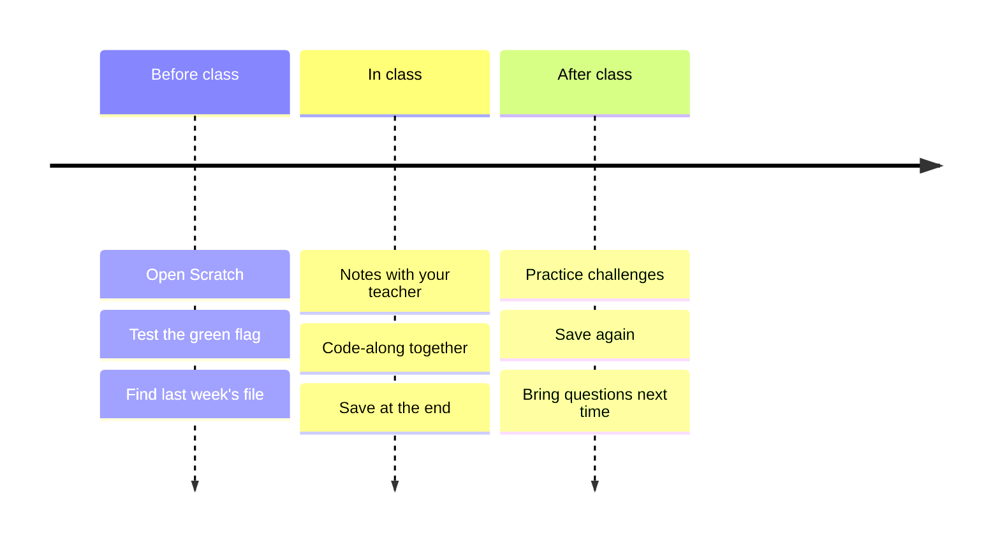
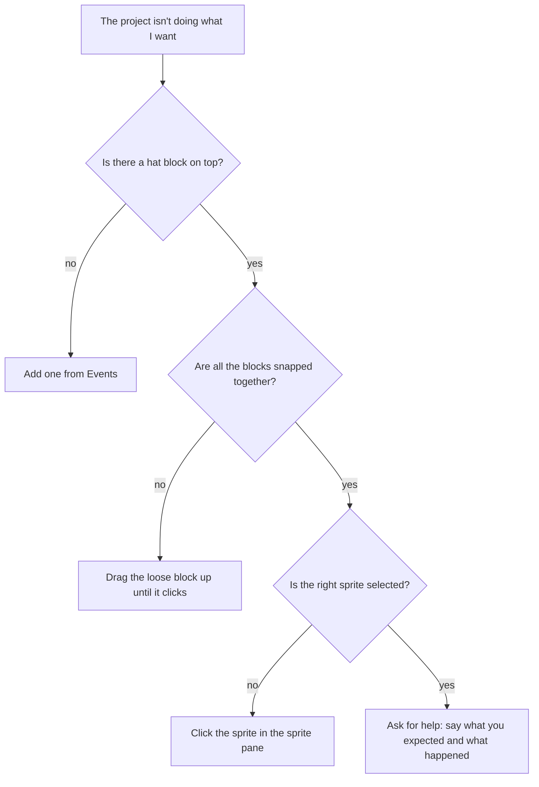

:::objectives
- Know what happens before, during, and after each live class.
- Save a project as an `.sb3` file and open it again, or use Save now with an account.
- Keep every week's project in one folder with a name you'll recognize.
- Fix the most common "it's not working" problems by yourself, and ask for help in a way that gets a fast answer.
:::

Picture this. You spend a whole class building a bouncing-ball game. It's great. Then you close the browser tab to go eat dinner, and when you come back, the editor shows a plain orange cat and nothing else. Without an account, the online editor doesn't keep your work for you, so the game is gone.

This happens to almost everyone once. After this lesson, it won't happen to you.

## What a class week looks like

We meet live online once a week for an hour and a half, six weeks in a row. Every week in this course has the same three parts:

1.  **Notes.** Your teacher explains the week's new blocks with small examples. Come back and reread them whenever something didn't stick.
2.  **Code-along.** We build one project together, step by step, and you build it in your own editor at the same time. Falling behind is normal. Say so in the chat, and your teacher will slow down.
3.  **Practice.** Challenges to try on your own, from easy to tricky. Each one has a hint and a solution. Try first, then peek at the hint, and only then open the solution. Skipping straight to the answer is like reading the last page of a mystery.



### Before each class

-   Open the Scratch editor and click the green flag on anything, just to be sure it works.
-   Have last week's project ready, either as a file or in your account.
-   Put on headphones if you have them, so project sounds don't mix with the call.

### During class

-   Keep the class call in one window and Scratch in another. With one screen, switch back and forth.
-   Ask questions any time. "My cat disappeared" is a perfectly good question, and other people usually have the same one.

## Saving without an account

Without an account, saving means downloading your project as a **file** that ends in `.sb3`. That's Scratch's file type, like `.docx` for a Word document.

1.  Click **File** at the top left of the editor.
2.  Click **Save to your computer**.
3.  Depending on your browser, the file goes straight into your **Downloads** folder, or a box pops up asking where to save it and what to call it. If it asks, choose your class folder (see below) and type a good name.

At first the file is usually called `Scratch Project.sb3`. Give it a name you'll recognize, like `week1-meet-me.sb3`, and always keep `.sb3` at the end. Here's how to find and rename it on your computer:

:::tabs
@tab Windows
1.  Open **File Explorer** (the folder icon on the taskbar) and click **Downloads** on the left.
2.  Right-click `Scratch Project.sb3` and choose **Rename**.
3.  Type the new name, keep the `.sb3` ending, and press **Enter**.
@tab macOS
1.  Open **Finder** and click **Downloads** in the sidebar.
2.  Click the file once, then press **Return** to edit its name.
3.  Type the new name, keep the `.sb3` ending, and press **Return** again.
@tab Chromebook
1.  Open the **Files** app and click **Downloads** under My files.
2.  Right-click the file and choose **Rename**.
3.  Type the new name, keep the `.sb3` ending, and press **Enter**.
:::

:::warning
Each time you click **Save to your computer**, you make a brand-new copy of the file. It doesn't update the old one. Save after every big change and always at the end of class, use names with the week in them (`week2-dance.sb3`), and delete old copies you don't need.
:::

### Opening your file again

1.  Open the editor.
2.  Click **File > Load from your computer**.
3.  Find your `.sb3` file and open it.

Scratch may ask whether to replace the project that's on screen. Say yes only if you've already saved whatever you were working on, because the old one will be swapped out.

## Saving with an account

When you're signed in, your projects are saved online.

-   Scratch saves by itself every so often while you work. Click **File > Save now** whenever you want to be sure.
-   Type a name in the title box at the top (instead of **Untitled**) so you can find the project later.
-   **File > Save as a copy** makes a second version. Use it before you try a wild idea, so the original stays safe.

To find your projects again, click the **folder icon** in the top bar. That page is called **My Stuff**, and it lists every project you've made, newest first. Click **See inside** to open one in the editor.

Your projects stay private until you click **Share**. We'll talk about sharing safely near the end of the course.

## Keep everything in one folder

Make a folder on your computer called **Scratch Class**, and put every project in it, named by week:

```text
Scratch Class/
    week1-meet-me.sb3
    week1-space-cat.sb3
    week2-dance-party.sb3
    week3-maze.sb3
```

Even with an account, downloading a copy at the end of each class is a smart backup. Websites go down sometimes; a file on your computer doesn't.

## Getting unstuck

When a project misbehaves, run through these questions in order. Most problems are solved by the first three.



### My sprite disappeared

It may have walked off the edge, shrunk to nothing, or been hidden by a `hide` block. Click the sprite in the sprite pane and look at its boxes: is **Show** turned off? Is the size tiny? A reset script at the start of every project fixes all of it at once:

```scratch title="A reset script that brings any sprite back"
when green flag clicked
show
go to x: (0) y: (0)
point in direction (90)
set size to (100) %
clear graphic effects
```

Click the green flag and the sprite appears in the exact middle of the stage, facing right, at normal size, with its normal colors.

### I deleted my sprite by mistake

Click **Edit > Restore Sprite** right away. It brings back the last sprite you deleted, code and all.

### I deleted some blocks by mistake

Right-click an empty part of the code area and choose **Undo**. Pressing **Ctrl+Z** (**Cmd+Z** on a Mac) right after clicking the code area works too.

### My code is a messy pile

Right-click an empty spot in the code area and choose **Clean up Blocks**. Scratch lines up all your scripts in a neat column.

### There's no sound

Check your computer's volume, look for a muted speaker icon on the browser tab, and make sure your headphones are plugged in all the way.

### Load from your computer can't find my file

Look in your **Downloads** folder first. If the file's name ends in something like `.sb3.txt`, rename it so it ends in `.sb3` again.

### Scratch is really slow

Close other tabs and programs. If it's still slow, try a different browser, or install the Scratch app.

## How to ask for help so you get a fast answer

"It doesn't work" is hard for anyone to fix. Try this instead: say **what you expected**, **what happened instead**, and **what you already tried**.

```text
I expected the cat to glide to the middle.
Instead it jumps straight there.
I checked that my blocks are snapped together.
```

A teacher can usually spot the problem from those three lines, often before you even share your screen.

:::video rC1gK2tkTRI
What to watch for: the two File menu steps you just read about, **Save to your computer** and **Load from your computer**, done start to finish in about three minutes.
:::

## Your setup checklist

Before Week 1, make sure you can do all four:

-   Open the editor.
-   Run a script with the green flag.
-   Save a project, either to your computer or with **Save now**.
-   Close the editor, open it again, and get your project back.

If you can do all four, you're ready for the first class.

## Further reading

-   [My Stuff on the Scratch Wiki](https://en.scratch-wiki.info/wiki/My_Stuff): everything the My Stuff page can do once you have an account.
-   [Project File on the Scratch Wiki](https://en.scratch-wiki.info/wiki/Scratch_File_Format): what's inside an `.sb3` file, if you're curious.
