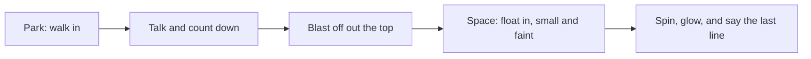

:::objectives
- Plan a short story as scenes before you build it.
- Use a reset script so the story starts the same way every time.
- Combine `move`, `next costume`, and `wait` to make a walk.
- Use `hide`, `show`, size, and the ghost effect to make a sprite look far away.
- Change scenes with `switch backdrop to`.
:::

Our cat has a dream: it wants to go to space. By the end of class it will get there, in a short animated movie with two scenes. Here's the plan, scene by scene:



When it's done, clicking the green flag plays the whole movie in about 15 seconds: the cat walks into a sunny park, wonders about the stars, counts down, and rockets out of the top of the stage. The scene switches to a starry sky, and the cat drifts up from below, tiny and see-through like it's far away, does a slow spin, and glows a new color.

Everything in it comes from this week's Notes: x and y, gliding, costumes, backdrops, and Looks effects.

## Step 1: Set up both scenes

Start a new project with **File > New**.

1.  Click **Choose a Backdrop** (bottom right).
2.  Type **Blue Sky** in the search box and click it.
3.  Click **Choose a Backdrop** again and pick **Stars**.

Your stage now has three backdrops: the plain white `backdrop1`, `Blue Sky`, and `Stars`. Click the cat in the sprite pane so you're writing code for the cat, not the stage.

:::tip
Can't find those exact backdrops? Any outdoor picture and any space picture will do. Just pick your own backdrop names in the dropdowns wherever you see ours.
:::

## Step 2: Write the reset script

A movie has to start the same way every time you press play. These blocks put the cat back on its starting mark, at normal size, facing right, with no leftover effects:

```scratch
when green flag clicked
switch backdrop to (Blue Sky v)
show
set size to (100) %
clear graphic effects
point in direction (90)
switch costume to (costume1 v)
go to x: (-200) y: (-110)
```

Click the green flag. The blue sky appears, and the cat sits near the bottom-left corner. Now drag the cat somewhere silly and click the flag again. It jumps right back. That's what a reset script is for.

Each block undoes something the story changes later: the backdrop, the hiding, the shrinking, the ghost and color effects, the spin, the costume, and the position. When you add a new trick to a project, add the block that undoes it to the reset.

## Step 3: Walk into the park

Now the cat walks in, switching costumes so its legs move. Keep adding these to the bottom of the same script:

```scratch
move (30) steps
next costume
wait (0.25) seconds
move (30) steps
next costume
wait (0.25) seconds
move (30) steps
next costume
wait (0.25) seconds
move (30) steps
next costume
wait (0.25) seconds
```

Click the flag. The cat takes four steps to the right, legs flipping each time.

Where does it stop? It started at x = -200 and moved 30 steps four times. That's -200 + 120 = **-80**. Look at the x box in the sprite pane to check. You'll need that number in Step 5.

Yes, that was the same three blocks four times. Lots of dragging! Next week the `repeat` block will do it for us in three blocks.

## Step 4: The cat talks

Add a speech bubble, a thought bubble, and a countdown:

```scratch
say [What a nice day.] for (2) seconds
think [But I want to see the stars...] for (2) seconds
say [3... 2... 1... BLAST OFF!] for (2) seconds
```

Click the flag and watch everything so far. The cat walks in, says "What a nice day.", thinks about the stars, and counts down. Each bubble waits two seconds before the next block runs, so they never overlap.

## Step 5: Blast off

The cat zooms straight up and disappears out of the top:

```scratch
glide (0.5) secs to x: (-80) y: (170)
hide
wait (1) seconds
```

The x stays at -80, the same spot the cat is standing on, so it flies straight up instead of drifting sideways. A short glide, only half a second, makes it feel fast. The one-second wait is a pause in the movie, like the screen going quiet before the next scene.

:::warning
Scratch won't let a sprite glide all the way off the stage. It always keeps a little piece of it showing at the edge. That's why we `hide` the cat once it reaches the top.
:::

## Step 6: Scene 2, in space

Switch to the starry backdrop. While the cat is still hidden, move it to the bottom and make it small and faint. Then show it and let it float up:

```scratch
switch backdrop to (Stars v)
go to x: (0) y: (-150)
set size to (50) %
set [ghost v] effect to (30)
show
glide (2) secs to x: (0) y: (0)
```

Why move and shrink the cat *before* `show`? It's what a stage crew does: set everything up while the curtain is closed. Right now these blocks run so quickly that you might not spot the difference, but the moment you add a pause between them (a `wait` for a dramatic scene change, say), anything that happens after `show` happens in front of the audience.

The ghost effect goes from 0 (solid) to 100 (invisible), so 30 makes the cat a little see-through, like something seen from a long way off.

## Step 7: The ending

Finish with a slow spin and a glow:

```scratch
turn right (90) degrees
wait (0.2) seconds
turn right (90) degrees
wait (0.2) seconds
turn right (90) degrees
wait (0.2) seconds
turn right (90) degrees
wait (0.2) seconds
change [color v] effect by (50)
say [I'm a space cat now!] for (3) seconds
```

Four quarter turns make one full circle, so the cat ends up facing right again. The short waits let you see each quarter turn. Without them, all four turns would happen before the screen redraws, and the cat would seem to stand still. The color change makes the cat glow, as if space changed it.

## The whole script

Here's everything in order, top to bottom. Yours should match, except for any words you changed:

```scratch title="The finished trip to space (on the cat)"
when green flag clicked
switch backdrop to (Blue Sky v)
show
set size to (100) %
clear graphic effects
point in direction (90)
switch costume to (costume1 v)
go to x: (-200) y: (-110)
move (30) steps
next costume
wait (0.25) seconds
move (30) steps
next costume
wait (0.25) seconds
move (30) steps
next costume
wait (0.25) seconds
move (30) steps
next costume
wait (0.25) seconds
say [What a nice day.] for (2) seconds
think [But I want to see the stars...] for (2) seconds
say [3... 2... 1... BLAST OFF!] for (2) seconds
glide (0.5) secs to x: (-80) y: (170)
hide
wait (1) seconds
switch backdrop to (Stars v)
go to x: (0) y: (-150)
set size to (50) %
set [ghost v] effect to (30)
show
glide (2) secs to x: (0) y: (0)
turn right (90) degrees
wait (0.2) seconds
turn right (90) degrees
wait (0.2) seconds
turn right (90) degrees
wait (0.2) seconds
turn right (90) degrees
wait (0.2) seconds
change [color v] effect by (50)
say [I'm a space cat now!] for (3) seconds
```

## Test it like a movie director

Click the green flag twice in a row. Does the movie look exactly the same both times? If the second showing starts in space, or with a tiny or invisible cat, a reset block is missing. These are the usual suspects:

-   **The second run starts in space.** `switch backdrop to (Blue Sky v)` is missing from the top.
-   **The cat is invisible on the second run.** `show` is missing from the reset, so it stayed hidden from the end of Scene 1.
-   **The cat is tiny or faint on the second run.** `set size to (100) %` or `clear graphic effects` is missing.
-   **The cat flies off at an angle.** The x in the blast-off glide doesn't match where the cat is standing. It should be -80.
-   **The cat finishes upside down.** You have three or five turn blocks instead of four.

:::video uv8mbL-MC58
What to watch for: how the Scratch Team builds a story with characters, scenes, and dialogue, and changes the backdrop to start each new scene. Notice how long each character waits before it speaks.
:::

:::quiz Decisions in this build
Q: You delete the `hide` block after the blast-off glide. What does the audience see during the one-second pause before space?
- [ ] An empty sky, the same as before
  Without `hide`, nothing makes the cat invisible, and a glide can't carry it fully off the stage.
- [x] A piece of the cat stuck at the top edge of the sky
  Scratch always keeps part of a sprite on the stage, so the cat's bottom half peeks down from the top until the scene changes.
- [ ] The cat falls back down to the grass
  Nothing in the script moves the cat down during the wait. It stays where the glide left it.

Q: Why does the blast-off glide go to x: -80 instead of x: 0?
- [x] The cat is standing at x: -80, so keeping x the same sends it straight up
  If only y changes, the glide is a straight vertical line.
- [ ] Glide blocks can't use 0
  Any number works in a glide. 0 would just make the cat fly up and to the right at the same time.
- [ ] -80 is the top of the stage
  The top is y = 180. -80 is an x value, a spot left of the middle.

Q: You take `clear graphic effects` out of the reset script and play the movie three times. What happens on the third run?
- [ ] Nothing changes, because effects reset when you click the flag
  Clicking the flag doesn't reset anything by itself. Only reset blocks do.
- [x] The cat starts in the park already faint and tinted, and gets stranger each run
  The ghost and color effects stay after a run ends. Each run adds 50 more color on top of what was left.
- [ ] The cat becomes completely invisible
  Each run *sets* ghost to 30 instead of adding to it, so it stays at 30. It's the color that keeps changing.
:::

:::takeaways
- Plan a story as scenes first, then build one scene at a time and test as you go.
- A reset script puts back everything the story changes: backdrop, position, direction, costume, size, effects, and visibility.
- Do your teleporting and shrinking while a sprite is hidden, then `show` it.
- Scratch can't push a sprite fully off the stage, so `hide` it when it exits.
- A `wait` between quick changes (costumes or turns) is what makes them visible.
:::

## Make it yours

-   Change what the cat says, or swap the cat for a different sprite from the library.
-   Add a third scene: switch to a planet backdrop and have the cat land with a `glide` from the top.
-   Add a sound to the blast-off. The Sounds library has a whole **Space** category.

Save your project as `week1-space-cat.sb3`, or click **File > Save now** if you have an account.

## Further reading

-   [Costume on the Scratch Wiki](https://en.scratch-wiki.info/wiki/Costume): how costumes work and how to edit them.
-   [Backdrop on the Scratch Wiki](https://en.scratch-wiki.info/wiki/Backdrop): adding, painting, and switching stage backgrounds.
-   [Glide () Secs to X: () Y: () on the Scratch Wiki](https://en.scratch-wiki.info/wiki/Glide_%28%29_Secs_to_X:_%28%29_Y:_%28%29_%28block%29): everything about the glide block.
