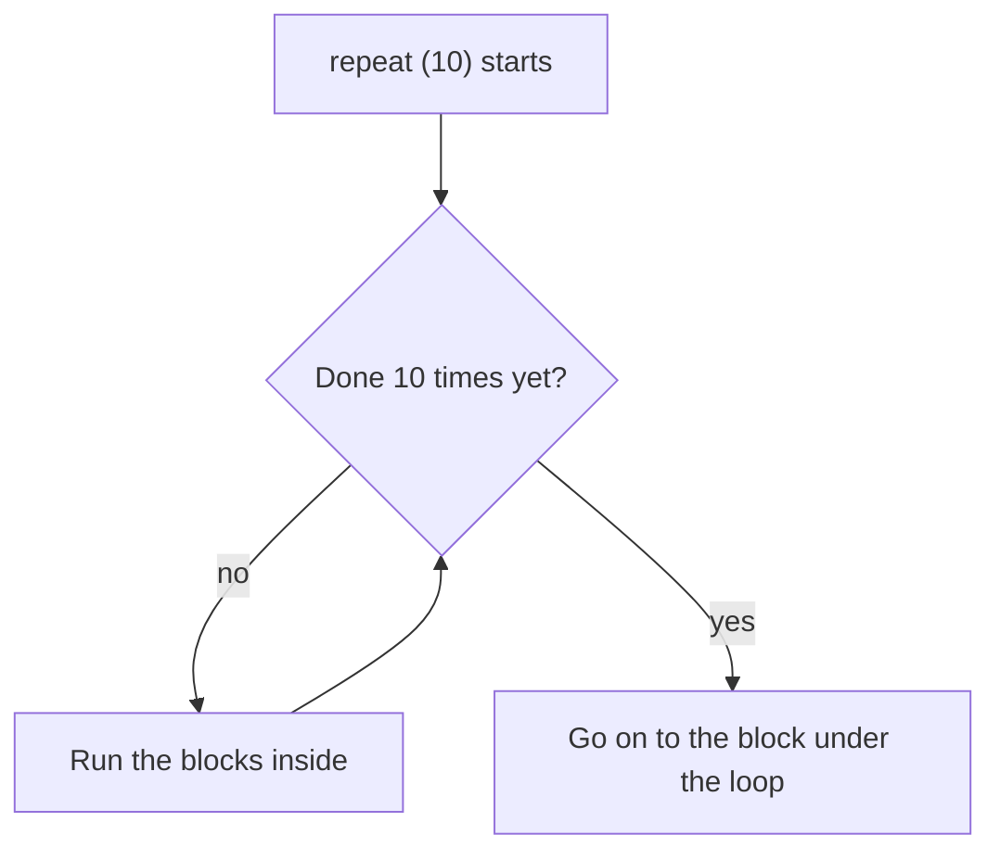

:::objectives
- Start scripts with event hat blocks: the green flag, a key, a click, or a backdrop change.
- Give one sprite several scripts that run at the same time.
- Repeat blocks a set number of times with `repeat`, or nonstop with `forever`.
- Build an animation from `next costume`, `wait`, and a loop.
- Choose between `start sound` and `play sound until done`.
:::

Open any video game and leave the controller alone. Nothing happens. The hero just stands there, waiting. Press the right arrow and the hero runs; press space and it jumps. The game was listening the whole time, and each button press started a different piece of code.

Those button presses are called **events**, and this week your projects start listening for them. Here's a cat you can steer and tickle. Every stack starts with a different yellow hat block:

```scratch title="Four scripts, all on the cat"
when green flag clicked
go to x: (0) y: (0)
set rotation style [left-right v]
say [Use the arrow keys!] for (2) seconds

when [right arrow v] key pressed
point in direction (90)
move (10) steps

when [left arrow v] key pressed
point in direction (-90)
move (10) steps

when this sprite clicked
say [Hey, that tickles!] for (1) seconds
```

Click the flag, then press the arrow keys and click the cat. Each action runs just the script with the matching hat.

## Hat blocks wait for something to happen

Hat blocks live in the yellow **Events** category. A hat sits on top of a script and waits. When its event happens, the blocks under it run.

| Hat block | Runs when... |
| --- | --- |
| `when green flag clicked` | someone clicks the green flag |
| `when [space v] key pressed` | someone presses that key (pick any key in the dropdown) |
| `when this sprite clicked` | someone clicks this sprite |
| `when backdrop switches to [backdrop1 v]` | the stage changes to that backdrop |
| `when stage clicked` | someone clicks an empty part of the stage (you'll only find this one on the Stage) |

A sprite can have as many scripts as you like, each with its own hat, and they all wait at the same time. That's how one cat can walk with the arrow keys *and* talk when you click it.

```mermaid caption="Each event starts only the script with the matching hat"
sequenceDiagram
    actor You
    participant Cat
    You->>Cat: click the green flag
    Note right of Cat: runs the green flag script
    You->>Cat: press the right arrow
    Note right of Cat: runs the right arrow script
    You->>Cat: click the cat
    Note right of Cat: runs the sprite-clicked script
```

Keep scripts spread out in the code area so you can read each one. If they start to overlap, right-click an empty spot and choose **Clean up Blocks**.

:::warning
When the cat faces left with `point in direction (-90)`, it turns upside down, because a sprite's normal rotation style is "all around." The `set rotation style [left-right v]` block from **Motion**, in the green flag script above, fixes it: now the cat flips to face left instead of rolling over.
:::

### Holding a key down

Hold the right arrow and watch closely: the cat moves once, pauses, and then keeps going. That pause is your keyboard's key repeat, the same pause you get when you hold a letter down while typing. It's fine for now. Next week you'll learn a smoother way that games use.

## `repeat`: do it this many times

Last week the frog needed twenty blocks to hop three times, because each hop was the same six blocks over again. Loops fix that. They're the C-shaped blocks in **Control**. Any blocks you put inside the mouth of the C get repeated.

`repeat (10)` runs the blocks inside it exactly that many times, then moves on to whatever is under the loop.

```scratch title="Ten steps with moving legs"
when green flag clicked
go to x: (-200) y: (0)
repeat (10)
    move (20) steps
    next costume
    wait (0.1) seconds
end
say [I made it!] for (2) seconds
```

The cat walks ten steps to the right, legs flipping each time. That's 10 × 20 = 200 steps, so it stops at x = 0. Only then does the `say` block run, because Scratch finishes the loop before moving on.



Want 20 steps instead of 10? Change one number. Stacking blocks by hand would mean dragging thirty more.

## `forever`: keep going until stop

`forever` repeats the blocks inside it over and over until you click the red stop sign. Look at its bottom edge: it's flat, with no bump. Nothing can snap under it, because nothing under a forever loop would ever get its turn.

```scratch title="A cat on a treadmill"
when green flag clicked
forever
    next costume
    wait (0.2) seconds
end
```

The cat walks in place forever, as if it's on a treadmill.

### The animation recipe: costume + wait + loop

That little script is the heart of almost every Scratch animation:

1.  `next costume` changes the picture.
2.  `wait` slows it down enough for your eyes to see it. A smaller number means a faster animation.
3.  A loop keeps it going.

Many library sprites come with costumes drawn for exactly this. Add the **Bat**, the **Parrot**, or **Butterfly 1** and open its **Costumes** tab to see the frames.

### Bounce around the stage

Put `if on edge, bounce` inside a `forever` loop and a sprite will zoom around the stage, turning back whenever it hits an edge:

```scratch title="Screensaver cat"
when green flag clicked
set rotation style [left-right v]
point in direction (45)
forever
    move (5) steps
    if on edge, bounce
end
```

Direction 45 is halfway between up and right, so the cat moves at an angle and bounces off all four edges like an old screensaver, until you click stop.

## Two ways to play a sound

Sound blocks are pink. Each sprite has its own sounds (the cat comes with **Meow**), and you can add more from the **Sounds** tab with the **Choose a Sound** button at the bottom left.

There are two blocks that play a sound, and the difference is all about timing:

-   `start sound (Meow v)` begins the sound and **immediately** moves on to the next block.
-   `play sound (Meow v) until done` waits until the sound has **finished** before moving on.

Try both of these on the cat, then press `a` and `b`:

```scratch
when [a v] key pressed
start sound (Meow v)
say [Meow!] for (1) seconds

when [b v] key pressed
play sound (Meow v) until done
say [Meow!] for (1) seconds
```

Press `a`: you hear the meow and see the bubble at the same moment. Press `b`: you hear the meow first, and the bubble shows up only after it ends.

Use `start sound` when a sound should go *with* an action, like a boing as a sprite jumps. Use `play sound until done` when things must happen *in order*, like the notes of a song.

### Make a staircase of meows

Put a sound in a loop and change its pitch each time around. Each 10 of pitch is about one key higher on a piano:

```scratch title="Five meows, each higher than the last"
when [space v] key pressed
set [pitch v] effect to (0)
repeat (5)
    play sound (Meow v) until done
    change [pitch v] effect by (50)
end
clear sound effects
```

Press space and the cat climbs a staircase: five meows, each one higher. The `set` block at the top and `clear sound effects` at the bottom keep the next press from starting high.

Other handy sound blocks: `stop all sounds`, `set volume to (100) %`, and `change volume by (-10)`.

:::video soWh2vVgqYk
What to watch for: three different art styles for animating a character, and the same costume-switching idea under all of them. Notice how many costumes each animation uses and how the wait time changes the feel.
:::

## What usually goes wrong

:::warning
**A loop runs too fast to see.** Ten costume changes with no `wait` inside the loop flicker past in a blink. Add a `wait` inside the loop, not after it.
:::

-   **A block won't snap under `forever`.** That's on purpose. Put it above the loop, or in a separate script.
-   **The wrong blocks are repeating.** Only blocks *inside* the C repeat. Drag blocks in or out until the loop holds exactly what you want.
-   **The music sounds squashed.** You used `start sound` inside a loop. The loop doesn't wait, so each pass cuts the sound off and restarts it. Use `play sound until done`.
-   **Pressing a key does nothing.** Click on the stage once, so the keyboard goes to Scratch and not to some other part of the page.

## Check yourself

The cat starts in the middle, facing right.

```scratch title="Script A"
when green flag clicked
go to x: (0) y: (0)
repeat (4)
    move (25) steps
end
say [Done!] for (2) seconds
```

```scratch title="Script B"
when [space v] key pressed
play sound (Meow v) until done
say [That was me!] for (1) seconds
```

```scratch title="Script C: two scripts on the same cat"
when green flag clicked
forever
    turn right (5) degrees
end

when green flag clicked
forever
    change [color v] effect by (5)
end
```

:::quiz
Q: What does **Script A** do?
- [ ] Moves 25 steps, says "Done!", and does that four times
  The `say` block is under the loop, not inside it, so it runs only once.
- [x] Moves to x = 100, then says "Done!" once
  The loop runs four times (4 × 25 = 100), and only then does Scratch reach the `say` block.
- [ ] Says "Done!" first, then moves
  Blocks run top to bottom, and a loop finishes before the next block starts.

Q: You press space with **Script B**. When does the bubble appear?
- [ ] At the same moment the meow starts
  That's what `start sound` would do. "Until done" makes the script wait.
- [x] Right after the meow finishes
  `play sound until done` holds the script until the sound ends, then the `say` block runs.
- [ ] Never, because the sound blocks the bubble
  The bubble does appear. It just waits its turn.

Q: You click the green flag with **Script C**. What happens?
- [ ] The cat spins forever but never changes color, because the first loop never ends
  Each script runs on its own. One forever loop doesn't block a *different* script.
- [x] The cat spins and changes color at the same time
  Both scripts start when the flag is clicked, and Scratch runs them side by side.
- [ ] The cat changes color once, then spins
  The color loop is a forever loop too, so it keeps changing the color the whole time.

Q: You drag `say [Bye!] for (2) seconds` under a `forever` loop. What happens?
- [x] It won't attach, because `forever` has no bump on the bottom
  Nothing after a forever loop would ever run, so Scratch doesn't let you put anything there.
- [ ] It attaches and runs when you click stop
  The stop sign stops every script, including that one.
- [ ] It attaches and runs once at the start
  Blocks run top to bottom, so something under the loop could never come first.
:::

:::takeaways
- Hat blocks in Events wait for something to happen (the flag, a key, a click, a backdrop change), then run their script.
- One sprite can have many scripts, and scripts with the same hat run at the same time.
- `repeat (n)` runs its inside n times and then moves on. `forever` never moves on, so nothing goes under it.
- Animation is `next costume` + `wait` + a loop.
- `start sound` doesn't wait. `play sound until done` waits for the sound to finish.
:::

## Further reading

-   [Events Blocks on the Scratch Wiki](https://en.scratch-wiki.info/wiki/Events_Blocks): every yellow hat block, with examples.
-   [Forever on the Scratch Wiki](https://en.scratch-wiki.info/wiki/Forever_%28block%29): how the forever loop works, and why nothing fits under it.
-   [Sound Blocks on the Scratch Wiki](https://en.scratch-wiki.info/wiki/Sound_Blocks): all the pink blocks, including pitch and pan effects.
