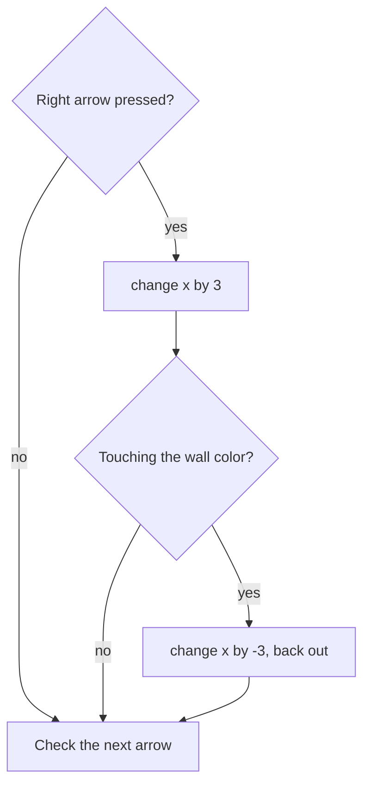

:::objectives
- Paint a maze backdrop with walls in one color.
- Move a player smoothly with `key pressed?` inside a `forever` loop.
- Make walls solid with the "move, check, undo" trick.
- Send the player back to the start when it touches the edge.
- Use `distance to` with `if else` so the goal reacts as the player gets close.
:::

Mazes are one of the oldest computer games, and they make a great first real game. Today you'll paint your own maze, then write the code that makes it play like one: walls you can't walk through, edges that send you back to the start, and a spinning star at the end that shouts "Almost there!" as you get close. When you're done, you can hand the keyboard to someone else and watch them try.

Here's the whole game as a picture. Each arrow is something that can happen while you play:

```mermaid caption="The maze game's states, and what moves the player between them"
stateDiagram-v2
    state "Playing" as Playing
    state "Back to start" as Reset
    state "You win" as Won
    [*] --> Playing: green flag
    Playing --> Playing: bump a wall, step is undone
    Playing --> Reset: touch the edge
    Reset --> Playing
    Playing --> Won: touch the Goal
    Won --> [*]: stop all
```

## Step 1: Paint the maze

The walls are part of the backdrop, so you paint them on the Stage.

1.  Start a new project (**File > New**).
2.  Click the **Stage** button in the bottom right, then open the **Backdrops** tab.
3.  Choose the **Rectangle** tool. Set **Fill** to one bright color, like blue, and set **Outline** to the same blue (or to no outline). Use this one color for every wall.
4.  Draw thick wall rectangles that make a path from the top-left corner to the bottom-right corner. Keep the path wide, at least two fingers wide on your screen.

:::tip
Make your first maze easy, with three or four turns. A maze that's too hard to test is a maze you can't finish building. You can paint a harder one once the code works.
:::

Why one color for every wall? The code will check for a single exact color. A wall in a slightly different blue, or with a black outline, won't count as a wall.

## Step 2: Add the player and the goal

1.  Delete the cat: right-click it in the sprite pane and choose **delete**.
2.  Add the **Ball** sprite from the library. In the sprite pane, rename it **Player** and set its **Size** to **40**.
3.  Drag the player to the start of your maze, at the top left. Write down the x and y in the sprite pane. We'll use x: -200, y: 140.
4.  Add the **Star** sprite (or any sprite you like) and rename it **Goal**. Drag it to the end of the maze at the bottom right. We'll use x: 200, y: -140.

Renaming matters. The `touching` and `distance to` dropdowns list sprites by name, and "Player" and "Goal" are much easier to read than "Ball" and "Star".

## Step 3: Move the player

Click the **Player** sprite. Build a reset and the smooth movement loop from the Notes, with steps of 3 so the ball is easy to steer through narrow spots:

```scratch title="On the Player"
when green flag clicked
go to x: (-200) y: (140)
say [Find the star!] for (2) seconds
forever
    if <key (right arrow v) pressed?> then
        change x by (3)
    end
    if <key (left arrow v) pressed?> then
        change x by (-3)
    end
    if <key (up arrow v) pressed?> then
        change y by (3)
    end
    if <key (down arrow v) pressed?> then
        change y by (-3)
    end
end
```

Click the green flag and steer with the arrows. The player moves smoothly... and drives straight through your walls like a ghost. Time to fix that.

## Step 4: Make the walls solid

Scratch has no "solid" setting for colors, so we fake it with a trick: **move, check, undo**. Take a step. If that step put the player inside a wall, take the same step backward, right away. It all happens before the screen redraws, so the player never looks like it entered the wall. It just looks like it stopped.



Put a `touching color` check **inside** each arrow's `if`. To set the color, click the color circle in the block, click the **eyedropper** at the bottom of the menu, then click one of your walls on the stage:

```scratch
if <key (right arrow v) pressed?> then
    change x by (3)
    if <touching color [#0000ff]?> then
        change x by (-3)
    end
end
```

Do the same for the other three arrows. The undo is always the same number with the opposite sign:

| Arrow | Move | Undo |
| --- | --- | --- |
| right | `change x by (3)` | `change x by (-3)` |
| left | `change x by (-3)` | `change x by (3)` |
| up | `change y by (3)` | `change y by (-3)` |
| down | `change y by (-3)` | `change y by (3)` |

Test it. The player should stop at walls as if they're solid, and still slide along them when you hold two arrows at once.

Why check inside each arrow's `if`, instead of once at the bottom of the loop? Because each check has to know *which* step to undo. A single check at the bottom would know the player hit a wall, but not whether to back out left, right, up, or down.

:::warning
If the player is stuck the moment the game starts, its starting spot overlaps a wall, so every move gets undone. Drag it to an open spot and update the numbers in `go to x: () y: ()`.
:::

## Step 5: The edge sends you back

If your maze has gaps at the side of the stage, a sneaky player could walk around the outside. Add this inside the `forever` loop, below the four arrow checks:

```scratch
if <touching (edge v)?> then
    go to x: (-200) y: (140)
end
```

Now reaching the edge of the stage sends the player back to the start.

## Step 6: Win the game

Still inside the `forever` loop, add the goal check:

```scratch
if <touching (Goal v)?> then
    say [I made it!] for (2) seconds
    stop [all v]
end
```

`stop [all v]` ends every script in the project, just like clicking the red stop sign.

## Step 7: The goal cheers you on

Click the **Goal** sprite. This script spins the star slowly, and uses `if else` with `distance to` to cheer when the player is near:

```scratch title="On the Goal"
when green flag clicked
go to x: (200) y: (-140)
forever
    turn right (3) degrees
    if <(distance to (Player v)) < (80)> then
        say [Almost there!]
    else
        say []
    end
end
```

`distance to (Player v)` is in Sensing. It reports how many steps away the player is, measured center to center. The star spins all the time, says "Almost there!" when the player is within 80 steps, and clears its bubble when the player wanders off.

## The complete Player script

Here's everything on the Player sprite. Your color may look different if you painted your walls another color.

```scratch title="The finished Player script"
when green flag clicked
go to x: (-200) y: (140)
say [Find the star!] for (2) seconds
forever
    if <key (right arrow v) pressed?> then
        change x by (3)
        if <touching color [#0000ff]?> then
            change x by (-3)
        end
    end
    if <key (left arrow v) pressed?> then
        change x by (-3)
        if <touching color [#0000ff]?> then
            change x by (3)
        end
    end
    if <key (up arrow v) pressed?> then
        change y by (3)
        if <touching color [#0000ff]?> then
            change y by (-3)
        end
    end
    if <key (down arrow v) pressed?> then
        change y by (-3)
        if <touching color [#0000ff]?> then
            change y by (3)
        end
    end
    if <touching (edge v)?> then
        go to x: (-200) y: (140)
    end
    if <touching (Goal v)?> then
        say [I made it!] for (2) seconds
        stop [all v]
    end
end
```

## Playtest it

Play your maze start to finish three times, then check:

-   Can you get through any wall? (You shouldn't!)
-   Is there anywhere you get stuck with no way out? Widen that part of the path.
-   Does the star say "Almost there!" only when you're close?
-   Does reaching the star end the game?

Then hand it to someone else and watch them play without helping. Wherever they get confused or stuck is the next thing to fix.

### Common bugs

-   **The player walks through walls.** The color in `touching color` doesn't match your walls. Use the eyedropper again, and check that every wall is the same color.
-   **The player can't move at all.** It starts on top of a wall. Move the start spot.
-   **Nothing happens at the star.** The Goal check is outside the `forever` loop, or the `touching` dropdown shows a name other than **Goal**.
-   **The star never cheers.** The ball isn't named **Player**, or the `distance to` dropdown isn't set to `Player`.

:::video AKUtkYZTUfo
What to watch for: how Zinnea paints the maze walls and keeps the character from walking through them. Compare her approach with the move, check, undo trick, and spot the ideas she adds for more levels.
:::

:::quiz Decisions in this build
Q: When the player hits a wall moving right, why do we undo with `change x by (-3)` and not `go to x: (-200) y: (140)`?
- [x] Backing out by the same step makes the wall feel solid, while `go to` would teleport the player to the start
  The undo puts the player exactly where it was a moment ago, touching the wall but not inside it.
- [ ] `go to` doesn't work inside an `if`
  `go to` works anywhere. It just does the wrong job here: it's a penalty, not a wall.
- [ ] -3 is how far the player is from the wall
  The number undoes the step the player just took. It's 3 because each step is 3.

Q: You paint one wall dark blue and the rest light blue. What happens at the dark blue wall?
- [ ] It works like the others, because blue is blue
  `touching color` checks one exact color. Dark blue and light blue are different colors to Scratch.
- [x] The player drives right through it
  The check only matches the color you picked with the eyedropper, so the dark blue wall doesn't count.
- [ ] The player gets stuck in it forever
  Getting stuck happens when the player *starts* inside a wall it can detect. This wall isn't detected at all.

Q: You drag the Goal check out of the loop and drop it just above `forever`, right under the `say` block. What happens when you reach the star?
- [ ] You win, same as before
  The check is no longer repeated, so it can't notice you arriving later.
- [x] Nothing, because the check ran once at the very start and never again
  At the start the player is far from the star, so the answer was false. Only checks inside `forever` keep asking.
- [ ] The game ends right at the start
  At the start the player isn't touching the star, so the `stop [all v]` inside the check doesn't run.
:::

:::takeaways
- Walls painted on the backdrop are detected by their color, so paint every wall in one exact color and set the check with the eyedropper.
- "Move, check, undo" makes a wall feel solid: step, and if you're in the wall, step straight back.
- Put each undo inside the matching arrow's `if`, so it knows which step to reverse.
- Checks for walls, edges, and goals all belong inside the `forever` loop.
- `distance to` plus `if else` lets a sprite react to how close another sprite is.
:::

## Make it yours

-   Paint a red "lava" patch on the backdrop. Touching it sends the player back to start.
-   Add sounds: a `start sound` when the player bumps a wall, and a cheer at the star.
-   Paint a second, harder maze backdrop for later. In Week 6 you'll learn to switch levels.

Save your project as `week3-maze.sb3`, or click **File > Save now**. Next week, you'll add a timer and a score with variables.

## Further reading

-   [Key () Pressed? on the Scratch Wiki](https://en.scratch-wiki.info/wiki/Key_%28%29_Pressed%3F_%28block%29): how the key pressed condition works, and why it's smoother than the hat block.
-   [Paint Editor on the Scratch Wiki](https://en.scratch-wiki.info/wiki/Paint_Editor): every drawing tool, for building better mazes.
-   [Touching Color ()? on the Scratch Wiki](https://en.scratch-wiki.info/wiki/Touching_Color_%28%29%3F_%28block%29): how color collisions work, and why exact colors matter.
