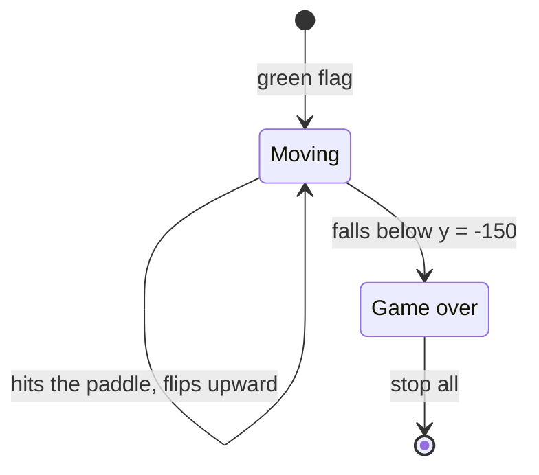

:::objectives
- Use `if else` so a sprite is always in one of two states.
- Check a typed answer with `ask and wait` and `=`.
- Build invisible walls with `x position` and comparisons.
- Detect a painted color and another sprite.
- Find and fix a check that's in the wrong place.
- Bounce a ball off a paddle and end the game when it's missed.
:::

These challenges are where your projects start to feel like real games. Most of them use the forever-if pattern from the Notes: a `forever` loop with an `if` inside, asking its question over and over. Try each one before you open the hint. When you get stuck, ask yourself: "What question does my sprite need to keep asking?"

## Warm-up: true or false?

Find `key (space v) pressed?` in Sensing and click it. Scratch shows `false`. Now hold the space bar down while you click it. What does the bubble say? Then try `touching (edge v)?` twice: once with the cat in the middle, once after you drag it against a side of the stage.

### Exercise 1: Glow button

When the green flag is clicked, the cat should glow (`color` effect set to 50) **only while** the space bar is held down. The moment you let go, it goes back to normal.

:::hint
The cat is always in one of two states, glowing or normal. Which block picks exactly one of two choices, every time? It needs to keep checking, too.
:::

:::solution
```scratch
when green flag clicked
forever
    if <key (space v) pressed?> then
        set [color v] effect to (50)
    else
        clear graphic effects
    end
end
```

Hold space and the cat changes color. Let go and it's back to orange right away. A `when [space v] key pressed` hat couldn't do this job, because it can only notice a key going down, never a key coming back up.
:::

### Exercise 2: Math quiz

When the green flag is clicked, the cat asks "What is 6 + 7?" If the player types 13, the cat plays its Meow sound and says "Correct!" Otherwise it says "Not quite. It's 13." Both messages last 2 seconds.

:::hint
`ask [] and wait` stores whatever was typed in the `answer` block. Put `answer` into one side of an `=` block from Operators.
:::

:::solution
```scratch
when green flag clicked
ask [What is 6 + 7?] and wait
if <(answer) = [13]> then
    start sound (Meow v)
    say [Correct!] for (2) seconds
else
    say [Not quite. It's 13.] for (2) seconds
end
```

Type `13` and you get a meow and "Correct!" Type `12`, or `thirteen`, and the cat corrects you. The `start sound` lets the meow and the bubble happen together.
:::

### Exercise 3: The invisible fence

Make the cat move left and right smoothly with the arrow keys, 5 steps at a time, but never let it go past x = 150 on the right or x = -150 on the left. No drawing allowed: use `x position` and the `>` and `<` blocks from Operators.

:::hint
Let the cat take its step first. Then ask: "Am I past the fence?" If it is, which Motion block puts it right back on the line without changing its y?
:::

:::solution
```scratch
when green flag clicked
go to x: (0) y: (0)
forever
    if <key (right arrow v) pressed?> then
        change x by (5)
    end
    if <key (left arrow v) pressed?> then
        change x by (-5)
    end
    if <(x position) > (150)> then
        set x to (150)
    end
    if <(x position) < (-150)> then
        set x to (-150)
    end
end
```

The cat slides while you hold the arrows and stops dead at x = 150 and x = -150. It never looks like it crossed the line, because the fix happens before the screen redraws.
:::

### Exercise 4: The floor is lava

Paint a backdrop with a red strip along the bottom of the stage (Rectangle tool, red fill). Then:

1.  The cat starts at x: 0, y: 100.
2.  The arrow keys move it in all four directions, 4 steps at a time.
3.  If it touches the red lava, it says "Too hot!" for 1 second and goes back to the start.

:::hint
Start from the smooth four-way movement in the Notes. Add one more `if` inside the same `forever` loop, and set its color with the eyedropper by clicking your red strip.
:::

:::solution
```scratch
when green flag clicked
go to x: (0) y: (100)
forever
    if <key (right arrow v) pressed?> then
        change x by (4)
    end
    if <key (left arrow v) pressed?> then
        change x by (-4)
    end
    if <key (up arrow v) pressed?> then
        change y by (4)
    end
    if <key (down arrow v) pressed?> then
        change y by (-4)
    end
    if <touching color [#ff0000]?> then
        say [Too hot!] for (1) seconds
        go to x: (0) y: (100)
    end
end
```

Steer into the red strip and the cat yelps "Too hot!", freezes for a second (the `say ... for (1) seconds` block makes the whole loop wait), and jumps back to its starting spot.
:::

### Exercise 5: Snack time

Add the **Apple** sprite. The cat follows your mouse pointer. Whenever the cat touches the apple, the **apple** (not the cat!) plays its Chomp sound, says "Chomp!" for half a second, and jumps to a random spot.

:::hint
This needs one script on each sprite. The cat only chases. The apple keeps asking, "Is the cat touching me?" What's the cat's name in the apple's `touching` dropdown?
:::

:::solution
```scratch title="On the cat"
when green flag clicked
forever
    point towards (mouse-pointer v)
    move (4) steps
end
```

```scratch title="On the Apple"
when green flag clicked
go to (random position v)
forever
    if <touching (Sprite1 v)?> then
        start sound (Chomp v)
        say [Chomp!] for (0.5) seconds
        go to (random position v)
    end
end
```

The cat chases your mouse. When it reaches the apple, the apple crunches, says "Chomp!", and pops up somewhere new. Splitting the jobs like this keeps each script short: each sprite looks after itself.

The cat is still called `Sprite1` unless you renamed it. If you did, pick its new name in the dropdown. And if the cat wobbles once it reaches the mouse, that's normal: it keeps stepping past the pointer and turning back.
:::

### Exercise 6: Bug hunt

This script should make the cat say "Ouch!" and go back to the middle whenever it touches the edge. It moves fine, but it never says "Ouch!" Find the bug and fix it.

```scratch title="Buggy script"
when green flag clicked
go to x: (0) y: (0)
if <touching (edge v)?> then
    say [Ouch!] for (1) seconds
    go to x: (0) y: (0)
end
forever
    if <key (right arrow v) pressed?> then
        change x by (5)
    end
    if <key (left arrow v) pressed?> then
        change x by (-5)
    end
end
```

:::hint
Read it top to bottom, the way Scratch does. When does Scratch reach the edge check? Is the cat anywhere near the edge at that moment? Does Scratch ever come back to it?
:::

:::solution
The edge check is **outside** the `forever` loop. It runs once, right after the cat goes to the middle, when it's nowhere near an edge. Then Scratch enters the loop and never comes back. Drag the whole `if` block into the loop:

```scratch title="Fixed script"
when green flag clicked
go to x: (0) y: (0)
forever
    if <key (right arrow v) pressed?> then
        change x by (5)
    end
    if <key (left arrow v) pressed?> then
        change x by (-5)
    end
    if <touching (edge v)?> then
        say [Ouch!] for (1) seconds
        go to x: (0) y: (0)
    end
end
```

Now the question gets asked on every pass, so the cat says "Ouch!" the moment it reaches either side. This is the single most common bug in Scratch games, so it's worth remembering what it looks like.
:::

### Challenge: Paddle ball

Build a mini paddle game:

-   **Paddle:** add the **Paddle** sprite from the library. It sits near the bottom at y = -140 and follows the mouse left and right.
-   **Ball:** add the **Ball** sprite at 50% size. It starts near the middle, moves at an angle, and bounces off the top and sides.
-   When the ball hits the paddle, it bounces back up.
-   If the ball gets past the paddle (below y = -150), it says "Game over!" and the game stops.

Here are the states the ball can be in:



:::hint
The paddle only needs `set x to (mouse x)` in a forever loop. For the ball, to bounce up off a flat paddle use `point in direction ((180) - (direction))`: it flips a ball heading down into a ball heading up. Then think hard about the **order** of the checks inside the ball's loop. What should Scratch notice first, a missed ball or the bottom edge?
:::

:::solution
```scratch title="On the Paddle"
when green flag clicked
go to x: (0) y: (-140)
forever
    set x to (mouse x)
end
```

```scratch title="On the Ball"
when green flag clicked
set size to (50) %
go to x: (0) y: (100)
point in direction (150)
forever
    move (6) steps
    if <touching (Paddle v)?> then
        point in direction ((180) - (direction))
        move (10) steps
    end
    if <(y position) < (-150)> then
        say [Game over!] for (2) seconds
        stop [all v]
    end
    if on edge, bounce
end
```

The ball starts in the middle and heads down at an angle. It bounces off the walls, the top, and your paddle. Miss it, and the ball says "Game over!" and everything stops.

**Why is the game over check above `if on edge, bounce`?** The loop runs top to bottom. If the bounce came first, the ball could bounce off the bottom edge before the game ever noticed it got past you, and you could never lose.

**Why the extra `move (10) steps` after hitting the paddle?** It pushes the ball clear of the paddle. Without it, the ball might still be touching the paddle on the next pass, flip again, and head back down into it.

Next week, you'll add a score that goes up with every hit.
:::

:::video BlmBDrnhd2I
What to watch for: the Scratch Team's version of this game. Watch how the ball bounces off the paddle and what makes the game end, then compare it with your solution. The video also adds a score and levels, which you'll learn to build in the next few weeks.
:::

Save your favorite as `week3-practice.sb3`.
