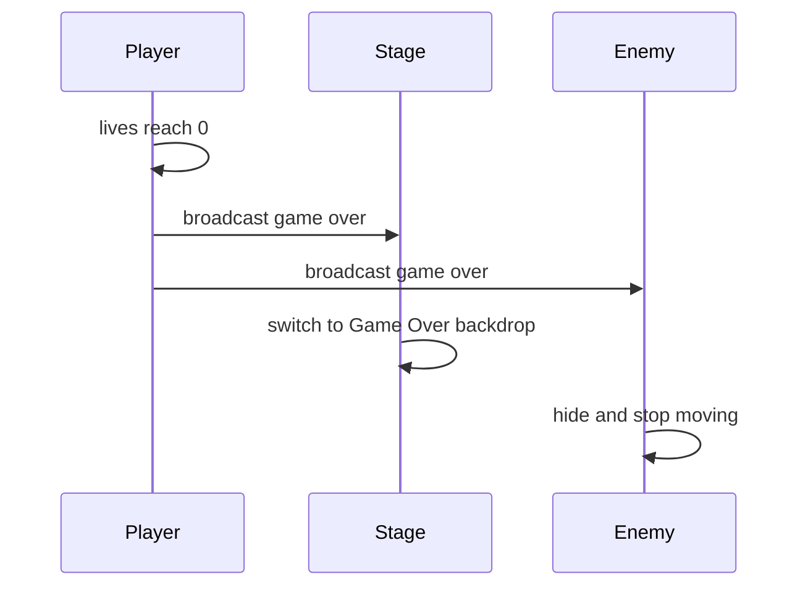

:::objectives
- Make a variable, show it on the stage, and reset it when the green flag is clicked.
- Count a score up, count lives down, and build a 30-second countdown clock.
- Send a broadcast from one sprite and react to it in other sprites and on the stage.
- Decide when a variable should be "For all sprites" or "For this sprite only".
:::

Look at the corner of almost any game. Mario has a coin counter. Minecraft has a row of hearts. A racing game has a clock ticking down. Those numbers are how the game remembers what's happening, and without them it has no idea if you're winning or losing.

By the end of today's class, the corner of your stage will look like this:

```text
score 12
lives 2
time left 8
```

And when that clock reaches 0, every sprite in your game will find out at the same moment, because one sprite will shout a message to all the others. Two new ideas make that work: **variables** and **broadcasts**.

## A variable is a box with a name on it

Picture a shoebox with `score` written on the lid. Inside is one number. Your scripts can peek inside, throw out the old number and put in a new one, or add a little to what's there. That box is a **variable**.

Variables live in the orange **Variables** category. To make one:

1.  Click **Variables** in the block list.
2.  Click **Make a Variable**.
3.  Type a name, like `score`.
4.  Choose **For all sprites** (more on this choice near the end).
5.  Click **OK**.

A round `(score)` block appears in the palette with a checkbox next to it. While that box is ticked, a little display called a **monitor** sits on the stage and shows the number live as your game runs.

:::tip
Right-click the monitor on the stage and pick **large readout**. You get just the number in a big orange box, which looks much more like a real game's scoreboard.
:::

## Four blocks run every scoreboard

```scratch
set [score v] to (0)
change [score v] by (1)
show variable [score v]
hide variable [score v]
```

-   `set` empties the box and puts in a brand-new value. Whatever was there before is gone.
-   `change` adds to whatever is already in the box. To subtract, change by a negative number, like `-1`.
-   `show variable` and `hide variable` switch the monitor on and off from inside a script, handy for hiding the score on a title screen.

The round `(score)` block is a **reporter**: it reports what's in the box right now. Drop it into any round hole, like the one in `say`, and the sprite says the current score.

## Score: count up, but reset first

Here's the smallest game possible. Click the cat, earn a point, and watch it run away.

```scratch title="Cat"
when green flag clicked
set [score v] to (0)

when this sprite clicked
change [score v] by (1)
go to (random position v)
```

Click the cat three times and the monitor reads:

```text
score 3
```

Now look at that first script. It does one boring, vital job: it puts the score back to 0 every time the green flag is clicked. Pull it off and play two games in a row, and your second game starts at 3 before you've clicked anything. Scratch remembers a variable's value until something changes it, even between games.

:::warning
The number one variable bug is forgetting to reset. Every variable your game uses should get a `set` block right under `when green flag clicked`. If a game works the first time and acts strange the second time, look for a missing `set`.
:::

## Lives: count down, then check for zero

Lives are a score running backward. You start with a few and lose one each time something bad happens. After every loss, you check whether any are left.

```scratch title="Diver"
when green flag clicked
set [lives v] to (3)
go to x: (-200) y: (0)
forever
  if <touching (Shark v)?> then
    change [lives v] by (-1)
    go to x: (-200) y: (0)
    if <(lives) = (0)> then
      say [Out of lives!] for (2) seconds
      stop [all v]
    end
  end
end
```

Why jump back to `x: (-200) y: (0)` right after losing a life? Scratch runs a `forever` loop about 30 times every second. If the diver stays on the shark, the very next pass sees it's still touching and takes another life, and the next pass takes another. Moving away from the danger means one bite costs exactly one life.

## Timers: two kinds of clock

### A countdown you build yourself

Make a variable called `time left`, then:

```scratch title="Stage"
when green flag clicked
set [time left v] to (30)
repeat until <(time left) = (0)>
  wait (1) seconds
  change [time left v] by (-1)
end
broadcast (time up v)
```

Each trip around the loop waits one second and knocks one off the clock, so the monitor counts 30, 29, 28, all the way down. When it reaches 0, the `repeat until` stops and the stage sends a message called `time up` that any sprite can react to. Messages get their own section below. Players can read this clock easily because it shows whole seconds.

### Scratch's built-in stopwatch

Scratch also has a stopwatch that is always running. It lives in the light-blue **Sensing** category.

```scratch title="Cat"
when green flag clicked
reset timer
wait until <(timer) > (10)>
say [Ten seconds have passed!]
```

`reset timer` puts the stopwatch back to 0, and `(timer)` reports how many seconds have gone by, with decimals, like `4.37`. Use it for "how fast did you finish?" games, where you want to measure time instead of counting it down.

## Broadcast: one sprite tells everyone

Each sprite only knows about itself. But when a game ends, lots of things must happen at once: the player stops, the enemies vanish, and the stage shows a Game Over screen. How does everyone find out?

Think of the speaker system at school. The principal says "Fire drill!" once, and every classroom knows its own job: line up, grab the attendance sheet, close the door. The principal doesn't walk to each room. In Scratch, that announcement is a **broadcast**, and these blocks live in the yellow **Events** category:

```scratch
broadcast (game over v)

when I receive [game over v]
```

To make a new message, click the little arrow on the `broadcast` block, choose **New message**, and type a name like `game over`.



Here is how that looks in blocks. The player notices its lives ran out and makes the announcement:

```scratch title="Player"
if <(lives) = (0)> then
  broadcast (game over v)
end
```

The stage hears it and changes the picture:

```scratch title="Stage"
when I receive [game over v]
switch backdrop to (Game Over v)
```

The enemy hears it and gets out of the way:

```scratch title="Enemy"
when I receive [game over v]
hide
stop [other scripts in sprite v]
```

Notice what the player did **not** need to know: which backdrop to show, or how many enemies there are. It sent one message, and each listener handled its own job. Add a fourth sprite next week and you just give it a `when I receive` script; the player's code doesn't change at all.

### Broadcast and wait

There's a second version: `broadcast (get ready v) and wait`. It sends the message and then **pauses** the sending script until every script that received it has finished. Plain `broadcast` fires the message and keeps going immediately.

Use the waiting version when order matters, like a "3, 2, 1, Go!" countdown that must finish before the apples start falling:

```scratch title="Stage"
when green flag clicked
broadcast (countdown v) and wait
broadcast (start v)
```

The `start` message isn't sent until the countdown sprite has said all its numbers.

:::video kRJ37shzFp0
What to watch for: how a variable gets made with **Make a Variable**, and how `set` and `change` behave differently as the project runs. Lists come up too; you won't need them this week, so focus on the variable part.
:::

## For all sprites, or for this sprite only?

When you make a variable, Scratch asks you to choose.

-   **For all sprites**: one shared box that every sprite can read and change. Use it for `score`, `lives`, and `time left`, because many sprites need them.
-   **For this sprite only**: a private box that belongs to one sprite. Use it for something personal, like how fast one particular enemy swims.

If you make a variable while the **Stage** is selected, Scratch doesn't ask. Stage variables are always shared.

:::warning
"I touch the coin and my score never changes!" Check this first: someone may have made `score` with **For this sprite only**, so there are two different boxes with the same name. A private variable's monitor shows the sprite's name in front, like `Coin: score`. If you see that, delete the private variable and make one shared `score` instead.
:::

## Check your understanding

Use this script for the first question.

```scratch title="Cat"
when green flag clicked
set [score v] to (10)

when this sprite clicked
change [score v] by (-2)
```

:::quiz
Q: You click the green flag, then click the cat 3 times. What does the `score` monitor show?
- [x] `4`
  The flag sets the box to 10, and each click takes away 2: 10, 8, 6, 4.
- [ ] `-6`
  That's what you'd get if the score started at 0. The green flag script sets it to 10 first.
- [ ] `16`
  `change` by `-2` subtracts. Only a positive number would add.

Q: These blocks run in order: `set [score v] to (5)`, then `change [score v] by (2)`, then `change [score v] by (-1)`, then `set [score v] to (10)`. What is `score` at the end?
- [ ] `16`
  That would be true if `set` added to the box. It doesn't; it replaces what's inside.
- [ ] `6`
  That's the value just before the last block runs. Then `set` throws the 6 away.
- [x] `10`
  `set` empties the box and puts in 10, no matter what was there before.

Q: The player runs `broadcast (gameover v)`. The enemy has a script under `when I receive [game over v]`. What does the enemy do?
- [ ] It hides, because the names are almost the same
  Scratch doesn't guess. "gameover" and "game over" are two different messages.
- [x] Nothing, because nobody is listening for "gameover"
  The space makes them different messages. Pick the same message from the dropdown in both blocks.
- [ ] It hides, but only after a short delay
  Broadcasts arrive almost instantly, but only at scripts listening for that exact message.

Q: A diver loses all 3 lives the instant it touches a shark. Which fix makes each bite cost exactly one life?
- [ ] Change `change [lives v] by (-1)` to `change [lives v] by (-3)`
  That makes the problem worse: one bite would still end the game.
- [ ] Put `set [lives v] to (3)` inside the `forever` loop
  Then lives reset to 3 every pass, so the diver could never lose.
- [x] Move the diver away from the shark right after taking a life
  The loop checks about 30 times a second. Once the diver isn't touching the shark, the next pass doesn't take another life.
:::

:::takeaways
- A variable is a named box holding one value. `set` replaces it, `change` adds to it.
- Reset every variable under `when green flag clicked`, or the second game starts where the first one ended.
- After losing a life, move the player away from the danger, or the `forever` loop keeps counting the same hit.
- `broadcast` lets one sprite announce an event; each sprite decides what to do under its own `when I receive`.
- Use **For all sprites** for anything more than one sprite needs, like `score` and `lives`.
:::

## Further reading

-   [Variable (Scratch Wiki)](https://en.scratch-wiki.info/wiki/Variable): every variable block, plus local versus global variables, with pictures.
-   [Broadcast (Scratch Wiki)](https://en.scratch-wiki.info/wiki/Broadcast): how messages travel, including clones and the order sprites hear them.
-   [Timer (Scratch Wiki)](https://en.scratch-wiki.info/wiki/Timer): what the built-in stopwatch measures and when it resets.
