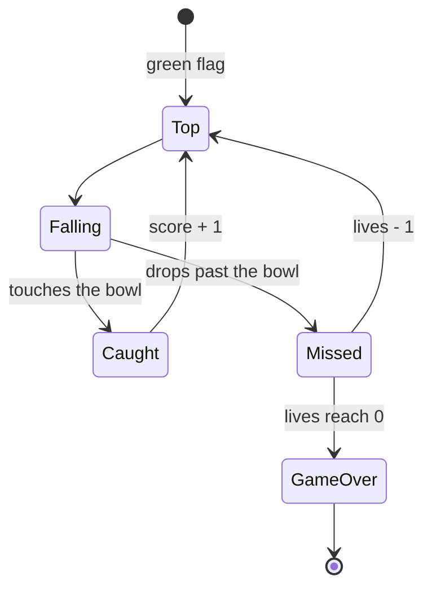

:::objectives
- Use three shared variables (`score`, `lives`, `time left`) in one game.
- Let the stage run the clock and reset the game.
- End the game with one `game over` broadcast that every sprite answers.
- Test every way a game can end, including playing a second time.
:::

Apples are dropping out of the sky and you have one bowl. Catch an apple: +1 point and a happy pop. Miss one: lose a life. You have 30 seconds. When the clock runs out or your lives hit zero, the sky turns into a big GAME OVER sign and the bowl announces your final score.

Here is the finished game in numbers, partway through a round:

```text
score 7
lives 2
time left 12
```

Every apple follows the same little loop, over and over, until the game ends:



Three sprites share the work. The **Stage** runs the clock and resets everything, the **Bowl** follows the arrow keys, and the **Apple** falls and keeps score. Build it step by step, and press the green flag after every step to see your progress.

## Step 1: Set up the sprites and backdrops

1.  Open a new project in Scratch.
2.  Delete the cat: right-click it in the sprite list and choose **delete**.
3.  Click **Choose a Sprite** and add **Bowl**. Then add **Apple**.
4.  Click **Choose a Backdrop** (bottom right) and add **Blue Sky**.
5.  Now paint a second backdrop. Hover over the backdrop button and pick **Paint**. Use the **Text** tool to write `GAME OVER` in big letters. In the name box at the top of the paint editor, rename this backdrop `Game Over`.

You should now have two sprites (Bowl and Apple) and backdrops named `Blue Sky` and `Game Over`.

:::tip
Scripts pick backdrops by name, so spell them the same way every time. A backdrop list with `backdrop1`, `Game Over`, and `game over 2` in it is a bug waiting to happen. Delete the extras now.
:::

## Step 2: Make the variables

Click **Variables**, then **Make a Variable**, three times. Choose **For all sprites** for each one:

-   `score`
-   `lives`
-   `time left`

Leave all three checkboxes ticked so their monitors appear on the stage. Drag the monitors into the top-left corner, out of the way of falling apples.

## Step 3: Steer the bowl

Click the **Bowl** sprite and build this:

```scratch title="Bowl"
when green flag clicked
go to x: (0) y: (-140)
forever
  if <key (left arrow v) pressed?> then
    change x by (-8)
  end
  if <key (right arrow v) pressed?> then
    change x by (8)
  end
end
```

Click the green flag. The bowl jumps to the bottom middle of the stage, and holding an arrow key slides it smoothly left or right.

There are two separate `if` blocks here, not one `if/else`. Each trip around the loop asks about both keys, and when you let go of both, nothing moves. Keep that in mind for the quiz at the end.

## Step 4: Let the stage run the clock

The stage is the best home for "whole game" jobs like resetting variables and counting down, because it never moves, hides, or gets deleted. Click the **Stage** (on the right, under the stage preview) and build this:

```scratch title="Stage"
when green flag clicked
switch backdrop to (Blue Sky v)
set [score v] to (0)
set [lives v] to (3)
set [time left v] to (30)
repeat until <(time left) = (0)>
  wait (1) seconds
  change [time left v] by (-1)
end
broadcast (game over v)
```

To make the `game over` message, click the arrow on the `broadcast` block, choose **New message**, and type `game over`.

Click the green flag and watch the monitors:

```text
score 0
lives 3
time left 30 ... 29 ... 28 ...
```

:::warning
Don't skip `switch backdrop to (Blue Sky v)`. When your first game ends, the stage is left showing the Game Over backdrop. This block brings the sky back when you play again.
:::

## Step 5: Make the apple fall

Click the **Apple** sprite. This is the biggest script in the game, so build it slowly and read each block as you snap it in.

```scratch title="Apple"
when green flag clicked
show
forever
  go to x: (pick random (-220) to (220)) y: (180)
  repeat until <<touching (Bowl v)?> or <(y position) < (-170)>>
    change y by (-5)
  end
  if <touching (Bowl v)?> then
    change [score v] by (1)
    start sound (Pop v)
  else
    change [lives v] by (-1)
    if <(lives) = (0)> then
      broadcast (game over v)
    end
  end
end
```

Here's what each part does:

1.  `show` makes sure the apple is visible. It hides at game over, so it has to come back for the next game.
2.  `go to x: (pick random (-220) to (220)) y: (180)` puts the apple at the top of the stage in a random spot.
3.  The `repeat until` loop moves it down 5 steps at a time and stops the moment the apple lands in the bowl **or** falls below it.
4.  The `if/else` asks why the loop stopped. Touching the bowl? Add a point and pop. Not touching? The apple was missed, so take a life.
5.  If that miss used up the last life, tell everyone with `broadcast (game over v)`.
6.  The `forever` loop sends the apple back to the top for another drop.

If **Pop** isn't in the apple's sound list, open the **Sounds** tab, click **Choose a Sound**, and add it.

Play a round. Catch two apples and miss one:

```text
score 2
lives 2
```

## Step 6: Everyone answers "game over"

Right now the message gets sent and nobody is listening. Let's give every part of the game a job when it arrives.

On the **Stage**, add:

```scratch title="Stage"
when I receive [game over v]
stop [other scripts in stage v]
switch backdrop to (Game Over v)
```

On the **Apple**, add:

```scratch title="Apple"
when I receive [game over v]
hide
stop [other scripts in sprite v]
```

On the **Bowl**, add:

```scratch title="Bowl"
when I receive [game over v]
stop [other scripts in sprite v]
say (join [Final score: ] (score))
```

`stop [other scripts in sprite v]` is the important block here. It freezes that sprite's `forever` loop, so the apple stops falling and the bowl stops sliding. On the stage, `stop [other scripts in stage v]` halts the clock, so a game you lost on lives doesn't keep ticking. The green `join` block (in **Operators**) glues words and a number together into one sentence.

Let the timer run out:

```text
time left 0
```

The sky changes to GAME OVER, the apple disappears, and the bowl says "Final score: 7" (or whatever you scored).

## Step 7: Test both endings, then test again

Good game designers test every way a game can end, plus the moment right after.

-   **Clock ending:** play and catch everything. At 0 seconds, the Game Over screen should appear.
-   **Lives ending:** click the green flag and don't touch the keys. After three misses the game should end, even with time left on the clock.
-   **Play again:** click the green flag a second time. Score should read 0, lives 3, time 30, the sky should be back, and the apple should be visible.

If a test fails, look for a missing `set`, `show`, or `switch backdrop` under a green flag first. That's where most second-game bugs hide.

## The finished scripts

Check your project against these. Each block below is everything on one sprite.

```scratch title="Stage (both scripts)"
when green flag clicked
switch backdrop to (Blue Sky v)
set [score v] to (0)
set [lives v] to (3)
set [time left v] to (30)
repeat until <(time left) = (0)>
  wait (1) seconds
  change [time left v] by (-1)
end
broadcast (game over v)

when I receive [game over v]
stop [other scripts in stage v]
switch backdrop to (Game Over v)
```

```scratch title="Bowl (both scripts)"
when green flag clicked
go to x: (0) y: (-140)
forever
  if <key (left arrow v) pressed?> then
    change x by (-8)
  end
  if <key (right arrow v) pressed?> then
    change x by (8)
  end
end

when I receive [game over v]
stop [other scripts in sprite v]
say (join [Final score: ] (score))
```

The Apple's two scripts are exactly the ones from Steps 5 and 6.

:::video 7NN5v2wSL4U
The Scratch Team builds a catch game of their own. Watch how they send the falling object back to the top after each catch, then compare it with your Apple script: ours adds lives, a clock, and a game-over broadcast on top.
:::

## Check your understanding

A classmate rewrote the bowl's loop like this:

```scratch title="Bowl (rewritten)"
when green flag clicked
go to x: (0) y: (-140)
forever
  if <key (left arrow v) pressed?> then
    change x by (-8)
  else
    change x by (8)
  end
end
```

:::quiz
Q: The player clicks the green flag and doesn't press any keys. What does the rewritten bowl do?
- [ ] It sits still in the middle
  It would with two separate `if` blocks. Here, "no key" means the `else` runs on every pass.
- [x] It slides to the right on its own until it reaches the edge
  When left isn't pressed, the `else` branch runs, so the bowl moves right 8 steps every pass.
- [ ] It moves left, because left is checked first
  Left only moves the bowl while the left arrow is held down.

Q: Why does the Apple's green-flag script begin with `show`?
- [ ] Sprites from the library start hidden
  Library sprites start visible. The trouble comes from the game itself.
- [x] At game over the apple hides, and without `show` it would stay hidden in the next game
  Anything a game changes, like hiding a sprite, has to be undone when the green flag starts a new game.
- [ ] `show` makes the apple fall faster
  `show` only makes a sprite visible; speed comes from `change y by (-5)`.

Q: You lose your last life with 10 seconds left on the clock. Which block stops the stage from later broadcasting `game over` a second time?
- [x] `stop [other scripts in stage v]`
  It halts the stage's countdown loop, so the clock never reaches 0 and never sends the message again.
- [ ] `stop [other scripts in sprite v]` on the Apple
  That only stops the Apple's own scripts. The countdown lives on the Stage.
- [ ] `hide` on the Apple
  Hiding the apple doesn't affect the stage's clock at all.
:::

:::takeaways
- The stage is a good home for jobs that belong to the whole game: resetting variables and running the clock.
- One `game over` broadcast can end the game for everyone, and each sprite decides how to react.
- `repeat until <<A> or <B>>` stops when either thing happens; an `if/else` right after tells you which one it was.
- Test both endings, and always test a second game. That's where missing resets show up.
:::

## Make it yours

Pick one or two:

-   **Speed it up.** Make apples fall faster as your score grows: replace `change y by (-5)` with `change y by ((-5) - ((score) / (5)))`.
-   **Add danger.** Add a second falling sprite, like a rock, that takes a life when you **catch** it.
-   **Celebrate.** Add a sprite that listens for `game over`, says "Nice try!", and does a little dance with `turn right (15) degrees`.

Save your project with **File > Save to your computer** or the **Save now** option if you're signed in. You'll use Apple Catcher again in Week 6.

## Further reading

-   [Broadcast () block (Scratch Wiki)](https://en.scratch-wiki.info/wiki/Broadcast_()_(block)): exactly when a broadcast starts the scripts that hear it.
-   [Stop () block (Scratch Wiki)](https://en.scratch-wiki.info/wiki/Stop_()_(block)): the difference between "all", "this script", and "other scripts in sprite".
-   [Stage Monitor (Scratch Wiki)](https://en.scratch-wiki.info/wiki/Stage_Monitor): normal readout, large readout, and slider, and how to move them.
